# Knowledge Graph

> Everything is one system. Every page is a node; every line is a real data or design dependency.
> Dikelola oleh skill `alaconnect`. Edit inkremental — jangan generate ulang.

Last verified: 39d0374 (2026-10-24) — review desain sambungan antar-DB (D1–D11, cek silang Codex + Claude independen) konvergen: keduanya [] pada HEAD yang sama (Codex D11, Claude D11). Diverifikasi di HEAD ini: `db reset` admin (core) dari rantai migrasi; creator/brand migrasi inkremental; declarative sync no changes di ketiganya; pgTAP identity 172 + admin 1067 + creator 103 + brand 123; deno identity 133 + core 28 + creator 59; lint (check-arch); e2e bus 9/9 + roles 21/21 + journey 10/10 + mobile 13/13; antrean bus ketiga DB kosong. Tidak diulang di rangkaian ini (terakhir cdcb879): typecheck workspace, unit test app, simulasi VPS `deploy.sh up all`. Keputusan terbuka owner: restore satu DB (CX2/CL3), jalur bus (CL5), alat ops bus + lewati snapshot (CL6/CL19).

**Status:** sistem sudah dibangun dan dites. 5 app Next.js 16 (`apps/web`, `apps/accounts`, `apps/clipper`, `apps/brand`, `apps/admin`) di atas `packages/{ui,campaign-builder,clipper-lib,auth,db-core,db-identity,i18n,config}`, plus app native Expo `apps/mobile` (Android + iOS, satu kode). 4 project Supabase (`db/identity`, `db/core` = admin, `db/creator`, `db/brand`): schema deklaratif, `migrations/` (pg-delta), config.toml, seed; bus event antar DB. Endpoint per DB: docs/endpoints/{identity,admin,creator,brand}.md.sql. 12 Edge Function: core `bridge`, `fulfill`, `notify`, `refresh-tokens`, `social`, `track-worker`; identity `admin-auth`, `bridge`, `delete-account`, `disburse`, `member-data`, `pii-export`. Tes: pgTAP 6 file (`db/core/supabase/tests` 4, `db/identity/supabase/tests` 2), unit test app/package (`pnpm test`, 38 file `*.test.ts(x)`), unit test Deno (29 file `*_test.ts` di `db/*/supabase/functions`), journey E2E lintas host `e2e/journey.cjs` (Playwright: web → accounts → app → undangan → brand), CI `.github/workflows/ci.yml` (job apps, functions, db per project). Diverifikasi di 7408318: `pnpm lint` ok, `pnpm typecheck` ok, `pnpm test` 197 tes lulus (campaign-builder 69, accounts 32, web 29, admin 24, brand 22, clipper 21), `pnpm build` 5 app ok, Deno fmt/lint/check ok + tes core 70 & identity 82, pgTAP core 727 & identity 107 (stub Postgres 16 dan `supabase test db`), `supabase db lint` (schema app) & `db advisors --type security` bersih, `pnpm e2e` 9/9 langkah 2× di build produksi. Node yang filenya ada punya kolom Path; bukti edge = `file:line` (dicek `check_graph.py`). Bukti yang masih rujukan PRD v0.3.1 = belum ada satu baris kode yang menyebut target, atau kodenya ada di folder route group `(account)`, `(auth)`, `(console)`: regex checker tidak menerima tanda kurung, jadi baris kodenya ditulis `kode baris N` (dicek manual). `(belum di kode)` = edge PRD yang tidak dibangun begitu. Edge `reads` page → table = dependency data logis; di kode jalannya lewat view/fungsi schema `api` (`policy:core.api-only`). Rujukan lintas DB (`table → table` antar project) tidak punya foreign key.

## Stack

- Monorepo pnpm workspaces: `apps/{web,accounts,clipper,brand,admin,mobile}`, `packages/{ui,campaign-builder,clipper-lib,auth,db-core,db-identity,db-creator,db-brand,i18n,config}`, `db/{identity,core,creator,brand}/supabase`.
- App native `apps/mobile`: Expo SDK 57 + expo-router (React Native 0.86), build lewat EAS (`config:eas`). Memakai RPC/view/Edge Function yang sama dengan app.{domain} (JWT identity sebagai access token core), logika murni dari `packages/clipper-lib`, copy dari `packages/i18n`, token DS dibangkitkan dari `packages/ui/src/styles.css`. Push native lewat Expo Push API (FCM/APNs), share sheet (Android SEND, iOS Share Extension), widget saldo Android.
- Next.js 16 App Router + TypeScript (`proxy.ts` per app), Tailwind + shadcn/ui, next-intl, next-themes, Recharts. Hosting: Vercel Pro, 1 project per app, region Functions sin1.
- Supabase ×2 di ap-southeast-1, compute Small + PITR: **identity** (Auth + MFA, schema `member`, Storage privat, Edge Functions `bridge`, `member-data`, `pii-export`, `delete-account`, `admin-auth`, `disburse`) dan **core** (schema `market`, `tracking`, `finance`, `trust`, `ops`, `api`; Vault; pg_cron; Queues `tracking` & `email`; Edge Functions `social`, `track-worker`, `refresh-tokens`, `notify`, `bridge`, `fulfill`). Core percaya JWT identity lewat Third-Party Auth → Custom OIDC; core tidak memegang private key identity.
- Sumber kebenaran schema: `db/<project>/supabase/schemas/` (declarative, wajib pg-delta lewat `[experimental.pgdelta]`; engine migra membuang security_invoker) → `migrations/`. Registri entitas & state: `spec/kg.yaml` (fields dibangkitkan dari katalog DB). Struktur domain/URL/folder: `spec/structure.yaml`. Journey: `spec/journeys.yaml`. Kontrak fungsi (PRD Lampiran A.3; semua sudah ditulis di `db/**`, berkas belum dipangkas): `spec/contracts.yaml`. Types: `packages/db-core`, `packages/db-identity` (supabase gen types).
- Alternatif hosting: self-hosted (`deploy/`, `doc:deploy/deploy.sh`) — tiga server: identity (auth.{domain}), core (api.{domain}), 5 app ({domain} + subdomain app), masing-masing Caddy sendiri; atau satu server (`up all`). Token user ES256 dari identity diverifikasi core lewat JWKS bersama; anon/service key HS256 per stack; secret dipecah per peran.
- Sumber kebenaran token desain: `packages/ui`. Copy: `packages/i18n`. Path alias: `@/` → `apps/<app>/src/`.

## Entry points

- Page publik: `page:accounts/invite/[token]`, `page:accounts/login`, `page:admin/login`, `page:app/login`, `page:www/`, `page:www/c/[slug]`, `page:www/legal/[doc]`, `page:www/r/[token]`.
- Job terjadwal: `job:alert-notify`, `job:broadcast-dispatch`, `job:budget-alerts`, `job:claim-expiry`, `job:earning-release`, `job:fraud-device-scan`, `job:fulfillment-retry`, `job:leaderboard-refresh`, `job:lifecycle`, `job:notify-drain`, `job:reconcile-daily`, `job:referral-bonus`, `job:token-refresh`, `job:track-due`, `job:trust-score`.
- Dipanggil sistem luar: `api:GET app/api/oauth/[platform]/callback` (redirect TikTok/Meta/Google), `api:GET accounts/auth/callback` dan `api:GET app/auth/callback` (redirect Google lewat Auth identity), `api:GET accounts/auth/confirm` (link email undangan), `fn:custom_access_token_hook` (dipanggil Supabase Auth), `api:fn identity/disburse` (callback penyedia disbursement).
- Dipanggil OS (app native `layout:mobile`): share sheet Android/iOS → layar Share (`page:mobile/share`), tap notifikasi push (Expo) → `nativeRoute`, universal link / App Link app.{domain} → `mod:native-intent`, widget `mod:mobile-widget` (headless Android) & `mod:mobile-widget-ios`, Live Activity `mod:live-activity` (push-to-start APNs dari `mod:apns`).
- Test & CI (Path terisi = berkas tes ada; kosong = manual/Fase 0): `test:accrue.idempotent`, `test:core.full-product`, `test:e2e.cross-host`, `test:member-data.integrity`, `test:pwa.ios-login`, `test:rls.access-matrix`, `test:spike.oidc-cross-project`, `config:ci`.

## Perintah verifikasi

Urut murah → mahal. `.github/workflows/ci.yml` menjalankan perintah yang sama: job `apps` (baris pnpm), `functions` (deno, matrix identity/core) dan `db` (`supabase start` lalu `test db`, `db lint`, `db advisors`, matrix identity/core). Stub pgTAP, `pnpm e2e` dan checker hanya lokal. Ubah perintah di sini dan di CI bersamaan.

```bash
deploy/deploy.sh up all         # satu VPS: 4 DB + 5 app + Caddy (HTTPS otomatis); DNS 9 nama → IP VPS (lihat deploy/config.env.example)
scripts/local-up.sh             # laptop sendiri: cek prasyarat + pnpm install + dev-stack (ulang sekali bila gagal) + pnpm dev; `admin email` = admin_super lokal (akun terpisah)
scripts/dev-stack.sh            # stack lokal: identity :54321 + core :55321, secret dev, Vault pg_cron, apps/*/.env.local (--reset = db reset)
deploy/deploy.sh secrets        # self-hosted, mesin admin: secret lengkap + secrets.{identity,core,apps}.env per server
deploy/deploy.sh up identity    # per server: identity | core | apps (atau all = satu server); idempoten, juga untuk update
deploy/deploy.sh admin email    # server identity: admin_super pertama (login OTP + MFA di admin.{domain})
deploy/deploy.sh check identity # pra-cek per peran: compose ≥ 2.24.4, secret, DNS host server ini, JWKS server lain
deploy/deploy.sh backup         # cron harian di server identity/core: dump DB + file Storage → deploy/stack/*/backups
pnpm install --frozen-lockfile
pnpm lint && pnpm typecheck && pnpm test && pnpm build      # lint = scripts/check-arch.mjs + drift token native (gen-native-tokens.mjs --check)
(cd db/identity/supabase/functions && deno fmt --check && deno lint && deno task check && deno task test)
(cd db/core/supabase/functions && deno fmt --check && deno lint && deno task check && deno task test)
# pgTAP tanpa Docker (Postgres 16 + stub Supabase), p = identity | core
python3 db/test-local/load.py identity t_identity && pg_prove -h 127.0.0.1 -U postgres -d t_identity db/identity/supabase/tests/*.test.sql
python3 db/test-local/load.py core t_core && pg_prove -h 127.0.0.1 -U postgres -d t_core db/core/supabase/tests/*.test.sql
# pgTAP + lint + advisor di stack Supabase asli (setelah scripts/dev-stack.sh)
supabase test db --workdir db/identity && supabase test db --workdir db/core
supabase db lint --workdir db/identity -s member,api --fail-on error
supabase db lint --workdir db/core -s market,tracking,finance,trust,ops,api --fail-on error
supabase db advisors --workdir db/identity --type security --fail-on warn
supabase db advisors --workdir db/core --type security --fail-on warn
pnpm e2e                        # e2e/seed.sql ke core + e2e/journey.cjs; butuh dev-stack + app web/accounts/clipper/brand di port 3000–3003
pnpm e2e:mobile                 # app native (build web Expo disajikan di :3002) + e2e/mobile.cjs; butuh dev-stack + accounts di :3001
(cd apps/mobile && npx expo prebuild --no-install --platform android)   # cek config plugin native (manifest SEND, widget, scheme); ios sama, lalu hapus android/ ios/
python3 <skill alaconnect>/scripts/check_graph.py .         # harus berakhir RESULT PASS
```

## Arsitektur 4 database (keputusan owner 2026-10-22, sedang dikerjakan)

Pemilik data = tempat data ditulis. Uang hanya bergerak di **admin** (satu ledger double-entry, satu transaksi per accrual/payout/invoice).

| DB | Folder | Pemilik | Tabel (dari core) |
|---|---|---|---|
| identity | `db/identity` | akun & PII | tetap (`member.*`, `auth.*`) |
| creator | `db/creator` | clipper | `market.profiles` (isi + storage avatar; status/sanksi/trust = replika admin), `tracking.social_accounts` + token Vault, `tracking.submissions` (isi; status/jadwal = replika admin), `tracking.view_snapshots`, antrean poll + Edge Function social/track-worker/refresh-tokens; replika `campaigns`, `claims`, `settings`, org |
| brand | `db/brand` | brand & agency | `market.organizations`, `org_members`, `org_invites`, `org_links`, `campaigns` (isi: judul, brief, syarat, eligibility, review mode, visibilitas; status/jadwal/pin = replika admin), `campaign_assets` + storage cover/aset, `campaign_invites`; replika `profiles`, `categories` |
| admin | `db/admin` (= core lama) | platform & uang | `finance.*` (ledger, clip_earnings, pool_settlements, invoices, payouts, batches, bank_lines, fulfillments, refunds, fee_rules, **reward_pools, reward_codes**), `market.rate_rules`, `market.reward_types`, `trust.*`, `ops.settings/alerts/audit_logs/broadcasts`, `market.categories`, `market.referrals` (bonus = uang) + kolom profil status/sanksi/trust/kode referral, `market.claims` (kuota & budget satu transaksi), status/`counted_views`/lock/jadwal poll submisi + fraud & accrual saat snapshot tiba, replika ringkas campaign (status, jadwal, window, min_views) untuk accrual. Definisi uang authoritative di sini (brand mengubah lewat RPC ke admin) supaya accrual/raise_rate tidak pernah memakai rate basi |

Lintas DB:
- **Tulis lintas domain = event** lewat transactional outbox (`bus.outbox` ditulis di transaksi yang sama dengan datanya) → relay pg_cron + pg_net → Edge Function `bus` penerima (HMAC, pola `policy:bridge-hmac`) → `bus.apply` idempoten (`bus.inbox` dedupe per event id, urut per aggregate). Tidak ada transaksi terdistribusi.
- **Baca lintas domain** = replika read-model di DB yang butuh (mis. katalog campaign di creator untuk claim_check; ekonomi campaign di admin untuk accrual; statistik views/spend di brand untuk dashboard), atau app membaca langsung view `api` DB pemilik dengan JWT user (semua DB percaya issuer identity yang sama).
- **Aksi admin** pada data domain lain = RPC bridge sinkron ke DB pemilik (HMAC) + audit log di admin.
- **Aksi admin pada org** dipanggil app admin langsung ke `api:rpc brand.manage_org` dengan JWT admin (DB brand percaya issuer identity yang sama, `ops.has_admin` aal2); hanya fee (`set_fee`) di admin.
- Replika baris: pemilik memasang `bus.replicate('<target>:<kolom milik sendiri>', …)`; penerima upsert parsial (kolom milik penerima tidak tersentuh), hook `bus_in.<schema>_<tabel>_applied`. Relay tiap 1 detik.
- Campaign: builder menyimpan isi + aset ke `api:rpc brand.save_campaign` (mengembalikan `content_version`), lalu selalu `api:rpc core.save_campaign` dengan versi itu (jadwal, pool, rule, fee, pengajuan): admin menjawab `retry:replica_lag` sampai replika isi versi itu tiba (`persistCampaign`, packages/campaign-builder/src/persist.ts) — read-your-writes untuk builder & pengajuan memvalidasi tepat isi yang dilihat. Brand mengunci brief dari status replika; balapan ≤ 1 detik ditutup `fn:bus_in.market_campaigns_applied` (in_review + isi lebih baru → kembali draft, invoice belum lunas batal). Report link & budget alert tetap di admin (angka uang/views).
- Progres: **4DB-3 langkah 1 & 2 selesai** — org, anggota, undangan, tautan agency milik DB brand (`table:brand/market.*`); admin & creator memegang replika; efek ke admin lewat event `audit.log`, `review.decision`, `notify.user`, `profile.ensure`, `org.owner_lost` (`fn:bus_in.admin`). App accounts/brand/admin membaca & menulis org lewat `mod:db-brand`. **4DB-4 langkah 4a selesai** — profil E-01 + storage avatar milik DB creator (`table:creator/market.profiles`, `api:rpc creator.ensure_profile`, `mod:db-creator`); admin memegang replika isi + kolom miliknya (status, suspended_until, trust_score, referral_code) yang direplika ke creator & brand; referral lewat event `referral.record`, hapus akun lewat `profile.anonymize` (file avatar dihapus `api:fn creator/bridge`). App menulis profil ke creator lalu menunggu replika admin (`untilReplicated`). **4DB-4 langkah 4b selesai** — pipeline tracking milik creator (akun sosmed + token, isi submisi, snapshot, antrean poll, Edge Function `api:fn creator/social` / `track-worker` / `refresh-tokens`); admin menerima replika lalu memutus (`fn:tracking.decide_new_submission`, `fn:tracking.apply_snapshot`, `fn:tracking.post_gone`) — hook tidak pernah raise (gagal → alert `tracking.apply_failed`). Claim tetap di admin (direplika ke creator). Berikutnya: rename core→admin + verifikasi penuh (4DB-5).

## Invarian pemisahan

Wajib tetap benar setiap perubahan (dicek otomatis saat graph ini dibuat; cek ulang tiap task; 1, 4, 11 juga dicek `pnpm lint` = `scripts/check-arch.mjs`):

1. Dari `layout:brand`, `layout:web`, semua `page:brand/…` dan `page:www/…` tidak ada jalur dependency ke data identity (`table:member.*`, `table:auth.*`, bucket identity, `api:* identity`, `mod:db-identity`, `env:PII_ENC_KEY`, `env:PII_HMAC_KEY`). Satu-satunya sentuhan ke identity = refresh sesi lewat `mod:auth`.
2. Tabel `finance.*` hanya ditulis node `api:`, `fn:`, atau `job:` — tidak pernah langsung dari page.
3. Tabel `member.*` dan `auth.*` hanya ditulis fungsi di project identity.
4. Secret (client secret sosmed, HMAC bridge, Resend, kunci PII, secret key core, URL DB, Turnstile) hanya dibaca Edge Functions, RPC identity, job, `mod:social` (Deno), `policy:fn-cron-key`, atau setelan Auth identity — tidak pernah oleh app Next.js maupun app native (`layout:mobile`, hanya publishable key + JWT user).
5. Tiap page dibungkus tepat satu layout sesuai host-nya; tiap tabel punya minimal satu `guarded-by`.
6. `env:PII_ENC_KEY` dan `env:PII_HMAC_KEY` hanya dibaca Edge Functions identity, tidak pernah oleh fungsi SQL: kunci tidak berada di database yang sama dengan ciphertext.
7. Setiap page bisa dicapai dari entry point lewat `routes-to` (menu + journey §6), dan tidak ada edge navigasi bertanda `?`.
8. Setiap tabel di SQL punya node dengan Path ke file pembuatnya, dan setiap edge `guarded-by` tabel → policy menunjuk baris `create policy` yang bertanda `-- policy:<id>` (dibangkitkan dari katalog DB uji).
9. Di database (dites pgTAP): RLS aktif di semua tabel keempat project, semua view `api` security_invoker, `anon` tidak bisa EXECUTE fungsi `api` identity apa pun, di admin hanya `health`, `list_campaigns` (landing) & `report_by_token`, di creator hanya `health`, di brand hanya `health` & `invite_preview` (health = angka & waktu saja); di core setiap FK ber-index dan setiap tabel punya policy restrictive iss; semua fungsi yang dipanggil job pg_cron ada.
10. Fitur → URL → folder → tabel untuk 45 fitur (+ 2 kelompok lintas fitur §4/§16) ada di `spec/structure.yaml`; setiap page di graph milik minimal satu fitur/kelompok, dan setiap page di structure.yaml ada di graph.
11. DB creator (token sosmed, isi submisi, profil) hanya dijangkau app accounts, clipper, mobile — tidak pernah web, brand, admin; web hanya memakai URL storage cover brand, bukan client DB brand (dicek `pnpm lint`).

## Nodes

| ID | Tipe | Path | Tanggung jawab | Rencana lokasi |
|---|---|---|---|---|
| `page:accounts/` | page | apps/accounts/src/app/(account)/page.tsx | Hub akun: status KYC, rekening, MFA, consent; kembali ke app/brand |  |
| `page:accounts/invite/[token]` | page | apps/accounts/src/app/(auth)/invite/[token]/page.tsx | Terima undangan anggota org (F-B01) |  |
| `page:accounts/kyc` | page | apps/accounts/src/app/(account)/kyc/page.tsx | KYC: nama KTP, NIK, foto KTP (F-C10; juga pemilik brand perorangan) |  |
| `page:accounts/login` | page | apps/accounts/src/app/(auth)/login/page.tsx | Login Google / email OTP (F-C01) |  |
| `page:accounts/onboarding` | page | apps/accounts/src/app/(auth)/onboarding/page.tsx | Profil publik, umur 18+, ToS sesuai peran (F-C01, F-B01) |  |
| `page:accounts/payout-methods` | page | apps/accounts/src/app/(account)/payout-methods/page.tsx | Rekening & data penerima reward (F-C09) |  |
| `page:accounts/privacy` | page | apps/accounts/src/app/(account)/privacy/page.tsx | Consent, unduh data saya, hapus akun (§16) |  |
| `page:accounts/security` | page | apps/accounts/src/app/(account)/security/page.tsx | MFA TOTP (wajib untuk aksi uang brand; admin di admin.{domain}/login) |  |
| `page:admin/` | page | apps/admin/src/app/(console)/page.tsx | Overview + alert (F-A01) |  |
| `page:admin/audit` | page | apps/admin/src/app/(console)/audit/page.tsx | Audit log (F-A11) |  |
| `page:admin/broadcast` | page | apps/admin/src/app/(console)/broadcast/page.tsx | Broadcast ke segmen clipper (F-A12) |  |
| `page:admin/campaigns` | page | apps/admin/src/app/(console)/campaigns/page.tsx | Review campaign (F-A02) + tab Paket managed (F-A03) |  |
| `page:admin/campaigns/new` | page | apps/admin/src/app/(console)/campaigns/new/page.tsx | Builder admin / paket managed (F-A03) |  |
| `page:admin/config` | page | apps/admin/src/app/(console)/config/page.tsx | Config & feature flag (F-A09) |  |
| `page:admin/finance` | page | apps/admin/src/app/(console)/finance/page.tsx | Pembayaran masuk, batch & instant payout, refund, rekonsiliasi, PPh 21 (F-A08) |  |
| `page:admin/fraud` | page | apps/admin/src/app/(console)/fraud/page.tsx | Fraud queue (F-A06) + antrean banding sanksi (§12) |  |
| `page:admin/fulfillment` | page | apps/admin/src/app/(console)/fulfillment/page.tsx | Fulfillment non-tunai (F-A10) |  |
| `page:admin/login` | page | apps/admin/src/app/login/page.tsx | Login admin terpisah: kode OTP + TOTP |  |
| `page:admin/pinned` | page | apps/admin/src/app/(console)/pinned/page.tsx | Pinned, kategori, banner (F-A04) |  |
| `page:admin/review` | page | apps/admin/src/app/(console)/review/page.tsx | Moderasi submisi & banding (F-A05) |  |
| `page:admin/users` | page | apps/admin/src/app/(console)/users/page.tsx | Clipper (KYC, Trust Score, suspend), org brand (verifikasi), role admin (F-A07) |  |
| `page:app/campaigns` | page | apps/clipper/src/app/campaigns/page.tsx | Daftar campaign + CTA 6 state (F-C03) |  |
| `page:app/campaigns/[id]` | page | apps/clipper/src/app/campaigns/[id]/page.tsx | Detail, claim, submit (F-C04–C06) |  |
| `page:app/leaderboard` | page | apps/clipper/src/app/leaderboard/page.tsx | Leaderboard mingguan & per campaign (F-C13) |  |
| `page:app/login` | page | apps/clipper/src/app/login/page.tsx | Login di dalam scope PWA: kode OTP & Google (F-C01, R-17) |  |
| `page:app/notifications` | page | apps/clipper/src/app/notifications/page.tsx | Notifikasi in-app (F-C11) |  |
| `page:app/offline` | page | apps/clipper/src/app/offline/page.tsx | Halaman offline PWA: disimpan service worker, tampil saat navigasi gagal tanpa koneksi (F-C14) |  |
| `page:app/profile` | page | apps/clipper/src/app/profile/page.tsx | Statistik + Trust Score & riwayatnya (F-C12) |  |
| `page:app/referral` | page | apps/clipper/src/app/referral/page.tsx | Kode & link referral, teman, bonus (F-C16) |  |
| `page:app/settings` | page | apps/clipper/src/app/settings/page.tsx | Bahasa, tema, notifikasi email promosi, push (F-C11, F-C14, F-C18) |  |
| `page:app/share` | page | apps/clipper/src/app/share/page.tsx | Share target PWA (manifest share_target): link dari share sheet app sosmed → pilih claim terbuka → detail ?submit=1&url= (sheet Submit terisi) |  |
| `page:app/.well-known/assetlinks.json` | page | apps/clipper/src/app/.well-known/assetlinks.json/route.ts | Digital Asset Links app Android TWA (Play Store); env kosong = 404 |  |
| `page:app/social` | page | apps/clipper/src/app/social/page.tsx | Connect akun sosmed (F-C02) |  |
| `page:app/tasks` | page | apps/clipper/src/app/tasks/page.tsx | Tugas Saya + banding (F-C07) |  |
| `page:app/wallet` | page | apps/clipper/src/app/wallet/page.tsx | Wallet per unit + kode voucher (F-C08) |  |
| `page:app/wallet/withdraw` | page | apps/clipper/src/app/wallet/withdraw/page.tsx | Withdraw batch/instant & klaim reward (F-C09, F-C15) |  |
| `page:brand/` | page | apps/brand/src/app/page.tsx | Pemilih org (termasuk org klien agency); kosong → Buat organisasi |  |
| `page:brand/[org]/billing` | page | apps/brand/src/app/[org]/billing/page.tsx | Invoice, bayar, faktur, refund/rollover (F-B04) |  |
| `page:brand/[org]/campaigns` | page | apps/brand/src/app/[org]/campaigns/page.tsx | Daftar campaign + template (F-B05, F-B10) |  |
| `page:brand/[org]/campaigns/[id]` | page | apps/brand/src/app/[org]/campaigns/[id]/page.tsx | Dashboard, kontrol, utilisasi, undangan, pin, laporan (F-B05, F-B06, F-B08, F-B09, F-B11) |  |
| `page:brand/[org]/campaigns/new` | page | apps/brand/src/app/[org]/campaigns/new/page.tsx | Builder campaign 7 langkah (F-B02) |  |
| `page:brand/[org]/review` | page | apps/brand/src/app/[org]/review/page.tsx | Review queue brand (F-B07) |  |
| `page:brand/[org]/reward-types` | page | apps/brand/src/app/[org]/reward-types/page.tsx | Reward type custom, pool kode, webhook (F-B03) |  |
| `page:brand/[org]/settings` | page | apps/brand/src/app/[org]/settings/page.tsx | Profil org, data faktur (ubah data + verifikasi ulang), agency (F-B01, F-B12) |  |
| `page:brand/[org]/team` | page | apps/brand/src/app/[org]/team/page.tsx | Anggota & undangan; owner ubah role, keluarkan, cabut link (F-B01) |  |
| `page:brand/new` | page | apps/brand/src/app/new/page.tsx | Buat organisasi brand/agency (F-B01) |  |
| `page:www/` | page | apps/web/src/app/page.tsx | Landing clipper & brand; ?ref=<kode> disimpan ke cookie referral |  |
| `page:www/c/[slug]` | page | apps/web/src/app/c/[slug]/page.tsx | Campaign publik + OG image (F-X02) |  |
| `page:www/legal/[doc]` | page | apps/web/src/app/legal/[doc]/page.tsx | ToS clipper, ToS brand, kebijakan privasi (§16) |  |
| `page:www/r/[token]` | page | apps/web/src/app/r/[token]/page.tsx | Laporan campaign read-only tanpa login; versi cetak = PDF (F-B09) |  |
| `layout:accounts` | layout | apps/accounts/src/app/layout.tsx | Shell accounts.{domain}: login & data member, menulis cookie SSO |  |
| `layout:admin` | layout | apps/admin/src/app/layout.tsx | Shell admin.{domain}: cookie host-only; semua halaman selain /login wajib aal2 |  |
| `layout:brand` | layout | apps/brand/src/app/layout.tsx | Shell brand.{domain} per org, membaca cookie SSO |  |
| `layout:clipper` | layout | apps/clipper/src/app/layout.tsx | Shell app.{domain}: PWA clipper, membaca cookie SSO |  |
| `layout:mobile` | layout | apps/mobile/app/_layout.tsx | App native Android/iOS (Expo, satu kode): sesi identity di SecureStore, gate login → onboarding → 4 tab Campaign · Clip · Dompet · Akun (Android nav bar M3 / rail ≥600dp, iOS UITabBar) + detail, kirim clip (modal), filter, share (auto-detect campaign), notifikasi, tarik saldo, sosmed, profil, leaderboard, referral, pengaturan; offline cache; widget Android/iOS, Live Activity iOS, universal/App Link. KYC, rekening, PII penerima reward & onboarding dibuka di browser in-app dengan sesi (handoff); tanpa secret (invarian 4) |  |
| `layout:web` | layout | apps/web/src/app/layout.tsx | Shell {domain}: halaman publik, tanpa sesi |  |
| `comp:CampaignBuilder` | comp | packages/campaign-builder/src/index.ts | Wizard 7 langkah F-B02, satu kode untuk brand & admin |  |
| `mod:auth` | mod | packages/auth | Cookie SSO .{domain}, cookie admin host-only, getClaims, guard role + aal2; tolak sesi ber-role admin di luar admin.{domain} |  |
| `mod:clipper-lib` | mod | packages/clipper-lib | Logika murni permukaan clipper (rate/budget, parse detail, teks detail, filter, render notifikasi, unit reward) — dipakai app clipper web dan app native supaya angka di HP = web |  |
| `mod:db-core` | mod | packages/db-core | Client + types core; memakai access token sesi identity |  |
| `mod:db-identity` | mod | packages/db-identity | Client + types identity; hanya untuk accounts, clipper, admin |  |
| `mod:i18n` | mod | packages/i18n | Pesan ID/EN |  |
| `mod:mobile-widget` | mod | apps/mobile/src/widget.tsx | Widget layar utama Android: Balance 4×2 (saldo + jadwal cair + ditahan, campaign baru + rate tertinggi, clip nunggu review) dan BalanceSmall 2×2 (saldo + jadwal cair); headless tiap 30 menit / saat app aktif, gagal jaringan = snapshot terakhir |  |
| `mod:native-tokens` | mod | apps/mobile/src/tokens.gen.ts | Token DS untuk React Native (warna light/dark, radius, tipografi) — dibangkitkan dari packages/ui/src/styles.css, drift dicek `pnpm lint` |  |
| `mod:social` | mod | db/creator/supabase/functions/_shared/social | PlatformAdapter TikTok/Instagram/YouTube/Threads/Facebook/X (§11) + feature flag platform, dipakai Edge Functions creator |  |
| `mod:ui` | mod | packages/ui | shadcn/ui + design token untuk 5 app |  |
| `api:GET accounts/auth/callback` | api | apps/accounts/src/app/auth/callback/route.ts | Tukar code OAuth Google (PKCE) jadi sesi, lalu ke onboarding atau next |  |
| `api:GET accounts/auth/confirm` | api | apps/accounts/src/app/auth/confirm/route.ts | Verifikasi token_hash dari email (undangan, ganti email) jadi sesi |  |
| `api:POST accounts/privacy/export` | api | apps/accounts/src/app/(account)/privacy/export/route.ts | Unduh data saya (C2.4, UU PDP): JSON gabungan data identity (member-data download_my_data) + data core milik sendiri; cek origin accounts |  |
| `api:GET app/api/oauth/[platform]/callback` | api | apps/clipper/src/app/api/oauth/[platform]/callback/route.ts | Callback OAuth sosmed: cek state, teruskan code ke creator/social |  |
| `api:GET app/api/oauth/[platform]/start` | api | apps/clipper/src/app/api/oauth/[platform]/start/route.ts | Mulai connect sosmed (C1.5): minta URL izin + state/PKCE ke creator/social, simpan di cookie httpOnly, redirect ke platform |  |
| `api:GET app/auth/callback` | api | apps/clipper/src/app/auth/callback/route.ts | Tukar code OAuth Google untuk login di app (PWA) |  |
| `api:GET brand/[org]/campaigns/[id]/report.csv` | api | apps/brand/src/app/[org]/campaigns/[id]/report.csv/route.ts | CSV laporan campaign per submisi + snapshot views untuk anggota org (F-B09) |  |
| `api:GET identity/.well-known/openid-configuration` | api |  | Discovery OIDC + JWKS identity (publik): issuer, jwks_uri; selalu ada, tanpa OAuth 2.1 Server | Supabase Auth identity, bawaan |
| `api:fn core/bridge` | api | db/core/supabase/functions/bridge/index.ts | Terima panggilan identity (HMAC): get_batch, attach_export, attach_proof, raise_fraud_flag, close_account, get_payout, mark_instant, pph21, fulfillment_export, attach_fulfillment_export, fulfillment_export_accepted; dari pg_cron (apikey): reconcile_ids, disburse, ban_user → identity |  |
| `api:fn core/fulfill` | api | db/core/supabase/functions/fulfill/index.ts | Fulfillment otomatis: pasang kode dari pool (E-41), kirim webhook reward ke brand (HMAC, retry 5 menit) |  |
| `api:fn core/notify` | api | db/core/supabase/functions/notify/index.ts | Kuras antrean email → bridge identity (alur 4) |  |
| `api:fn creator/refresh-tokens` | api | db/creator/supabase/functions/refresh-tokens/index.ts | Refresh token sosmed sebelum kedaluwarsa (§11, R-08) |  |
| `api:fn creator/social` | api | db/creator/supabase/functions/social/index.ts | Connect OAuth (tukar code), daftar video, verifikasi kepemilikan, submit |  |
| `api:fn creator/track-worker` | api | db/creator/supabase/functions/track-worker/index.ts | Ambil metrik per batch, tulis snapshot, panggil accrue (§11) |  |
| `api:fn identity/admin-auth` | api | db/identity/supabase/functions/admin-auth/index.ts | Auth Admin API dengan secret key identity: undang user (paket managed), ban/unban (ban_duration), reset MFA admin |  |
| `api:fn identity/bridge` | api | db/identity/supabase/functions/bridge/index.ts | Terima panggilan core (HMAC): send_email, send_push, check_ids, disburse, ban_user; dari pg_cron (apikey): fraud_device_scan |  |
| `api:fn identity/delete-account` | api | db/identity/supabase/functions/delete-account/index.ts | Orkestrasi hapus akun UU PDP (alur 7) |  |
| `api:fn identity/disburse` | api | db/identity/supabase/functions/disburse/index.ts | Callback penyedia disbursement (POST /disburse/callback, header x-callback-token) → core mark_instant. Pengiriman instant withdraw dimulai core lewat identity/bridge aksi disburse (_shared/disburse.ts: cek pemilik & nama rekening, dekripsi, kirim ke Xendit) |  |
| `api:fn identity/member-data` | api | db/identity/supabase/functions/member-data/index.ts | Tulis PII milik sendiri: KYC (NIK), rekening, data penerima. Verifikasi JWT, HMAC + enkripsi di fungsi, simpan lewat SQL khusus service role; NIK/rekening milik akun lain → ditolak + fraud flag FR-04 |  |
| `api:fn identity/pii-export` | api | db/identity/supabase/functions/pii-export/index.ts | CSV ber-PII: payout (rekening) & reward fisik (alur 3); unduh ulang berkas yang sudah diserahkan (payout_csv batch exported, recipients_resign); rekening refund org perorangan (refund_destination) |  |
| `api:rpc brand.accept_org_invite` | api | db/brand/supabase/schemas/api/org.sql | Terima undangan → org_members (alur 5) |  |
| `api:rpc core.appeal_submission` | api | db/core/supabase/schemas/api/review.sql | hanya dari rejected, 1× (unique index), S-03 rejected → appealed |  |
| `api:rpc core.approve_payout_batch` | api | db/core/supabase/schemas/finance/payout_flow.sql | approved_by ≠ created_by (constraint) |  |
| `api:rpc core.buy_pin` | api | db/core/supabase/schemas/api/campaigns.sql | invoice kind pinned + pin_until; pinned_until diset saat lunas |  |
| `api:rpc core.claim_campaign` | api | db/core/supabase/schemas/api/campaigns.sql | Claim 1 slot 48 jam (F-C05) |  |
| `api:rpc core.my_clip_terms` | api | db/core/supabase/schemas/api/read_models.sql | Cap & hold yang berlaku per platform untuk clipper ini (finance.clip_terms, §12/C4.1) |  |
| `api:rpc core.attach_faktur` | api | db/core/supabase/schemas/finance/invoice_confirm.sql | admin_finance catat nomor faktur pajak (Coretax) + PDF di invoice-docs untuk invoice lunas; nomor unik (faktur_used), berkas wajib ada |  |
| `api:rpc core.confirm_invoice_payment` | api | db/core/supabase/schemas/finance/invoice_confirm.sql | Finance konfirmasi QRIS/transfer → ledger bank → pool (F-A08) |  |
| `api:rpc core.import_bank_lines` | api | db/core/supabase/schemas/finance/bank_lines.sql | Unggah CSV mutasi rekening → cocokkan per referensi dengan kas sistem (F-A08, A3.5) |  |
| `api:rpc core.resolve_bank_line` | api | db/core/supabase/schemas/finance/bank_lines.sql | Tutup baris mutasi bukan transaksi platform dengan catatan (audit) |  |
| `api:rpc core.hold_payout` | api | db/core/supabase/schemas/finance/payout_holds.sql | Finance menahan payout batch tanpa mengembalikan dana (A3.2) |  |
| `api:rpc core.release_payout` | api | db/core/supabase/schemas/finance/payout_holds.sql | Lepas tahan setelah review (S-05 on_hold → requested), ditolak selama ban/suspend/flag |  |
| `api:rpc core.set_bank_ref` | api | db/core/supabase/schemas/finance/bank_lines.sql | Referensi mutasi bank pada refund (sebelum bukti) / koreksi payout & invoice (catatan, audit) |  |
| `api:rpc core.bank_issues` | api | db/core/supabase/schemas/finance/bank_lines.sql | Selisih rekonsiliasi bank terkini (baca saja) untuk tab Mutasi bank |  |
| `api:rpc core.control_campaign` | api | db/core/supabase/schemas/api/campaigns.sql | pause/resume/extend/raise_rate/topup/end_early; raise_rate = tutup rule lama + rule baru; topup = invoice kind topup |  |
| `api:rpc brand.create_org` | api | db/brand/supabase/schemas/api/org.sql | status pending_verification, pembuat = brand_owner; badan usaha wajib nama legal, NPWP, alamat |  |
| `api:rpc brand.manage_team` | api | db/brand/supabase/schemas/api/org.sql | brand_owner langsung: ubah role, keluarkan anggota, cabut undangan belum dipakai; org dikunci, ≥ 1 brand_owner (last_owner) |  |
| `api:rpc brand.update_org` | api | db/brand/supabase/schemas/api/org.sql | brand_owner langsung ubah data org; nama legal/NPWP/alamat berubah pada org verified → pending_verification; updated_at = tanda diajukan ulang |  |
| `api:rpc brand.create_org_invite` | api | db/brand/supabase/schemas/api/org.sql | Token undangan org tanpa email (alur 5) |  |
| `api:rpc core.create_payout_batch` | api | db/core/supabase/schemas/finance/payout_flow.sql | Buat batch payout mingguan (F-A08) |  |
| `api:rpc core.create_report_link` | api | db/core/supabase/schemas/api/report_links.sql | Buat link laporan read-only (token sekali tampil, simpan sha256) — brand_owner/manager |  |
| `api:rpc brand.duplicate_campaign` | api | db/brand/supabase/schemas/api/campaigns.sql | Salinan isi selalu draft (tanpa jadwal, pin, aset); pool & rule disalin `api:rpc core.copy_campaign_economics` | `db/brand` |
| `api:rpc core.copy_campaign_economics` | api | db/core/supabase/schemas/api/campaigns.sql | Pool & rule aktif + fee campaign ke salinan dari brand (retry:replica_lag sampai salinan tiba) |  |
| `api:rpc brand.save_campaign` | api | db/brand/supabase/schemas/api/campaigns.sql | Isi + aset campaign dari builder (F-B02/F-A03); brief terkunci sejak status replika ≠ draft/rejected; kembalikan content_version | `db/brand` |
| `api:rpc creator.ensure_profile` | api | db/creator/supabase/schemas/api/profile.sql | Buat/perbarui profil E-01 dari JWT identity di DB creator, idempoten (alur 1); referral → event ke admin | `db/creator` |
| `api:rpc brand.invite_preview` | api | db/brand/supabase/schemas/api/org.sql | Preview undangan org dari token (nama org, agency, role, kedaluwarsa, terpakai); token = kapabilitas, anon & authenticated |  |
| `api:rpc brand.invite_to_campaign` | api | db/brand/supabase/schemas/api/campaigns.sql | Undangan campaign privat; notifikasi campaign.invited lewat admin (rate dilengkapi admin) | `db/brand` |
| `api:rpc brand.link_agency` | api | db/brand/supabase/schemas/api/org.sql | approved_by = brand_owner klien |  |
| `api:rpc core.list_campaigns` | api | db/core/supabase/schemas/api/campaigns.sql | CTA per user: bisa claim / sudah claim belum submit / slot penuh / budget habis / deadline lewat / tidak eligible + alasan |  |
| `api:rpc core.manage_org` | api | db/core/supabase/schemas/api/org.sql | Admin fee custom org (set_fee, F-A07); aksi org lain di `api:rpc brand.manage_org` |  |
| `api:rpc core.manage_user` | api | db/core/supabase/schemas/trust/manage_user.sql | Admin atas clipper: override Trust Score, suspend/unsuspend + audit log (F-A07) |  |
| `api:rpc core.reset_social_account` | api | db/core/supabase/schemas/trust/manage_user.sql | admin_support/admin_moderator reset koneksi akun sosmed (§4) lewat event social.reset ke creator (token dicabut, tracking berhenti), clipper diminta sambung ulang |  |
| `api:rpc core.mark_batch_paid` | api | db/core/supabase/schemas/finance/payout_flow.sql | Tandai batch paid/gagal + jurnal (F-A08) |  |
| `api:rpc core.mark_fulfillment_delivered` | api | db/core/supabase/schemas/finance/fulfillment_admin.sql | Admin tandai fulfillment manual_export (atau webhook macet yang dikonfirmasi brand) terkirim dengan referensi kiriman + audit log (F-A10) |  |
| `api:rpc core.retry_fulfillment` | api | db/core/supabase/schemas/finance/fulfillment_admin.sql | Admin kirim ulang webhook macet (on_hold setelah 12× gagal): attempts 0, worker mengambil lagi, berhenti lagi setelah 12× gagal (J-A5) |  |
| `api:rpc core.cancel_payout` | api | db/core/supabase/schemas/finance/payout_flow.sql | Admin finance batalkan payout on_hold / batch requested (bukan di batch approved: batch_locked) → dana kembali ke Tersedia + audit |  |
| `api:rpc core.cancel_fulfillment` | api | db/core/supabase/schemas/finance/payout_flow.sql | S-06 batal klaim reward; ditolak saat kiriman berjalan (delivery_in_flight), butuh konfirmasi bila hasil kirim/export tidak pasti (delivery_unconfirmed) |  |
| `api:rpc core.missing_brief_tags` | api | db/core/supabase/schemas/api/brief.sql | Hashtag/mention/link wajib yang belum ada di caption, urut brief; {} = lengkap, NULL = campaign tidak terlihat (sheet Submit, core/social, track-worker) |  |
| `api:rpc core.my_referral_code` | api | db/core/supabase/schemas/market/referrals.sql | Kode referral 8 karakter milik sendiri, dibuat saat pertama diminta (F-C16) |  |
| `api:rpc core.org_credit` | api | db/core/supabase/schemas/finance/invoice_confirm.sql | Kredit org (rollover): saldo, tersedia, riwayat, sisa per campaign dari ledger — brand_owner/brand_finance (F-B04) |  |
| `api:rpc core.pay_invoice_with_credit` | api | db/core/supabase/schemas/finance/invoice_confirm.sql | Bayar invoice penuh dari kredit org (aal2); jurnal sama dengan transfer lewat finance.settle_invoice |  |
| `api:rpc core.record_review` | api | db/core/supabase/schemas/api/review.sql | Keputusan review campaign/submisi/KYC (F-A02, F-A05, F-B07); KYC approve memulai bonus referral |  |
| `api:rpc core.report_by_token` | api | db/core/supabase/schemas/api/report_links.sql | Angka agregat campaign untuk {domain}/r/[token] (anon, tanpa data clipper selain URL posting) |  |
| `api:rpc core.request_fulfillment` | api | db/core/supabase/schemas/finance/payout_flow.sql | Klaim reward non-tunai → antre fulfillment (F-C09) |  |
| `api:rpc core.request_payout` | api | db/core/supabase/schemas/finance/payout_flow.sql | Tarik saldo tersedia → payout requested (F-C09) |  |
| `api:rpc core.set_refund_dest` | api | db/core/supabase/schemas/finance/refund_flow.sql | Rekening tujuan refund (status requested, aal2): badan = rekening perusahaan a.n. nama legal; perorangan = rekening pribadi pemilik di identity (owner_account) |  |
| `api:rpc core.request_refund` | api | db/core/supabase/schemas/finance/refund_flow.sql | rollover → jurnal ke org_credit; refund → E-35 requested |  |
| `api:rpc core.appeal_sanction` | api | db/core/supabase/schemas/trust/sanctions.sql | Clipper membanding sanksinya sendiri, sekali per sanksi (§12) |  |
| `api:rpc core.decide_sanction_appeal` | api | db/core/supabase/schemas/trust/sanctions.sql | admin_moderator memutus banding sanksi; dikabulkan → status dihitung ulang dari sanksi lain yang masih berlaku + login identity disamakan, hold di-dismiss, penalti skor dikembalikan |  |
| `api:rpc core.record_sanction_appeal` | api | db/core/supabase/schemas/trust/sanctions.sql | admin_support/admin_moderator mencatat banding atas nama clipper yang login-nya diblokir (R30-1); sekali per sanksi |  |
| `api:rpc core.resolve_fraud_flag` | api | db/core/supabase/schemas/trust/fraud_resolve.sql | Tahan/reverse/suspend dari fraud queue (F-A06) |  |
| `api:rpc core.revoke_report_link` | api | db/core/supabase/schemas/api/report_links.sql | Cabut link laporan read-only |  |
| `api:rpc core.save_campaign` | api | db/core/supabase/schemas/api/campaigns.sql | Bagian admin builder: jadwal, pool, rule, fee, pengajuan + invoice; gerbang content_version replika isi (retry:replica_lag) |  |
| `api:rpc core.save_reward_type` | api | db/core/supabase/schemas/api/org.sql | Brand simpan reward type custom (F-B03) |  |
| `api:rpc core.send_broadcast` | api | db/core/supabase/schemas/api/config.sql | dikirim job broadcast-dispatch |  |
| `api:rpc creator.store_social_token` | api | db/creator/supabase/schemas/tracking/vault.sql | Simpan/perbarui token OAuth sosmed di Vault creator; hanya service role (creator/social, refresh-tokens) |  |
| `api:rpc core.update_config` | api | db/core/supabase/schemas/api/config.sql | Admin ubah settings, fee rules, pinned & kategori (F-A04, F-A09) |  |
| `api:rpc core.upload_reward_codes` | api | db/core/supabase/schemas/api/org.sql | kode duplikat diabaikan (unique) |  |
| `api:view core.admin_profiles` | api | db/core/supabase/schemas/api/views.sql | View status & Trust Score semua profil, hanya admin aal2 (F-A07) |  |
| `api:view core.managed_briefs` | api | db/core/supabase/schemas/api/views.sql | Brief mentah paket managed untuk anggota org pemilik & admin (J-A7); api.campaigns publik tidak membawanya |  |
| `api:view core.fulfillment_exports` | api | db/core/supabase/schemas/api/views.sql | CSV penerima reward manual yang sudah diserahkan per reward type + klaim yang masih menunggu, hanya admin (unduh ulang A5.1) |  |
| `api:view core.admin_ledger` | api | db/core/supabase/schemas/api/views.sql | Ledger (entri + pemilik akun) untuk back-office finance, hanya admin_finance (F-A08) |  |
| `api:rpc identity.admin_kyc_decision` | api | db/identity/supabase/schemas/api/admin_kyc_decision.sql | Admin approve/reject KYC (aal2) |  |
| `api:rpc identity.admin_kyc_queue` | api | db/identity/supabase/schemas/api/admin_lists.sql | Antrean KYC tanpa PII untuk admin_moderator aal2 (F-A07) |  |
| `api:rpc identity.admin_list_roles` | api | db/identity/supabase/schemas/api/admin_lists.sql | Daftar pemegang role platform + email, hanya admin_super aal2 (F-A07) |  |
| `api:rpc identity.admin_read` | api | db/identity/supabase/schemas/api/admin_read.sql | Admin baca KYC & log akses PII, ikut tercatat (aal2) |  |
| `api:rpc identity.admin_set_role` | api | db/identity/supabase/schemas/api/admin_set_role.sql | admin_super ubah role platform (E-27), aal2 |  |
| `api:rpc identity.my_payout_methods` | api | db/identity/supabase/schemas/api/my_payout_methods.sql | Daftar rekening tersamar milik sendiri (withdraw) |  |
| `api:rpc identity.record_consent` | api | db/identity/supabase/schemas/api/record_consent.sql | Catat consent ToS/privasi/kyc/share_with_brand (E-28) |  |
| `api:rpc identity.save_expo_push_token` | api | db/identity/supabase/schemas/member/push_subscriptions.sql | Simpan token Expo push perangkat ini (E-36, kind expo; app native); token pindah ke akun yang sedang login |  |
| `api:rpc identity.save_push_subscription` | api | db/identity/supabase/schemas/member/push_subscriptions.sql | Simpan langganan web push perangkat ini (E-36); endpoint pindah ke akun yang sedang login |  |
| `api:rpc identity.shared_device_groups` | api | db/identity/supabase/schemas/api/shared_device_groups.sql | Grup sesi IP + user agent dengan ≥ N akun (FR-05); hanya service role |  |
| `api:rpc identity.store_kyc` | api | db/identity/supabase/schemas/api/member_data.sql | Simpan KYC (hash + ciphertext dari member-data); NIK di akun lain ditolak; hanya service role |  |
| `api:rpc identity.store_payout_method` | api | db/identity/supabase/schemas/api/member_data.sql | Simpan rekening; nama wajib = nama KYC; rekening di akun lain ditolak; hanya service role |  |
| `api:rpc identity.store_recipient` | api | db/identity/supabase/schemas/api/member_data.sql | Simpan data penerima reward terenkripsi; hanya service role |  |
| `api:view identity.audit_logs` | api | db/identity/supabase/schemas/api/views.sql | View audit log identity (KYC, role, ekspor PII) untuk admin_super (F-A11) |  |
| `api:view identity.my_recipients` | api | db/identity/supabase/schemas/api/views.sql | View data penerima reward milik sendiri (tanpa isi terenkripsi); id = recipient_ref klaim non-tunai |  |
| `fn:accrue_earnings` | fn | db/core/supabase/schemas/finance/earnings.sql | Hitung earning per snapshot, alokasi pool atomik (§10.5) |  |
| `fn:custom_access_token_hook` | fn | db/identity/supabase/schemas/member/custom_access_token_hook.sql | Isi claim app_roles & kyc sebelum JWT terbit |  |
| `fn:enqueue_notification` | fn | db/core/supabase/schemas/ops/enqueue_notification.sql | Tulis notifikasi in-app + masukkan antrean email |  |
| `fn:reverse_earning` | fn | db/core/supabase/schemas/finance/earnings.sql | Koreksi/reverse earning pending, kembalikan ke pool (§10.5 #6, §12) |  |
| `job:broadcast-dispatch` | job | db/core/supabase/schemas/ops/cron.sql | Kirim broadcast terjadwal (F-A12) |  |
| `job:budget-alerts` | job | db/core/supabase/schemas/market/cron.sql | Alert pemakaian budget 50/80/100% & proyeksi < 50% (F-B08) |  |
| `job:claim-expiry` | job | db/core/supabase/schemas/market/cron.sql | Claim 48 jam kedaluwarsa + notifikasi |  |
| `job:earning-release` | job | db/core/supabase/schemas/finance/cron.sql | Pending → Tersedia setelah lock + hold 7 hari |  |
| `job:fraud-device-scan` | job | db/identity/supabase/schemas/member/cron.sql | Cari banyak akun dari device/IP sama (FR-05) |  |
| `job:fulfillment-retry` | job | db/core/supabase/schemas/finance/cron.sql | Picu worker fulfill tiap 5 menit (F-B03) |  |
| `job:leaderboard-refresh` | job | db/core/supabase/schemas/market/cron.sql | Refresh leaderboard tiap jam (F-C13) |  |
| `job:lifecycle` | job | db/core/supabase/schemas/market/cron.sql | Transisi S-01, lock submisi di akhir view window, settlement mode, auto-approve 72 jam |  |
| `job:alert-notify` | job | db/core/supabase/schemas/ops/cron.sql | Ulangi email admin untuk alert yang belum terkirim (F-X01, ops.notify_alerts tiap 15 menit) |  |
| `job:notify-drain` | job | db/core/supabase/schemas/ops/cron.sql | Cron pemicu worker notify (antrean email) |  |
| `job:reconcile-daily` | job | db/core/supabase/schemas/finance/cron.sql | Rekonsiliasi harian + cari ID lintas DB yatim |  |
| `job:referral-bonus` | job | db/core/supabase/schemas/finance/cron.sql | Bonus referral harian dari earning teman (F-C16) |  |
| `job:token-refresh` | job | db/creator/supabase/schemas/tracking/jobs.sql | Cron refresh token sosmed (creator) |  |
| `job:track-due` | job | db/creator/supabase/schemas/tracking/jobs.sql | pg_cron 15 menit (creator): submisi jatuh tempo (jadwal admin) → antrean tracking, lease & backoff lokal |  |
| `job:trust-score` | job | db/core/supabase/schemas/trust/cron.sql | Hitung ulang Trust Score tiap malam (F-C12) |  |
| `event:queue.email` | event | db/core/supabase/schemas/ops/cron.sql | Supabase Queue email notifikasi (tanpa PII); tidak diekspos, dibaca worker lewat Postgres |  |
| `event:queue.tracking` | event | db/creator/supabase/schemas/tracking/jobs.sql | Supabase Queue submisi jatuh tempo; tidak diekspos (pgmq_public mati), dibaca worker lewat Postgres |  |
| `table:auth.sessions` | table |  | Sesi login + ip & user_agent | identity (bawaan Supabase) |
| `table:auth.users` | table |  | Akun login Supabase Auth: email, HP, Google | identity (bawaan Supabase) |
| `table:bucket.avatars` | table | db/creator/supabase/schemas/market/storage.sql | Storage creator publik: foto profil (F-C01), folder {user_id}/ | `db/creator` |
| `table:bucket.invoice-docs` | table | db/core/supabase/schemas/market/storage.sql | Storage core privat: PDF faktur pajak {org_id}/{invoice_id}/; admin_finance unggah, brand_owner/brand_finance unduh |  |
| `table:bucket.campaign-assets` | table | db/brand/supabase/schemas/market/storage.sql | Storage brand privat: aset brief | `db/brand` |
| `table:bucket.campaign-covers` | table | db/brand/supabase/schemas/market/storage.sql | Storage brand publik: cover campaign (card & OG) | `db/brand` |
| `table:bucket.kyc-docs` | table | db/identity/supabase/schemas/member/storage.sql | Storage identity: foto KTP |  |
| `table:bucket.payout-proofs` | table | db/identity/supabase/schemas/member/storage.sql | Storage identity: bukti transfer (berisi nomor rekening) |  |
| `table:bucket.pii-exports` | table | db/identity/supabase/schemas/member/storage.sql | Storage identity: CSV rekening & penerima |  |
| `table:finance.fee_rules` | table | db/core/supabase/schemas/finance/fee_rules.sql | E-21 fee rule |  |
| `table:finance.fulfillments` | table | db/core/supabase/schemas/finance/fulfillments.sql | E-18 fulfillment non-tunai |  |
| `table:finance.bank_lines` | table | db/core/supabase/schemas/finance/bank_lines.sql | Mutasi rekening bank yang diunggah finance (rekonsiliasi harian §16) |  |
| `table:finance.invoices` | table | db/core/supabase/schemas/finance/invoices.sql | E-22 invoice |  |
| `table:finance.ledger_accounts` | table | db/core/supabase/schemas/finance/ledger_accounts.sql | E-14 akun ledger |  |
| `table:finance.ledger_entries` | table | db/core/supabase/schemas/finance/ledger_entries.sql | E-15 jurnal double-entry (append-only) |  |
| `table:finance.org_refunds` | table | db/core/supabase/schemas/finance/org_refunds.sql | E-35 org_refunds |  |
| `table:finance.payout_batches` | table | db/core/supabase/schemas/finance/payout_batches.sql | E-26 batch transfer |  |
| `table:finance.payouts` | table | db/core/supabase/schemas/finance/payouts.sql | E-17 payout |  |
| `table:finance.reward_codes` | table | db/core/supabase/schemas/finance/reward_codes.sql | E-41 reward_codes |  |
| `table:finance.reward_pools` | table | db/core/supabase/schemas/finance/reward_pools.sql | E-09 pool (allocated = cache ledger) |  |
| `table:market.campaign_assets` | table | db/core/supabase/schemas/market/campaign_assets.sql | E-10 metadata aset campaign — replika dari DB brand |  |
| `table:market.campaign_invites` | table | db/core/supabase/schemas/market/campaigns.sql | E-37 campaign_invites — replika dari DB brand (cek claim, RLS invite) |  |
| `table:market.campaigns` | table | db/core/supabase/schemas/market/campaigns.sql | E-06 campaign: isi = replika DB brand; milik admin: status, jadwal, fee, pin, submitted_version |  |
| `table:market.categories` | table | db/core/supabase/schemas/market/categories.sql | E-32 categories (pemilik admin; direplika ke brand) |  |
| `table:market.claims` | table | db/core/supabase/schemas/market/claims.sql | E-11 claim 48 jam |  |
| `table:market.leaderboard_campaign` | table | db/core/supabase/schemas/market/leaderboard.sql | Leaderboard (leaderboard_campaign), materialized view |  |
| `table:market.leaderboard_weekly` | table | db/core/supabase/schemas/market/leaderboard.sql | Leaderboard (leaderboard_weekly), materialized view |  |
| `table:brand/market.organizations` | table | db/brand/supabase/schemas/market/organizations.sql | E-02 org brand (pemilik data): replika ke admin (data badan untuk faktur) & creator (nama, status) | `db/brand` |
| `table:brand/market.org_members` | table | db/brand/supabase/schemas/market/org_members.sql | E-03 anggota org + role (pemilik); ≥ 1 brand_owner; owner hilang → event org.owner_lost | `db/brand` |
| `table:brand/market.org_links` | table | db/brand/supabase/schemas/market/org_links.sql | E-38 tautan agency (pemilik) | `db/brand` |
| `table:brand/market.profiles` | table | db/brand/supabase/schemas/market/profiles.sql | Replika profil publik dari admin (nama anggota tim, status aktif) | `db/brand` |
| `table:brand/ops.audit_logs` | table | db/brand/supabase/schemas/ops/audit_logs.sql | Audit lokal brand, diteruskan ke pusat audit admin (event audit.log) | `db/brand` |
| `table:creator/market.organizations` | table | db/creator/supabase/schemas/market/orgs.sql | Replika org/anggota/tautan agency di creator (katalog, aturan claim) | `db/creator` |
| `api:rpc brand.manage_org` | api | db/brand/supabase/schemas/api/org.sql | Admin (admin_ops aal2) verifikasi/tolak/suspend org, tambah anggota paket managed; keputusan → event review.decision | `db/brand` |
| `fn:bus_in.admin` | fn | db/core/supabase/schemas/bus/inbound.sql | Handler event masuk admin: audit.log, review.decision, notify.user, referral.record, org.owner_lost (reset refund) |  |
| `fn:bus_in.creator` | fn | db/creator/supabase/schemas/api/profile.sql | Handler event masuk creator: profile.ensure (anggota brand belum onboarding), profile.anonymize (hapus akun: profil, token, akun sosmed), social.reset | `db/creator` |
| `table:creator/market.profiles` | table | db/creator/supabase/schemas/market/profiles.sql | E-01 profil publik (pemilik): username, nama, avatar; status/trust = replika admin | `db/creator` |
| `mod:db-creator` | module | packages/db-creator/src/index.ts | Client Data API DB creator (createCreatorClient) + types + untilReplicated (read-your-writes) | accounts, clipper, mobile |
| `env:NEXT_PUBLIC_CREATOR_DB_URL` | env | .env.example | URL Data API DB creator (publik) | semua app |
| `test:creator.profiles` | test | db/creator/supabase/tests/creator_profiles.test.sql | pgTAP profil creator: ensure_profile, avatar, referral.record, replika ke admin/brand, profile.ensure/anonymize, storage avatar | `db/creator` |
| `mod:db-brand` | module | packages/db-brand/src/index.ts | Client Data API DB brand (createBrandClient) + types | accounts, brand, admin |
| `env:NEXT_PUBLIC_BRAND_DB_URL` | env | .env.example | URL Data API DB brand (publik) | accounts, brand, admin |
| `table:brand/market.campaigns` | table | db/brand/supabase/schemas/market/campaigns.sql | E-06 isi campaign (pemilik); status/jadwal/pin = replika admin; content_version | `db/brand` |
| `table:brand/market.campaign_assets` | table | db/brand/supabase/schemas/market/campaign_assets.sql | E-10 aset campaign (pemilik) | `db/brand` |
| `table:brand/market.campaign_invites` | table | db/brand/supabase/schemas/market/campaigns.sql | E-37 undangan campaign (pemilik) | `db/brand` |
| `table:brand/market.categories` | table | db/brand/supabase/schemas/market/categories.sql | Replika kategori dari admin | `db/brand` |
| `fn:bus.accepts` | fn | db/core/supabase/schemas/bus/accept.sql | Allowlist bus per penerima: rep.row (pengirim, tabel) → kolom yang boleh ditulis (dari trigger bus.replicate pengirim) + bus.accepts_topic (pengirim, topik) dari bus.emit pengirim; dibangkitkan scripts/gen-bus-accept.mjs, dicek `pnpm lint` | per DB (admin/creator/brand) |
| `fn:bus_in.market_campaigns_applied` | fn | db/core/supabase/schemas/market/campaigns.sql | Isi campaign tiba setelah diajukan → kembali draft (invoice belum lunas batal) / tercatat; tidak pernah menolak event |  |
| `test:brand.campaigns` | test | db/brand/supabase/tests/brand_campaigns.test.sql | pgTAP isi campaign brand: normalisasi, slug, aset, kunci brief, versi isi, duplikat, undangan, visibilitas, storage | `db/brand` |
| `table:brand/market.org_invites` | table | db/brand/supabase/schemas/market/org_invites.sql | E-30 token undangan tanpa email (DB brand; dulu core) | `db/brand` |
| `table:market.org_links` | table | db/core/supabase/schemas/market/org_links.sql | E-38 org_links — replika dari DB brand (RLS campaign agency) |  |
| `table:market.org_members` | table | db/core/supabase/schemas/market/org_members.sql | E-03 anggota org + role — replika dari DB brand (RLS org di admin) |  |
| `table:market.organizations` | table | db/core/supabase/schemas/market/organizations.sql | E-02 org brand — replika dari DB brand; kolom milik admin: fee_rule_id |  |
| `table:market.profiles` | table | db/core/supabase/schemas/market/profiles.sql | E-01 di admin: isi = replika creator; milik admin: trust score, status, sanksi, kode referral |  |
| `table:market.rate_rules` | table | db/core/supabase/schemas/market/rate_rules.sql | E-08 rate rule |  |
| `table:market.referrals` | table | db/core/supabase/schemas/market/referrals.sql | E-39 referrals |  |
| `table:market.report_links` | table | db/core/supabase/schemas/market/report_links.sql | E-33 report_links |  |
| `table:market.reward_types` | table | db/core/supabase/schemas/market/reward_types.sql | E-07 reward type |  |
| `table:member.audit_logs` | table | db/identity/supabase/schemas/member/audit_logs.sql | E-24 (identity) log akses PII |  |
| `table:member.consents` | table | db/identity/supabase/schemas/member/consents.sql | E-28 consent UU PDP |  |
| `table:member.kyc_records` | table | db/identity/supabase/schemas/member/kyc_records.sql | E-05 KYC: nik_hash, nik_enc, nama KTP |  |
| `table:member.legal_versions` | table | db/identity/supabase/schemas/member/legal_versions.sql | E-31 legal_versions |  |
| `table:member.payout_methods` | table | db/identity/supabase/schemas/member/payout_methods.sql | E-16 rekening terenkripsi |  |
| `table:member.platform_roles` | table | db/identity/supabase/schemas/member/platform_roles.sql | E-27 role platform → claim app_roles |  |
| `table:member.push_subscriptions` | table | db/identity/supabase/schemas/member/push_subscriptions.sql | E-36 push_subscriptions |  |
| `table:member.recipient_details` | table | db/identity/supabase/schemas/member/recipient_details.sql | E-29 alamat/HP penerima reward non-tunai |  |
| `table:ops.audit_logs` | table | db/core/supabase/schemas/ops/audit_logs.sql | E-24 (core) aksi admin/finance/config |  |
| `table:ops.broadcasts` | table | db/core/supabase/schemas/ops/broadcasts.sql | E-42 broadcasts |  |
| `table:ops.notification_prefs` | table | db/core/supabase/schemas/ops/notifications.sql | E-34 notification_prefs |  |
| `table:ops.notifications` | table | db/core/supabase/schemas/ops/notifications.sql | E-23 notifikasi in-app |  |
| `table:ops.settings` | table | db/core/supabase/schemas/ops/settings.sql | E-25 config |  |
| `table:tracking.social_accounts` | table | db/core/supabase/schemas/tracking/social_accounts.sql | E-04 akun sosmed — replika creator tanpa token (claim_check, fraud, admin) |  |
| `table:tracking.submissions` | table | db/core/supabase/schemas/tracking/submissions.sql | E-12 submisi di admin: isi = replika creator; milik admin: status, counted_views, locked_at, next_poll_at |  |
| `table:tracking.view_snapshots` | table | db/core/supabase/schemas/tracking/view_snapshots.sql | E-13 snapshot views — replika creator (append-only); tiba → tracking.apply_snapshot |
| `table:creator/tracking.social_accounts` | table | db/creator/supabase/schemas/tracking/social_accounts.sql | E-04 akun sosmed (pemilik) + token_ref Vault creator + batas akun per platform | `db/creator` |
| `table:creator/tracking.submissions` | table | db/creator/supabase/schemas/tracking/submissions.sql | E-12 submisi (pemilik isi, review_route, lease/backoff poll); status/jadwal = replika admin | `db/creator` |
| `table:creator/tracking.view_snapshots` | table | db/creator/supabase/schemas/tracking/submissions.sql | E-13 snapshot views (pemilik, append-only; raw + caption + extra) | `db/creator` |
| `table:creator/market.campaigns` | table | db/creator/supabase/schemas/market/campaigns.sql | Replika katalog campaign (isi dari brand, status/jadwal dari admin) untuk submit & tracking | `db/creator` |
| `table:creator/market.claims` | table | db/creator/supabase/schemas/market/campaigns.sql | Replika claim dari admin (submit memeriksa claim terbuka) | `db/creator` |
| `table:creator/ops.settings` | table | db/creator/supabase/schemas/ops/settings.sql | Replika config admin (flag platform, jadwal poll, batas akun) | `db/creator` |
| `api:rpc creator.worker_create_submission` | api | db/creator/supabase/schemas/api/worker.sql | Validasi submit (claim, akun, video, caption, durasi, kuota, video dipakai ulang) + review_route; status diputus admin | `db/creator` |
| `api:rpc creator.missing_brief_tags` | api | db/creator/supabase/schemas/api/worker.sql | Salinan cek caption atas replika campaign (creator/social) | `db/creator` |
| `fn:tracking.apply_snapshot` | fn | db/core/supabase/schemas/api/worker.sql | Snapshot creator tiba di admin: fraud FR-01..11, accrue_earnings, lock final, jadwal poll berikutnya |  |
| `fn:tracking.decide_new_submission` | fn | db/core/supabase/schemas/api/worker.sql | Submisi baru dari creator: auto/manual review, claim submitted, FR-07, notifikasi brand |  |
| `fn:tracking.post_gone` | fn | db/core/supabase/schemas/api/worker.sql | Event submission.post_gone dari creator: earning pending hangus, Trust Score turun, notifikasi |  |
| `env:CREATOR_SECRET_KEY` | env | db/creator/supabase/schemas/ops/helpers.sql | Secret key creator (Vault creator_secret_key) untuk pg_cron → Edge Function creator |  |
| `test:creator.tracking` | test | db/creator/supabase/tests/creator_tracking.test.sql | pgTAP pipeline tracking creator: akun + token, validasi submit, snapshot, antrean (lease, backoff, akun tidak verified), event ke/dari admin | `db/creator` |  |
| `table:trust.fraud_flags` | table | db/core/supabase/schemas/trust/fraud_flags.sql | E-20 fraud flag |  |
| `table:trust.sanctions` | table | db/core/supabase/schemas/trust/sanctions.sql | §12 sanksi bertingkat per clipper (warn/hold/reverse/suspend/ban) + banding sekali |  |
| `table:trust.review_decisions` | table | db/core/supabase/schemas/trust/review_decisions.sql | E-19 keputusan review |  |
| `table:trust.score_events` | table | db/core/supabase/schemas/trust/score_events.sql | E-40 score_events |  |
| `table:bus.outbox` | table | db/core/supabase/schemas/bus/bus.sql | Outbox event antar DB (transactional outbox, urut seq per target, backoff) | identik di creator/brand |
| `table:bus.inbox` | table | db/core/supabase/schemas/bus/bus.sql | Event yang sudah diterima (dedupe idempoten) | identik di creator/brand |
| `job:bus-relay` | job | db/core/supabase/schemas/bus/self.sql | Kirim batch outbox per target lewat pg_net + HMAC (tiap 5 detik) | per project |
| `api:rpc core.bus_receive` | api | db/core/supabase/schemas/bus/bus.sql | Terapkan batch event dari project lain dalam satu transaksi, idempoten | identik di creator/brand |
| `table:vault.social-tokens` | table | db/creator/supabase/schemas/tracking/vault.sql | Supabase Vault creator: token sosmed |  |
| `policy:bridge-hmac` | policy | db/core/supabase/functions/_shared/bridge.ts | Panggilan lintas project wajib tanda tangan HMAC per arah (x-bridge-ts + x-bridge-sig, skew 300 detik); salinan identity di db/identity/supabase/functions/_shared/bridge.ts |  |
| `policy:core.admin-aal2` | policy | db/core/supabase/schemas/ops/_auth.sql | Claim app_roles admin_* + aal2 (tanpa IP allowlist: IP klien belum terbukti bisa dipercaya) |  |
| `policy:core.api-only` | policy | db/core/supabase/config.toml | Data API core hanya mengekspos schema api (`[api] schemas`, view security_invoker); public & pgmq_public tidak diekspos, pg_graphql mati; EXECUTE fungsi baru dicabut dari PUBLIC (schemas/00_setup.sql) |  |
| `policy:core.definer-only` | policy | db/creator/supabase/schemas/tracking/vault.sql | Tanpa grant ke user; hanya fungsi security definer (EXECUTE khusus service_role) / Edge Function |  |
| `policy:core.inherit-parent` | policy | db/core/supabase/schemas/market/rate_rules.sql | Baris terlihat kalau baris induknya terlihat (RLS induk ikut berlaku di subquery): aset/rule/pool → campaign, snapshot → submisi, entri → akun ledger; tag `-- policy:core.inherit-parent` di tiap tabel |  |
| `policy:core.iss-identity` | policy | db/core/supabase/schemas/ops/_auth.sql | Restrictive TO authenticated: JWT harus terbitan identity; fungsi definer cek iss sendiri |  |
| `policy:core.org-role` | policy | db/core/supabase/schemas/ops/_auth.sql | Role per org (E-03): owner kelola member, manager campaign & review, finance billing (aal2), viewer baca |  |
| `policy:core.public-read` | policy | db/core/supabase/schemas/market/campaigns.sql | anon & clipper hanya baca campaign live (view api); tag `-- policy:core.public-read` juga di categories, profiles, reward_types, settings public.*, fee_rules global |  |
| `policy:core.rls-org` | policy | db/core/supabase/schemas/ops/_auth.sql | RLS anggota org lewat E-03 |  |
| `policy:core.rls-self` | policy | db/core/supabase/schemas/market/claims.sql | RLS data sendiri: user_id = auth.uid(); tag `-- policy:core.rls-self` di tiap tabel |  |
| `policy:core.storage-private` | policy | db/core/supabase/schemas/market/storage.sql | Bucket core privat (campaign-assets, config.toml public = false), baca lewat signed URL berumur pendek |  |
| `policy:fn-cron-key` | policy | db/core/supabase/functions/_shared/auth.ts | Worker yang dipicu pg_cron lewat pg_net: verify_jwt = false, cek secret key core di header apikey (requireApiKey); identity: isCronRequest di db/identity/supabase/functions/_shared/auth.ts |  |
| `policy:fn-verify-jwt` | policy | db/core/supabase/functions/_shared/auth.ts | Edge Function yang dipanggil user: verify_jwt = false, JWT identity diverifikasi di kode lewat JWKS (verifyUserJwt); salinan identity di db/identity/supabase/functions/_shared/auth.ts |  |
| `policy:identity.admin-aal2` | policy | db/identity/supabase/schemas/member/_auth.sql | Fungsi admin identity: role admin_* + aal2, akses tercatat |  |
| `policy:identity.api-only` | policy | db/identity/supabase/config.toml | Data API identity hanya mengekspos schema api (`[api] schemas`); schema auth & member tertutup; pg_graphql mati; EXECUTE fungsi baru dicabut dari PUBLIC (schemas/00_setup.sql) |  |
| `policy:identity.auth-hook` | policy | db/identity/supabase/schemas/member/platform_roles.sql | Hanya role supabase_auth_admin (custom access token hook) yang membaca tabel ini; tag `-- policy:identity.auth-hook` di consents, kyc_records, legal_versions, platform_roles |  |
| `policy:identity.public-read` | policy | db/identity/supabase/schemas/member/legal_versions.sql | anon & user login membaca versi dokumen legal |  |
| `policy:identity.rls-self` | policy | db/identity/supabase/schemas/member/kyc_records.sql | Data member sendiri (user_id = auth.uid()); tag `-- policy:identity.rls-self` di tiap tabel member & bucket kyc-docs |  |
| `policy:identity.storage-private` | policy | db/identity/supabase/schemas/member/storage.sql | Bucket identity privat (config.toml public = false), signed URL berumur pendek dibuat Edge Function |  |
| `policy:identity.unique-identity` | policy | db/identity/supabase/schemas/member/kyc_records.sql | UNIQUE nik_hash (kyc_records) dan bank_code + account_no_hash (payout_methods) (F-C10, FR-04) |  |
| `env:ADMIN_COOKIE_NAME` | env | packages/auth/src/cookies.ts | Bukan env: nama cookie host-only admin tetap 'clipper-admin-auth' (cookieOptions('admin')) |  |
| `env:BRIDGE_SECRET_CORE_TO_IDENTITY` | env | db/core/supabase/config.toml | HMAC core → identity; `[edge_runtime.secrets]` core (menandatangani) dan identity (memverifikasi) |  |
| `env:BRIDGE_SECRET_IDENTITY_TO_CORE` | env | db/identity/supabase/config.toml | HMAC identity → core; `[edge_runtime.secrets]` identity (menandatangani) dan core (memverifikasi) |  |
| `env:COOKIE_DOMAIN` | env | .env.example | Nama asli NEXT_PUBLIC_COOKIE_DOMAIN: .{domain} untuk cookie SSO accounts/app/brand (dibaca packages/auth/src/cookies.ts) |  |
| `env:CORE_SECRET_KEY` | env | db/core/supabase/schemas/ops/enqueue_notification.sql | Secret key core: di Edge Functions = SUPABASE_SECRET_KEYS / SUPABASE_SERVICE_ROLE_KEY (otomatis); salinan di Vault core 'core_secret_key' dibaca ops.invoke_function untuk pg_net |  |
| `env:DISBURSEMENT_API_KEY` | env | db/identity/supabase/config.toml | Nama asli XENDIT_SECRET_KEY (+ DISBURSE_PROVIDER, DISBURSE_CALLBACK_TOKEN): kredensial penyedia disbursement — hanya Edge Function identity (_shared/disburse.ts) |  |
| `env:EXPO_ACCESS_TOKEN` | env | deploy/config.env.example | Opsional: access token Expo (enhanced push security) — hanya Edge Function identity (bridge) |  |
| `env:GOOGLE_CLIENT_SECRET` | env | db/core/supabase/config.toml | Secret Google (YouTube) — hanya Edge Functions core |  |
| `env:IDENTITY_ISSUER` | env | db/core/supabase/config.toml | Issuer Auth identity (publik); JWKS = issuer + /.well-known/jwks.json atau IDENTITY_JWKS_URL — `[edge_runtime.secrets]` kedua project |  |
| `env:META_APP_SECRET` | env | db/core/supabase/config.toml | Secret Meta — hanya Edge Functions core |  |
| `env:NEXT_PUBLIC_CORE_PUBLISHABLE_KEY` | env | .env.example | sb_publishable core |  |
| `env:NEXT_PUBLIC_CORE_URL` | env | .env.example | URL project core |  |
| `env:NEXT_PUBLIC_GOOGLE_CLIENT_ID` | env | db/creator/supabase/config.toml | Nama asli GOOGLE_CLIENT_ID: secret Edge Functions creator (URL OAuth dibuat creator/social), tidak dibaca app |  |
| `env:NEXT_PUBLIC_IDENTITY_PUBLISHABLE_KEY` | env | .env.example | sb_publishable identity |  |
| `env:NEXT_PUBLIC_IDENTITY_URL` | env | .env.example | URL project identity (auth.{domain}) |  |
| `env:NEXT_PUBLIC_META_APP_ID` | env | db/creator/supabase/config.toml | Nama asli META_APP_ID: secret Edge Functions creator (URL OAuth dibuat creator/social), tidak dibaca app |  |
| `env:NEXT_PUBLIC_TIKTOK_CLIENT_KEY` | env | db/creator/supabase/config.toml | Nama asli TIKTOK_CLIENT_KEY: secret Edge Functions creator (URL OAuth dibuat creator/social), tidak dibaca app |  |
| `env:NEXT_PUBLIC_TURNSTILE_SITE_KEY` | env | .env.example | Site key Turnstile (publik) untuk form login |  |
| `env:NEXT_PUBLIC_VAPID_PUBLIC_KEY` | env | .env.example | Kunci publik Web Push untuk service worker clipper |  |
| `env:ANDROID_APP_PACKAGE` | env | deploy/config.env.example | Package app Android TWA (runtime app clipper, bukan secret) |  |
| `env:ANDROID_CERT_SHA256` | env | deploy/config.env.example | Sidik jari SHA-256 sertifikat signing app Android (Play App Signing) |  |
| `env:PII_ENC_KEY` | env | db/identity/supabase/config.toml | Nama asli PII_ENC_KEYS (JSON versi → kunci AES-256-GCM) + PII_ENC_KEY_VERSION: enkripsi NIK/rekening/penerima — secret Edge Function identity, tidak di DB |  |
| `env:PII_HMAC_KEY` | env | db/identity/supabase/config.toml | Kunci HMAC nik_hash & account_no_hash — secret Edge Function identity, tidak di DB |  |
| `env:RESEND_API_KEY` | env | db/identity/supabase/config.toml | Kirim email — hanya identity |  |
| `env:RESEND_SMTP_KEY` | env |  | API key Resend khusus SMTP Auth identity (terpisah dari RESEND_API_KEY bridge) | Tidak ada di repo: SMTP Auth identity diatur di Dashboard/Management API (db/identity/supabase/config.toml baris 1–2) |
| `env:SUPABASE_DB_URL` | env |  | Koneksi Postgres core lewat pooler untuk worker Queue — otomatis di Edge Functions core | Tidak dipakai: worker membaca Queue lewat RPC api.worker_dequeue (service role), bukan koneksi Postgres langsung |
| `env:TIKTOK_CLIENT_SECRET` | env | db/core/supabase/config.toml | Secret TikTok — hanya Edge Functions core |  |
| `env:TURNSTILE_SECRET` | env |  | Secret Cloudflare Turnstile — setelan CAPTCHA Auth identity | Tidak ada di repo: CAPTCHA Auth identity diatur di Dashboard/Management API (db/identity/supabase/config.toml baris 1–2) |
| `env:VAPID_PRIVATE_KEY` | env | db/identity/supabase/config.toml | Kunci privat Web Push — hanya Edge Function identity (bridge) |  |
| `env:YOUTUBE_API_KEY` | env | db/core/supabase/config.toml | API key YouTube Data (fallback kode deskripsi D-11) — Edge Functions core; kosong = verifikasi deskripsi mati (fallback_unavailable) |  |
| `config:eslint.imports` | config | scripts/check-arch.mjs | Arah import apps → packages; db-identity & invokeFunction identity dilarang di brand & web; secret tidak boleh dibaca app/package (`pnpm lint`) |  |
| `config:ci` | config | .github/workflows/ci.yml | CI: job apps (pnpm lint/typecheck/test/build), functions (deno per project), db (supabase test db, db lint, db advisors per project) |  |
| `config:eas` | config | apps/mobile/eas.json | Profil EAS Build: preview (APK internal) & production (AAB/IPA, autoIncrement); EXPO_PUBLIC_* dari EAS environment |  |
| `config:host.accounts` | config |  | accounts.{domain} → project Vercel apps/accounts; Vercel Pro, region Functions sin1 | Vercel / Supabase dashboard + DNS |
| `config:host.admin` | config |  | admin.{domain} → project Vercel apps/admin; halaman dibatasi IP/zero-trust (tidak menjaga API Supabase); Vercel Pro, region Functions sin1 | Vercel / Supabase dashboard + DNS |
| `config:host.app` | config |  | app.{domain} → project Vercel apps/clipper; host redirect URI OAuth sosmed; Vercel Pro, region Functions sin1 | Vercel / Supabase dashboard + DNS |
| `config:host.auth` | config |  | auth.{domain} → custom domain project Supabase identity (consent screen Google); aktif sebelum issuer didaftarkan di core | Vercel / Supabase dashboard + DNS |
| `config:host.brand` | config |  | brand.{domain} → project Vercel apps/brand; Vercel Pro, region Functions sin1 | Vercel / Supabase dashboard + DNS |
| `config:host.brand-api` | config | deploy/caddy/brand.caddy | brand-api.{domain} → API Supabase brand (org, isi campaign, storage cover/aset); NEXT_PUBLIC_BRAND_DB_URL | DNS A ke server brand |
| `config:host.creator-api` | config | deploy/caddy/creator.caddy | creator-api.{domain} → API Supabase creator (bridge bus; domain creator di 4DB-4) | DNS A ke server creator |
| `config:host.www` | config |  | Domain {domain} + www → project Vercel apps/web; Vercel Pro, region Functions sin1 | Vercel / Supabase dashboard + DNS |
| `config:identity-signing-key` | config |  | Signing key ES256 identity (asimetris, ber-kid; syarat Custom OIDC); private key hanya di identity | Supabase dashboard identity → JWT signing keys |
| `config:supabase.core` | config | db/core/supabase/config.toml | config.toml core: project_id, port, pgdelta, auth off (signup & provider mati), signing_keys_path sama dengan identity (dev); hosted: compute Small + PITR; Branching tidak dipakai |  |
| `config:supabase.creator` | config | db/creator/supabase/config.toml | config.toml creator (4 DB): project_id clipper-creator, port 5632x, auth off, bucket avatars, secret bus per pengirim | `db/creator` |
| `config:supabase.brand` | config | db/brand/supabase/config.toml | config.toml brand (4 DB): project_id clipper-brand, port 5732x, auth off, bucket campaign-covers/assets, secret bus per pengirim | `db/brand` |
| `api:fn creator/bridge` | api | db/creator/supabase/functions/bridge/index.ts | Terima event bus (HMAC per pengirim) → bus_receive creator |  |
| `api:fn brand/bridge` | api | db/brand/supabase/functions/bridge/index.ts | Terima event bus (HMAC per pengirim) → bus_receive brand |  |
| `config:supabase.identity` | config | db/identity/supabase/config.toml | config.toml identity: project_id, port, pgdelta, auth hook, jwt_expiry 600, template OTP {{ .Token }}, bucket privat, signing_keys_path (dev), `[edge_runtime.secrets]`; SMTP Resend & CAPTCHA Turnstile diatur di Dashboard; hosted: compute Small + PITR |  |
| `config:tpa-oidc-identity` | config |  | Third-Party Auth core → Custom OIDC; issuer = nilai issuer discovery identity setelah custom domain aktif; tidak ada di CLI/config.toml | Supabase dashboard core / Management API (oidc_issuer_url) |
| `ext:ai-clip` | ext |  | Tool AI Clip (produk terpisah, F-C17) — link keluar dari menu app | — |
| `ext:bank` | ext |  | QRIS merchant + internet banking transfer massal (manual) | — |
| `ext:brand-webhook` | ext |  | Endpoint webhook milik brand untuk reward otomatis (F-B03) | — |
| `ext:community` | ext |  | Grup komunitas Discord/WhatsApp (F-C19), link dari config public.community.links | — |
| `ext:disbursement` | ext |  | Penyedia disbursement otomatis (API transfer + callback) untuk instant withdraw — dependency D-02 | — |
| `ext:google` | ext |  | Google login (Auth identity) + YouTube Data/Analytics | — |
| `ext:meta` | ext |  | Instagram API (Instagram Login) + Threads API | — |
| `ext:expo-push` | ext |  | Expo Push API (exp.host) → FCM/APNs untuk app native | — |
| `ext:resend` | ext |  | Email transaksional | — |
| `ext:supabase-core` | ext |  | Project Supabase core (marketplace + ledger) | — |
| `ext:supabase-identity` | ext |  | Project Supabase identity (Auth + PII) | — |
| `ext:tiktok` | ext |  | Login Kit + Display API | — |
| `ext:turnstile` | ext |  | Cloudflare Turnstile: CAPTCHA sign-up & sign-in Auth identity | — |
| `ext:web-push` | ext |  | Layanan push browser (FCM/APNs/Mozilla) lewat Web Push + VAPID | — |
| `test:accrue.idempotent` | test | db/core/supabase/tests/core_contracts_finance.test.sql | accrue_earnings dipanggil 2× = hasil sama; pool tidak minus (bagian pgTAP kontrak finance core) |  |
| `test:core.full-product` | test | db/core/supabase/tests/core_full_product.test.sql | pgTAP core fitur penuh: campaign privat & template, agency, referral, leaderboard, kode voucher, invoice pinned/managed, instant withdraw, Trust Score, brief terstruktur (format, cek caption, brief terkunci, berkas internal) — 36 tes |  |
| `test:e2e.cross-host` | test | e2e/journey.cjs | Journey Playwright 390px lintas host: web → accounts (OTP Mailpit, onboarding + avatar) → app (claim, tasks) → accounts/invite → brand; seed e2e/seed.sql (`pnpm e2e`) |  |
| `test:e2e.mobile` | test | e2e/mobile.cjs | Journey Playwright 390px app native (build web Expo di host app): login OTP → gate onboarding → onboarding di accounts → tab Campaign → claim + snackbar → tab Clip → share (campaign terdeteksi dari link) & tempel link → notifikasi + angka → Dompet → Tarik saldo (checklist) → hub Akun (Referral, Leaderboard, Sosmed, Pengaturan tema gelap) → keluar |  |
| `test:e2e.roles` | test | e2e/roles.cjs | QA lintas peran Playwright: brand → admin → clipper → brand → admin, plus pemeriksaan pemilik data & bus tidak macet di 4 DB |  |
| `test:e2e.bus` | test | e2e/bus.sh | Bus lintas stack sungguhan: 6 pasangan pengirim→penerima (admin/creator/brand), 2 event berurutan + outbox terkirim; kiriman kembar bersamaan ke bus_receive dilewati (bukan 500); handler uji dibersihkan |  |
| `test:member-data.integrity` | test | db/identity/supabase/tests/identity_access.test.sql | pgTAP identity: consent versi terbaru, hook claim, NIK/rekening ganda, nama rekening = KYC, reviewer KYC aal2, tombstone hapus akun, push — 50 tes |  |
| `test:pwa.ios-login` | test |  | Fase 0 di iPhone: login OTP & Google di PWA terinstal, buka accounts dari PWA, sesi > 7 hari | Manual Fase 0 di iPhone (belum ada berkas tes) |
| `test:rls.access-matrix` | test | db/core/supabase/tests/core_access.test.sql | pgTAP core: RLS per role (anon, clipper, anggota org, admin aal1/aal2, iss lain), state machine, ledger, constraint uang, link laporan, storage, job; bagian identity di db/identity/supabase/tests/identity_access.test.sql |  |
| `test:spike.oidc-cross-project` | test |  | Spike Fase 0: discovery identity terbaca; JWT identity diterima REST, RLS, Storage core; iss lain ditolak | Fase 0 manual di project hosted (Custom OIDC tidak ada di CLI); lokal: kunci signing sama, iss lain ditolak di core_access.test.sql |
| `doc:scripts/dev-stack.sh` | doc | scripts/dev-stack.sh | Stack lokal penuh: 4 project Supabase, secret dev Edge Function, Vault pg_cron, apps/*/.env.local |  |
| `api:rpc core.health` | api | db/core/supabase/schemas/bus/bus.sql | Endpoint health admin: antrean bus keluar per target + event terakhir per sumber (anon boleh, angka & waktu saja) |  |
| `api:rpc creator.health` | api | db/creator/supabase/schemas/bus/bus.sql | Endpoint health creator (fungsi bersama bus.sql) | `db/creator` |
| `api:rpc brand.health` | api | db/brand/supabase/schemas/bus/bus.sql | Endpoint health brand (fungsi bersama bus.sql) | `db/brand` |
| `job:bus-ping` | job | db/creator/supabase/schemas/bus/self.sql | Tiap 5 menit creator & brand mengirim bus.ping ke admin: tanda hidup + antrean macet + watermark (at = waktu ping atau awal transaksi lain yang masih terbuka di DB itu, mana yang lebih dulu — tidak menunggu; transaksi terbuka > 5 menit dilaporkan di stuck) | creator, brand |
| `job:bus-watch` | job | db/core/supabase/schemas/bus/inbound.sql | Tiap 5 menit admin: ping tidak diterima > 15 menit (seen_at) / antrean macet → alert kritis bus.stuck (email lewat alert-notify); watermark tertahan > 1 jam oleh transaksi terbuka di pengirim → alert warning bus.watermark_held |  |
| `job:bus-prune` | job | db/core/supabase/schemas/bus/self.sql | Tiap hari 03:17 di admin, creator, brand: bus.prune hapus outbox terkirim > 14 hari (payload berisi data user). Inbox tidak dipangkas: id inbox = pencegah perintah diterapkan dua kali saat batch yang ack-nya hilang dikirim ulang (CX7) | creator, brand: self.sql masing-masing |
| `fn:bus.reject` | fn | db/core/supabase/schemas/bus/bus.sql | Replika ke tabel/kolom yang ADA di penerima tapi bukan milik pengirim (kontrak dipensiunkan / secret bocor) dilewati + dikumpulkan per batch → bus.report_rejects: 1 alert kritis bus.rejected_payload per kiriman (di creator/brand: 1 event bus.rejected ke admin). Tabel/kolom yang belum ada di penerima dan topik di luar allowlist → raise (antrean ditahan, tidak ada yang hilang) | fungsi bersama bus.sql |
| `table:ops.bus_peers` | table | db/core/supabase/schemas/bus/inbound.sql | Per pengirim (creator, brand): watermark pinged_at (dasar lock/settle), seen_at (ping terakhir diterima = tanda hidup), antrean macet / transaksi panjang yang dilaporkannya |  |
| `doc:docs/endpoints` | doc | scripts/endpoints.mjs | Katalog endpoint per DB (view, RPC + siapa boleh memanggil, Edge Function, health, URL) → docs/endpoints/{identity,admin,creator,brand}.md, dibangkitkan dari DB yang jalan (`pnpm endpoints`) |  |
| `doc:deploy/deploy.sh` | doc | deploy/deploy.sh | Deploy self-hosted 4 DB: `up identity` / `up core` (admin) / `up creator` / `up brand` / `up apps` (server per peran) atau `up all` (satu VPS); compose resmi Supabase (dipin) + override deploy/supabase/*.yml, `deploy.sh secrets` memecah secret per peran (core tanpa PII/private key, creator/brand hanya kunci stack + secret bus pasangannya, app hanya kunci publik; secrets.env lama dilengkapi tanpa mengubah kunci), migration + seed + bucket + Vault (bus_url_/bus_secret_ per target) + issuer, kick antrean bus setelah semua hidup, 5 app (app.Dockerfile / APP_IMAGE), Caddy per server (deploy/caddy/*.caddy); `check` (pra-cek peran) dan `backup` (dump DB + file Storage, BACKUP_KEEP_DAYS). Diuji di sandbox: `up all` (domain uji, SCHEME=http) → e2e roles 20/20 + bus 6/6 |  |
| `doc:spec/contracts.yaml` | doc | spec/contracts.yaml | Kontrak fungsi SQL & Edge Function (PRD Lampiran A.3); semua sudah ditulis di db/**, berkas belum dipangkas |  |
| `doc:spec/journeys.yaml` | doc | spec/journeys.yaml | Journey per layar J-C1–C6, J-B1–B3, J-A1–A7, aturan pindah host, menu per app (PRD §6) |  |
| `doc:spec/kg.yaml` | doc | spec/kg.yaml | Registri 44 entitas (fields = salinan kolom SQL) + state machine S-01–S-06; trigger state machine dibangkitkan spec/gen_states.py |  |
| `doc:spec/structure.yaml` | doc | spec/structure.yaml | Host & DNS → URL → file route → folder fitur → tabel → fungsi (45 fitur + 2 kelompok lintas fitur; PRD §15.2–15.3, Lampiran B) |  |
| `page:app/.well-known/apple-app-site-association` | page | apps/clipper/src/app/.well-known/apple-app-site-association/route.ts | Universal link app iOS native: path native (NATIVE_PATHS) dibuka di app, API/OAuth/login dikecualikan; env kosong = 404 |  |
| `api:GET app/app-return` | api | apps/clipper/src/app/app-return/route.ts | Ujung OAuth sosmed yang dimulai app native: requireClipper → clipper://social?… (hanya connected/handle/error/platform/pages) |  |
| `page:accounts/handoff` | page | apps/accounts/src/app/(auth)/handoff/route.ts | Tukar kode handoff sekali pakai (60 detik) dari app native jadi cookie SSO .{domain}, lalu ke next (safeNext); gagal → /login?next |  |
| `api:fn identity/session-handoff` | api | db/identity/supabase/functions/session-handoff/index.ts | create (JWT user; next hanya host accounts/app/brand; tolak admin; maks 10 kode aktif) / redeem (publishable key, sekali pakai) |  |
| `table:member.session_handoffs` | table | db/identity/supabase/schemas/member/session_handoffs.sql | Kode handoff app native → web (hash, kedaluwarsa 60 detik, sekali pakai) |  |
| `table:member.push_tickets` | table | db/identity/supabase/schemas/member/push_tickets.sql | Tiket Expo push per kiriman; receipt DeviceNotRegistered → langganan dihapus |  |
| `api:rpc identity.save_activity_token` | api | db/identity/supabase/schemas/member/push_subscriptions.sql | Simpan token APNs Live Activity: apns_start (push-to-start perangkat) / apns_activity (+ ref payout); pindah ke akun yang login |  |
| `job:push-receipts` | job | db/identity/supabase/schemas/member/cron.sql | Tiap 30 menit: ambil receipt Expo untuk push_tickets, bersihkan token mati |  |
| `mod:apns` | mod | db/identity/supabase/functions/_shared/apns.ts | Provider token ES256 + Live Activity "Payout" ke APNs: start di payout.processing, end di paid/failed/cancelled |  |
| `ext:apns` | ext |  | Apple Push Notification service (Live Activity push-to-start & update) |  |
| `env:APNS_PRIVATE_KEY` | env | deploy/config.env.example | Kunci .p8 APNs (secret, server identity); kosong = Live Activity mati |  |
| `env:APNS_TEAM_ID` | env | deploy/config.env.example | Team ID Apple (APNs; default APPLE_TEAM_ID universal link) |  |
| `env:APNS_BUNDLE_ID` | env | deploy/config.env.example | Bundle id app iOS (topic APNs; default IOS_BUNDLE_ID) |  |
| `env:APPLE_TEAM_ID` | env | deploy/config.env.example | Team ID untuk apple-app-site-association (server app) |  |
| `env:IOS_BUNDLE_ID` | env | deploy/config.env.example | Bundle id untuk apple-app-site-association (server app) & build EAS |  |
| `fn:payout_notice` | fn | db/core/supabase/schemas/finance/payout_flow.sql | Payload notifikasi payout seragam: amount_ref + payout_id, payout_method_id, fee, channel |  |
| `fn:notify_payout_processing` | fn | db/core/supabase/schemas/finance/payout_flow.sql | Kirim payout.processing (eta_at dari finance.payout_eta_<channel>_minutes) |  |
| `fn:clip_estimate` | fn | db/core/supabase/schemas/finance/earnings.sql | Estimasi earning satu submisi untuk notifikasi approve (cap sama dengan accrual) |  |
| `fn:rate_per_1k` | fn | db/core/supabase/schemas/api/_helpers.sql | Rate Rp per 1K views campaign (per platform / tertinggi) untuk notifikasi campaign |  |
| `mod:mobile-nav` | mod | apps/mobile/src/ui/nav.tsx | Header native per platform (iOS large title + material + back "‹ layar sebelumnya"; Android top bar + predictive back), lonceng notifikasi, tutup modal; tab bar M3 / rail ≥600dp (src/ui/tab-bar.tsx), UITabBar asli iOS (app/(tabs)/_layout.ios.tsx) |  |
| `mod:native-intent` | mod | apps/mobile/app/+native-intent.tsx | URL masuk dari sistem (universal link / App Link / clipper://) → rute native lewat nativeRoute; share extension iOS tidak memindah router |  |
| `mod:widget-snapshot` | mod | apps/mobile/src/widget-snapshot.ts | Isi widget (teks jadi): saldo, jadwal cair (batch Senin 10.00 WIB / lagi ditransfer + rekening tersamar), ditahan, campaign baru + rate tertinggi, clip nunggu review |  |
| `mod:mobile-widget-ios` | mod | apps/mobile/src/widget.ios.tsx | Widget iOS (expo-widgets → SwiftUI): ClipperBalance small + ClipperCampaigns medium; fungsi 'widget' mandiri, diperbarui saat app aktif |  |
| `mod:live-activity` | mod | apps/mobile/src/live-activity.ios.tsx | Layout Live Activity "Payout" (Lock Screen + Dynamic Island) + daftar token push-to-start / activity ke identity; dilepas saat keluar |  |
| `config:expo-app` | config | apps/mobile/app.config.ts | Config app native: ikon (Android adaptive + monochrome, iOS terang/gelap/tinted), predictive back, App Link intent filter + associatedDomains, plugin widget Android/iOS, izin foto |  |
| `page:mobile/withdraw` | page | apps/mobile/app/withdraw.tsx | Tarik saldo native (F-C09): checklist KYC/rekening/saldo, metode, nominal, batch/instan, tahan untuk konfirmasi; reward non-tunai (PII penerima tetap di accounts) |  |
| `page:mobile/social` | page | apps/mobile/app/social.tsx | Akun sosmed native: status, followers, hubungkan/reconnect (OAuth resmi di browser in-app → kembali via app-return), panduan IG, pilih Page FB, kode YouTube |  |
| `page:mobile/share` | page | apps/mobile/app/share.tsx | Kirim clip: link dari share sheet atau tempel → dicocokkan ke claim terbuka (matchShare) → Submit 1 tap |  |
| `page:mobile/notifications` | page | apps/mobile/app/notifications.tsx | Notifikasi in-app native: ikon, judul, isi, baris angka (notificationFacts), alasan; tap → layar native / browser |  |
| `page:mobile/profile` | page | apps/mobile/app/profile.tsx | Profil & Trust Score native: sanksi + banding, riwayat skor, edit nama & foto (diperkecil 512 px, ≤ 1 MB) |  |
| `test:mobile.unit` | test | apps/mobile/src/widget-snapshot.test.ts | Vitest app native: snapshot widget (jadwal cair, rekening, campaign) + nativeRoute (src/links.test.ts) |  |

## Edges

Arah: `A --tipe--> B` = A bergantung pada B. `?` = belum terverifikasi.

| From | Edge | To | Bukti |
|---|---|---|---|
| `page:accounts/` | calls | `api:rpc identity.my_payout_methods` | PRD v0.3.1 §6.2 C2.3 jumlah rekening; kode baris 23 |
| `page:accounts/` | reads | `table:member.kyc_records` | PRD v0.3.1 §6.2 C2.3 status KYC; kode baris 22 (view api.my_kyc) |
| `page:accounts/` | routes-to | `page:accounts/kyc` | PRD v0.3.1 §6 C2.3; kode baris 47 |
| `page:accounts/` | routes-to | `page:accounts/payout-methods` | PRD v0.3.1 §6 C2.3; kode baris 55 |
| `page:accounts/` | routes-to | `page:accounts/privacy` | PRD v0.3.1 §6 C2.3; kode baris 75 |
| `page:accounts/` | routes-to | `page:accounts/security` | PRD v0.3.1 §6 C2.3; kode baris 63 |
| `page:accounts/` | routes-to | `page:app/campaigns` | PRD v0.3.1 §6 C2.3; kode baris 96 (safeNext → app/campaigns) |
| `page:accounts/` | routes-to | `page:brand/` | PRD v0.3.1 §6 C2.3; kode baris 92 |
| `page:accounts/` | wrapped-by | `layout:accounts` | apps/accounts/src/app/layout.tsx:20 |
| `page:accounts/invite/[token]` | calls | `api:rpc brand.accept_org_invite` | apps/accounts/src/features/invite/actions.ts:8 |
| `page:accounts/invite/[token]` | calls | `api:rpc brand.invite_preview` | kode: (auth)/invite/[token]/page.tsx baris 22 (path ber-kurung) |
| `page:accounts/invite/[token]` | routes-to | `page:accounts/login` | apps/accounts/src/features/invite/actions.ts:20 (ganti akun → /login) |
| `page:accounts/invite/[token]` | routes-to | `page:brand/` | apps/accounts/src/features/invite/actions.ts:13 |
| `page:accounts/invite/[token]` | wrapped-by | `layout:accounts` | apps/accounts/src/app/layout.tsx:20 |
| `page:accounts/kyc` | calls | `api:fn identity/member-data` | apps/accounts/src/features/kyc/actions.ts:23 |
| `page:accounts/kyc` | reads | `table:member.kyc_records` | PRD v0.3.1 §6.1 C1.12 status KYC; kode baris 20 (view api.my_kyc) |
| `page:accounts/kyc` | routes-to | `page:accounts/payout-methods` | PRD v0.3.1 §6 C1.12; kode baris 32 |
| `page:accounts/kyc` | routes-to | `page:app/wallet/withdraw` | PRD v0.3.1 §6 C1.12; kode baris 27 (kembali ke next, mis. app/wallet/withdraw) |
| `page:accounts/kyc` | wrapped-by | `layout:accounts` | apps/accounts/src/app/layout.tsx:20 |
| `page:accounts/kyc` | writes | `table:bucket.kyc-docs` | apps/accounts/src/features/kyc/actions.ts:16 |
| `page:accounts/login` | calls | `mod:auth` | PRD v0.3.1 §7 F-C01; kode baris 6 (LoginForm @clipper/auth/components) |
| `page:accounts/login` | routes-to | `api:GET accounts/auth/callback` | packages/auth/src/actions.ts:52 (googleSignIn redirectTo) |
| `page:accounts/login` | routes-to | `page:accounts/onboarding` | packages/auth/src/proxy.ts:95 (user baru: guard app → onboarding) |
| `page:accounts/login` | wrapped-by | `layout:accounts` | apps/accounts/src/app/layout.tsx:20 |
| `page:accounts/onboarding` | calls | `api:rpc creator.ensure_profile` | apps/accounts/src/features/onboarding/actions.ts:69 (lalu tunggu replika admin api.my_profile sebelum consent) |
| `page:accounts/onboarding` | reads | `table:creator/market.profiles` | apps/accounts/src/features/onboarding/actions.ts:21 (cek username unik) |
| `page:accounts/onboarding` | calls | `api:rpc identity.record_consent` | apps/accounts/src/features/onboarding/actions.ts:84 |
| `page:accounts/onboarding` | routes-to | `page:app/campaigns` | PRD v0.3.1 §7 F-C01 AC sampai halaman campaign; kode baris 31 (fallback hosts.app/campaigns) |
| `page:accounts/onboarding` | routes-to | `page:brand/new` | PRD v0.3.1 §6 B1.3; kode baris 31 (fallback hosts.brand/new) |
| `page:accounts/onboarding` | wrapped-by | `layout:accounts` | apps/accounts/src/app/layout.tsx:20 |
| `page:accounts/onboarding` | writes | `table:bucket.avatars` | apps/accounts/src/features/onboarding/actions.ts:32 |
| `page:accounts/payout-methods` | calls | `api:fn identity/member-data` | apps/accounts/src/features/payout-methods/actions.ts:22 |
| `page:accounts/payout-methods` | routes-to | `page:app/wallet/withdraw` | PRD v0.3.1 §6 C1.13; kode baris 62 (kembali ke next); features/payout-methods/actions.ts baris 30 membawa method_id |
| `page:accounts/payout-methods` | wrapped-by | `layout:accounts` | apps/accounts/src/app/layout.tsx:20 |
| `page:accounts/privacy` | calls | `api:fn identity/delete-account` | apps/accounts/src/features/privacy/actions.ts:27 |
| `page:accounts/privacy` | routes-to | `api:POST accounts/privacy/export` | apps/accounts/src/features/privacy/privacy-panels.tsx:87 |
| `page:accounts/privacy` | calls | `api:rpc identity.record_consent` | apps/accounts/src/features/privacy/actions.ts:18 |
| `page:accounts/privacy` | routes-to | `page:www/` | PRD v0.3.1 §6 C2.4; kode: features/privacy/actions.ts baris 31 (hosts.web setelah hapus akun) |
| `page:accounts/privacy` | wrapped-by | `layout:accounts` | apps/accounts/src/app/layout.tsx:20 |
| `page:accounts/security` | calls | `mod:auth` | apps/accounts/src/features/security/mfa-section.tsx:6 |
| `page:accounts/security` | wrapped-by | `layout:accounts` | apps/accounts/src/app/layout.tsx:20 |
| `page:admin/` | reads | `table:finance.ledger_entries` | PRD v0.3.1 §9 F-A01; kode baris 33 (rpc admin_overview; tabel dibaca di db/core/supabase/schemas/api/admin_overview.sql baris 20) |
| `page:admin/` | reads | `table:finance.payouts` | PRD v0.3.1 §9 F-A01; kode baris 33 (rpc admin_overview; tabel dibaca di db/core/supabase/schemas/api/admin_overview.sql baris 23) |
| `page:admin/` | reads | `table:market.campaigns` | PRD v0.3.1 §9 F-A01; kode baris 33 (rpc admin_overview; tabel dibaca di db/core/supabase/schemas/api/admin_overview.sql baris 21) |
| `page:admin/` | reads | `table:trust.fraud_flags` | PRD v0.3.1 §9 F-A01; kode baris 33 (rpc admin_overview; tabel dibaca di db/core/supabase/schemas/api/admin_overview.sql baris 24) |
| `page:admin/` | routes-to | `page:admin/campaigns` | apps/admin/src/features/shell/nav.ts:11 (navFor, (console)/page.tsx baris 117) |
| `page:admin/` | routes-to | `page:admin/finance` | apps/admin/src/features/shell/nav.ts:17 (navFor, (console)/page.tsx baris 117) |
| `page:admin/` | routes-to | `page:admin/fraud` | apps/admin/src/features/shell/nav.ts:15 (navFor, (console)/page.tsx baris 117) |
| `page:admin/` | routes-to | `page:admin/review` | apps/admin/src/features/shell/nav.ts:14 (navFor, (console)/page.tsx baris 117) |
| `page:admin/` | routes-to | `page:admin/users` | apps/admin/src/features/shell/nav.ts:16 (navFor, (console)/page.tsx baris 117) |
| `page:admin/` | wrapped-by | `layout:admin` | apps/admin/src/app/layout.tsx:20 |
| `page:admin/audit` | calls | `api:rpc identity.admin_read` | PRD v0.3.1 §14 kg.yaml E-24 (log akses PII) (belum di kode: log akses PII identity dibaca lewat api:view identity.audit_logs, kode baris 34) |
| `page:admin/audit` | calls | `api:rpc identity.admin_list_roles` | kode: (console)/audit/page.tsx baris 46 (path ber-kurung) |
| `page:admin/audit` | reads | `api:view core.admin_profiles` | kode: (console)/audit/page.tsx baris 45 (path ber-kurung) |
| `page:admin/audit` | reads | `api:view identity.audit_logs` | kode: (console)/audit/page.tsx baris 34, source=identity (path ber-kurung) |
| `page:admin/audit` | reads | `table:ops.audit_logs` | PRD v0.3.1 §14 kg.yaml features.F-A11; kode baris 34 (view api.audit_logs core) |
| `page:admin/audit` | wrapped-by | `layout:admin` | apps/admin/src/app/layout.tsx:20 |
| `page:admin/broadcast` | calls | `api:rpc core.send_broadcast` | apps/admin/src/features/broadcast/actions.ts:16 |
| `page:admin/broadcast` | reads | `table:ops.broadcasts` | PRD v0.3.1 Lampiran B (ops.broadcasts); kode baris 19 |
| `page:admin/broadcast` | wrapped-by | `layout:admin` | apps/admin/src/app/layout.tsx:20 |
| `page:admin/campaigns` | calls | `api:rpc core.record_review` | apps/admin/src/features/campaign-review/actions.ts:10 |
| `page:admin/campaigns` | reads | `table:finance.invoices` | apps/admin/src/features/campaign-review/review-detail.tsx:34 |
| `page:admin/campaigns` | reads | `api:view core.managed_briefs` | apps/admin/src/features/campaign-review/managed-queue.tsx:24 |
| `api:view core.managed_briefs` | reads | `table:market.campaigns` | db/core/supabase/schemas/api/views.sql:37 |
| `page:admin/campaigns` | reads | `table:market.campaigns` | apps/admin/src/features/campaign-review/managed-queue.tsx:13 |
| `page:admin/campaigns` | routes-to | `page:admin/campaigns/new` | apps/admin/src/features/campaign-review/review-detail.tsx:226 |
| `page:admin/campaigns` | wrapped-by | `layout:admin` | apps/admin/src/app/layout.tsx:20 |
| `page:admin/campaigns/new` | renders | `comp:CampaignBuilder` | apps/admin/src/features/builder/admin-builder.tsx:4 |
| `page:admin/campaigns/new` | wrapped-by | `layout:admin` | apps/admin/src/app/layout.tsx:20 |
| `page:admin/config` | calls | `api:rpc core.update_config` | apps/admin/src/features/config/actions.ts:15 |
| `page:admin/config` | wrapped-by | `layout:admin` | apps/admin/src/app/layout.tsx:20 |
| `page:admin/finance` | calls | `api:rpc core.attach_faktur` | apps/admin/src/features/finance/actions.ts:92 |
| `page:admin/finance` | writes | `table:bucket.invoice-docs` | apps/admin/src/features/finance/actions.ts:90 |
| `page:admin/finance` | calls | `api:fn identity/pii-export` | apps/admin/src/features/finance/actions.ts:112 (upload_proof), apps/admin/src/features/finance/actions.ts:130 (refund_destination) |
| `page:admin/finance` | calls | `api:rpc core.import_bank_lines` | apps/admin/src/features/finance/actions.ts:158 |
| `page:admin/finance` | calls | `api:rpc core.hold_payout` | apps/admin/src/features/finance/actions.ts:182 |
| `page:admin/finance` | calls | `api:rpc core.release_payout` | apps/admin/src/features/finance/actions.ts:188 |
| `api:rpc core.hold_payout` | writes | `table:finance.payouts` | db/core/supabase/schemas/finance/payout_holds.sql:26 (finance.hold_payouts) |
| `page:admin/finance` | calls | `api:rpc core.set_bank_ref` | apps/admin/src/features/finance/actions.ts:175 |
| `page:admin/finance` | calls | `api:rpc core.bank_issues` | tab Mutasi bank (rpc bank_issues); kode baris 463 |
| `api:rpc core.set_bank_ref` | writes | `table:finance.payouts` | db/core/supabase/schemas/finance/bank_lines.sql:138 |
| `page:admin/finance` | calls | `api:rpc core.resolve_bank_line` | apps/admin/src/features/finance/actions.ts:168 |
| `page:admin/finance` | reads | `table:finance.bank_lines` | tab Mutasi bank (view api.bank_lines); kode baris 459 |
| `api:rpc core.import_bank_lines` | writes | `table:finance.bank_lines` | db/core/supabase/schemas/finance/bank_lines.sql:182 |
| `api:rpc core.resolve_bank_line` | writes | `table:finance.bank_lines` | db/core/supabase/schemas/finance/bank_lines.sql:207 |
| `job:reconcile-daily` | reads | `table:finance.bank_lines` | db/core/supabase/schemas/finance/bank_lines.sql:76 (finance.reconcile_bank dari cron reconcile-daily) |
| `page:admin/finance` | calls | `api:rpc core.cancel_payout` | apps/admin/src/features/finance/actions.ts:121 |
| `page:admin/finance` | calls | `api:rpc core.approve_payout_batch` | apps/admin/src/features/finance/actions.ts:44 |
| `page:admin/finance` | calls | `api:rpc core.confirm_invoice_payment` | apps/admin/src/features/finance/actions.ts:23 |
| `page:admin/finance` | calls | `api:rpc core.create_payout_batch` | apps/admin/src/features/finance/actions.ts:36 |
| `page:admin/finance` | calls | `api:rpc core.mark_batch_paid` | apps/admin/src/features/finance/actions.ts:66 |
| `page:admin/finance` | calls | `ext:bank` | apps/admin/src/features/finance/batch-results.tsx:15 (hasil transfer manual + referensi bank) |
| `page:admin/finance` | reads | `table:finance.invoices` | PRD v0.3.1 §14 kg.yaml features.F-A08; kode baris 64 |
| `page:admin/finance` | reads | `table:finance.org_refunds` | PRD v0.3.1 Lampiran B (finance.org_refunds); kode baris 419 |
| `page:admin/finance` | reads | `table:finance.payout_batches` | PRD v0.3.1 §14 kg.yaml features.F-A08; kode baris 154 |
| `page:admin/finance` | reads | `table:finance.payouts` | PRD v0.3.1 §14 kg.yaml features.F-A08; kode baris 152 |
| `page:admin/finance` | wrapped-by | `layout:admin` | apps/admin/src/app/layout.tsx:20 |
| `page:admin/fraud` | calls | `api:fn identity/admin-auth` | PRD v0.3.1 §6 A4.2 ban → ban_duration (belum di kode: ban dari fraud queue = resolve_fraud_flag → core bridge ban_user → identity bridge, features/fraud/actions.ts baris 9) |
| `page:admin/fraud` | calls | `api:rpc core.resolve_fraud_flag` | apps/admin/src/features/fraud/actions.ts:15 |
| `page:admin/fraud` | calls | `api:rpc core.decide_sanction_appeal` | apps/admin/src/features/fraud/actions.ts:23 |
| `page:admin/fraud` | reads | `table:trust.sanctions` | kode: (console)/fraud/page.tsx baris 35 (view api.sanctions, path ber-kurung) |
| `page:admin/fraud` | reads | `table:trust.fraud_flags` | PRD v0.3.1 §14 kg.yaml features.F-A06; kode baris 29 |
| `page:admin/fraud` | wrapped-by | `layout:admin` | apps/admin/src/app/layout.tsx:20 |
| `page:admin/fulfillment` | calls | `api:fn identity/pii-export` | apps/admin/src/features/fulfillment/actions.ts:12 |
| `page:admin/fulfillment` | calls | `api:rpc core.mark_fulfillment_delivered` | apps/admin/src/features/fulfillment/actions.ts:44 |
| `page:admin/fulfillment` | calls | `api:rpc core.retry_fulfillment` | apps/admin/src/features/fulfillment/actions.ts:52 |
| `api:rpc core.retry_fulfillment` | guarded-by | `policy:core.admin-aal2` | db/core/supabase/schemas/finance/fulfillment_admin.sql:51 |
| `api:rpc core.retry_fulfillment` | writes | `table:finance.fulfillments` | db/core/supabase/schemas/finance/fulfillment_admin.sql:61 |
| `api:rpc core.retry_fulfillment` | writes | `table:ops.audit_logs` | db/core/supabase/schemas/finance/fulfillment_admin.sql:62 |
| `page:admin/fulfillment` | calls | `api:rpc core.upload_reward_codes` | apps/admin/src/features/fulfillment/actions.ts:65 |
| `page:admin/fulfillment` | calls | `api:rpc core.cancel_fulfillment` | apps/admin/src/features/fulfillment/actions.ts:32 |
| `page:admin/fulfillment` | reads | `api:view core.fulfillment_exports` | kode: (console)/fulfillment/page.tsx baris 132 (path ber-kurung) |
| `page:admin/fulfillment` | reads | `table:finance.fulfillments` | PRD v0.3.1 §14 kg.yaml features.F-A10; kode baris 51 |
| `page:admin/fulfillment` | wrapped-by | `layout:admin` | apps/admin/src/app/layout.tsx:20 |
| `page:admin/login` | calls | `mod:auth` | apps/admin/src/app/login/page.tsx:6 |
| `page:admin/login` | routes-to | `page:admin/` | apps/admin/src/app/login/page.tsx:18 |
| `page:admin/login` | wrapped-by | `layout:admin` | apps/admin/src/app/layout.tsx:20 |
| `page:admin/pinned` | calls | `api:rpc core.update_config` | apps/admin/src/features/pinned/actions.ts:11 |
| `page:admin/pinned` | reads | `table:market.categories` | PRD v0.3.1 Lampiran B (market.categories); kode baris 28 |
| `page:admin/pinned` | wrapped-by | `layout:admin` | apps/admin/src/app/layout.tsx:20 |
| `page:admin/review` | calls | `api:rpc core.record_review` | apps/admin/src/features/moderation/actions.ts:29 |
| `page:admin/review` | reads | `table:tracking.submissions` | PRD v0.3.1 §14 kg.yaml features.F-A05; kode baris 25 |
| `page:admin/review` | wrapped-by | `layout:admin` | apps/admin/src/app/layout.tsx:20 |
| `page:admin/users` | calls | `api:fn identity/admin-auth` | apps/admin/src/features/users/actions.ts:126 |
| `page:admin/users` | calls | `api:rpc core.manage_org` | apps/admin/src/features/users/actions.ts:103 (fee) |
| `page:admin/users` | calls | `api:rpc brand.manage_org` | apps/admin/src/features/users/actions.ts:88 (verify/reject/suspend; add_member baris 109) |
| `page:admin/users` | calls | `api:rpc core.record_review` | apps/admin/src/features/users/actions.ts:19 |
| `page:admin/users` | calls | `api:rpc core.record_sanction_appeal` | apps/admin/src/features/fraud/actions.ts:31 (user-detail.tsx baris 190, Catat banding) |
| `page:admin/users` | reads | `table:trust.sanctions` | apps/admin/src/features/users/user-detail.tsx:27 (view api.sanctions, riwayat sanksi) |
| `page:admin/users` | calls | `api:rpc identity.admin_kyc_decision` | apps/admin/src/features/users/actions.ts:37 |
| `page:admin/users` | calls | `api:rpc identity.admin_read` | apps/admin/src/features/users/user-detail.tsx:38 |
| `page:admin/users` | calls | `api:rpc identity.admin_set_role` | apps/admin/src/features/users/actions.ts:139 |
| `page:admin/users` | calls | `api:rpc core.reset_social_account` | apps/admin/src/features/users/actions.ts:178 (user-detail.tsx baris 159, Reset koneksi) |
| `page:admin/users` | calls | `api:rpc core.manage_user` | apps/admin/src/features/users/actions.ts:170 |
| `page:admin/users` | calls | `api:rpc identity.admin_kyc_queue` | kode: (console)/users/page.tsx baris 138 (path ber-kurung) |
| `page:admin/users` | calls | `api:rpc identity.admin_list_roles` | kode: (console)/users/page.tsx baris 265 (path ber-kurung) |
| `page:admin/users` | reads | `api:view core.admin_profiles` | apps/admin/src/features/users/user-detail.tsx:22 |
| `page:admin/users` | reads | `table:bucket.kyc-docs` | apps/admin/src/features/users/user-detail.tsx:42 (signed URL foto KTP) |
| `page:admin/users` | reads | `table:market.profiles` | apps/admin/src/features/users/user-detail.tsx:22 (view api.admin_profiles) |
| `page:admin/users` | wrapped-by | `layout:admin` | apps/admin/src/app/layout.tsx:20 |
| `page:app/campaigns` | calls | `api:rpc core.list_campaigns` | apps/clipper/src/features/campaigns/cards.ts:50 |
| `page:app/campaigns` | reads | `table:bucket.campaign-covers` | apps/clipper/src/features/campaigns/cards.ts:88 |
| `page:app/campaigns` | reads | `table:finance.reward_pools` | PRD v0.3.1 §14 kg.yaml features.F-C03; kode: lewat rpc list_campaigns (features/campaigns/cards.ts baris 59) |
| `page:app/campaigns` | reads | `table:market.campaigns` | apps/clipper/src/features/campaigns/cards.ts:50 (rpc list_campaigns) |
| `page:app/campaigns` | reads | `table:market.categories` | apps/clipper/src/features/campaigns/cards.ts:41 |
| `page:app/campaigns` | reads | `table:market.reward_types` | apps/clipper/src/features/lib/server.ts:71 (rewardTypes, features/campaigns/cards.ts baris 77) |
| `page:app/campaigns` | reads | `table:tracking.social_accounts` | apps/clipper/src/app/campaigns/page.tsx:28 |
| `page:app/campaigns` | routes-to | `page:app/campaigns/[id]` | apps/clipper/src/features/campaigns/feed.tsx:51 |
| `page:app/campaigns` | routes-to | `page:app/login` | packages/auth/src/server.ts:84 (requireClipper) |
| `page:app/campaigns` | routes-to | `page:app/social` | apps/clipper/src/app/campaigns/page.tsx:39 |
| `page:app/campaigns` | wrapped-by | `layout:clipper` | apps/clipper/src/app/layout.tsx:31 |
| `page:app/campaigns/[id]` | calls | `api:fn creator/social` | apps/clipper/src/features/submit/actions.ts:25 |
| `page:app/campaigns/[id]` | calls | `api:rpc core.my_clip_terms` | apps/clipper/src/features/lib/server.ts:35 (myClipTerms → rpc my_clip_terms: cap efektif per platform) |
| `page:app/campaigns/[id]` | calls | `api:rpc core.claim_campaign` | apps/clipper/src/features/claim/actions.ts:13 |
| `page:app/campaigns/[id]` | calls | `api:rpc core.missing_brief_tags` | PRD v0.3.1 §6 C1.8 tanda caption kurang sebelum Submit (belum di kode langsung: tag kurang dihitung creator/social list_videos → missing_brief_tags, features/submit/actions.ts baris 20) |
| `page:app/campaigns/[id]` | reads | `table:bucket.campaign-assets` | apps/clipper/src/app/campaigns/[id]/page.tsx:66 |
| `page:app/campaigns/[id]` | reads | `table:market.campaign_assets` | PRD v0.3.1 §14 kg.yaml features.F-C04; kode: lewat rpc campaign_detail (page.tsx baris 44) |
| `page:app/campaigns/[id]` | reads | `table:market.campaigns` | PRD v0.3.1 §14 kg.yaml features.F-C04; kode: lewat rpc campaign_detail (page.tsx baris 44) |
| `page:app/campaigns/[id]` | reads | `table:market.rate_rules` | PRD v0.3.1 §14 kg.yaml features.F-C04; kode: lewat rpc campaign_detail (page.tsx baris 44) |
| `page:app/campaigns/[id]` | routes-to | `page:accounts/kyc` | apps/clipper/src/features/campaigns/fix.ts:12 (fixFor, features/claim/detail-cta.tsx baris 77) |
| `page:app/campaigns/[id]` | routes-to | `page:app/social` | apps/clipper/src/features/campaigns/fix.ts:11 |
| `page:app/campaigns/[id]` | routes-to | `page:app/tasks` | apps/clipper/src/app/campaigns/[id]/page.tsx:360 |
| `page:app/campaigns/[id]` | wrapped-by | `layout:clipper` | apps/clipper/src/app/layout.tsx:31 |
| `page:app/leaderboard` | reads | `table:market.leaderboard_campaign` | apps/clipper/src/app/leaderboard/page.tsx:43 (view api.leaderboard scope campaign) |
| `page:app/leaderboard` | reads | `table:market.leaderboard_weekly` | apps/clipper/src/app/leaderboard/page.tsx:41 (view api.leaderboard scope week) |
| `page:app/leaderboard` | routes-to | `page:app/campaigns/[id]` | apps/clipper/src/app/leaderboard/page.tsx:78 |
| `page:app/leaderboard` | wrapped-by | `layout:clipper` | apps/clipper/src/app/layout.tsx:31 |
| `page:app/login` | calls | `mod:auth` | apps/clipper/src/app/login/page.tsx:7 |
| `page:app/login` | routes-to | `api:GET app/auth/callback` | packages/auth/src/actions.ts:52 (googleSignIn redirectTo origin app) |
| `page:app/login` | routes-to | `page:accounts/onboarding` | packages/auth/src/server.ts:86 (requireClipper: belum consent → onboarding) |
| `page:app/login` | routes-to | `page:app/campaigns` | apps/clipper/src/app/login/page.tsx:17 |
| `page:app/login` | wrapped-by | `layout:clipper` | apps/clipper/src/app/layout.tsx:31 |
| `page:app/notifications` | reads | `table:ops.notifications` | apps/clipper/src/app/notifications/page.tsx:21 |
| `page:app/notifications` | wrapped-by | `layout:clipper` | apps/clipper/src/app/layout.tsx:31 |
| `page:app/notifications` | writes | `table:ops.notifications` | apps/clipper/src/features/notifications/actions.ts:19 |
| `page:app/offline` | routes-to | `page:app/campaigns` | apps/clipper/src/app/offline/page.tsx:12 |
| `page:app/offline` | wrapped-by | `layout:clipper` | apps/clipper/src/app/layout.tsx:31 |
| `page:app/profile` | reads | `table:market.profiles` | PRD v0.3.1 Lampiran B (market.profiles); kode baris 36 (view api.my_profile) |
| `page:app/profile` | reads | `table:trust.sanctions` | apps/clipper/src/app/profile/page.tsx:39 (view api.sanctions) |
| `page:app/profile` | calls | `api:rpc core.appeal_sanction` | apps/clipper/src/features/profile/actions.ts:52 (AppealButton) |
| `page:app/profile` | reads | `table:trust.score_events` | apps/clipper/src/app/profile/page.tsx:38 |
| `page:app/profile` | routes-to | `page:app/leaderboard` | apps/clipper/src/app/profile/page.tsx:207 |
| `page:app/profile` | wrapped-by | `layout:clipper` | apps/clipper/src/app/layout.tsx:31 |
| `page:app/referral` | calls | `api:rpc core.my_referral_code` | apps/clipper/src/app/referral/page.tsx:21 |
| `page:app/referral` | reads | `table:market.referrals` | apps/clipper/src/app/referral/page.tsx:22 |
| `page:app/referral` | routes-to | `page:app/wallet` | apps/clipper/src/app/referral/page.tsx:61 (C5.3 link wallet di kartu total bonus) |
| `page:app/referral` | routes-to | `page:www/` | PRD v0.3.1 §6 C5.1; kode baris 27 (link hosts.web/?ref=) |
| `page:app/referral` | wrapped-by | `layout:clipper` | apps/clipper/src/app/layout.tsx:31 |
| `page:app/settings` | calls | `api:rpc identity.save_push_subscription` | apps/clipper/src/features/settings/actions.ts:47 |
| `page:app/settings` | configured-by | `env:NEXT_PUBLIC_VAPID_PUBLIC_KEY` | apps/clipper/src/features/settings/push-card.tsx:13 |
| `page:app/settings` | reads | `table:ops.notification_prefs` | apps/clipper/src/app/settings/page.tsx:23 |
| `page:app/settings` | routes-to | `page:app/campaigns` | PRD v0.3.1 §6 C2.5 (belum di kode: halaman ini tanpa link ke /campaigns; lewat nav bawah layout:clipper) |
| `page:app/settings` | wrapped-by | `layout:clipper` | apps/clipper/src/app/layout.tsx:31 |
| `page:app/settings` | writes | `table:ops.notification_prefs` | apps/clipper/src/features/settings/actions.ts:29 |
| `page:app/share` | wrapped-by | `layout:clipper` | apps/clipper/src/app/layout.tsx:31 |
| `page:app/share` | reads | `table:market.claims` | apps/clipper/src/app/share/page.tsx:27 |
| `page:app/share` | routes-to | `page:app/campaigns/[id]` | apps/clipper/src/app/share/page.tsx:64 (?submit=1&url= → SubmitSheet initialUrl) |
| `layout:clipper` | routes-to | `page:app/share` | apps/clipper/src/app/manifest.ts:19 (share_target) |
| `page:app/.well-known/assetlinks.json` | configured-by | `env:ANDROID_APP_PACKAGE` | apps/clipper/src/app/.well-known/assetlinks.json/route.ts:7 |
| `page:app/.well-known/assetlinks.json` | configured-by | `env:ANDROID_CERT_SHA256` | apps/clipper/src/app/.well-known/assetlinks.json/route.ts:7 |
| `doc:deploy/deploy.sh` | documents | `env:ANDROID_APP_PACKAGE` | deploy/deploy.sh:356 |
| `page:app/social` | configured-by | `env:NEXT_PUBLIC_GOOGLE_CLIENT_ID` | PRD v0.3.1 §15.7 client ID publik (belum di kode: app tidak membaca client ID; URL OAuth dibuat creator/social, lihat mod:social) |
| `page:app/social` | configured-by | `env:NEXT_PUBLIC_META_APP_ID` | PRD v0.3.1 §15.7 client ID publik (belum di kode: app tidak membaca client ID; URL OAuth dibuat creator/social, lihat mod:social) |
| `page:app/social` | configured-by | `env:NEXT_PUBLIC_TIKTOK_CLIENT_KEY` | PRD v0.3.1 §15.7 client ID publik (belum di kode: app tidak membaca client ID; URL OAuth dibuat creator/social, lihat mod:social) |
| `page:app/social` | calls | `api:fn creator/social` | apps/clipper/src/features/social/actions.ts:13 (social youtube_code / youtube_verify, fallback D-11) |
| `page:app/social` | reads | `table:tracking.social_accounts` | apps/clipper/src/app/social/page.tsx:44 |
| `page:app/social` | routes-to | `api:GET app/api/oauth/[platform]/start` | apps/clipper/src/app/social/page.tsx:53 |
| `page:app/social` | wrapped-by | `layout:clipper` | apps/clipper/src/app/layout.tsx:31 |
| `page:app/tasks` | calls | `api:rpc core.my_clip_terms` | apps/clipper/src/features/lib/server.ts:35 (myClipTerms → rpc my_clip_terms: hold per platform untuk tanggal Tersedia) |
| `page:app/tasks` | calls | `api:rpc core.appeal_submission` | apps/clipper/src/features/tasks/actions.ts:15 |
| `page:app/tasks` | reads | `table:market.claims` | apps/clipper/src/app/tasks/page.tsx:45 |
| `page:app/tasks` | reads | `table:tracking.submissions` | apps/clipper/src/app/tasks/page.tsx:47 |
| `page:app/tasks` | reads | `table:tracking.view_snapshots` | PRD v0.3.1 §14 kg.yaml features.F-C07 (belum di kode: views dari submissions.counted_views/last_snapshot_at, page.tsx baris 48) |
| `page:app/tasks` | routes-to | `api:GET app/api/oauth/[platform]/start` | apps/clipper/src/app/tasks/page.tsx:223 (sambung ulang akun) |
| `page:app/tasks` | routes-to | `page:app/wallet` | apps/clipper/src/app/tasks/page.tsx:261 |
| `page:app/tasks` | wrapped-by | `layout:clipper` | apps/clipper/src/app/layout.tsx:31 |
| `page:app/wallet` | calls | `api:rpc core.my_clip_terms` | apps/clipper/src/features/lib/server.ts:35 (myClipTerms → rpc my_clip_terms: hold per platform untuk tanggal Tersedia) |
| `page:app/wallet` | reads | `table:finance.ledger_accounts` | PRD v0.3.1 §14 kg.yaml features.F-C08; kode: view api.wallet_balances (features/wallet/data.ts baris 21) |
| `page:app/wallet` | reads | `table:finance.ledger_entries` | PRD v0.3.1 §14 kg.yaml features.F-C08; kode baris 42 (view api.wallet_entries) |
| `page:app/wallet` | reads | `table:finance.reward_codes` | apps/clipper/src/app/wallet/page.tsx:54 |
| `page:app/wallet` | routes-to | `page:app/wallet/withdraw` | apps/clipper/src/app/wallet/page.tsx:100 |
| `page:app/wallet` | wrapped-by | `layout:clipper` | apps/clipper/src/app/layout.tsx:31 |
| `page:app/wallet/withdraw` | calls | `api:fn identity/disburse` | PRD v0.3.1 §6 C6.3 instant withdraw (belum di kode: instant = request_payout channel instant; core memicu bridge disburse, finance/payout_flow.sql baris 93) |
| `page:app/wallet/withdraw` | calls | `api:rpc core.request_fulfillment` | apps/clipper/src/features/withdraw/actions.ts:54 |
| `page:app/wallet/withdraw` | calls | `api:rpc core.request_payout` | apps/clipper/src/features/withdraw/actions.ts:23 |
| `page:app/wallet/withdraw` | calls | `api:rpc identity.my_payout_methods` | apps/clipper/src/app/wallet/withdraw/page.tsx:47 |
| `page:app/wallet/withdraw` | reads | `api:view identity.my_recipients` | apps/clipper/src/app/wallet/withdraw/page.tsx:48 |
| `page:app/wallet/withdraw` | routes-to | `page:accounts/kyc` | apps/clipper/src/app/wallet/withdraw/page.tsx:75 |
| `page:app/wallet/withdraw` | routes-to | `page:accounts/payout-methods` | apps/clipper/src/app/wallet/withdraw/page.tsx:64 |
| `page:app/wallet/withdraw` | routes-to | `page:app/wallet` | apps/clipper/src/app/wallet/withdraw/page.tsx:190 |
| `page:app/wallet/withdraw` | typed-by | `fn:custom_access_token_hook` | PRD v0.3.1 §6.1 C1.11 checklist KYC dari claim kyc; kode baris 55 (claim kyc) |
| `page:app/wallet/withdraw` | wrapped-by | `layout:clipper` | apps/clipper/src/app/layout.tsx:31 |
| `page:brand/` | reads | `table:brand/market.org_members` | apps/brand/src/app/page.tsx:20 |
| `page:brand/` | wrapped-by | `layout:brand` | apps/brand/src/app/layout.tsx:20 |
| `page:brand/[org]/billing` | reads | `table:bucket.invoice-docs` | apps/brand/src/app/[org]/billing/page.tsx:85 (signed URL faktur) |
| `page:brand/[org]/billing` | calls | `api:rpc core.set_refund_dest` | apps/brand/src/features/billing/actions.ts:43 (RefundDestDialog, LeftoverPanel) |
| `page:brand/[org]/billing` | calls | `api:rpc core.request_refund` | apps/brand/src/features/billing/actions.ts:21 |
| `page:brand/[org]/billing` | calls | `api:rpc core.org_credit` | apps/brand/src/app/[org]/billing/page.tsx:81 |
| `page:brand/[org]/billing` | calls | `api:rpc core.pay_invoice_with_credit` | apps/brand/src/features/billing/actions.ts:62 |
| `page:brand/[org]/billing` | reads | `table:finance.invoices` | apps/brand/src/app/[org]/billing/page.tsx:77 |
| `page:brand/[org]/billing` | reads | `table:finance.org_refunds` | apps/brand/src/app/[org]/billing/page.tsx:79 |
| `page:brand/[org]/billing` | routes-to | `page:accounts/security` | apps/brand/src/app/[org]/billing/page.tsx:131 |
| `page:brand/[org]/billing` | routes-to | `page:brand/[org]/campaigns` | PRD v0.3.1 §6 B1.8 (belum di kode: halaman billing tanpa link ke daftar campaign; lewat sidebar layout:brand) |
| `page:brand/[org]/billing` | wrapped-by | `layout:brand` | apps/brand/src/app/layout.tsx:20 |
| `page:brand/[org]/campaigns` | calls | `api:rpc brand.duplicate_campaign` | apps/brand/src/features/campaigns/actions.ts:12 |
| `page:brand/[org]/campaigns` | reads | `table:market.campaigns` | apps/brand/src/app/[org]/campaigns/page.tsx:49 |
| `page:brand/[org]/campaigns` | routes-to | `page:brand/[org]/campaigns/[id]` | apps/brand/src/app/[org]/campaigns/page.tsx:62 (base; href = base/id baris 117) |
| `page:brand/[org]/campaigns` | routes-to | `page:brand/[org]/campaigns/new` | apps/brand/src/app/[org]/campaigns/page.tsx:70 |
| `page:brand/[org]/campaigns` | wrapped-by | `layout:brand` | apps/brand/src/app/layout.tsx:20 |
| `page:brand/[org]/campaigns/[id]` | calls | `api:rpc core.buy_pin` | apps/brand/src/features/controls/actions.ts:27 |
| `page:brand/[org]/campaigns/[id]` | calls | `api:rpc core.control_campaign` | apps/brand/src/features/controls/actions.ts:17 |
| `page:brand/[org]/campaigns/[id]` | calls | `api:rpc core.create_report_link` | apps/brand/src/features/reports/actions.ts:11 |
| `page:brand/[org]/campaigns/[id]` | calls | `api:rpc brand.invite_to_campaign` | apps/brand/src/features/invites/actions.ts:13 |
| `page:brand/[org]/campaigns/[id]` | calls | `api:rpc core.revoke_report_link` | apps/brand/src/features/reports/actions.ts:20 |
| `page:brand/[org]/campaigns/[id]` | reads | `table:finance.ledger_entries` | PRD v0.3.1 §14 kg.yaml features.F-B05; kode baris 59 (rpc campaign_stats) |
| `page:brand/[org]/campaigns/[id]` | reads | `table:finance.reward_pools` | PRD v0.3.1 Lampiran B (finance.reward_pools); kode baris 59 (rpc campaign_stats) |
| `page:brand/[org]/campaigns/[id]` | reads | `table:market.campaign_invites` | apps/brand/src/app/[org]/campaigns/[id]/page.tsx:62 |
| `page:brand/[org]/campaigns/[id]` | reads | `table:market.campaigns` | apps/brand/src/app/[org]/campaigns/[id]/page.tsx:48 |
| `page:brand/[org]/campaigns/[id]` | reads | `table:market.report_links` | apps/brand/src/app/[org]/campaigns/[id]/page.tsx:63 |
| `page:brand/[org]/campaigns/[id]` | reads | `table:tracking.submissions` | PRD v0.3.1 §14 kg.yaml features.F-B05; kode baris 59 (rpc campaign_stats); per submisi lewat api:GET brand/[org]/campaigns/[id]/report.csv |
| `page:brand/[org]/campaigns/[id]` | reads | `table:tracking.view_snapshots` | PRD v0.3.1 §14 kg.yaml features.F-B05; kode baris 59 (rpc campaign_stats); per snapshot lewat api:GET brand/[org]/campaigns/[id]/report.csv |
| `page:brand/[org]/campaigns/[id]` | routes-to | `page:brand/[org]/billing` | apps/brand/src/features/controls/control-panel.tsx:292 |
| `page:brand/[org]/campaigns/[id]` | routes-to | `page:brand/[org]/review` | PRD v0.3.1 §6 B3.1 (belum di kode: dashboard tanpa link ke review; lewat sidebar layout:brand) |
| `page:brand/[org]/campaigns/[id]` | routes-to | `api:GET brand/[org]/campaigns/[id]/report.csv` | apps/brand/src/app/[org]/campaigns/[id]/page.tsx:168 |
| `page:brand/[org]/campaigns/[id]` | routes-to | `page:www/r/[token]` | PRD v0.3.1 §6 B3.6; kode: features/reports/actions.ts baris 14 (hosts.web/r/<token>) |
| `page:brand/[org]/campaigns/[id]` | wrapped-by | `layout:brand` | apps/brand/src/app/layout.tsx:20 |
| `page:brand/[org]/campaigns/new` | renders | `comp:CampaignBuilder` | apps/brand/src/features/campaigns/builder-host.tsx:6 |
| `page:brand/[org]/campaigns/new` | routes-to | `page:brand/[org]/billing` | apps/brand/src/features/campaigns/builder-host.tsx:44 |
| `page:brand/[org]/campaigns/new` | wrapped-by | `layout:brand` | apps/brand/src/app/layout.tsx:20 |
| `page:brand/[org]/review` | calls | `api:rpc core.record_review` | apps/brand/src/features/review/actions.ts:21 |
| `page:brand/[org]/review` | wrapped-by | `layout:brand` | apps/brand/src/app/layout.tsx:20 |
| `page:brand/[org]/reward-types` | calls | `api:rpc core.save_reward_type` | apps/brand/src/features/reward-types/actions.ts:47 |
| `page:brand/[org]/reward-types` | calls | `api:rpc core.upload_reward_codes` | apps/brand/src/features/reward-types/actions.ts:59 |
| `page:brand/[org]/reward-types` | wrapped-by | `layout:brand` | apps/brand/src/app/layout.tsx:20 |
| `page:brand/[org]/settings` | calls | `api:rpc brand.link_agency` | apps/brand/src/features/org/actions.ts:52 |
| `page:brand/[org]/settings` | calls | `api:rpc brand.update_org` | apps/brand/src/features/org/actions.ts:62 (EditOrgDialog) |
| `page:brand/[org]/settings` | reads | `table:brand/market.org_links` | apps/brand/src/app/[org]/settings/page.tsx:22 |
| `page:brand/[org]/settings` | reads | `table:brand/market.organizations` | apps/brand/src/app/[org]/settings/page.tsx:26 |
| `page:brand/[org]/settings` | routes-to | `page:brand/` | PRD v0.3.1 §6 B2.3 (belum di kode: halaman ini tanpa link ke pemilih org; lewat menu avatar layout:brand) |
| `page:brand/[org]/settings` | wrapped-by | `layout:brand` | apps/brand/src/app/layout.tsx:20 |
| `page:brand/[org]/team` | calls | `api:rpc brand.create_org_invite` | apps/brand/src/features/org/actions.ts:42 |
| `page:brand/[org]/team` | calls | `api:rpc brand.manage_team` | apps/brand/src/features/org/actions.ts:77 (MemberActions, RevokeInvite) |
| `page:brand/[org]/team` | reads | `table:brand/market.org_members` | apps/brand/src/app/[org]/team/page.tsx:19 |
| `page:brand/[org]/team` | reads | `table:brand/market.organizations` | apps/brand/src/lib/org.ts:48 (getOrgContext) |
| `page:brand/[org]/team` | wrapped-by | `layout:brand` | apps/brand/src/app/layout.tsx:20 |
| `page:brand/new` | calls | `api:rpc brand.create_org` | apps/brand/src/features/org/actions.ts:27 |
| `page:brand/new` | calls | `mod:auth` | apps/brand/src/app/new/page.tsx:4 |
| `page:brand/new` | routes-to | `page:accounts/kyc` | apps/brand/src/features/org/actions.ts:35 |
| `page:brand/new` | routes-to | `page:brand/[org]/campaigns` | apps/brand/src/features/org/actions.ts:36 |
| `page:brand/new` | wrapped-by | `layout:brand` | apps/brand/src/app/layout.tsx:20 |
| `page:www/` | reads | `table:market.campaigns` | apps/web/src/features/landing/data.ts:10 |
| `page:www/` | routes-to | `page:accounts/login` | apps/web/src/lib/session.ts:12 (clipperHref → loginUrl, dipakai features/landing/sections.tsx baris 61) |
| `page:www/` | wrapped-by | `layout:web` | apps/web/src/app/layout.tsx:30 |
| `page:www/c/[slug]` | reads | `table:bucket.campaign-covers` | apps/web/src/lib/cover.ts:5 (coverUrl, features/campaign-public/campaign-view.tsx baris 93) |
| `page:www/c/[slug]` | reads | `table:market.campaigns` | apps/web/src/features/campaign-public/data.ts:53 |
| `page:www/c/[slug]` | routes-to | `page:app/campaigns/[id]` | apps/web/src/features/campaign-public/campaign-view.tsx:97 |
| `page:www/c/[slug]` | wrapped-by | `layout:web` | apps/web/src/app/layout.tsx:30 |
| `page:www/legal/[doc]` | wrapped-by | `layout:web` | apps/web/src/app/layout.tsx:30 |
| `page:www/r/[token]` | calls | `api:rpc core.report_by_token` | apps/web/src/features/report/data.ts:7 |
| `page:www/r/[token]` | wrapped-by | `layout:web` | apps/web/src/app/layout.tsx:30 |
| `layout:accounts` | calls | `mod:auth` | apps/accounts/src/features/hub/account-nav.tsx:6 |
| `layout:accounts` | calls | `mod:db-core` | apps/accounts/package.json:16 |
| `layout:accounts` | calls | `mod:db-identity` | apps/accounts/src/lib/identity.ts:2 |
| `layout:accounts` | configured-by | `config:host.accounts` | packages/auth/src/index.ts:7 |
| `layout:accounts` | renders | `mod:ui` | apps/accounts/src/app/layout.tsx:6 |
| `layout:accounts` | routes-to | `page:accounts/` | PRD v0.3.1 §6.6 menu: Ringkasan akun; kode: features/hub/account-nav.tsx baris 11 |
| `layout:accounts` | routes-to | `page:accounts/kyc` | apps/accounts/src/features/hub/account-nav.tsx:12 |
| `layout:accounts` | routes-to | `page:accounts/payout-methods` | apps/accounts/src/features/hub/account-nav.tsx:13 |
| `layout:accounts` | routes-to | `page:accounts/privacy` | apps/accounts/src/features/hub/account-nav.tsx:15 |
| `layout:accounts` | routes-to | `page:accounts/security` | apps/accounts/src/features/hub/account-nav.tsx:14 |
| `layout:accounts` | routes-to | `page:app/campaigns` | packages/auth/src/index.ts:33 (safeNext default, BackToApp features/hub/account-nav.tsx baris 62) |
| `layout:accounts` | routes-to | `page:brand/` | PRD v0.3.1 §6.6 menu: Ke brand (kalau anggota org) (belum di kode di layout: tombol Ke brand hanya di page:accounts/, (account)/page.tsx baris 92) |
| `layout:admin` | calls | `mod:auth` | apps/admin/src/features/shell/admin-shell.tsx:7 |
| `layout:admin` | calls | `mod:db-core` | apps/admin/package.json:16 |
| `layout:admin` | calls | `mod:db-identity` | apps/admin/package.json:16 |
| `layout:admin` | configured-by | `config:host.admin` | packages/auth/src/index.ts:10 |
| `layout:admin` | renders | `mod:ui` | apps/admin/src/app/layout.tsx:6 |
| `layout:admin` | routes-to | `page:admin/` | PRD v0.3.1 §6.6 menu: Sidebar: Overview; kode: features/shell/nav.ts baris 10 (href /) |
| `layout:admin` | routes-to | `page:admin/audit` | apps/admin/src/features/shell/nav.ts:20 |
| `layout:admin` | routes-to | `page:admin/broadcast` | apps/admin/src/features/shell/nav.ts:21 |
| `layout:admin` | routes-to | `page:admin/campaigns` | apps/admin/src/features/shell/nav.ts:11 |
| `layout:admin` | routes-to | `page:admin/campaigns/new` | apps/admin/src/features/shell/nav.ts:12 |
| `layout:admin` | routes-to | `page:admin/config` | apps/admin/src/features/shell/nav.ts:19 |
| `layout:admin` | routes-to | `page:admin/finance` | apps/admin/src/features/shell/nav.ts:17 |
| `layout:admin` | routes-to | `page:admin/fraud` | apps/admin/src/features/shell/nav.ts:15 |
| `layout:admin` | routes-to | `page:admin/fulfillment` | apps/admin/src/features/shell/nav.ts:18 |
| `layout:admin` | routes-to | `page:admin/login` | packages/auth/src/server.ts:114 (requireAdmin, (console)/layout.tsx baris 6) |
| `layout:admin` | routes-to | `page:admin/pinned` | apps/admin/src/features/shell/nav.ts:13 |
| `layout:admin` | routes-to | `page:admin/review` | apps/admin/src/features/shell/nav.ts:14 |
| `layout:admin` | routes-to | `page:admin/users` | apps/admin/src/features/shell/nav.ts:16 |
| `layout:brand` | calls | `mod:auth` | apps/brand/src/app/[org]/layout.tsx:3 |
| `layout:brand` | calls | `mod:db-core` | apps/brand/package.json:16 |
| `layout:brand` | configured-by | `config:host.brand` | packages/auth/src/index.ts:9 |
| `layout:brand` | renders | `mod:ui` | apps/brand/src/app/layout.tsx:6 |
| `layout:brand` | routes-to | `page:accounts/` | apps/brand/src/features/shell/user-menu.tsx:37 |
| `layout:brand` | routes-to | `page:accounts/login` | packages/auth/src/proxy.ts:85 (loginUrl, next=brand) |
| `layout:brand` | routes-to | `page:brand/` | PRD v0.3.1 §6.6 menu: Pemilih org (org sendiri + klien agency); kode: features/shell/user-menu.tsx baris 40 (href /, pemilih org) |
| `layout:brand` | routes-to | `page:brand/[org]/billing` | apps/brand/src/app/[org]/layout.tsx:28 |
| `layout:brand` | routes-to | `page:brand/[org]/campaigns` | apps/brand/src/app/[org]/layout.tsx:26 |
| `layout:brand` | routes-to | `page:brand/[org]/review` | apps/brand/src/app/[org]/layout.tsx:27 |
| `layout:brand` | routes-to | `page:brand/[org]/reward-types` | apps/brand/src/app/[org]/layout.tsx:29 |
| `layout:brand` | routes-to | `page:brand/[org]/settings` | apps/brand/src/app/[org]/layout.tsx:31 |
| `layout:brand` | routes-to | `page:brand/[org]/team` | apps/brand/src/app/[org]/layout.tsx:30 |
| `layout:brand` | routes-to | `page:brand/new` | apps/brand/src/features/shell/org-switcher.tsx:56 |
| `layout:brand` | routes-to | `page:www/` | PRD v0.3.1 §6.6 menu: Menu avatar: Keluar; kode: features/shell/user-menu.tsx baris 44 → signOut → hosts.web (packages/auth/src/actions.ts baris 70) |
| `layout:clipper` | calls | `mod:auth` | apps/clipper/src/features/shell/chrome.ts:2 |
| `layout:clipper` | calls | `mod:db-core` | apps/clipper/package.json:16 |
| `layout:clipper` | calls | `mod:db-identity` | apps/clipper/package.json:16 |
| `layout:clipper` | configured-by | `config:host.app` | packages/auth/src/index.ts:8 |
| `layout:clipper` | renders | `mod:ui` | apps/clipper/src/app/layout.tsx:6 |
| `layout:clipper` | routes-to | `ext:ai-clip` | apps/clipper/src/features/shell/account-menu.tsx:62 |
| `layout:clipper` | routes-to | `ext:community` | apps/clipper/src/features/shell/account-menu.tsx:56 |
| `layout:clipper` | routes-to | `page:accounts/` | apps/clipper/src/features/shell/account-menu.tsx:24 |
| `layout:clipper` | routes-to | `page:app/campaigns` | apps/clipper/src/features/shell/app-chrome.tsx:33 |
| `layout:clipper` | routes-to | `page:app/leaderboard` | apps/clipper/src/features/shell/account-menu.tsx:46 |
| `layout:clipper` | routes-to | `page:app/login` | packages/auth/src/proxy.ts:86 |
| `layout:clipper` | routes-to | `page:app/notifications` | apps/clipper/src/features/shell/app-chrome.tsx:54 |
| `layout:clipper` | routes-to | `page:app/offline` | apps/clipper/public/sw.js:36 (fallback service worker, didaftarkan layout.tsx baris 41) |
| `layout:clipper` | routes-to | `page:app/profile` | apps/clipper/src/features/shell/account-menu.tsx:43 |
| `layout:clipper` | routes-to | `page:app/referral` | apps/clipper/src/features/shell/account-menu.tsx:49 |
| `layout:clipper` | routes-to | `page:app/settings` | apps/clipper/src/features/shell/account-menu.tsx:52 |
| `layout:clipper` | routes-to | `page:app/social` | apps/clipper/src/features/shell/app-chrome.tsx:36 |
| `layout:clipper` | routes-to | `page:app/tasks` | apps/clipper/src/features/shell/app-chrome.tsx:34 |
| `layout:clipper` | routes-to | `page:app/wallet` | apps/clipper/src/features/shell/app-chrome.tsx:35 |
| `layout:clipper` | routes-to | `page:www/` | PRD v0.3.1 §6.6 menu: Menu avatar: Keluar; kode: features/shell/account-menu.tsx baris 76 → signOut → hosts.web (packages/auth/src/actions.ts baris 70) |
| `layout:clipper` | wrapped-by | `mod:i18n` | apps/clipper/src/i18n/request.ts:3 |
| `layout:mobile` | calls | `mod:auth` | apps/mobile/app/login.tsx:6 (validasi email + pesan error OTP sama dengan accounts) |
| `layout:mobile` | calls | `mod:db-core` | apps/mobile/src/supabase.ts:5 |
| `layout:mobile` | calls | `mod:db-identity` | apps/mobile/src/supabase.ts:7 |
| `layout:mobile` | calls | `mod:i18n` | apps/mobile/src/i18n.tsx:4 |
| `layout:mobile` | calls | `mod:clipper-lib` | apps/mobile/src/data.ts:4 |
| `layout:mobile` | renders | `mod:native-tokens` | apps/mobile/src/theme.tsx:4 |
| `layout:mobile` | renders | `mod:mobile-widget` | apps/mobile/index.ts:7 (registerWidgetTaskHandler, Android) |
| `layout:mobile` | calls | `api:rpc core.list_campaigns` | apps/mobile/src/data.ts:141 |
| `layout:mobile` | calls | `api:rpc core.claim_campaign` | apps/mobile/src/data.ts:218 |
| `layout:mobile` | calls | `api:fn creator/social` | apps/mobile/src/data.ts:237 (list_videos; submit baris 262, kode YouTube baris 274/280) |
| `layout:mobile` | reads | `table:finance.ledger_accounts` | kode: view api.wallet_balances (apps/mobile src/data.ts baris 359) |
| `layout:mobile` | calls | `api:rpc identity.save_expo_push_token` | apps/mobile/src/push.ts:49 |
| `layout:mobile` | calls | `ext:expo-push` | apps/mobile/src/push.ts:26 (token perangkat dari Expo) |
| `layout:mobile` | configured-by | `config:eas` | apps/mobile/app.config.ts:110 (extra.eas.projectId) |
| `layout:mobile` | routes-to | `page:accounts/onboarding` | apps/mobile/app/onboarding.tsx:30 |
| `layout:mobile` | routes-to | `page:accounts/kyc` | apps/mobile/src/fix.ts:10 (fix kyc dari kartu/detail campaign, sesi dibawa lewat handoff) |
| `mod:mobile-widget` | reads | `table:finance.ledger_accounts` | kode: loadWidgetSnapshot → widgetData → view api.wallet_balances (apps/mobile src/widget-load.ts baris 21, src/data.ts baris 658) |
| `mod:native-tokens` | reads | `mod:ui` | packages/ui/scripts/gen-native-tokens.mjs:67 |
| `layout:clipper` | calls | `mod:clipper-lib` | apps/clipper/package.json:16 |
| `layout:web` | calls | `mod:db-core` | apps/web/src/lib/core.ts:2 (client anon app web) |
| `layout:web` | configured-by | `config:host.www` | apps/web/src/app/layout.tsx:14 |
| `layout:web` | renders | `mod:ui` | apps/web/src/app/layout.tsx:7 |
| `layout:web` | calls | `mod:i18n` | apps/web/src/features/locale/locale-switch.tsx:6 (ganti bahasa: cookie NEXT_LOCALE Domain .{domain}) |
| `layout:web` | routes-to | `page:accounts/login` | apps/web/src/components/site-shell.tsx:34 (Masuk = clipperHref(false) → loginUrl) |
| `layout:web` | routes-to | `page:app/campaigns` | apps/web/src/lib/session.ts:11 (clipperHref, components/site-shell.tsx baris 33) |
| `layout:web` | routes-to | `page:www/legal/[doc]` | apps/web/src/components/site-shell.tsx:65 |
| `comp:CampaignBuilder` | calls | `api:rpc core.save_campaign` | packages/campaign-builder/src/types.ts:62 (BuilderActions.save; host: apps/brand/src/features/campaigns/actions.ts baris 25) |
| `comp:CampaignBuilder` | reads | `table:finance.fee_rules` | apps/brand/src/features/campaigns/builder-context.ts:24 (BuilderContext dari host) |
| `comp:CampaignBuilder` | reads | `table:market.reward_types` | apps/brand/src/features/campaigns/builder-context.ts:19 (BuilderContext dari host) |
| `comp:CampaignBuilder` | renders | `mod:ui` | packages/campaign-builder/src/builder.tsx:4 |
| `comp:CampaignBuilder` | writes | `table:bucket.campaign-assets` | packages/campaign-builder/src/types.ts:64 |
| `comp:CampaignBuilder` | writes | `table:bucket.campaign-covers` | packages/campaign-builder/src/types.ts:64 |
| `mod:auth` | calls | `ext:supabase-identity` | packages/auth/src/server.ts:17 |
| `mod:auth` | calls | `ext:turnstile` | packages/auth/src/components.tsx:95 |
| `mod:auth` | configured-by | `env:ADMIN_COOKIE_NAME` | PRD v0.3.1 §15.6 cookie admin host-only; kode: packages/auth/src/cookies.ts baris 13 (nama tetap clipper-admin-auth, bukan env) |
| `mod:auth` | configured-by | `env:COOKIE_DOMAIN` | packages/auth/src/cookies.ts:14 |
| `mod:auth` | configured-by | `env:NEXT_PUBLIC_IDENTITY_PUBLISHABLE_KEY` | packages/auth/src/cookies.ts:18 |
| `mod:auth` | configured-by | `env:NEXT_PUBLIC_IDENTITY_URL` | packages/auth/src/cookies.ts:17 |
| `mod:auth` | configured-by | `env:NEXT_PUBLIC_TURNSTILE_SITE_KEY` | apps/clipper/src/app/login/page.tsx:38 (prop turnstileSiteKey ke LoginForm) |
| `mod:auth` | calls | `mod:db-core` | packages/auth/src/server.ts:5 (coreServer → createCoreClient) |
| `mod:db-core` | calls | `ext:supabase-core` | packages/db-core/src/index.ts:11 |
| `mod:db-core` | calls | `mod:auth` | PRD v0.3.1 §15.6 opsi accessToken (belum di kode: arah terbalik, @clipper/auth memanggil createCoreClient, packages/auth/src/server.ts baris 5; db-core hanya menerima accessToken) |
| `mod:db-core` | configured-by | `env:NEXT_PUBLIC_CORE_PUBLISHABLE_KEY` | packages/db-core/src/index.ts:11 |
| `mod:db-core` | configured-by | `env:NEXT_PUBLIC_CORE_URL` | packages/db-core/src/index.ts:11 |
| `mod:db-identity` | calls | `ext:supabase-identity` | packages/db-identity/src/index.ts:17 |
| `mod:db-identity` | calls | `mod:auth` | packages/db-identity/src/index.ts:8 (client sesi dari @clipper/auth) |
| `mod:db-identity` | configured-by | `env:NEXT_PUBLIC_IDENTITY_PUBLISHABLE_KEY` | PRD v0.3.1 §15.7 (belum di kode: db-identity tidak membaca env; client sesi dibuat @clipper/auth, packages/auth/src/cookies.ts baris 18) |
| `mod:db-identity` | configured-by | `env:NEXT_PUBLIC_IDENTITY_URL` | packages/db-identity/src/index.ts:17 |
| `mod:db-identity` | guarded-by | `config:eslint.imports` | PRD v0.3.1 §15.3 aturan import; kode: scripts/check-arch.mjs baris 23, 30 (baris tidak menyebut nama node) |
| `mod:social` | calls | `ext:google` | db/creator/supabase/functions/_shared/social/youtube.ts:24 |
| `mod:social` | calls | `ext:meta` | db/creator/supabase/functions/_shared/social/instagram.ts:23 (Graph API Meta) |
| `mod:social` | calls | `ext:tiktok` | db/creator/supabase/functions/_shared/social/tiktok.ts:20 |
| `mod:social` | configured-by | `env:YOUTUBE_API_KEY` | db/creator/supabase/functions/_shared/social/mod.ts:34 (YOUTUBE_API_KEY → createYouTube apiKey; token meta.mode api_key memakai ?key=) |
| `mod:social` | configured-by | `env:NEXT_PUBLIC_GOOGLE_CLIENT_ID` | kode: _shared/social/mod.ts baris 19 (nama asli GOOGLE_CLIENT_ID) |
| `mod:social` | configured-by | `env:NEXT_PUBLIC_META_APP_ID` | kode: _shared/social/mod.ts baris 18 (nama asli META_APP_ID) |
| `mod:social` | configured-by | `env:NEXT_PUBLIC_TIKTOK_CLIENT_KEY` | kode: _shared/social/mod.ts baris 17 (nama asli TIKTOK_CLIENT_KEY) |
| `api:GET accounts/auth/callback` | calls | `mod:auth` | apps/accounts/src/app/auth/callback/route.ts:1 |
| `api:GET accounts/auth/callback` | routes-to | `page:accounts/onboarding` | packages/auth/src/proxy.ts:95 (user baru: guard app → onboarding) |
| `api:GET accounts/auth/callback` | routes-to | `page:app/campaigns` | packages/auth/src/index.ts:33 (safeNext default, routes.ts baris 9) |
| `api:GET accounts/auth/confirm` | calls | `mod:auth` | apps/accounts/src/app/auth/confirm/route.ts:1 |
| `api:POST accounts/privacy/export` | calls | `api:fn identity/member-data` | apps/accounts/src/features/privacy/export.ts:24 |
| `api:POST accounts/privacy/export` | calls | `mod:auth` | apps/accounts/src/features/privacy/export.ts:1 |
| `api:POST accounts/privacy/export` | reads | `table:finance.fulfillments` | apps/accounts/src/features/privacy/export.ts:38 |
| `api:POST accounts/privacy/export` | reads | `table:finance.payouts` | apps/accounts/src/features/privacy/export.ts:37 |
| `api:POST accounts/privacy/export` | reads | `table:market.claims` | apps/accounts/src/features/privacy/export.ts:33 |
| `api:POST accounts/privacy/export` | reads | `table:market.referrals` | apps/accounts/src/features/privacy/export.ts:40 |
| `api:POST accounts/privacy/export` | reads | `table:ops.notifications` | apps/accounts/src/features/privacy/export.ts:39 |
| `api:POST accounts/privacy/export` | reads | `table:tracking.social_accounts` | apps/accounts/src/features/privacy/export.ts:35 |
| `api:POST accounts/privacy/export` | reads | `table:tracking.submissions` | apps/accounts/src/features/privacy/export.ts:34 |
| `api:POST accounts/privacy/export` | reads | `table:trust.score_events` | apps/accounts/src/features/privacy/export.ts:41 |
| `api:GET app/api/oauth/[platform]/callback` | calls | `api:fn creator/social` | apps/clipper/src/app/api/oauth/[platform]/callback/route.ts:30 |
| `api:GET app/api/oauth/[platform]/callback` | routes-to | `page:app/social` | apps/clipper/src/app/api/oauth/[platform]/callback/route.ts:19 |
| `api:GET app/api/oauth/[platform]/start` | calls | `api:fn creator/social` | apps/clipper/src/app/api/oauth/[platform]/start/route.ts:15 |
| `api:GET app/api/oauth/[platform]/start` | calls | `mod:auth` | apps/clipper/src/app/api/oauth/[platform]/start/route.ts:3 |
| `api:GET app/api/oauth/[platform]/start` | routes-to | `api:GET app/api/oauth/[platform]/callback` | apps/clipper/src/features/social/oauth.ts:16 (redirect_uri, start/route.ts baris 18) |
| `api:GET app/auth/callback` | calls | `mod:auth` | apps/clipper/src/app/auth/callback/route.ts:1 |
| `api:GET app/auth/callback` | routes-to | `page:accounts/onboarding` | packages/auth/src/proxy.ts:95 (user baru: guard app → onboarding) |
| `api:GET app/auth/callback` | routes-to | `page:app/campaigns` | packages/auth/src/index.ts:33 (safeNext default, routes.ts baris 9) |
| `api:GET brand/[org]/campaigns/[id]/report.csv` | calls | `mod:auth` | apps/brand/src/app/[org]/campaigns/[id]/report.csv/route.ts:1 |
| `api:GET brand/[org]/campaigns/[id]/report.csv` | reads | `table:market.campaigns` | apps/brand/src/app/[org]/campaigns/[id]/report.csv/route.ts:15 |
| `api:GET brand/[org]/campaigns/[id]/report.csv` | reads | `table:market.profiles` | apps/brand/src/app/[org]/campaigns/[id]/report.csv/route.ts:35 |
| `api:GET brand/[org]/campaigns/[id]/report.csv` | reads | `table:tracking.submissions` | apps/brand/src/app/[org]/campaigns/[id]/report.csv/route.ts:21 |
| `api:GET brand/[org]/campaigns/[id]/report.csv` | reads | `table:tracking.view_snapshots` | apps/brand/src/app/[org]/campaigns/[id]/report.csv/route.ts:42 |
| `api:GET identity/.well-known/openid-configuration` | reads | `config:identity-signing-key` | PRD v0.3.1 §15.6 public key di JWKS |
| `api:fn core/bridge` | configured-by | `env:BRIDGE_SECRET_IDENTITY_TO_CORE` | db/core/supabase/functions/bridge/index.ts:10 |
| `api:fn core/bridge` | guarded-by | `policy:bridge-hmac` | db/core/supabase/functions/bridge/handler.ts:177 |
| `api:fn core/bridge` | reads | `table:finance.fulfillments` | db/core/supabase/schemas/api/bridge.sql:282 (rpc bridge_fulfillment_export), db/core/supabase/schemas/api/bridge.sql:269 (rpc bridge_pph21: reward non-tunai terkirim, §5.4) |
| `api:fn core/bridge` | writes | `table:finance.fulfillments` | db/core/supabase/schemas/api/bridge.sql:308 (rpc bridge_attach_fulfillment_export: klaim di CSV → processing + export_ref) |
| `api:fn core/bridge` | reads | `table:finance.ledger_entries` | db/core/supabase/schemas/api/bridge.sql:139 (rpc bridge_close_account: cek saldo) |
| `api:fn core/bridge` | reads | `table:finance.org_refunds` | db/core/supabase/schemas/api/bridge.sql:181 (rpc bridge_get_refund) |
| `api:fn core/bridge` | reads | `table:finance.payout_batches` | db/core/supabase/schemas/api/bridge.sql:11 (rpc bridge_get_batch) |
| `api:fn core/bridge` | reads | `table:finance.payouts` | db/core/supabase/schemas/api/bridge.sql:25 (rpc bridge_get_batch) |
| `api:fn core/bridge` | writes | `table:finance.payout_batches` | db/core/supabase/schemas/api/bridge.sql:78 (rpc bridge_attach_export) |
| `api:fn core/bridge` | writes | `table:finance.payouts` | db/core/supabase/schemas/api/bridge.sql:67 (hold, bridge_attach_export), db/core/supabase/schemas/api/bridge.sql:101 (bridge_attach_proof) |
| `api:fn creator/bridge` | writes | `table:bucket.avatars` | db/creator/supabase/functions/bridge/avatars.ts:24 (profile.anonymize: foto profil dihapus lewat Storage API) |
| `api:fn core/bridge` | writes | `table:market.profiles` | db/core/supabase/schemas/api/bridge.sql:155 (rpc bridge_close_account: closed) |
| `api:fn core/bridge` | calls | `fn:bus_in.creator` | db/core/supabase/schemas/api/bridge.sql:157 (event profile.anonymize: profil, token, akun sosmed) |
| `api:fn core/bridge` | writes | `table:trust.fraud_flags` | db/core/supabase/schemas/api/bridge.sql:115 (rpc bridge_raise_fraud_flag → trust.raise_flag) |
| `api:fn core/bridge` | calls | `api:fn identity/bridge` | db/core/supabase/functions/bridge/handler.ts:153 (cron disburse & ban_user → identity) |
| `api:fn core/fulfill` | calls | `ext:brand-webhook` | db/core/supabase/functions/fulfill/fulfill.ts:115 |
| `api:fn core/fulfill` | guarded-by | `policy:fn-cron-key` | db/core/supabase/functions/fulfill/index.ts:10 |
| `api:fn core/fulfill` | reads | `table:finance.fulfillments` | db/core/supabase/schemas/api/worker.sql:445 (rpc worker_fulfillments_due) |
| `api:fn core/fulfill` | reads | `table:vault.social-tokens` | db/core/supabase/schemas/api/worker.sql:467 (secret webhook reward type di Vault core) |
| `api:fn core/fulfill` | writes | `table:finance.fulfillments` | db/core/supabase/schemas/api/worker.sql:523 (rpc worker_fulfillment_result) |
| `api:fn core/fulfill` | writes | `table:finance.reward_codes` | db/core/supabase/schemas/api/worker.sql:502 (rpc worker_assign_code) |
| `api:fn core/notify` | calls | `api:fn identity/bridge` | db/core/supabase/functions/notify/notify.ts:94 (send_email; send_push sesuai flag kanal pesan) |
| `api:fn core/notify` | configured-by | `env:BRIDGE_SECRET_CORE_TO_IDENTITY` | db/core/supabase/functions/_shared/bridge.ts:66 |
| `api:fn core/notify` | configured-by | `env:SUPABASE_DB_URL` | PRD v0.3.1 §15.8 Queue lewat koneksi Postgres langsung (belum di kode: queue dibaca lewat rpc api.worker_dequeue dengan secret key, bukan koneksi Postgres) |
| `api:fn core/notify` | guarded-by | `policy:fn-cron-key` | db/core/supabase/functions/notify/index.ts:16 |
| `api:fn core/notify` | subscribes | `event:queue.email` | db/core/supabase/functions/notify/notify.ts:51 |
| `api:fn creator/refresh-tokens` | calls | `api:rpc creator.store_social_token` | db/creator/supabase/functions/refresh-tokens/refresh.ts:43 |
| `api:fn creator/refresh-tokens` | calls | `mod:social` | db/creator/supabase/functions/refresh-tokens/index.ts:5 |
| `api:fn creator/refresh-tokens` | configured-by | `env:GOOGLE_CLIENT_SECRET` | db/creator/supabase/functions/_shared/social/mod.ts:19 |
| `api:fn creator/refresh-tokens` | configured-by | `env:META_APP_SECRET` | db/creator/supabase/functions/_shared/social/mod.ts:18 |
| `api:fn creator/refresh-tokens` | configured-by | `env:TIKTOK_CLIENT_SECRET` | db/creator/supabase/functions/_shared/social/mod.ts:17 |
| `api:fn creator/refresh-tokens` | guarded-by | `policy:fn-cron-key` | db/creator/supabase/functions/refresh-tokens/index.ts:11 |
| `api:fn creator/refresh-tokens` | writes | `table:creator/tracking.social_accounts` | db/creator/supabase/schemas/api/worker.sql:196 (rpc worker_account_status) |
| `api:fn creator/refresh-tokens` | writes | `table:vault.social-tokens` | db/creator/supabase/functions/refresh-tokens/refresh.ts:43 (store_social_token → Vault) |
| `api:fn creator/social` | calls | `api:rpc creator.missing_brief_tags` | db/creator/supabase/functions/social/handler.ts:343 |
| `api:fn creator/social` | calls | `api:rpc creator.store_social_token` | db/creator/supabase/schemas/api/worker.sql:271 (rpc worker_upsert_social_account) |
| `api:fn creator/social` | calls | `api:rpc creator.worker_create_submission` | db/creator/supabase/functions/social/handler.ts:294 |
| `api:rpc creator.worker_create_submission` | writes | `table:creator/tracking.submissions` | db/creator/supabase/schemas/api/worker.sql:366 |
| `api:rpc creator.worker_create_submission` | reads | `table:creator/market.claims` | db/creator/supabase/schemas/api/worker.sql:299 |
| `fn:tracking.decide_new_submission` | writes | `table:trust.fraud_flags` | db/core/supabase/schemas/api/worker.sql:360 (FR-07, cover_hash dari submit) |
| `fn:tracking.decide_new_submission` | writes | `table:market.claims` | db/core/supabase/schemas/api/worker.sql:286 |
| `api:fn creator/social` | calls | `mod:social` | db/creator/supabase/functions/social/handler.ts:23 |
| `api:fn creator/social` | configured-by | `env:GOOGLE_CLIENT_SECRET` | db/creator/supabase/functions/_shared/social/mod.ts:19 |
| `api:fn creator/social` | configured-by | `env:META_APP_SECRET` | db/creator/supabase/functions/_shared/social/mod.ts:18 |
| `api:fn creator/social` | configured-by | `env:TIKTOK_CLIENT_SECRET` | db/creator/supabase/functions/_shared/social/mod.ts:17 |
| `api:fn creator/social` | guarded-by | `policy:fn-verify-jwt` | db/creator/supabase/functions/social/handler.ts:330 |
| `api:fn creator/social` | reads | `table:creator/market.claims` | db/creator/supabase/functions/social/handler.ts:335 |
| `api:fn creator/social` | writes | `table:creator/tracking.social_accounts` | db/creator/supabase/schemas/api/worker.sql:264 (rpc worker_upsert_social_account) |
| `api:fn creator/social` | writes | `table:vault.social-tokens` | db/creator/supabase/schemas/api/worker.sql:271 (api.store_social_token) |
| `fn:tracking.apply_snapshot` | calls | `api:rpc core.missing_brief_tags` | db/core/supabase/schemas/api/worker.sql:119 (FR-06 caption dari raw snapshot) |
| `fn:tracking.apply_snapshot` | calls | `fn:accrue_earnings` | db/core/supabase/schemas/api/worker.sql:197 |
| `fn:tracking.post_gone` | calls | `fn:reverse_earning` | db/core/supabase/schemas/api/worker.sql:240 |
| `api:fn creator/track-worker` | calls | `fn:tracking.post_gone` | db/creator/supabase/schemas/api/worker.sql:170 (event submission.post_gone) |
| `fn:tracking.post_gone` | writes | `table:trust.score_events` | db/core/supabase/schemas/api/worker.sql:237 (FR-06 otomatis menurunkan Trust Score, AA-9) |
| `api:fn creator/track-worker` | calls | `mod:social` | db/creator/supabase/functions/track-worker/index.ts:6 |
| `api:fn creator/track-worker` | configured-by | `env:SUPABASE_DB_URL` | PRD v0.3.1 §15.8 Queue lewat koneksi Postgres langsung (belum di kode: queue dibaca lewat rpc api.worker_dequeue dengan secret key, bukan koneksi Postgres) |
| `api:fn creator/track-worker` | guarded-by | `policy:fn-cron-key` | db/creator/supabase/functions/track-worker/index.ts:12 |
| `api:fn creator/track-worker` | reads | `table:creator/tracking.submissions` | db/creator/supabase/schemas/api/worker.sql:69 (rpc worker_submission_context) |
| `api:fn creator/track-worker` | reads | `table:vault.social-tokens` | db/creator/supabase/schemas/api/worker.sql:75 (rpc worker_submission_context) |
| `api:fn creator/track-worker` | subscribes | `event:queue.tracking` | db/creator/supabase/functions/track-worker/worker.ts:134 |
| `api:fn creator/track-worker` | writes | `table:creator/tracking.view_snapshots` | db/creator/supabase/schemas/api/worker.sql:145 (rpc worker_record_snapshot) |
| `table:creator/tracking.view_snapshots` | replicates-to | `table:tracking.view_snapshots` | db/creator/supabase/schemas/tracking/submissions.sql:66 |
| `table:tracking.view_snapshots` | calls | `fn:tracking.apply_snapshot` | db/core/supabase/schemas/api/worker.sql:396 (hook bus_in.tracking_view_snapshots_applied) |
| `table:creator/tracking.submissions` | replicates-to | `table:tracking.submissions` | db/creator/supabase/schemas/tracking/submissions.sql:39 (isi + review_route) |
| `table:tracking.submissions` | replicates-to | `table:creator/tracking.submissions` | db/core/supabase/schemas/tracking/submissions.sql:43 (status, counted_views, locked_at, next_poll_at) |
| `table:tracking.submissions` | calls | `fn:tracking.decide_new_submission` | db/core/supabase/schemas/api/worker.sql:380 (hook bus_in.tracking_submissions_applied) |
| `table:creator/tracking.social_accounts` | replicates-to | `table:tracking.social_accounts` | db/creator/supabase/schemas/tracking/social_accounts.sql:20 (tanpa token_ref) |
| `table:market.claims` | replicates-to | `table:creator/market.claims` | db/core/supabase/schemas/market/claims.sql:20 |
| `table:market.campaigns` | replicates-to | `table:creator/market.campaigns` | db/core/supabase/schemas/market/campaigns.sql:118 (status, deadline, view window, tag wajib caption yang disetujui) |
| `table:ops.settings` | replicates-to | `table:creator/ops.settings` | db/core/supabase/schemas/ops/settings.sql:12 |
| `table:creator/tracking.social_accounts` | guarded-by | `policy:core.iss-identity` | db/creator/supabase/schemas/tracking/social_accounts.sql:48 |
| `table:creator/tracking.social_accounts` | guarded-by | `policy:core.rls-self` | db/creator/supabase/schemas/tracking/social_accounts.sql:50 |
| `table:creator/tracking.submissions` | guarded-by | `policy:core.rls-self` | db/creator/supabase/schemas/tracking/submissions.sql:45 |
| `table:creator/tracking.view_snapshots` | guarded-by | `policy:core.inherit-parent` | db/creator/supabase/schemas/tracking/submissions.sql:72 |
| `table:creator/market.campaigns` | guarded-by | `policy:core.iss-identity` | db/creator/supabase/schemas/market/campaigns.sql:28 |
| `table:creator/market.claims` | guarded-by | `policy:core.rls-self` | db/creator/supabase/schemas/market/campaigns.sql:46 |
| `table:creator/ops.settings` | guarded-by | `policy:core.public-read` | db/creator/supabase/schemas/ops/settings.sql:13 |
| `test:creator.tracking` | tests | `api:rpc creator.worker_create_submission` | db/creator/supabase/tests/creator_tracking.test.sql:1 |
| `fn:bus_in.creator` | writes | `table:creator/tracking.social_accounts` | db/creator/supabase/schemas/api/profile.sql:102 (social.reset) |
| `fn:tracking.apply_snapshot` | writes | `table:trust.fraud_flags` | db/core/supabase/schemas/api/worker.sql:129 (trust.raise_flag) |
| `fn:tracking.apply_snapshot` | writes | `table:tracking.submissions` | db/core/supabase/schemas/api/worker.sql:214 (applied_snapshot_id = penanda diproses milik admin; last_snapshot_at/last_views milik creator, tidak ditulis admin) |
| `fn:tracking.apply_snapshot` | calls | `fn:tracking.apply_snapshot` | db/core/supabase/schemas/api/worker.sql:95 (CL16/CX13: snapshot sebelumnya yang belum diproses — id > applied_snapshot_id — diproses dulu, berurutan) |
| `test:core.full-product` | tests | `fn:tracking.apply_snapshot` | db/core/supabase/tests/core_contracts_finance.test.sql:1897 (CL20: snapshot lama dari resync = no-op, penanda tidak mundur) |
| `test:core.full-product` | tests | `fn:tracking.apply_snapshot` | db/core/supabase/tests/core_contracts_finance.test.sql:1864 (CL18: 25 snapshot tertunda submisi locked diproses linear) |
| `test:core.full-product` | tests | `fn:accrue_earnings` | db/core/supabase/tests/core_contracts_finance.test.sql:1850 (CL16/CX13: jatah settlement S1 yang hook-nya gagal tetap tercatat) |
| `test:core.full-product` | tests | `fn:tracking.apply_snapshot` | db/core/supabase/tests/core_contracts_finance.test.sql:1831 (CL15/CX12: pasangan event creator + hook gagal → tidak lock tanpa cek fraud) |
| `api:fn identity/admin-auth` | guarded-by | `policy:identity.admin-aal2` | db/identity/supabase/functions/admin-auth/handler.ts:33 |
| `api:fn identity/admin-auth` | writes | `table:auth.users` | db/identity/supabase/functions/admin-auth/handler.ts:51 (invite; ban_duration lewat _shared/moderation.ts) |
| `api:fn identity/bridge` | calls | `api:rpc identity.shared_device_groups` | db/identity/supabase/functions/bridge/handler.ts:214 |
| `api:fn identity/bridge` | calls | `api:fn core/bridge` | db/identity/supabase/functions/bridge/handler.ts:208 (fraud_device_params: ambang FR-05 dari config core, AA-13) |
| `api:fn core/bridge` | reads | `table:ops.settings` | db/core/supabase/schemas/ops/alerts.sql:31 (ops.cfg dari rpc bridge_fraud_device_params, bridge.sql baris 311: trust.fraud.shared_device_*) |
| `api:fn identity/bridge` | calls | `ext:resend` | db/identity/supabase/functions/bridge/index.ts:29 |
| `api:fn identity/bridge` | calls | `ext:web-push` | db/identity/supabase/functions/bridge/index.ts:30 |
| `api:fn identity/bridge` | configured-by | `env:BRIDGE_SECRET_CORE_TO_IDENTITY` | db/identity/supabase/functions/bridge/index.ts:22 |
| `api:fn identity/bridge` | configured-by | `env:RESEND_API_KEY` | db/identity/supabase/functions/bridge/index.ts:29 |
| `api:fn identity/bridge` | configured-by | `env:VAPID_PRIVATE_KEY` | db/identity/supabase/functions/_shared/push.ts:127 |
| `api:fn identity/bridge` | calls | `ext:expo-push` | db/identity/supabase/functions/_shared/push.ts:74 (send_push: token kind expo dikirim batch 100; ticket diterima → table:member.push_tickets, receipt dibaca job:push-receipts) |
| `api:fn identity/bridge` | configured-by | `env:EXPO_ACCESS_TOKEN` | db/identity/supabase/functions/_shared/push.ts:94 |
| `api:fn identity/bridge` | guarded-by | `policy:bridge-hmac` | db/identity/supabase/functions/bridge/handler.ts:254 |
| `api:fn identity/bridge` | reads | `table:auth.users` | db/identity/supabase/functions/bridge/handler.ts:106 |
| `api:fn identity/bridge` | calls | `api:fn core/bridge` | db/identity/supabase/functions/_shared/disburse.ts:264 (aksi disburse: get_payout, lalu mark_instant) |
| `api:fn identity/bridge` | calls | `ext:disbursement` | db/identity/supabase/functions/_shared/disburse.ts:113 (runDisburse → Xendit Payouts API) |
| `api:fn identity/bridge` | configured-by | `env:DISBURSEMENT_API_KEY` | kode: _shared/disburse.ts baris 203 (XENDIT_SECRET_KEY lewat providerFromEnv, bridge/index.ts baris 30) |
| `api:fn identity/bridge` | configured-by | `env:PII_ENC_KEY` | db/identity/supabase/functions/_shared/crypto.ts:97 (dekripsi rekening aksi disburse) |
| `api:fn identity/bridge` | reads | `table:member.payout_methods` | db/identity/supabase/schemas/api/svc.sql:14 (rpc svc_payout_methods, _shared/disburse.ts baris 256) |
| `api:fn identity/bridge` | writes | `table:auth.users` | db/identity/supabase/functions/_shared/moderation.ts:41 (aksi ban_user → ban_duration) |
| `api:fn identity/delete-account` | calls | `api:fn core/bridge` | db/identity/supabase/functions/delete-account/handler.ts:47 |
| `api:fn identity/delete-account` | configured-by | `env:BRIDGE_SECRET_IDENTITY_TO_CORE` | db/identity/supabase/functions/_shared/bridge.ts:136 |
| `api:fn identity/delete-account` | guarded-by | `policy:fn-verify-jwt` | db/identity/supabase/functions/delete-account/index.ts:10 |
| `api:fn identity/delete-account` | guarded-by | `policy:identity.rls-self` | PRD v0.3.1 §15.5 alur 7 pemilik akun; kode: hanya akun claims.sub (delete-account/handler.ts baris 41) |
| `api:fn identity/delete-account` | writes | `table:auth.users` | db/identity/supabase/functions/delete-account/handler.ts:67 |
| `api:fn identity/delete-account` | writes | `table:bucket.kyc-docs` | db/identity/supabase/functions/delete-account/handler.ts:66 |
| `api:fn identity/delete-account` | writes | `table:member.consents` | db/identity/supabase/functions/delete-account/handler.ts:7 (deleteUser baris 67 → FK on delete cascade) |
| `api:fn identity/delete-account` | writes | `table:member.kyc_records` | db/identity/supabase/schemas/api/svc.sql:237 (rpc svc_close_member: tombstone) |
| `api:fn identity/delete-account` | writes | `table:member.payout_methods` | db/identity/supabase/schemas/api/svc.sql:257 (rpc svc_close_member) |
| `api:fn identity/delete-account` | writes | `table:member.recipient_details` | PRD v0.3.1 §15.5 alur 7 hapus PII (kecuali wajib pajak); kode: auth.admin.deleteUser (delete-account/handler.ts baris 67) → FK on delete cascade (member/recipient_details.sql baris 4) |
| `api:fn identity/disburse` | calls | `api:fn core/bridge` | db/identity/supabase/functions/disburse/index.ts:14 (callback → core mark_instant) |
| `api:fn identity/disburse` | calls | `ext:disbursement` | PRD v0.3.1 Lampiran A.3 identity/disburse (belum di kode: fungsi ini hanya menerima callback penyedia; panggilan ke penyedia = identity/bridge aksi disburse → _shared/disburse.ts runDisburse) |
| `api:fn identity/disburse` | configured-by | `env:DISBURSEMENT_API_KEY` | PRD v0.3.1 §15.7; kode: providerFromEnv → XENDIT_SECRET_KEY (_shared/disburse.ts baris 203) untuk parse callback |
| `api:fn identity/disburse` | configured-by | `env:PII_ENC_KEY` | PRD v0.3.1 §15.7 dekripsi rekening (belum di kode: dekripsi di identity/bridge aksi disburse, bukan fungsi callback ini) |
| `api:fn identity/disburse` | guarded-by | `policy:fn-verify-jwt` | PRD v0.3.1 §15.6 dipanggil user (belum di kode: callback penyedia dijaga header x-callback-token = DISBURSE_CALLBACK_TOKEN, _shared/disburse.ts baris 312) |
| `api:fn identity/disburse` | reads | `table:member.payout_methods` | PRD v0.3.1 Lampiran A.3 identity/disburse dekripsi rekening (belum di kode: dibaca identity/bridge aksi disburse lewat rpc svc_payout_methods) |
| `api:fn identity/member-data` | calls | `api:fn core/bridge` | db/identity/supabase/functions/member-data/handler.ts:92 (raise_fraud_flag FR-04: NIK/rekening akun lain) |
| `api:fn identity/member-data` | reads | `table:member.kyc_records` | db/identity/supabase/schemas/api/svc.sql:34 (rpc svc_hash_holder) |
| `api:fn identity/member-data` | calls | `api:rpc identity.store_kyc` | db/identity/supabase/functions/member-data/handler.ts:124 |
| `api:fn identity/member-data` | calls | `api:rpc identity.store_payout_method` | db/identity/supabase/functions/member-data/handler.ts:170 |
| `api:fn identity/member-data` | calls | `api:rpc identity.store_recipient` | db/identity/supabase/functions/member-data/handler.ts:207 |
| `api:fn identity/member-data` | configured-by | `env:PII_ENC_KEY` | db/identity/supabase/functions/_shared/crypto.ts:97 (PII_ENC_KEYS) |
| `api:fn identity/member-data` | configured-by | `env:PII_HMAC_KEY` | db/identity/supabase/functions/_shared/crypto.ts:92 |
| `api:fn identity/member-data` | guarded-by | `policy:fn-verify-jwt` | db/identity/supabase/functions/member-data/index.ts:12 |
| `api:fn identity/member-data` | guarded-by | `policy:identity.rls-self` | PRD v0.3.1 §15.4 fungsi verifikasi JWT, hanya baris milik sub; kode: semua RPC memakai c.sub dari JWT (member-data/handler.ts baris 108, 125, 156, 171, 208) |
| `api:fn identity/member-data` | guarded-by | `policy:identity.unique-identity` | db/identity/supabase/schemas/api/member_data.sql:10 (rpc store_kyc, handler.ts baris 102) |
| `api:fn identity/member-data` | reads | `table:member.kyc_records` | db/identity/supabase/schemas/api/svc.sql:48 (rpc svc_kyc, handler.ts baris 133) |
| `api:fn identity/member-data` | writes | `table:member.consents` | db/identity/supabase/schemas/api/record_consent.sql:29 (rpc record_consent kind kyc, handler.ts baris 93) |
| `api:fn identity/member-data` | writes | `table:member.kyc_records` | db/identity/supabase/schemas/api/member_data.sql:13 (rpc store_kyc) |
| `api:fn identity/member-data` | writes | `table:member.payout_methods` | db/identity/supabase/schemas/api/member_data.sql:41 (rpc store_payout_method) |
| `api:fn identity/member-data` | writes | `table:member.recipient_details` | db/identity/supabase/schemas/api/member_data.sql:52 (rpc store_recipient) |
| `api:fn identity/pii-export` | calls | `api:fn core/bridge` | db/identity/supabase/functions/pii-export/handler.ts:72 |
| `api:fn identity/pii-export` | configured-by | `env:BRIDGE_SECRET_IDENTITY_TO_CORE` | db/identity/supabase/functions/_shared/bridge.ts:136 |
| `api:fn identity/pii-export` | configured-by | `env:PII_ENC_KEY` | db/identity/supabase/functions/_shared/crypto.ts:97 (PII_ENC_KEYS) |
| `api:fn identity/pii-export` | guarded-by | `policy:fn-verify-jwt` | db/identity/supabase/functions/pii-export/index.ts:11 |
| `api:fn identity/pii-export` | guarded-by | `policy:identity.admin-aal2` | db/identity/supabase/functions/pii-export/handler.ts:418 |
| `api:fn identity/pii-export` | reads | `table:member.consents` | db/identity/supabase/schemas/api/svc.sql:73 (rpc svc_has_consent, handler.ts baris 237) |
| `api:fn identity/pii-export` | reads | `table:member.kyc_records` | db/identity/supabase/schemas/api/svc.sql:48 (rpc svc_kyc) |
| `api:fn identity/pii-export` | reads | `table:member.payout_methods` | db/identity/supabase/schemas/api/svc.sql:14 (rpc svc_payout_methods), db/identity/supabase/schemas/api/svc.sql:25 (rpc svc_user_payout_methods, refund perorangan) |
| `api:fn identity/pii-export` | calls | `api:fn core/bridge` | db/identity/supabase/functions/pii-export/handler.ts:156 (get_refund), db/identity/supabase/functions/pii-export/handler.ts:180 (refund_revealed) |
| `api:fn identity/pii-export` | reads | `table:member.recipient_details` | db/identity/supabase/schemas/api/svc.sql:63 (rpc svc_recipients) |
| `api:fn identity/pii-export` | writes | `table:bucket.payout-proofs` | db/identity/supabase/functions/pii-export/handler.ts:231 |
| `api:fn identity/pii-export` | writes | `table:bucket.pii-exports` | db/identity/supabase/functions/pii-export/handler.ts:46 |
| `api:fn identity/pii-export` | writes | `table:member.audit_logs` | db/identity/supabase/schemas/api/svc.sql:280 (rpc svc_audit, handler.ts baris 42) |
| `api:rpc brand.accept_org_invite` | reads | `table:brand/market.org_invites` | db/brand/supabase/schemas/api/org.sql:222 |
| `api:rpc brand.accept_org_invite` | writes | `table:brand/market.org_invites` | db/brand/supabase/schemas/api/org.sql:240 |
| `api:rpc brand.accept_org_invite` | writes | `table:brand/market.org_members` | db/brand/supabase/schemas/api/org.sql:239 |
| `api:rpc brand.accept_org_invite` | calls | `fn:bus_in.creator` | db/brand/supabase/schemas/api/org.sql:9 (accept_org_invite → market.ensure_member_profile → event profile.ensure) |
| `api:rpc core.appeal_submission` | writes | `table:tracking.submissions` | db/core/supabase/schemas/api/review.sql:50 |
| `api:rpc core.appeal_submission` | writes | `table:trust.review_decisions` | db/core/supabase/schemas/api/review.sql:45 |
| `api:rpc core.approve_payout_batch` | writes | `table:finance.payout_batches` | db/core/supabase/schemas/finance/payout_flow.sql:215 |
| `api:rpc core.buy_pin` | writes | `table:finance.invoices` | db/core/supabase/schemas/api/campaigns.sql:569 (finance.issue_invoice) |
| `api:rpc core.my_clip_terms` | reads | `table:market.profiles` | db/core/supabase/schemas/api/read_models.sql:153 (trust_score dari market.profiles) |
| `api:rpc core.claim_campaign` | reads | `table:market.campaigns` | db/core/supabase/schemas/api/campaigns.sql:136 |
| `api:rpc core.claim_campaign` | reads | `table:market.profiles` | db/core/supabase/schemas/api/_helpers.sql:140 (market.claim_check) |
| `api:rpc core.claim_campaign` | writes | `table:market.claims` | db/core/supabase/schemas/api/campaigns.sql:150 |
| `api:rpc core.confirm_invoice_payment` | guarded-by | `policy:core.admin-aal2` | db/core/supabase/schemas/finance/invoice_confirm.sql:114 |
| `api:rpc core.confirm_invoice_payment` | writes | `table:finance.invoices` | db/core/supabase/schemas/finance/invoice_confirm.sql:142 |
| `api:rpc core.confirm_invoice_payment` | writes | `table:finance.ledger_accounts` | db/core/supabase/schemas/finance/invoice_confirm.sql:57 (finance.account membuat akun campaign_pool, finance.settle_invoice) |
| `api:rpc core.confirm_invoice_payment` | writes | `table:finance.ledger_entries` | db/core/supabase/schemas/finance/invoice_confirm.sql:145 (finance.settle_invoice → finance.post) |
| `api:rpc core.confirm_invoice_payment` | writes | `table:finance.reward_pools` | db/core/supabase/schemas/finance/invoice_confirm.sql:55 (finance.settle_invoice) |
| `api:rpc core.confirm_invoice_payment` | writes | `table:ops.audit_logs` | db/core/supabase/schemas/finance/invoice_confirm.sql:147 |
| `api:rpc core.control_campaign` | writes | `table:finance.invoices` | db/core/supabase/schemas/api/campaigns.sql:493 (topup → finance.issue_invoice) |
| `api:rpc core.control_campaign` | writes | `table:market.campaigns` | db/core/supabase/schemas/api/campaigns.sql:424 |
| `api:rpc core.control_campaign` | writes | `table:market.rate_rules` | db/core/supabase/schemas/api/campaigns.sql:468 |
| `api:rpc brand.create_org` | writes | `table:brand/market.org_members` | db/brand/supabase/schemas/api/org.sql:88 |
| `api:rpc brand.create_org` | writes | `table:brand/market.organizations` | db/brand/supabase/schemas/api/org.sql:84 |
| `api:rpc brand.manage_team` | guarded-by | `policy:core.org-role` | db/brand/supabase/schemas/api/org.sql:178 |
| `api:rpc brand.manage_team` | writes | `table:brand/market.org_invites` | db/brand/supabase/schemas/api/org.sql:182 |
| `api:rpc brand.manage_team` | writes | `table:brand/market.org_members` | db/brand/supabase/schemas/api/org.sql:202 |
| `api:rpc brand.manage_team` | writes | `table:brand/ops.audit_logs` | db/brand/supabase/schemas/api/org.sql:209 |
| `api:rpc core.set_refund_dest` | guarded-by | `policy:core.org-role` | db/core/supabase/schemas/finance/refund_flow.sql:103 |
| `api:rpc core.set_refund_dest` | writes | `table:finance.org_refunds` | db/core/supabase/schemas/finance/refund_flow.sql:132 |
| `api:rpc core.set_refund_dest` | writes | `table:ops.audit_logs` | db/core/supabase/schemas/finance/refund_flow.sql:141 |
| `api:rpc brand.update_org` | guarded-by | `policy:core.org-role` | db/brand/supabase/schemas/api/org.sql:320 |
| `api:rpc brand.update_org` | writes | `table:brand/market.organizations` | db/brand/supabase/schemas/api/org.sql:341 |
| `api:rpc brand.update_org` | writes | `table:brand/ops.audit_logs` | db/brand/supabase/schemas/api/org.sql:348 |
| `api:rpc brand.create_org_invite` | guarded-by | `policy:core.org-role` | db/brand/supabase/schemas/api/org.sql:156 |
| `api:rpc brand.create_org_invite` | writes | `table:brand/market.org_invites` | db/brand/supabase/schemas/api/org.sql:163 |
| `api:rpc core.create_payout_batch` | guarded-by | `policy:core.admin-aal2` | db/core/supabase/schemas/finance/payout_flow.sql:178 |
| `api:rpc core.create_payout_batch` | reads | `table:finance.payouts` | db/core/supabase/schemas/finance/payout_flow.sql:190 |
| `api:rpc core.create_payout_batch` | writes | `table:finance.payout_batches` | db/core/supabase/schemas/finance/payout_flow.sql:188 |
| `api:rpc core.create_payout_batch` | writes | `table:finance.payouts` | db/core/supabase/schemas/finance/payout_flow.sql:190 |
| `api:rpc core.create_payout_batch` | writes | `table:ops.audit_logs` | db/core/supabase/schemas/finance/payout_flow.sql:202 |
| `api:rpc core.create_report_link` | guarded-by | `policy:core.org-role` | db/core/supabase/schemas/api/report_links.sql:13 |
| `api:rpc core.create_report_link` | reads | `table:market.campaigns` | db/core/supabase/schemas/api/report_links.sql:12 |
| `api:rpc core.create_report_link` | writes | `table:market.report_links` | db/core/supabase/schemas/api/report_links.sql:17 |
| `api:rpc brand.duplicate_campaign` | writes | `table:brand/market.campaigns` | db/brand/supabase/schemas/api/campaigns.sql:175 |
| `api:rpc brand.invite_preview` | reads | `table:brand/market.org_invites` | db/brand/supabase/schemas/api/org.sql:250 |
| `api:rpc brand.invite_preview` | reads | `table:brand/market.organizations` | db/brand/supabase/schemas/api/org.sql:250 |
| `api:rpc brand.invite_to_campaign` | writes | `table:brand/market.campaign_invites` | db/brand/supabase/schemas/api/campaigns.sql:214 |
| `api:rpc brand.link_agency` | writes | `table:brand/market.org_links` | db/brand/supabase/schemas/api/org.sql:114 |
| `api:rpc core.list_campaigns` | reads | `table:finance.reward_pools` | db/core/supabase/schemas/api/campaigns.sql:82 |
| `api:rpc core.list_campaigns` | reads | `table:market.campaigns` | db/core/supabase/schemas/api/campaigns.sql:90 |
| `api:rpc core.list_campaigns` | reads | `table:market.claims` | db/core/supabase/schemas/api/_helpers.sql:121 (market.claim_check) |
| `api:rpc core.list_campaigns` | reads | `table:market.profiles` | db/core/supabase/schemas/api/_helpers.sql:140 (market.claim_check) |
| `api:rpc core.list_campaigns` | reads | `table:tracking.social_accounts` | db/core/supabase/schemas/api/_helpers.sql:164 (market.claim_check) |
| `api:rpc brand.manage_org` | writes | `table:brand/market.organizations` | db/brand/supabase/schemas/api/org.sql:283 |
| `api:rpc brand.manage_org` | writes | `table:brand/market.org_members` | db/brand/supabase/schemas/api/org.sql:296 |
| `api:rpc brand.manage_org` | guarded-by | `policy:core.admin-aal2` | db/brand/supabase/schemas/api/org.sql:268 |
| `api:rpc brand.manage_org` | calls | `fn:bus_in.admin` | db/brand/supabase/schemas/api/org.sql:35 (event review.decision ke admin) |
| `table:brand/market.organizations` | replicates-to | `table:market.organizations` | db/brand/supabase/schemas/market/organizations.sql:30 (bus.replicate kolom admin:…) |
| `table:brand/market.organizations` | replicates-to | `table:creator/market.organizations` | db/brand/supabase/schemas/market/organizations.sql:32 (nama, agency, status) |
| `table:brand/market.org_members` | replicates-to | `table:market.org_members` | db/brand/supabase/schemas/market/org_members.sql:48 |
| `table:brand/market.org_members` | calls | `fn:bus_in.admin` | db/brand/supabase/schemas/market/org_members.sql:33 (owner hilang → reset refund di admin) |
| `table:brand/market.org_links` | replicates-to | `table:market.org_links` | db/brand/supabase/schemas/market/org_links.sql:24 |
| `table:market.profiles` | replicates-to | `table:brand/market.profiles` | db/core/supabase/schemas/market/profiles.sql:22 (status, sanksi, trust score) |
| `table:market.profiles` | replicates-to | `table:creator/market.profiles` | db/core/supabase/schemas/market/profiles.sql:22 (status, sanksi, trust score) |
| `table:creator/market.profiles` | replicates-to | `table:market.profiles` | db/creator/supabase/schemas/market/profiles.sql:17 (username, nama, avatar, created_at) |
| `table:creator/market.profiles` | replicates-to | `table:brand/market.profiles` | db/creator/supabase/schemas/market/profiles.sql:17 (username, nama, avatar) |
| `api:rpc creator.ensure_profile` | writes | `table:creator/market.profiles` | db/creator/supabase/schemas/api/profile.sql:28 |
| `api:rpc creator.ensure_profile` | calls | `fn:bus_in.admin` | db/creator/supabase/schemas/api/profile.sql:41 (event referral.record) |
| `fn:bus_in.creator` | writes | `table:creator/market.profiles` | db/creator/supabase/schemas/api/profile.sql:65 (profile_ensure; profile_anonymize baris 67) |
| `mod:auth` | calls | `mod:db-creator` | packages/auth/src/server.ts:7 (creatorServer) |
| `mod:db-creator` | configured-by | `env:NEXT_PUBLIC_CREATOR_DB_URL` | packages/db-creator/src/index.ts:9 |
| `mod:db-creator` | configured-by | `config:host.creator-api` | deploy/deploy.sh:349 (apps_env) |
| `page:app/profile` | calls | `api:rpc creator.ensure_profile` | apps/clipper/src/features/profile/actions.ts:31 (saveProfile, lalu tunggu replika admin) |
| `page:app/profile` | writes | `table:bucket.avatars` | apps/clipper/src/features/profile/actions.ts:16 (avatarUploadUrl) |
| `test:creator.profiles` | tests | `api:rpc creator.ensure_profile` | db/creator/supabase/tests/creator_profiles.test.sql:1 |
| `test:e2e.roles` | tests | `page:app/profile` | e2e/roles.cjs:451 (ubah nama + foto → creator → replika admin) |
| `table:brand/ops.audit_logs` | calls | `fn:bus_in.admin` | db/brand/supabase/schemas/ops/audit_logs.sql:24 (ops.forward_audit) |
| `api:rpc core.bus_receive` | calls | `fn:bus_in.admin` | db/core/supabase/schemas/bus/bus.sql:180 |
| `api:rpc core.bus_receive` | calls | `fn:bus.accepts` | db/core/supabase/schemas/bus/bus.sql:298 (apply_row menolak tabel/kolom di luar allowlist pengirim) |
| `job:bus-ping` | emits | `fn:bus_in.admin` | db/creator/supabase/schemas/bus/self.sql:8 (bus.ping; brand: db/brand/supabase/schemas/bus/self.sql baris 6) |
| `fn:bus_in.admin` | writes | `table:ops.bus_peers` | db/core/supabase/schemas/bus/inbound.sql:100 (bus_ping: watermark pinged_at + seen_at) |
| `job:bus-watch` | reads | `table:ops.bus_peers` | db/core/supabase/schemas/bus/inbound.sql:120 (late dari seen_at; watermark > 1 jam → bus.watermark_held baris 128) |
| `test:core.full-product` | tests | `job:bus-watch` | db/core/supabase/tests/core_contracts_finance.test.sql:1591 (CL14: watermark tertahan ≠ antrean macet) |
| `job:bus-watch` | calls | `job:alert-notify` | db/core/supabase/schemas/bus/inbound.sql:132 (ops.raise_alert bus.stuck → email admin) |
| `table:ops.bus_peers` | guarded-by | `policy:core.iss-identity` | db/core/supabase/schemas/bus/inbound.sql:93 |
| `table:ops.bus_peers` | guarded-by | `policy:core.admin-aal2` | db/core/supabase/schemas/bus/inbound.sql:95 |
| `api:rpc core.health` | reads | `table:bus.outbox` | db/core/supabase/schemas/bus/bus.sql:248 |
| `doc:docs/endpoints` | documents | `api:rpc core.health` | docs/endpoints/admin.md:13 |
| `test:core.full-product` | tests | `job:bus-watch` | db/core/supabase/tests/core_contracts_finance.test.sql:1569 |
| `job:bus-prune` | writes | `table:bus.outbox` | db/core/supabase/schemas/bus/bus.sql:118 (bus.prune; dijadwalkan self.sql baris 7) |
| `api:rpc core.bus_receive` | calls | `fn:bus.reject` | db/core/supabase/schemas/bus/bus.sql:191 (bus.report_rejects akhir batch; topik tak diizinkan raise baris 183, tabel/kolom belum ada raise baris 304, 316) |
| `fn:bus.reject` | calls | `job:alert-notify` | db/core/supabase/schemas/bus/bus.sql:145 (admin: ops.raise_alert bus.rejected_payload per batch → email admin_ops) |
| `fn:bus.reject` | emits | `fn:bus_in.admin` | db/core/supabase/schemas/bus/bus.sql:149 (creator/brand: event bus.rejected per batch; handler inbound.sql baris 27) |
| `job:alert-notify` | calls | `api:fn identity/bridge` | db/core/supabase/schemas/ops/alerts.sql:79 (kind bus.* masuk daftar baris 65/apply_failed/content_drift → notify_admins; rute peran bridge/handler.ts) |
| `job:bus-prune` | writes | `table:bus.outbox` | db/creator/supabase/schemas/api/profile.sql:116 (creator: bus.scrub_closed hapus salinan data akun closed di outbox terkirim, malam — di luar bus_receive) |
| `test:core.full-product` | tests | `fn:bus.reject` | db/core/supabase/tests/bus.test.sql:130 (CL8 satu alert per batch; CL7 raise baris 121) |
| `test:core.full-product` | tests | `job:bus-prune` | db/core/supabase/tests/bus.test.sql:93 |
| `test:e2e.bus` | tests | `job:bus-ping` | e2e/bus.sh:63 (CX6/CL11: at ping tidak melewati awal transaksi yang belum commit; ping tidak menunggu) |
| `test:core.full-product` | tests | `table:ops.bus_peers` | db/core/supabase/tests/core_contracts_finance.test.sql:1803 (CX3: lock fallback menunggu ping creator) |
| `test:rls.access-matrix` | tests | `job:bus-prune` | db/core/supabase/tests/core_access.test.sql:273 |
| `test:creator.profiles` | tests | `job:bus-prune` | db/creator/supabase/tests/creator_profiles.test.sql:79 (CL10: scrub di job malam, bukan di handler) |
| `test:creator.tracking` | tests | `api:rpc creator.health` | db/creator/supabase/tests/creator_tracking.test.sql:229 |
| `fn:bus_in.admin` | writes | `table:ops.audit_logs` | db/core/supabase/schemas/bus/inbound.sql:7 |
| `fn:bus_in.admin` | writes | `table:trust.review_decisions` | db/core/supabase/schemas/bus/inbound.sql:21 |
| `fn:bus_in.admin` | writes | `table:market.referrals` | db/core/supabase/schemas/bus/inbound.sql:55 (referral_record) |
| `fn:bus_in.admin` | writes | `table:finance.org_refunds` | db/core/supabase/schemas/bus/inbound.sql:72 |
| `mod:auth` | calls | `mod:db-brand` | packages/auth/src/server.ts:6 (brandServer) |
| `mod:db-brand` | configured-by | `env:NEXT_PUBLIC_BRAND_DB_URL` | packages/db-brand/src/index.ts:10 |
| `layout:brand` | calls | `mod:db-brand` | apps/brand/src/lib/org.ts:5 |
| `layout:accounts` | calls | `mod:db-brand` | apps/accounts/package.json:16 |
| `layout:admin` | calls | `mod:db-brand` | apps/admin/package.json:16 |
| `page:brand/[org]/team` | reads | `table:brand/market.org_invites` | apps/brand/src/app/[org]/team/page.tsx:20 |
| `page:brand/[org]/team` | reads | `table:brand/market.profiles` | apps/brand/src/app/[org]/team/page.tsx:26 |
| `table:brand/market.campaigns` | replicates-to | `table:market.campaigns` | db/brand/supabase/schemas/market/campaigns.sql:81 (isi) |
| `table:market.campaigns` | replicates-to | `table:brand/market.campaigns` | db/core/supabase/schemas/market/campaigns.sql:117 (status, jadwal, pin) |
| `table:brand/market.campaign_assets` | replicates-to | `table:market.campaign_assets` | db/brand/supabase/schemas/market/campaign_assets.sql:20 |
| `table:brand/market.campaign_invites` | replicates-to | `table:market.campaign_invites` | db/brand/supabase/schemas/market/campaigns.sql:94 |
| `table:market.categories` | replicates-to | `table:brand/market.categories` | db/core/supabase/schemas/market/categories.sql:10 |
| `table:brand/market.campaigns` | typed-by | `table:brand/market.categories` | db/brand/supabase/schemas/market/campaigns.sql:10 |
| `table:brand/market.campaigns` | typed-by | `table:brand/market.organizations` | db/brand/supabase/schemas/market/campaigns.sql:6 |
| `table:brand/market.campaign_assets` | typed-by | `table:brand/market.campaigns` | db/brand/supabase/schemas/market/campaign_assets.sql:6 |
| `table:brand/market.campaign_assets` | typed-by | `table:bucket.campaign-assets` | db/brand/supabase/schemas/market/campaign_assets.sql:1 |
| `api:rpc brand.save_campaign` | writes | `table:brand/market.campaigns` | db/brand/supabase/schemas/api/campaigns.sql:117 |
| `api:rpc brand.save_campaign` | guarded-by | `policy:core.org-role` | db/brand/supabase/schemas/api/campaigns.sql:52 |
| `api:rpc brand.invite_to_campaign` | calls | `fn:bus_in.admin` | db/brand/supabase/schemas/ops/notify.sql:7 (ops.enqueue_notification brand → notify.user ke admin; dipanggil api/campaigns.sql invite_to_campaign) |
| `api:rpc core.copy_campaign_economics` | writes | `table:finance.reward_pools` | db/core/supabase/schemas/api/campaigns.sql:536 |
| `api:rpc core.copy_campaign_economics` | writes | `table:market.rate_rules` | db/core/supabase/schemas/api/campaigns.sql:539 |
| `api:rpc core.save_campaign` | reads | `table:market.campaigns` | db/core/supabase/schemas/api/campaigns.sql:206 (gerbang content_version replika) |
| `api:rpc core.bus_receive` | calls | `fn:bus_in.market_campaigns_applied` | db/core/supabase/schemas/bus/bus.sql:375 |
| `fn:bus_in.market_campaigns_applied` | writes | `table:market.campaigns` | db/core/supabase/schemas/market/campaigns.sql:153 |
| `fn:bus_in.market_campaigns_applied` | writes | `table:finance.invoices` | db/core/supabase/schemas/market/campaigns.sql:127 (lewat market.require_resubmit, juga dari trigger aset) |
| `comp:CampaignBuilder` | calls | `api:rpc brand.save_campaign` | packages/campaign-builder/src/persist.ts:47 (persistCampaign) |
| `page:brand/[org]/campaigns` | calls | `api:rpc core.copy_campaign_economics` | apps/brand/src/features/campaigns/actions.ts:14 |
| `page:app/campaigns/[id]` | reads | `table:bucket.campaign-covers` | apps/clipper/src/features/lib/server.ts:49 (publicUrl cover) |
| `api:rpc core.manage_org` | guarded-by | `policy:core.admin-aal2` | db/core/supabase/schemas/api/org.sql:13 |
| `api:rpc core.manage_org` | writes | `table:market.organizations` | db/core/supabase/schemas/api/org.sql:28 (fee_rule_id saja) |
| `api:rpc core.manage_org` | writes | `table:ops.audit_logs` | db/core/supabase/schemas/api/org.sql:29 |
| `api:rpc core.manage_user` | calls | `fn:enqueue_notification` | db/core/supabase/schemas/trust/manage_user.sql:54 |
| `api:rpc core.manage_user` | guarded-by | `policy:core.admin-aal2` | db/core/supabase/schemas/trust/manage_user.sql:15 |
| `api:rpc core.manage_user` | writes | `table:market.claims` | db/core/supabase/schemas/trust/manage_user.sql:52 |
| `api:rpc core.manage_user` | writes | `table:market.profiles` | db/core/supabase/schemas/trust/manage_user.sql:51 (suspend/ban/unban, trust_override baris 31) |
| `api:rpc core.manage_user` | writes | `table:ops.audit_logs` | db/core/supabase/schemas/trust/manage_user.sql:81 |
| `api:rpc core.manage_user` | writes | `table:trust.score_events` | db/core/supabase/schemas/trust/manage_user.sql:30 |
| `api:rpc core.mark_batch_paid` | calls | `fn:enqueue_notification` | db/core/supabase/schemas/finance/payout_flow.sql:257 |
| `api:rpc core.mark_batch_paid` | guarded-by | `policy:core.admin-aal2` | db/core/supabase/schemas/finance/payout_flow.sql:233 |
| `api:rpc core.mark_batch_paid` | writes | `table:finance.ledger_entries` | db/core/supabase/schemas/finance/payout_flow.sql:261 (gagal → finance.return_payout → jurnal balik) |
| `api:rpc core.mark_batch_paid` | writes | `table:finance.payout_batches` | db/core/supabase/schemas/finance/payout_flow.sql:267 |
| `api:rpc core.mark_batch_paid` | writes | `table:finance.payouts` | db/core/supabase/schemas/finance/payout_flow.sql:256 |
| `api:rpc core.mark_batch_paid` | writes | `table:ops.audit_logs` | db/core/supabase/schemas/finance/payout_flow.sql:269 |
| `api:rpc core.mark_fulfillment_delivered` | guarded-by | `policy:core.admin-aal2` | db/core/supabase/schemas/finance/fulfillment_admin.sql:9 |
| `api:rpc core.mark_fulfillment_delivered` | reads | `table:market.reward_types` | db/core/supabase/schemas/finance/fulfillment_admin.sql:21 |
| `api:rpc core.mark_fulfillment_delivered` | writes | `table:finance.fulfillments` | db/core/supabase/schemas/finance/fulfillment_admin.sql:12, db/core/supabase/schemas/api/worker.sql:523 (api.worker_fulfillment_result, baris 28) |
| `api:rpc core.mark_fulfillment_delivered` | writes | `table:ops.audit_logs` | db/core/supabase/schemas/finance/fulfillment_admin.sql:40 |
| `api:rpc core.cancel_payout` | writes | `table:finance.payouts` | db/core/supabase/schemas/finance/payout_flow.sql:379 |
| `api:rpc core.cancel_fulfillment` | writes | `table:finance.fulfillments` | db/core/supabase/schemas/finance/payout_flow.sql:430 |
| `api:view core.fulfillment_exports` | reads | `table:finance.fulfillments` | db/core/supabase/schemas/api/views.sql:98 |
| `api:view core.admin_ledger` | reads | `table:finance.ledger_entries` | db/core/supabase/schemas/api/views.sql:84 |
| `api:rpc core.missing_brief_tags` | guarded-by | `policy:core.public-read` | db/core/supabase/schemas/api/brief.sql:4 (security invoker lewat api.campaigns) |
| `api:rpc core.missing_brief_tags` | guarded-by | `policy:core.rls-org` | db/core/supabase/schemas/api/brief.sql:4 (security invoker lewat api.campaigns) |
| `api:rpc core.missing_brief_tags` | reads | `table:market.campaigns` | db/core/supabase/schemas/api/brief.sql:15 |
| `api:rpc core.my_referral_code` | guarded-by | `policy:core.rls-self` | PRD v0.3.1 Lampiran A.2 my_referral_code; kode: security definer, hanya profil auth.uid() (market/referrals.sql baris 27, 33) |
| `api:rpc core.my_referral_code` | writes | `table:market.profiles` | db/core/supabase/schemas/market/referrals.sql:36 |
| `api:rpc core.org_credit` | guarded-by | `policy:core.admin-aal2` | db/core/supabase/schemas/finance/invoice_confirm.sql:168 |
| `api:rpc core.org_credit` | guarded-by | `policy:core.org-role` | db/core/supabase/schemas/finance/invoice_confirm.sql:168 |
| `api:rpc core.org_credit` | reads | `table:finance.ledger_accounts` | db/core/supabase/schemas/finance/invoice_confirm.sql:171 |
| `api:rpc core.org_credit` | reads | `table:finance.ledger_entries` | db/core/supabase/schemas/finance/invoice_confirm.sql:179 |
| `api:rpc core.org_credit` | reads | `table:finance.org_refunds` | db/core/supabase/schemas/finance/invoice_confirm.sql:158 (finance.org_credit_available) |
| `api:rpc core.org_credit` | reads | `table:finance.reward_pools` | db/core/supabase/schemas/finance/invoice_confirm.sql:184 |
| `api:rpc core.pay_invoice_with_credit` | guarded-by | `policy:core.org-role` | db/core/supabase/schemas/finance/invoice_confirm.sql:218 |
| `api:rpc core.pay_invoice_with_credit` | writes | `table:finance.invoices` | db/core/supabase/schemas/finance/invoice_confirm.sql:273 |
| `api:rpc core.pay_invoice_with_credit` | writes | `table:finance.ledger_entries` | db/core/supabase/schemas/finance/invoice_confirm.sql:278 (finance.settle_invoice → finance.post) |
| `api:rpc core.pay_invoice_with_credit` | writes | `table:finance.reward_pools` | db/core/supabase/schemas/finance/invoice_confirm.sql:55 (finance.settle_invoice) |
| `api:rpc core.record_review` | calls | `fn:enqueue_notification` | db/core/supabase/schemas/trust/decisions.sql:56 (trust.apply_submission_decision) |
| `api:rpc core.record_review` | guarded-by | `policy:core.admin-aal2` | db/core/supabase/schemas/api/review.sql:67 |
| `api:rpc core.record_review` | guarded-by | `policy:core.org-role` | db/core/supabase/schemas/api/review.sql:116 |
| `api:rpc core.record_review` | writes | `table:market.campaigns` | db/core/supabase/schemas/api/review.sql:85 |
| `api:rpc core.record_review` | writes | `table:market.referrals` | db/core/supabase/schemas/api/review.sql:144 (KYC approve → referral berlaku) |
| `api:rpc core.record_review` | writes | `table:ops.audit_logs` | db/core/supabase/schemas/api/review.sql:99 |
| `api:rpc core.record_review` | writes | `table:tracking.submissions` | db/core/supabase/schemas/trust/decisions.sql:46 (trust.apply_submission_decision) |
| `api:rpc core.record_review` | writes | `table:trust.review_decisions` | db/core/supabase/schemas/api/review.sql:94 |
| `api:rpc core.report_by_token` | guarded-by | `policy:core.public-read` | PRD v0.3.1 Lampiran A.2 report_by_token (belum di kode: bukan RLS public-read; security definer, anon boleh EXECUTE, token sha256 = kapabilitas, api/report_links.sql baris 74, 85) |
| `api:rpc core.report_by_token` | reads | `table:finance.reward_pools` | db/core/supabase/schemas/api/report_links.sql:59 (market.campaign_report) |
| `api:rpc core.report_by_token` | reads | `table:market.campaigns` | db/core/supabase/schemas/api/report_links.sql:71 (market.campaign_report) |
| `api:rpc core.report_by_token` | reads | `table:market.report_links` | db/core/supabase/schemas/api/report_links.sql:89 |
| `api:rpc core.report_by_token` | reads | `table:tracking.submissions` | db/core/supabase/schemas/api/report_links.sql:55 (market.campaign_report) |
| `api:rpc core.request_fulfillment` | reads | `table:market.profiles` | db/core/supabase/schemas/finance/payout_flow.sql:16 (finance.require_active_clipper) |
| `api:rpc core.request_fulfillment` | reads | `table:market.reward_types` | db/core/supabase/schemas/finance/payout_flow.sql:298 |
| `api:rpc core.request_fulfillment` | writes | `table:finance.fulfillments` | db/core/supabase/schemas/finance/payout_flow.sql:337 |
| `api:rpc core.request_fulfillment` | writes | `table:finance.ledger_entries` | db/core/supabase/schemas/finance/payout_flow.sql:339 (finance.post) |
| `api:rpc core.request_payout` | reads | `table:finance.ledger_accounts` | db/core/supabase/schemas/finance/payout_flow.sql:85 |
| `api:rpc core.request_payout` | reads | `table:finance.ledger_entries` | db/core/supabase/schemas/finance/payout_flow.sql:86 (finance.balance) |
| `api:rpc core.request_payout` | reads | `table:market.profiles` | db/core/supabase/schemas/finance/payout_flow.sql:16 (finance.require_active_clipper) |
| `api:rpc core.request_payout` | writes | `table:finance.ledger_entries` | db/core/supabase/schemas/finance/payout_flow.sql:92 (finance.post) |
| `api:rpc core.request_payout` | writes | `table:finance.payouts` | db/core/supabase/schemas/finance/payout_flow.sql:90 |
| `api:rpc core.request_payout` | calls | `api:fn core/bridge` | db/core/supabase/schemas/finance/payout_flow.sql:102 (instant → bridge disburse) |
| `api:rpc core.request_refund` | writes | `table:finance.ledger_entries` | db/core/supabase/schemas/finance/refund_flow.sql:85 (finance.post) |
| `api:rpc core.request_refund` | writes | `table:finance.org_refunds` | db/core/supabase/schemas/finance/refund_flow.sql:67 |
| `api:rpc core.resolve_fraud_flag` | calls | `fn:reverse_earning` | db/core/supabase/schemas/trust/fraud_resolve.sql:140 |
| `api:rpc core.resolve_fraud_flag` | guarded-by | `policy:core.admin-aal2` | db/core/supabase/schemas/trust/fraud_resolve.sql:74 |
| `api:rpc core.resolve_fraud_flag` | writes | `table:finance.ledger_entries` | db/core/supabase/schemas/trust/fraud_resolve.sql:140 (finance.reverse_earning → jurnal balik) |
| `api:rpc core.resolve_fraud_flag` | writes | `table:market.profiles` | db/core/supabase/schemas/trust/fraud_resolve.sql:154 |
| `api:rpc core.resolve_fraud_flag` | writes | `table:ops.audit_logs` | db/core/supabase/schemas/trust/fraud_resolve.sql:182 |
| `api:rpc core.resolve_fraud_flag` | writes | `table:trust.fraud_flags` | db/core/supabase/schemas/trust/fraud_resolve.sql:124 |
| `api:rpc core.resolve_fraud_flag` | writes | `table:trust.score_events` | db/core/supabase/schemas/trust/fraud_resolve.sql:180 |
| `api:rpc core.resolve_fraud_flag` | calls | `api:fn core/bridge` | db/core/supabase/schemas/trust/fraud_resolve.sql:162 (ban → bridge ban_user) |
| `api:rpc core.revoke_report_link` | guarded-by | `policy:core.org-role` | db/core/supabase/schemas/api/report_links.sql:32 |
| `api:rpc core.revoke_report_link` | writes | `table:market.report_links` | db/core/supabase/schemas/api/report_links.sql:29 |
| `api:rpc core.save_campaign` | guarded-by | `policy:core.admin-aal2` | db/core/supabase/schemas/api/campaigns.sql:172 |
| `api:rpc core.save_campaign` | guarded-by | `policy:core.org-role` | db/core/supabase/schemas/api/campaigns.sql:214 |
| `api:rpc core.save_campaign` | reads | `table:finance.fee_rules` | db/core/supabase/schemas/api/campaigns.sql:318 (finance.effective_fee_rule) |
| `api:rpc core.save_campaign` | writes | `table:finance.invoices` | db/core/supabase/schemas/api/campaigns.sql:384 (finance.issue_invoice) |
| `api:rpc core.save_campaign` | writes | `table:finance.ledger_accounts` | PRD v0.3.1 §14 kg.yaml E-14 akun campaign_pool (belum di kode: akun campaign_pool dibuat finance.settle_invoice saat invoice lunas, finance/invoice_confirm.sql baris 39) |
| `api:rpc core.save_campaign` | writes | `table:finance.reward_pools` | db/core/supabase/schemas/api/campaigns.sql:270 |
| `api:rpc brand.save_campaign` | writes | `table:brand/market.campaign_assets` | db/brand/supabase/schemas/api/campaigns.sql:141 |
| `api:rpc core.save_campaign` | writes | `table:market.campaigns` | db/core/supabase/schemas/api/campaigns.sql:381 (status, jadwal, fee) |
| `api:rpc core.save_campaign` | writes | `table:market.rate_rules` | db/core/supabase/schemas/api/campaigns.sql:310 |
| `api:rpc core.save_reward_type` | guarded-by | `policy:core.org-role` | db/core/supabase/schemas/api/org.sql:73 |
| `api:rpc core.save_reward_type` | writes | `table:market.reward_types` | db/core/supabase/schemas/api/org.sql:102 |
| `api:rpc core.send_broadcast` | writes | `table:ops.broadcasts` | db/core/supabase/schemas/api/config.sql:168 |
| `api:rpc creator.store_social_token` | guarded-by | `policy:core.definer-only` | db/creator/supabase/schemas/tracking/vault.sql:4 (security definer; EXECUTE hanya service_role, baris 29) |
| `api:rpc creator.store_social_token` | writes | `table:creator/tracking.social_accounts` | db/creator/supabase/schemas/tracking/vault.sql:20 |
| `api:rpc creator.store_social_token` | writes | `table:vault.social-tokens` | db/creator/supabase/schemas/tracking/vault.sql:19 |
| `api:rpc core.update_config` | guarded-by | `policy:core.admin-aal2` | db/core/supabase/schemas/api/config.sql:23 |
| `api:rpc core.update_config` | writes | `table:finance.fee_rules` | db/core/supabase/schemas/api/config.sql:64 |
| `api:rpc core.update_config` | writes | `table:market.campaigns` | db/core/supabase/schemas/api/config.sql:55 |
| `api:rpc core.update_config` | writes | `table:market.categories` | db/core/supabase/schemas/api/config.sql:36 |
| `api:rpc core.update_config` | writes | `table:ops.audit_logs` | db/core/supabase/schemas/api/config.sql:118 |
| `api:rpc core.update_config` | writes | `table:ops.settings` | db/core/supabase/schemas/api/config.sql:113 |
| `api:rpc core.upload_reward_codes` | writes | `table:finance.reward_codes` | db/core/supabase/schemas/api/org.sql:159 |
| `api:view core.admin_profiles` | guarded-by | `policy:core.admin-aal2` | db/core/supabase/schemas/api/views.sql:42 |
| `api:view core.admin_profiles` | reads | `table:market.profiles` | db/core/supabase/schemas/api/views.sql:42 |
| `api:rpc identity.admin_kyc_decision` | guarded-by | `policy:identity.admin-aal2` | db/identity/supabase/schemas/api/admin_kyc_decision.sql:11 |
| `api:rpc identity.admin_kyc_decision` | writes | `table:member.audit_logs` | db/identity/supabase/schemas/api/admin_kyc_decision.sql:26 |
| `api:rpc identity.admin_kyc_decision` | writes | `table:member.kyc_records` | db/identity/supabase/schemas/api/admin_kyc_decision.sql:17 |
| `api:rpc identity.admin_kyc_queue` | guarded-by | `policy:identity.admin-aal2` | db/identity/supabase/schemas/api/admin_lists.sql:6 |
| `api:rpc identity.admin_kyc_queue` | reads | `table:member.kyc_records` | db/identity/supabase/schemas/api/admin_lists.sql:11 |
| `api:rpc identity.admin_list_roles` | guarded-by | `policy:identity.admin-aal2` | db/identity/supabase/schemas/api/admin_lists.sql:22 |
| `api:rpc identity.admin_list_roles` | reads | `table:auth.users` | db/identity/supabase/schemas/api/admin_lists.sql:27 |
| `api:rpc identity.admin_list_roles` | reads | `table:member.platform_roles` | db/identity/supabase/schemas/api/admin_lists.sql:27 |
| `api:rpc identity.admin_read` | guarded-by | `policy:identity.admin-aal2` | db/identity/supabase/schemas/api/admin_read.sql:7 |
| `api:rpc identity.admin_read` | reads | `table:bucket.kyc-docs` | PRD v0.3.1 §9 F-A07 cek KTP (belum di kode: admin_read hanya mengembalikan doc_ref; foto dibaca page:admin/users lewat signed URL) |
| `api:rpc identity.admin_read` | reads | `table:member.audit_logs` | PRD v0.3.1 §14 kg.yaml E-24 akses PII (belum di kode: admin_read hanya menulis audit log, baris 10; dibaca lewat api:view identity.audit_logs) |
| `api:rpc identity.admin_read` | reads | `table:member.kyc_records` | db/identity/supabase/schemas/api/admin_read.sql:17 |
| `api:rpc identity.admin_read` | writes | `table:member.audit_logs` | db/identity/supabase/schemas/api/admin_read.sql:10 |
| `api:rpc identity.admin_set_role` | guarded-by | `policy:identity.admin-aal2` | db/identity/supabase/schemas/api/admin_set_role.sql:10 |
| `api:rpc identity.admin_set_role` | writes | `table:member.audit_logs` | db/identity/supabase/schemas/api/admin_set_role.sql:29 |
| `api:rpc identity.admin_set_role` | writes | `table:member.platform_roles` | db/identity/supabase/schemas/api/admin_set_role.sql:23 |
| `api:rpc identity.admin_set_role` | reads | `table:member.consents` | db/identity/supabase/schemas/api/admin_set_role.sql:19 (akun ber-ToS clipper/brand tidak bisa jadi admin, AA-20) |
| `api:rpc core.reset_social_account` | guarded-by | `policy:core.admin-aal2` | db/core/supabase/schemas/trust/manage_user.sql:97 |
| `api:rpc core.reset_social_account` | calls | `fn:bus_in.creator` | db/core/supabase/schemas/trust/manage_user.sql:110 (event social.reset) |
| `api:rpc core.reset_social_account` | writes | `table:ops.audit_logs` | db/core/supabase/schemas/trust/manage_user.sql:111 |
| `api:rpc identity.my_payout_methods` | guarded-by | `policy:identity.rls-self` | PRD v0.3.1 §15.4 data sendiri; kode: security definer + filter auth.uid() (api/my_payout_methods.sql baris 9) |
| `api:rpc identity.my_payout_methods` | reads | `table:member.payout_methods` | db/identity/supabase/schemas/api/my_payout_methods.sql:8 |
| `api:rpc identity.record_consent` | guarded-by | `policy:identity.rls-self` | PRD v0.3.1 §15.4 data sendiri; kode: uid = auth.uid() (api/record_consent.sql baris 10) |
| `api:rpc identity.record_consent` | reads | `table:member.legal_versions` | db/identity/supabase/schemas/api/record_consent.sql:22 |
| `api:rpc identity.record_consent` | writes | `table:member.consents` | db/identity/supabase/schemas/api/record_consent.sql:29 |
| `api:rpc identity.save_expo_push_token` | guarded-by | `policy:identity.rls-self` | kode: uid = auth.uid() (member/push_subscriptions.sql baris 54), execute hanya authenticated baris 67 |
| `api:rpc identity.save_expo_push_token` | writes | `table:member.push_subscriptions` | db/identity/supabase/schemas/member/push_subscriptions.sql:64 |
| `api:rpc identity.save_push_subscription` | guarded-by | `policy:identity.rls-self` | PRD v0.3.1 Lampiran A.2 save_push_subscription; kode: uid = auth.uid() (member/push_subscriptions.sql baris 26) |
| `api:rpc identity.save_push_subscription` | writes | `table:member.push_subscriptions` | db/identity/supabase/schemas/member/push_subscriptions.sql:44 |
| `api:rpc identity.shared_device_groups` | reads | `table:auth.sessions` | db/identity/supabase/schemas/api/shared_device_groups.sql:6 |
| `api:rpc identity.store_kyc` | guarded-by | `policy:identity.unique-identity` | db/identity/supabase/schemas/api/member_data.sql:10 |
| `api:rpc identity.store_kyc` | writes | `table:member.audit_logs` | db/identity/supabase/schemas/api/member_data.sql:23 |
| `api:rpc identity.store_kyc` | writes | `table:member.kyc_records` | db/identity/supabase/schemas/api/member_data.sql:13 |
| `api:rpc identity.store_payout_method` | guarded-by | `policy:identity.unique-identity` | db/identity/supabase/schemas/member/payout_methods.sql:18 (UNIQUE menolak insert baris 41) |
| `api:rpc identity.store_payout_method` | reads | `table:member.kyc_records` | db/identity/supabase/schemas/api/member_data.sql:34 |
| `api:rpc identity.store_payout_method` | writes | `table:member.payout_methods` | db/identity/supabase/schemas/api/member_data.sql:41 |
| `api:rpc identity.store_recipient` | writes | `table:member.recipient_details` | db/identity/supabase/schemas/api/member_data.sql:52 |
| `api:view identity.audit_logs` | guarded-by | `policy:identity.admin-aal2` | db/identity/supabase/schemas/api/views.sql:17 |
| `api:view identity.audit_logs` | reads | `table:member.audit_logs` | db/identity/supabase/schemas/api/views.sql:19 |
| `api:view identity.my_recipients` | reads | `table:member.recipient_details` | db/identity/supabase/schemas/api/views.sql:16 |
| `fn:accrue_earnings` | reads | `table:market.campaigns` | db/core/supabase/schemas/finance/earnings.sql:175 |
| `fn:accrue_earnings` | reads | `table:market.rate_rules` | db/core/supabase/schemas/finance/earnings.sql:193 |
| `fn:accrue_earnings` | reads | `table:tracking.submissions` | db/core/supabase/schemas/finance/earnings.sql:164 |
| `fn:accrue_earnings` | reads | `table:tracking.view_snapshots` | db/core/supabase/schemas/finance/earnings.sql:168 |
| `fn:accrue_earnings` | writes | `table:finance.ledger_accounts` | db/core/supabase/schemas/finance/earnings.sql:268 (finance.account membuat wallet bila belum ada) |
| `fn:accrue_earnings` | writes | `table:finance.ledger_entries` | db/core/supabase/schemas/finance/earnings.sql:284 (finance.post) |
| `fn:accrue_earnings` | writes | `table:finance.reward_pools` | db/core/supabase/schemas/finance/earnings.sql:269 |
| `fn:accrue_earnings` | writes | `table:tracking.submissions` | db/core/supabase/schemas/finance/earnings.sql:182 |
| `fn:custom_access_token_hook` | reads | `table:member.consents` | db/identity/supabase/schemas/member/custom_access_token_hook.sql:32 |
| `fn:custom_access_token_hook` | reads | `table:member.kyc_records` | db/identity/supabase/schemas/member/custom_access_token_hook.sql:26 |
| `fn:custom_access_token_hook` | reads | `table:member.legal_versions` | db/identity/supabase/schemas/member/custom_access_token_hook.sql:11 |
| `fn:custom_access_token_hook` | reads | `table:member.platform_roles` | db/identity/supabase/schemas/member/custom_access_token_hook.sql:25 |
| `fn:enqueue_notification` | emits | `event:queue.email` | db/core/supabase/schemas/ops/enqueue_notification.sql:20 |
| `fn:enqueue_notification` | reads | `table:ops.notification_prefs` | db/core/supabase/schemas/ops/enqueue_notification.sql:17 (hanya email promosi; push tetap) |
| `fn:enqueue_notification` | writes | `table:ops.notifications` | db/core/supabase/schemas/ops/enqueue_notification.sql:14 |
| `fn:reverse_earning` | writes | `table:finance.ledger_entries` | db/core/supabase/schemas/finance/earnings.sql:370 (finance.post) |
| `fn:reverse_earning` | writes | `table:finance.reward_pools` | db/core/supabase/schemas/finance/earnings.sql:363 |
| `job:broadcast-dispatch` | calls | `fn:enqueue_notification` | db/core/supabase/schemas/ops/broadcast_dispatch.sql:40 |
| `job:broadcast-dispatch` | writes | `table:ops.broadcasts` | db/core/supabase/schemas/ops/broadcast_dispatch.sql:46 |
| `job:broadcast-dispatch` | writes | `table:ops.notifications` | db/core/supabase/schemas/ops/broadcast_dispatch.sql:40 (ops.enqueue_notification) |
| `job:budget-alerts` | calls | `fn:enqueue_notification` | db/core/supabase/schemas/market/_org_helpers.sql:35 (market.notify_org, dipanggil market/jobs.sql baris 92) |
| `job:budget-alerts` | writes | `table:ops.notifications` | db/core/supabase/schemas/market/_org_helpers.sql:35 (market.notify_org → ops.enqueue_notification) |
| `job:claim-expiry` | calls | `fn:enqueue_notification` | db/core/supabase/schemas/market/claims.sql:40 |
| `job:claim-expiry` | writes | `table:market.claims` | db/core/supabase/schemas/market/claims.sql:44 |
| `job:earning-release` | calls | `fn:enqueue_notification` | db/core/supabase/schemas/finance/earnings.sql:509 |
| `job:earning-release` | writes | `table:finance.ledger_entries` | db/core/supabase/schemas/finance/earnings.sql:507 (finance.post) |
| `job:earning-release` | reads | `table:finance.fee_rules` | db/core/supabase/schemas/finance/earnings.sql:476 (fee rule efektif campaign → clipper_fee_pct dipotong saat rilis) |
| `job:fraud-device-scan` | calls | `api:fn core/bridge` | db/identity/supabase/functions/bridge/handler.ts:227 |
| `job:fraud-device-scan` | calls | `api:fn identity/bridge` | db/identity/supabase/schemas/member/cron.sql:17 |
| `job:fraud-device-scan` | configured-by | `env:BRIDGE_SECRET_IDENTITY_TO_CORE` | db/identity/supabase/functions/_shared/bridge.ts:136 |
| `job:fraud-device-scan` | reads | `table:auth.sessions` | db/identity/supabase/schemas/api/shared_device_groups.sql:6 (dipanggil bridge/handler.ts baris 113) |
| `job:fulfillment-retry` | calls | `api:fn core/fulfill` | db/core/supabase/schemas/finance/cron.sql:14 |
| `job:fulfillment-retry` | configured-by | `env:CORE_SECRET_KEY` | db/core/supabase/schemas/ops/enqueue_notification.sql:36 (ops.invoke_function → header apikey) |
| `job:leaderboard-refresh` | writes | `table:market.leaderboard_campaign` | db/core/supabase/schemas/market/leaderboard.sql:27 |
| `job:leaderboard-refresh` | writes | `table:market.leaderboard_weekly` | db/core/supabase/schemas/market/leaderboard.sql:26 |
| `job:lifecycle` | calls | `fn:tracking.apply_snapshot` | db/core/supabase/schemas/market/lifecycle.sql:84 (CX11/CL15: snapshot final yang belum diproses admin — applied_snapshot_id < final (naik berurutan; ≥ final = sudah diproses, CX15) — diproses ulang dengan cek fraud, bukan accrual langsung) |
| `test:core.full-product` | tests | `job:lifecycle` | db/core/supabase/tests/core_contracts_finance.test.sql:1880 (CX15: snapshot sesudah final tidak membuat final diproses ulang) |
| `job:lifecycle` | calls | `fn:accrue_earnings` | db/core/supabase/schemas/market/lifecycle.sql:91 |
| `job:lifecycle` | calls | `fn:reverse_earning` | PRD v0.3.1 §10.5 langkah 6 koreksi turun (belum di kode: koreksi turun = finance.correct_down di accrue_earnings; reverse_earning hanya dipanggil api.worker_post_gone & resolve_fraud_flag) |
| `job:lifecycle` | writes | `table:market.campaigns` | db/core/supabase/schemas/market/lifecycle.sql:61 |
| `job:lifecycle` | writes | `table:tracking.submissions` | db/core/supabase/schemas/market/lifecycle.sql:92 |
| `job:lifecycle` | writes | `table:trust.review_decisions` | db/core/supabase/schemas/market/lifecycle.sql:136 (trust.auto_approve_overdue) |
| `job:alert-notify` | calls | `api:fn core/bridge` | db/core/supabase/schemas/ops/alerts.sql:79 (ops.notify_alerts → invoke bridge notify_admins) |
| `job:notify-drain` | calls | `api:fn core/notify` | db/core/supabase/schemas/ops/cron.sql:7 |
| `job:notify-drain` | configured-by | `env:CORE_SECRET_KEY` | db/core/supabase/schemas/ops/enqueue_notification.sql:36 (ops.invoke_function → header apikey) |
| `job:reconcile-daily` | calls | `api:fn core/bridge` | db/core/supabase/schemas/finance/cron.sql:9 |
| `job:reconcile-daily` | calls | `api:fn identity/bridge` | db/core/supabase/functions/bridge/handler.ts:118 |
| `job:reconcile-daily` | configured-by | `env:BRIDGE_SECRET_CORE_TO_IDENTITY` | db/core/supabase/functions/_shared/bridge.ts:66 |
| `job:reconcile-daily` | reads | `table:finance.ledger_entries` | db/core/supabase/schemas/finance/reconcile.sql:15 |
| `job:referral-bonus` | writes | `table:finance.ledger_entries` | db/core/supabase/schemas/finance/referral_bonus.sql:34 (finance.post) |
| `job:referral-bonus` | reads | `table:market.referrals` | db/core/supabase/schemas/finance/referral_bonus.sql:19 |
| `job:referral-bonus` | reads | `table:trust.fraud_flags` | db/core/supabase/schemas/finance/referral_bonus.sql:25 (FR-04/FR-05 teman ↔ pengundang → bonus batal) |
| `job:token-refresh` | calls | `api:fn creator/refresh-tokens` | db/creator/supabase/schemas/tracking/jobs.sql:36 |
| `job:token-refresh` | configured-by | `env:CREATOR_SECRET_KEY` | db/creator/supabase/schemas/ops/helpers.sql:19 (ops.invoke_function → header apikey creator_secret_key) |
| `job:track-due` | calls | `api:fn creator/track-worker` | db/creator/supabase/schemas/tracking/jobs.sql:35 |
| `job:track-due` | configured-by | `env:CREATOR_SECRET_KEY` | db/creator/supabase/schemas/ops/helpers.sql:19 (ops.invoke_function → header apikey creator_secret_key) |
| `job:track-due` | emits | `event:queue.tracking` | db/creator/supabase/schemas/tracking/jobs.sql:18 |
| `job:track-due` | reads | `table:creator/tracking.submissions` | db/creator/supabase/schemas/tracking/jobs.sql:11 |
| `job:trust-score` | reads | `table:trust.score_events` | db/core/supabase/schemas/trust/decisions.sql:112 |
| `job:trust-score` | writes | `table:trust.score_events` | db/core/supabase/schemas/trust/decisions.sql:97 (clean_tenure per 30 hari bersih) |
| `job:trust-score` | writes | `table:market.profiles` | db/core/supabase/schemas/trust/decisions.sql:110 |
| `table:auth.sessions` | guarded-by | `policy:identity.api-only` | PRD v0.3.1 §15.4 kolom Akses |
| `table:auth.users` | guarded-by | `policy:identity.api-only` | PRD v0.3.1 §15.4 kolom Akses |
| `table:bucket.avatars` | guarded-by | `policy:core.public-read` | db/creator/supabase/config.toml:37 |
| `table:bucket.avatars` | guarded-by | `policy:core.rls-self` | db/creator/supabase/schemas/market/storage.sql:2 |
| `table:bucket.invoice-docs` | guarded-by | `policy:core.admin-aal2` | db/core/supabase/schemas/market/storage.sql:4 |
| `table:bucket.invoice-docs` | guarded-by | `policy:core.org-role` | db/core/supabase/schemas/market/storage.sql:8 |
| `table:bucket.invoice-docs` | guarded-by | `policy:core.storage-private` | db/core/supabase/config.toml:38 (public = false baris 44) |
| `api:rpc core.attach_faktur` | guarded-by | `policy:core.admin-aal2` | db/core/supabase/schemas/finance/invoice_confirm.sql:293 |
| `api:rpc core.attach_faktur` | reads | `table:bucket.invoice-docs` | db/core/supabase/schemas/finance/invoice_confirm.sql:310 |
| `api:rpc core.attach_faktur` | writes | `table:finance.invoices` | db/core/supabase/schemas/finance/invoice_confirm.sql:313 |
| `api:rpc core.attach_faktur` | writes | `table:ops.audit_logs` | db/core/supabase/schemas/finance/invoice_confirm.sql:314 |
| `table:bucket.campaign-assets` | guarded-by | `policy:core.inherit-parent` | db/brand/supabase/schemas/market/storage.sql:9 |
| `table:bucket.campaign-assets` | guarded-by | `policy:core.org-role` | db/brand/supabase/schemas/market/storage.sql:5 |
| `table:bucket.campaign-assets` | guarded-by | `policy:core.storage-private` | db/brand/supabase/config.toml:41 (public = false) |
| `table:bucket.campaign-covers` | guarded-by | `policy:core.org-role` | db/brand/supabase/schemas/market/storage.sql:5 |
| `table:bucket.campaign-covers` | guarded-by | `policy:core.public-read` | db/brand/supabase/config.toml:37 |
| `table:bucket.kyc-docs` | guarded-by | `policy:identity.admin-aal2` | db/identity/supabase/schemas/member/storage.sql:10 |
| `table:bucket.kyc-docs` | guarded-by | `policy:identity.rls-self` | db/identity/supabase/schemas/member/storage.sql:6 |
| `table:bucket.kyc-docs` | guarded-by | `policy:identity.storage-private` | db/identity/supabase/config.toml:43 (public = false) |
| `table:bucket.payout-proofs` | guarded-by | `policy:identity.storage-private` | db/identity/supabase/config.toml:53 (public = false) |
| `table:bucket.pii-exports` | guarded-by | `policy:identity.storage-private` | db/identity/supabase/config.toml:48 (public = false) |
| `table:finance.fee_rules` | guarded-by | `policy:core.inherit-parent` | db/core/supabase/schemas/finance/fee_rules.sql:29 |
| `table:finance.fee_rules` | guarded-by | `policy:core.iss-identity` | db/core/supabase/schemas/finance/fee_rules.sql:27 |
| `table:finance.fulfillments` | guarded-by | `policy:core.admin-aal2` | db/core/supabase/schemas/finance/fulfillments.sql:35 |
| `table:finance.fulfillments` | guarded-by | `policy:core.iss-identity` | db/core/supabase/schemas/finance/fulfillments.sql:32 |
| `table:finance.fulfillments` | guarded-by | `policy:core.rls-self` | db/core/supabase/schemas/finance/fulfillments.sql:34 |
| `table:finance.fulfillments` | typed-by | `doc:spec/kg.yaml` | db/core/supabase/schemas/ops/state_triggers.sql:1 |
| `table:finance.fulfillments` | typed-by | `table:market.profiles` | db/core/supabase/schemas/finance/fulfillments.sql:5 |
| `table:finance.fulfillments` | typed-by | `table:market.reward_types` | db/core/supabase/schemas/finance/fulfillments.sql:6 |
| `table:finance.fulfillments` | typed-by | `table:member.recipient_details` | PRD v0.3.1 §14 kg.yaml E-18 refs E-29 (recipient_ref, tanpa FK); kode: finance/fulfillments.sql baris 9 recipient_ref |
| `table:finance.invoices` | guarded-by | `policy:core.admin-aal2` | db/core/supabase/schemas/finance/invoices.sql:56 |
| `table:finance.invoices` | guarded-by | `policy:core.iss-identity` | db/core/supabase/schemas/finance/invoices.sql:51 |
| `table:finance.invoices` | guarded-by | `policy:core.org-role` | db/core/supabase/schemas/finance/invoices.sql:53 |
| `table:finance.invoices` | typed-by | `table:market.campaigns` | db/core/supabase/schemas/finance/invoices.sql:7 |
| `table:finance.invoices` | typed-by | `table:market.organizations` | db/core/supabase/schemas/finance/invoices.sql:6 |
| `table:finance.ledger_accounts` | guarded-by | `policy:core.admin-aal2` | db/core/supabase/schemas/finance/ledger_accounts.sql:24 |
| `table:finance.ledger_accounts` | guarded-by | `policy:core.iss-identity` | db/core/supabase/schemas/finance/ledger_accounts.sql:18 |
| `table:finance.ledger_accounts` | guarded-by | `policy:core.org-role` | db/core/supabase/schemas/finance/ledger_accounts.sql:22 |
| `table:finance.ledger_accounts` | guarded-by | `policy:core.rls-self` | db/core/supabase/schemas/finance/ledger_accounts.sql:20 |
| `table:finance.ledger_accounts` | typed-by | `table:market.reward_types` | db/core/supabase/schemas/finance/ledger_accounts.sql:8 |
| `table:finance.ledger_entries` | guarded-by | `policy:core.inherit-parent` | db/core/supabase/schemas/finance/ledger_entries.sql:60 |
| `table:finance.ledger_entries` | guarded-by | `policy:core.iss-identity` | db/core/supabase/schemas/finance/ledger_entries.sql:58 |
| `table:finance.ledger_entries` | typed-by | `table:finance.ledger_accounts` | db/core/supabase/schemas/finance/ledger_entries.sql:22 |
| `table:finance.org_refunds` | guarded-by | `policy:core.admin-aal2` | db/core/supabase/schemas/finance/org_refunds.sql:42 |
| `table:finance.org_refunds` | guarded-by | `policy:core.iss-identity` | db/core/supabase/schemas/finance/org_refunds.sql:38 |
| `table:finance.org_refunds` | guarded-by | `policy:core.org-role` | db/core/supabase/schemas/finance/org_refunds.sql:40 |
| `table:finance.org_refunds` | typed-by | `table:market.campaigns` | db/core/supabase/schemas/finance/org_refunds.sql:6 |
| `table:finance.org_refunds` | typed-by | `table:market.organizations` | db/core/supabase/schemas/finance/org_refunds.sql:5 |
| `table:finance.payout_batches` | guarded-by | `policy:core.admin-aal2` | db/core/supabase/schemas/finance/payout_batches.sql:23 |
| `table:finance.payout_batches` | guarded-by | `policy:core.iss-identity` | db/core/supabase/schemas/finance/payout_batches.sql:21 |
| `table:finance.payout_batches` | typed-by | `table:bucket.pii-exports` | db/core/supabase/schemas/finance/payout_batches.sql:2 |
| `table:finance.payouts` | guarded-by | `policy:core.admin-aal2` | db/core/supabase/schemas/finance/payouts.sql:36 |
| `table:finance.payouts` | guarded-by | `policy:core.iss-identity` | db/core/supabase/schemas/finance/payouts.sql:33 |
| `table:finance.payouts` | guarded-by | `policy:core.rls-self` | db/core/supabase/schemas/finance/payouts.sql:35 |
| `table:finance.payouts` | typed-by | `doc:spec/kg.yaml` | db/core/supabase/schemas/ops/state_triggers.sql:1 |
| `table:finance.payouts` | typed-by | `table:bucket.payout-proofs` | db/core/supabase/schemas/finance/payouts.sql:2 |
| `table:finance.payouts` | typed-by | `table:finance.payout_batches` | db/core/supabase/schemas/finance/payouts.sql:7 |
| `table:finance.payouts` | typed-by | `table:market.profiles` | db/core/supabase/schemas/finance/payouts.sql:5 |
| `table:finance.payouts` | typed-by | `table:member.payout_methods` | PRD v0.3.1 §14 kg.yaml E-17 refs E-16 (method_id, tanpa FK); kode: finance/payouts.sql baris 1, 6 method_id |
| `table:finance.reward_codes` | guarded-by | `policy:core.admin-aal2` | db/core/supabase/schemas/finance/reward_codes.sql:25 |
| `table:finance.reward_codes` | guarded-by | `policy:core.iss-identity` | db/core/supabase/schemas/finance/reward_codes.sql:18 |
| `table:finance.reward_codes` | guarded-by | `policy:core.org-role` | db/core/supabase/schemas/finance/reward_codes.sql:22 |
| `table:finance.reward_codes` | guarded-by | `policy:core.rls-self` | db/core/supabase/schemas/finance/reward_codes.sql:20 |
| `table:finance.reward_codes` | typed-by | `table:finance.fulfillments` | db/core/supabase/schemas/finance/reward_codes.sql:7 |
| `table:finance.reward_codes` | typed-by | `table:market.reward_types` | db/core/supabase/schemas/finance/reward_codes.sql:5 |
| `table:finance.reward_pools` | guarded-by | `policy:core.inherit-parent` | db/core/supabase/schemas/finance/reward_pools.sql:20 |
| `table:finance.reward_pools` | guarded-by | `policy:core.iss-identity` | db/core/supabase/schemas/finance/reward_pools.sql:18 |
| `table:finance.reward_pools` | typed-by | `table:market.campaigns` | db/core/supabase/schemas/finance/reward_pools.sql:6 |
| `table:finance.reward_pools` | typed-by | `table:market.reward_types` | db/core/supabase/schemas/finance/reward_pools.sql:7 |
| `table:market.campaign_assets` | guarded-by | `policy:core.inherit-parent` | db/core/supabase/schemas/market/campaign_assets.sql:62 |
| `table:market.campaign_assets` | guarded-by | `policy:core.iss-identity` | db/core/supabase/schemas/market/campaign_assets.sql:58 |
| `table:market.campaign_assets` | guarded-by | `policy:core.public-read` | db/core/supabase/schemas/market/campaign_assets.sql:60 |
| `table:market.campaign_assets` | typed-by | `table:bucket.campaign-assets` | db/core/supabase/schemas/market/campaign_assets.sql:1 |
| `table:market.campaign_assets` | typed-by | `table:bucket.campaign-covers` | db/core/supabase/schemas/market/campaign_assets.sql:1 |
| `table:market.campaign_assets` | typed-by | `table:market.campaigns` | db/core/supabase/schemas/market/campaign_assets.sql:7 |
| `table:market.campaign_invites` | guarded-by | `policy:core.admin-aal2` | db/core/supabase/schemas/market/campaigns.sql:176 |
| `table:market.campaign_invites` | guarded-by | `policy:core.iss-identity` | db/core/supabase/schemas/market/campaigns.sql:173 |
| `table:market.campaign_invites` | guarded-by | `policy:core.rls-org` | db/core/supabase/schemas/market/campaigns.sql:208 |
| `table:market.campaign_invites` | guarded-by | `policy:core.rls-self` | db/core/supabase/schemas/market/campaigns.sql:175 |
| `table:market.campaign_invites` | typed-by | `table:market.campaigns` | db/core/supabase/schemas/market/campaigns.sql:164 |
| `table:market.campaigns` | guarded-by | `policy:core.admin-aal2` | db/core/supabase/schemas/market/campaigns.sql:204 |
| `table:market.campaigns` | guarded-by | `policy:core.iss-identity` | db/core/supabase/schemas/market/campaigns.sql:190 |
| `table:market.campaigns` | guarded-by | `policy:core.public-read` | db/core/supabase/schemas/market/campaigns.sql:195 |
| `table:market.campaigns` | guarded-by | `policy:core.rls-org` | db/core/supabase/schemas/market/campaigns.sql:203 |
| `table:market.campaigns` | typed-by | `doc:spec/kg.yaml` | db/core/supabase/schemas/ops/state_triggers.sql:1 |
| `table:market.campaigns` | typed-by | `table:finance.fee_rules` | db/core/supabase/schemas/market/campaigns.sql:45 |
| `table:market.campaigns` | typed-by | `table:market.categories` | db/core/supabase/schemas/market/campaigns.sql:11 |
| `table:market.campaigns` | typed-by | `table:market.organizations` | db/core/supabase/schemas/market/campaigns.sql:7 |
| `table:market.categories` | guarded-by | `policy:core.admin-aal2` | db/core/supabase/schemas/market/categories.sql:17 |
| `table:market.categories` | guarded-by | `policy:core.iss-identity` | db/core/supabase/schemas/market/categories.sql:14 |
| `table:market.categories` | guarded-by | `policy:core.public-read` | db/core/supabase/schemas/market/categories.sql:16 |
| `table:market.claims` | guarded-by | `policy:core.admin-aal2` | db/core/supabase/schemas/market/claims.sql:28 |
| `table:market.claims` | guarded-by | `policy:core.iss-identity` | db/core/supabase/schemas/market/claims.sql:23 |
| `table:market.claims` | guarded-by | `policy:core.rls-org` | db/core/supabase/schemas/market/claims.sql:26 |
| `table:market.claims` | guarded-by | `policy:core.rls-self` | db/core/supabase/schemas/market/claims.sql:25 |
| `table:market.claims` | typed-by | `doc:spec/kg.yaml` | db/core/supabase/schemas/ops/state_triggers.sql:1 |
| `table:market.claims` | typed-by | `table:market.campaigns` | db/core/supabase/schemas/market/claims.sql:5 |
| `table:market.claims` | typed-by | `table:market.profiles` | db/core/supabase/schemas/market/claims.sql:6 |
| `table:market.leaderboard_campaign` | guarded-by | `policy:core.api-only` | db/core/supabase/schemas/api/views.sql:124 |
| `table:market.leaderboard_campaign` | reads | `table:tracking.submissions` | db/core/supabase/schemas/market/leaderboard.sql:16 |
| `table:market.leaderboard_weekly` | guarded-by | `policy:core.api-only` | db/core/supabase/schemas/api/views.sql:124 |
| `table:market.leaderboard_weekly` | reads | `table:tracking.submissions` | db/core/supabase/schemas/market/leaderboard.sql:8 |
| `table:brand/market.org_invites` | guarded-by | `policy:core.iss-identity` | db/brand/supabase/schemas/market/org_invites.sql:21 |
| `table:brand/market.org_invites` | guarded-by | `policy:core.org-role` | db/brand/supabase/schemas/market/org_invites.sql:23 |
| `table:brand/market.org_invites` | typed-by | `table:brand/market.organizations` | db/brand/supabase/schemas/market/org_invites.sql:4 |
| `table:market.org_links` | guarded-by | `policy:core.admin-aal2` | db/core/supabase/schemas/market/org_links.sql:21 |
| `table:market.org_links` | guarded-by | `policy:core.iss-identity` | db/core/supabase/schemas/market/org_links.sql:17 |
| `table:market.org_links` | guarded-by | `policy:core.org-role` | db/core/supabase/schemas/market/org_links.sql:19 |
| `table:market.org_links` | typed-by | `table:market.organizations` | db/core/supabase/schemas/market/org_links.sql:4 |
| `table:market.org_members` | guarded-by | `policy:core.admin-aal2` | db/core/supabase/schemas/market/org_members.sql:16 |
| `table:market.org_members` | guarded-by | `policy:core.iss-identity` | db/core/supabase/schemas/market/org_members.sql:13 |
| `table:market.org_members` | guarded-by | `policy:core.rls-org` | db/core/supabase/schemas/market/org_members.sql:15 |
| `table:market.org_members` | typed-by | `table:market.organizations` | db/core/supabase/schemas/market/org_members.sql:3 |
| `table:market.organizations` | guarded-by | `policy:core.admin-aal2` | db/core/supabase/schemas/market/organizations.sql:27 |
| `table:market.organizations` | guarded-by | `policy:core.iss-identity` | db/core/supabase/schemas/market/organizations.sql:24 |
| `table:market.organizations` | guarded-by | `policy:core.rls-org` | db/core/supabase/schemas/market/organizations.sql:26 |
| `table:market.organizations` | typed-by | `table:finance.fee_rules` | db/core/supabase/schemas/market/organizations.sql:11 |
| `table:market.profiles` | guarded-by | `policy:core.iss-identity` | db/core/supabase/schemas/market/profiles.sql:25 |
| `table:market.profiles` | guarded-by | `policy:core.public-read` | db/core/supabase/schemas/market/profiles.sql:27 |
| `table:market.profiles` | typed-by | `table:auth.users` | db/core/supabase/schemas/market/profiles.sql:1 |
| `table:market.rate_rules` | guarded-by | `policy:core.inherit-parent` | db/core/supabase/schemas/market/rate_rules.sql:30 |
| `table:market.rate_rules` | guarded-by | `policy:core.iss-identity` | db/core/supabase/schemas/market/rate_rules.sql:28 |
| `table:market.rate_rules` | typed-by | `table:finance.reward_pools` | db/core/supabase/schemas/market/rate_rules.sql:16 |
| `table:market.rate_rules` | typed-by | `table:market.campaigns` | db/core/supabase/schemas/market/rate_rules.sql:5 |
| `table:market.rate_rules` | typed-by | `table:market.reward_types` | db/core/supabase/schemas/market/rate_rules.sql:7 |
| `table:market.referrals` | guarded-by | `policy:core.admin-aal2` | db/core/supabase/schemas/market/referrals.sql:20 |
| `table:market.referrals` | guarded-by | `policy:core.iss-identity` | db/core/supabase/schemas/market/referrals.sql:17 |
| `table:market.referrals` | guarded-by | `policy:core.rls-self` | db/core/supabase/schemas/market/referrals.sql:19 |
| `table:market.referrals` | typed-by | `table:market.profiles` | db/core/supabase/schemas/market/referrals.sql:5 |
| `table:market.report_links` | guarded-by | `policy:core.iss-identity` | db/core/supabase/schemas/market/report_links.sql:17 |
| `table:market.report_links` | guarded-by | `policy:core.rls-org` | db/core/supabase/schemas/market/report_links.sql:19 |
| `table:market.report_links` | typed-by | `table:market.campaigns` | db/core/supabase/schemas/market/report_links.sql:5 |
| `table:market.report_links` | typed-by | `table:market.profiles` | db/core/supabase/schemas/market/report_links.sql:7 |
| `table:market.reward_types` | guarded-by | `policy:core.iss-identity` | db/core/supabase/schemas/market/reward_types.sql:25 |
| `table:market.reward_types` | guarded-by | `policy:core.public-read` | db/core/supabase/schemas/market/reward_types.sql:27 |
| `table:market.reward_types` | typed-by | `table:market.organizations` | db/core/supabase/schemas/market/reward_types.sql:4 |
| `table:member.audit_logs` | guarded-by | `policy:identity.admin-aal2` | db/identity/supabase/schemas/member/audit_logs.sql:16 |
| `table:member.consents` | guarded-by | `policy:identity.auth-hook` | db/identity/supabase/schemas/member/consents.sql:16 |
| `table:member.consents` | guarded-by | `policy:identity.rls-self` | db/identity/supabase/schemas/member/consents.sql:15 |
| `table:member.consents` | typed-by | `table:auth.users` | db/identity/supabase/schemas/member/consents.sql:4 |
| `table:member.kyc_records` | guarded-by | `policy:identity.auth-hook` | db/identity/supabase/schemas/member/kyc_records.sql:34 |
| `table:member.kyc_records` | guarded-by | `policy:identity.rls-self` | db/identity/supabase/schemas/member/kyc_records.sql:33 |
| `table:member.kyc_records` | guarded-by | `policy:identity.unique-identity` | db/identity/supabase/schemas/member/kyc_records.sql:21 |
| `table:member.kyc_records` | typed-by | `table:auth.users` | db/identity/supabase/schemas/member/kyc_records.sql:7 |
| `table:member.kyc_records` | typed-by | `table:bucket.kyc-docs` | db/identity/supabase/schemas/member/kyc_records.sql:25 (doc_ref di folder user bucket kyc-docs) |
| `table:member.legal_versions` | guarded-by | `policy:identity.auth-hook` | db/identity/supabase/schemas/member/legal_versions.sql:12 |
| `table:member.legal_versions` | guarded-by | `policy:identity.public-read` | db/identity/supabase/schemas/member/legal_versions.sql:11 |
| `table:member.payout_methods` | guarded-by | `policy:identity.rls-self` | db/identity/supabase/schemas/member/payout_methods.sql:26 |
| `table:member.payout_methods` | guarded-by | `policy:identity.unique-identity` | db/identity/supabase/schemas/member/payout_methods.sql:18 |
| `table:member.payout_methods` | typed-by | `table:auth.users` | db/identity/supabase/schemas/member/payout_methods.sql:6 |
| `table:member.platform_roles` | guarded-by | `policy:identity.admin-aal2` | db/identity/supabase/schemas/member/platform_roles.sql:13 |
| `table:member.platform_roles` | guarded-by | `policy:identity.auth-hook` | db/identity/supabase/schemas/member/platform_roles.sql:12 |
| `table:member.platform_roles` | typed-by | `table:auth.users` | db/identity/supabase/schemas/member/platform_roles.sql:3 |
| `table:member.push_subscriptions` | guarded-by | `policy:identity.rls-self` | db/identity/supabase/schemas/member/push_subscriptions.sql:30 |
| `table:member.push_subscriptions` | typed-by | `table:auth.users` | db/identity/supabase/schemas/member/push_subscriptions.sql:5 |
| `table:member.recipient_details` | guarded-by | `policy:identity.rls-self` | db/identity/supabase/schemas/member/recipient_details.sql:13 |
| `table:member.recipient_details` | typed-by | `table:auth.users` | db/identity/supabase/schemas/member/recipient_details.sql:4 |
| `table:ops.audit_logs` | guarded-by | `policy:core.admin-aal2` | db/core/supabase/schemas/ops/audit_logs.sql:19 |
| `table:ops.audit_logs` | guarded-by | `policy:core.iss-identity` | db/core/supabase/schemas/ops/audit_logs.sql:17 |
| `table:ops.broadcasts` | guarded-by | `policy:core.admin-aal2` | db/core/supabase/schemas/ops/broadcasts.sql:23 |
| `table:ops.broadcasts` | guarded-by | `policy:core.iss-identity` | db/core/supabase/schemas/ops/broadcasts.sql:21 |
| `table:ops.notification_prefs` | guarded-by | `policy:core.iss-identity` | db/core/supabase/schemas/ops/notifications.sql:32 |
| `table:ops.notification_prefs` | guarded-by | `policy:core.rls-self` | db/core/supabase/schemas/ops/notifications.sql:34 |
| `table:ops.notification_prefs` | typed-by | `table:market.profiles` | db/core/supabase/schemas/ops/notifications.sql:26 |
| `table:ops.notifications` | guarded-by | `policy:core.iss-identity` | db/core/supabase/schemas/ops/notifications.sql:17 |
| `table:ops.notifications` | guarded-by | `policy:core.rls-self` | db/core/supabase/schemas/ops/notifications.sql:20 |
| `table:ops.settings` | guarded-by | `policy:core.admin-aal2` | db/core/supabase/schemas/ops/settings.sql:18 |
| `table:ops.settings` | guarded-by | `policy:core.iss-identity` | db/core/supabase/schemas/ops/settings.sql:15 |
| `table:ops.settings` | guarded-by | `policy:core.public-read` | db/core/supabase/schemas/ops/settings.sql:17 |
| `table:tracking.social_accounts` | guarded-by | `policy:core.admin-aal2` | db/core/supabase/schemas/tracking/social_accounts.sql:23 |
| `table:tracking.social_accounts` | guarded-by | `policy:core.iss-identity` | db/core/supabase/schemas/tracking/social_accounts.sql:20 |
| `table:tracking.social_accounts` | guarded-by | `policy:core.rls-self` | db/core/supabase/schemas/tracking/social_accounts.sql:22 |
| `table:tracking.social_accounts` | typed-by | `table:market.profiles` | db/core/supabase/schemas/tracking/social_accounts.sql:5 |
| `table:tracking.submissions` | guarded-by | `policy:core.admin-aal2` | db/core/supabase/schemas/tracking/submissions.sql:51 |
| `table:tracking.submissions` | guarded-by | `policy:core.iss-identity` | db/core/supabase/schemas/tracking/submissions.sql:46 |
| `table:tracking.submissions` | guarded-by | `policy:core.rls-org` | db/core/supabase/schemas/tracking/submissions.sql:49 |
| `table:tracking.submissions` | guarded-by | `policy:core.rls-self` | db/core/supabase/schemas/tracking/submissions.sql:48 |
| `table:tracking.submissions` | typed-by | `doc:spec/kg.yaml` | db/core/supabase/schemas/ops/state_triggers.sql:1 |
| `table:tracking.submissions` | typed-by | `table:market.claims` | db/core/supabase/schemas/tracking/submissions.sql:30 |
| `table:tracking.submissions` | typed-by | `table:tracking.social_accounts` | db/core/supabase/schemas/tracking/submissions.sql:32 |
| `table:tracking.view_snapshots` | guarded-by | `policy:core.inherit-parent` | db/core/supabase/schemas/tracking/view_snapshots.sql:23 |
| `table:tracking.view_snapshots` | guarded-by | `policy:core.iss-identity` | db/core/supabase/schemas/tracking/view_snapshots.sql:21 |
| `table:tracking.view_snapshots` | typed-by | `table:tracking.submissions` | db/core/supabase/schemas/tracking/view_snapshots.sql:6 |
| `table:trust.sanctions` | guarded-by | `policy:core.admin-aal2` | db/core/supabase/schemas/trust/sanctions.sql:35 |
| `table:trust.sanctions` | guarded-by | `policy:core.iss-identity` | db/core/supabase/schemas/trust/sanctions.sql:32 |
| `table:trust.sanctions` | guarded-by | `policy:core.rls-self` | db/core/supabase/schemas/trust/sanctions.sql:34 |
| `table:trust.sanctions` | typed-by | `table:trust.fraud_flags` | db/core/supabase/schemas/trust/sanctions.sql:8 |
| `api:rpc core.appeal_sanction` | writes | `table:trust.sanctions` | db/core/supabase/schemas/trust/sanctions.sql:64 |
| `api:rpc core.decide_sanction_appeal` | guarded-by | `policy:core.admin-aal2` | db/core/supabase/schemas/trust/sanctions.sql:106 |
| `api:rpc core.decide_sanction_appeal` | writes | `table:trust.sanctions` | db/core/supabase/schemas/trust/sanctions.sql:122 |
| `api:rpc core.decide_sanction_appeal` | writes | `table:ops.audit_logs` | db/core/supabase/schemas/trust/sanctions.sql:160 |
| `api:rpc core.decide_sanction_appeal` | writes | `table:market.profiles` | db/core/supabase/schemas/trust/sanctions.sql:135 (status dihitung ulang dari sanksi lain, R30-4) |
| `api:rpc core.decide_sanction_appeal` | calls | `api:fn core/bridge` | db/core/supabase/schemas/trust/sanctions.sql:138 (bridge ban_user → identity: unban / sisa durasi, R30-3) |
| `api:rpc core.record_sanction_appeal` | guarded-by | `policy:core.admin-aal2` | db/core/supabase/schemas/trust/sanctions.sql:84 |
| `api:rpc core.record_sanction_appeal` | writes | `table:trust.sanctions` | db/core/supabase/schemas/trust/sanctions.sql:87 (trust.file_appeal) |
| `api:rpc core.record_sanction_appeal` | writes | `table:ops.audit_logs` | db/core/supabase/schemas/trust/sanctions.sql:88 |
| `api:rpc core.resolve_fraud_flag` | writes | `table:trust.sanctions` | db/core/supabase/schemas/trust/fraud_resolve.sql:174 (trust.record_sanction) |
| `api:rpc core.manage_user` | writes | `table:trust.sanctions` | db/core/supabase/schemas/trust/manage_user.sql:57 (trust.record_sanction: suspend), db/core/supabase/schemas/trust/manage_user.sql:71 (ban), db/core/supabase/schemas/trust/manage_user.sql:63 (unsuspend → lifted_at) |
| `table:trust.fraud_flags` | guarded-by | `policy:core.admin-aal2` | db/core/supabase/schemas/trust/fraud_flags.sql:21 |
| `table:trust.fraud_flags` | guarded-by | `policy:core.iss-identity` | db/core/supabase/schemas/trust/fraud_flags.sql:19 |
| `table:trust.review_decisions` | guarded-by | `policy:core.admin-aal2` | db/core/supabase/schemas/trust/review_decisions.sql:32 |
| `table:trust.review_decisions` | guarded-by | `policy:core.inherit-parent` | db/core/supabase/schemas/trust/review_decisions.sql:26 |
| `table:trust.review_decisions` | guarded-by | `policy:core.iss-identity` | db/core/supabase/schemas/trust/review_decisions.sql:24 |
| `table:trust.score_events` | guarded-by | `policy:core.admin-aal2` | db/core/supabase/schemas/trust/score_events.sql:22 |
| `table:trust.score_events` | guarded-by | `policy:core.iss-identity` | db/core/supabase/schemas/trust/score_events.sql:19 |
| `table:trust.score_events` | guarded-by | `policy:core.rls-self` | db/core/supabase/schemas/trust/score_events.sql:21 |
| `table:trust.score_events` | typed-by | `table:market.profiles` | db/core/supabase/schemas/trust/score_events.sql:5 |
| `table:vault.social-tokens` | guarded-by | `policy:core.definer-only` | db/creator/supabase/schemas/tracking/vault.sql:4 |
| `table:bus.outbox` | guarded-by | `policy:core.definer-only` | db/core/supabase/schemas/bus/bus.sql:38 |
| `table:bus.inbox` | guarded-by | `policy:core.definer-only` | db/core/supabase/schemas/bus/bus.sql:39 |
| `job:bus-relay` | writes | `table:bus.outbox` | db/core/supabase/schemas/bus/bus.sql:106 |
| `job:bus-relay` | calls | `api:fn core/bridge` | db/core/supabase/schemas/bus/bus.sql:101 |
| `api:fn core/bridge` | calls | `api:rpc core.bus_receive` | db/core/supabase/functions/_shared/bus.ts:33 |
| `api:rpc core.bus_receive` | reads | `table:bus.inbox` | db/core/supabase/schemas/bus/bus.sql:167 (klaim on conflict = cek idempoten) |
| `api:rpc core.bus_receive` | writes | `table:bus.inbox` | db/core/supabase/schemas/bus/bus.sql:167 |
| `policy:bridge-hmac` | configured-by | `env:BRIDGE_SECRET_CORE_TO_IDENTITY` | db/core/supabase/functions/_shared/bridge.ts:66 |
| `policy:bridge-hmac` | configured-by | `env:BRIDGE_SECRET_IDENTITY_TO_CORE` | db/core/supabase/functions/bridge/index.ts:10 |
| `policy:core.admin-aal2` | typed-by | `fn:custom_access_token_hook` | PRD v0.3.1 §15.5 alur 2 kontrak claim app_roles; kode: ops/_auth.sql baris 12, 18 (claim app_roles dari hook) |
| `policy:core.iss-identity` | configured-by | `config:tpa-oidc-identity` | PRD v0.3.1 §15.6 issuer dari discovery = iss JWT (supabase/auth service.go baris 719, jwks.go baris 76); kode: Custom OIDC di Dashboard, policy membandingkan iss dengan ops.settings auth.identity_issuer (ops/_auth.sql baris 9) |
| `policy:core.iss-identity` | reads | `table:ops.settings` | db/core/supabase/schemas/ops/_auth.sql:9 |
| `policy:core.org-role` | reads | `table:market.org_members` | db/core/supabase/schemas/ops/_auth.sql:28 |
| `policy:core.rls-org` | reads | `table:market.org_members` | db/core/supabase/schemas/ops/_auth.sql:28 (ops.org_role, dipanggil is_org_member baris 38) |
| `policy:fn-cron-key` | configured-by | `env:CORE_SECRET_KEY` | db/core/supabase/schemas/ops/enqueue_notification.sql:36 |
| `policy:fn-verify-jwt` | calls | `api:GET identity/.well-known/openid-configuration` | db/core/supabase/functions/_shared/auth.ts:22 |
| `policy:fn-verify-jwt` | configured-by | `env:IDENTITY_ISSUER` | db/core/supabase/functions/_shared/auth.ts:38 |
| `policy:identity.admin-aal2` | reads | `table:member.platform_roles` | db/identity/supabase/schemas/member/_auth.sql:10 |
| `config:supabase.identity` | configured-by | `env:RESEND_SMTP_KEY` | PRD v0.3.1 §15.7 + §15.10 SMTP custom (belum di kode: SMTP Auth diatur di Dashboard/Management API, config.toml baris 1–2) |
| `config:supabase.identity` | configured-by | `env:TURNSTILE_SECRET` | PRD v0.3.1 §15.6 + §15.7 CAPTCHA (belum di kode: CAPTCHA Auth diatur di Dashboard/Management API, config.toml baris 1–2) |
| `config:ci` | calls | `config:eslint.imports` | kode: .github/workflows/ci.yml baris 29 (pnpm lint = scripts/check-arch.mjs) |
| `config:ci` | tests | `config:supabase.core` | .github/workflows/ci.yml:69 |
| `config:ci` | tests | `config:supabase.identity` | .github/workflows/ci.yml:69 |
| `config:tpa-oidc-identity` | calls | `api:GET identity/.well-known/openid-configuration` | PRD v0.3.1 §15.6; kode supabase/auth api.go baris 207 (route tanpa syarat OAuth Server) |
| `ext:disbursement` | calls | `api:fn identity/disburse` | db/identity/supabase/functions/disburse/index.ts:1 (callback penyedia, POST /disburse/callback) |
| `ext:google` | configured-by | `config:host.app` | PRD v0.3.1 §15.2 redirect URI per host |
| `ext:google` | configured-by | `config:host.auth` | PRD v0.3.1 §15.2 consent screen login Google |
| `ext:meta` | configured-by | `config:host.app` | PRD v0.3.1 §15.2 redirect URI per host |
| `ext:supabase-core` | configured-by | `config:supabase.core` | PRD v0.3.1 §15.3 |
| `ext:supabase-core` | configured-by | `config:tpa-oidc-identity` | PRD v0.3.1 §15.6 Custom OIDC |
| `ext:supabase-core` | guarded-by | `policy:core.api-only` | PRD v0.3.1 §15.4 hanya schema api |
| `ext:supabase-core` | guarded-by | `policy:core.iss-identity` | PRD v0.3.1 §15.6 policy restrictive |
| `ext:supabase-identity` | calls | `ext:google` | PRD v0.3.1 §7 F-C01 login Google |
| `ext:supabase-identity` | calls | `ext:resend` | PRD v0.3.1 §15.8 SMTP custom: kirim kode OTP |
| `ext:supabase-identity` | calls | `ext:turnstile` | PRD v0.3.1 §15.6 verifikasi token CAPTCHA |
| `ext:supabase-identity` | calls | `fn:custom_access_token_hook` | PRD v0.3.1 §15.5 alur 2 |
| `ext:supabase-identity` | configured-by | `config:host.auth` | PRD v0.3.1 §15.2 custom domain |
| `ext:supabase-identity` | configured-by | `config:identity-signing-key` | PRD v0.3.1 §15.6 key ES256 |
| `ext:supabase-identity` | configured-by | `config:supabase.identity` | PRD v0.3.1 §15.3 |
| `ext:supabase-identity` | guarded-by | `policy:identity.api-only` | PRD v0.3.1 §15.4 hanya schema api |
| `ext:tiktok` | configured-by | `config:host.app` | PRD v0.3.1 §15.2 redirect URI per host |
| `test:accrue.idempotent` | tests | `fn:accrue_earnings` | db/core/supabase/tests/core_contracts_finance.test.sql:210 |
| `test:core.full-product` | tests | `api:rpc core.missing_brief_tags` | db/core/supabase/tests/core_full_product.test.sql:175 |
| `test:brand.campaigns` | tests | `table:bucket.campaign-assets` | db/brand/supabase/tests/brand_campaigns.test.sql:199 |
| `test:core.full-product` | tests | `table:finance.reward_codes` | db/core/supabase/tests/core_full_product.test.sql:132 |
| `test:core.full-product` | tests | `table:market.campaign_assets` | db/core/supabase/tests/core_full_product.test.sql:226 |
| `test:core.full-product` | tests | `table:market.campaign_invites` | db/core/supabase/tests/core_full_product.test.sql:36 |
| `test:core.full-product` | tests | `table:market.leaderboard_campaign` | db/core/supabase/tests/core_full_product.test.sql:115 |
| `test:core.full-product` | tests | `table:market.org_links` | db/core/supabase/tests/core_full_product.test.sql:59 |
| `test:core.full-product` | tests | `table:market.referrals` | db/core/supabase/tests/core_full_product.test.sql:98 |
| `test:core.full-product` | tests | `table:trust.score_events` | db/core/supabase/tests/core_full_product.test.sql:153 |
| `test:e2e.cross-host` | configured-by | `doc:scripts/dev-stack.sh` | e2e/journey.cjs:1 |
| `test:e2e.bus` | configured-by | `doc:scripts/dev-stack.sh` | e2e/bus.sh:2 |
| `test:e2e.bus` | calls | `api:fn creator/bridge` | e2e/bus.sh:3 |
| `test:e2e.bus` | tests | `api:rpc core.bus_receive` | e2e/bus.sh:43 |
| `test:core.full-product` | tests | `fn:bus.accepts` | db/core/supabase/tests/bus.test.sql:6 |
| `test:core.full-product` | tests | `table:bus.outbox` | db/core/supabase/tests/bus.test.sql:176 (CX16: resync mengirim urut kunci primer) |
| `test:e2e.bus` | calls | `api:fn brand/bridge` | e2e/bus.sh:3 |
| `test:e2e.cross-host` | configured-by | `doc:deploy/deploy.sh` | e2e/journey.cjs:2 (E2E_* menimpa host & DB untuk stack self-hosted) |
| `test:e2e.cross-host` | tests | `page:accounts/invite/[token]` | e2e/journey.cjs:118 |
| `test:e2e.cross-host` | tests | `page:accounts/login` | e2e/journey.cjs:57 |
| `test:e2e.cross-host` | tests | `page:accounts/onboarding` | e2e/journey.cjs:64 |
| `test:e2e.cross-host` | tests | `page:app/campaigns` | e2e/journey.cjs:77 |
| `test:e2e.cross-host` | tests | `page:app/campaigns/[id]` | e2e/journey.cjs:90 |
| `test:e2e.cross-host` | tests | `page:app/tasks` | e2e/journey.cjs:98 |
| `test:e2e.cross-host` | tests | `page:brand/` | e2e/journey.cjs:132 |
| `test:e2e.cross-host` | tests | `page:www/` | e2e/journey.cjs:46 |
| `test:e2e.cross-host` | tests | `page:www/c/[slug]` | e2e/journey.cjs:51 |
| `test:e2e.mobile` | tests | `layout:mobile` | e2e/mobile.cjs:13 |
| `test:e2e.mobile` | tests | `page:accounts/onboarding` | e2e/mobile.cjs:78 |
| `test:member-data.integrity` | tests | `api:fn identity/member-data` | db/identity/supabase/tests/identity_access.test.sql:69 (SQL di balik member-data; handler dites Deno member-data/handler_test.ts) |
| `test:member-data.integrity` | tests | `api:rpc identity.store_kyc` | db/identity/supabase/tests/identity_access.test.sql:72 |
| `test:member-data.integrity` | tests | `fn:custom_access_token_hook` | db/identity/supabase/tests/identity_access.test.sql:46 |
| `test:member-data.integrity` | tests | `policy:identity.unique-identity` | PRD v0.3.1 §15.4 FR-04; kode: identity_access.test.sql baris 72–73 (FR-04 NIK ganda ditolak) |
| `test:member-data.integrity` | tests | `table:member.push_subscriptions` | db/identity/supabase/tests/identity_access.test.sql:177 |
| `test:pwa.ios-login` | tests | `mod:auth` | PRD v0.3.1 R-17 sesi diset dari server |
| `test:pwa.ios-login` | tests | `page:app/login` | PRD v0.3.1 R-17 |
| `test:rls.access-matrix` | tests | `job:broadcast-dispatch` | db/core/supabase/tests/core_access.test.sql:272 |
| `test:rls.access-matrix` | tests | `job:budget-alerts` | db/core/supabase/tests/core_access.test.sql:272 (job terdaftar; perilaku dites core_contracts_market.test.sql) |
| `test:rls.access-matrix` | tests | `job:earning-release` | db/core/supabase/tests/core_access.test.sql:272 |
| `test:rls.access-matrix` | tests | `job:lifecycle` | db/core/supabase/tests/core_access.test.sql:272 |
| `test:rls.access-matrix` | tests | `job:referral-bonus` | db/core/supabase/tests/core_access.test.sql:272 (job terdaftar; perilaku dites core_contracts_finance.test.sql) |
| `test:rls.access-matrix` | tests | `job:trust-score` | db/core/supabase/tests/core_access.test.sql:272 (job terdaftar; perilaku dites core_contracts_market.test.sql) |
| `test:rls.access-matrix` | tests | `policy:core.admin-aal2` | db/core/supabase/tests/core_access.test.sql:209 |
| `test:rls.access-matrix` | tests | `policy:core.iss-identity` | db/core/supabase/tests/core_access.test.sql:178 |
| `test:rls.access-matrix` | tests | `policy:core.org-role` | db/core/supabase/tests/core_access.test.sql:200 |
| `test:rls.access-matrix` | tests | `policy:core.rls-org` | db/core/supabase/tests/core_access.test.sql:195 |
| `test:rls.access-matrix` | tests | `policy:core.rls-self` | db/core/supabase/tests/core_access.test.sql:180 |
| `test:rls.access-matrix` | tests | `policy:identity.admin-aal2` | db/identity/supabase/tests/identity_access.test.sql:120 |
| `test:rls.access-matrix` | tests | `policy:identity.rls-self` | db/identity/supabase/tests/identity_access.test.sql:90 |
| `test:rls.access-matrix` | tests | `table:finance.ledger_entries` | db/core/supabase/tests/core_access.test.sql:148 |
| `test:rls.access-matrix` | tests | `table:finance.payout_batches` | db/core/supabase/tests/core_access.test.sql:150 |
| `test:rls.access-matrix` | tests | `table:market.claims` | db/core/supabase/tests/core_access.test.sql:89 |
| `test:spike.oidc-cross-project` | tests | `config:tpa-oidc-identity` | PRD v0.3.1 R-14 |
| `test:spike.oidc-cross-project` | tests | `policy:core.iss-identity` | PRD v0.3.1 R-14 + §15.6 |
| `test:spike.oidc-cross-project` | tests | `policy:fn-verify-jwt` | PRD v0.3.1 §15.6 |
| `doc:scripts/dev-stack.sh` | documents | `config:supabase.core` | scripts/dev-stack.sh:64 |
| `doc:scripts/dev-stack.sh` | documents | `config:supabase.identity` | scripts/dev-stack.sh:64 |
| `doc:scripts/dev-stack.sh` | documents | `env:BRIDGE_SECRET_CORE_TO_IDENTITY` | scripts/dev-stack.sh:18 |
| `doc:deploy/deploy.sh` | documents | `env:BRIDGE_SECRET_CORE_TO_IDENTITY` | deploy/keys.mjs:66 |
| `doc:deploy/deploy.sh` | documents | `env:BRIDGE_SECRET_IDENTITY_TO_CORE` | deploy/keys.mjs:67 |
| `doc:deploy/deploy.sh` | documents | `env:PII_HMAC_KEY` | deploy/keys.mjs:68 |
| `doc:deploy/deploy.sh` | documents | `env:PII_ENC_KEY` | deploy/keys.mjs:69 (PII_ENC_KEYS) |
| `doc:deploy/deploy.sh` | documents | `env:VAPID_PRIVATE_KEY` | deploy/keys.mjs:74 |
| `doc:deploy/deploy.sh` | documents | `env:IDENTITY_ISSUER` | deploy/deploy.sh:247 |
| `doc:deploy/deploy.sh` | documents | `config:host.brand-api` | deploy/deploy.sh:57 (stack_host: <stack>-api.DOMAIN) |
| `doc:deploy/deploy.sh` | documents | `config:host.creator-api` | deploy/deploy.sh:57 (stack_host: <stack>-api.DOMAIN) |
| `mod:db-brand` | configured-by | `config:host.brand-api` | deploy/deploy.sh:348 (apps_env) |
| `doc:deploy/deploy.sh` | documents | `fn:custom_access_token_hook` | deploy/supabase/identity.yml:17 (GOTRUE_HOOK_CUSTOM_ACCESS_TOKEN_URI) |
| `doc:scripts/dev-stack.sh` | documents | `env:BRIDGE_SECRET_IDENTITY_TO_CORE` | scripts/dev-stack.sh:19 |
| `doc:scripts/dev-stack.sh` | documents | `env:IDENTITY_ISSUER` | scripts/dev-stack.sh:44 |
| `doc:scripts/dev-stack.sh` | documents | `env:PII_ENC_KEY` | scripts/dev-stack.sh:21 |
| `doc:scripts/dev-stack.sh` | documents | `env:PII_HMAC_KEY` | scripts/dev-stack.sh:20 |
| `doc:scripts/dev-stack.sh` | documents | `env:VAPID_PRIVATE_KEY` | scripts/dev-stack.sh:26 |
| `doc:spec/contracts.yaml` | documents | `api:fn core/bridge` | spec/contracts.yaml:45 |
| `doc:spec/contracts.yaml` | documents | `api:fn core/fulfill` | spec/contracts.yaml:46 |
| `doc:spec/contracts.yaml` | documents | `api:fn core/notify` | spec/contracts.yaml:44 |
| `doc:spec/contracts.yaml` | documents | `api:fn creator/refresh-tokens` | spec/contracts.yaml:43 |
| `doc:spec/contracts.yaml` | documents | `api:fn creator/social` | spec/contracts.yaml:41 |
| `doc:spec/contracts.yaml` | documents | `api:fn creator/track-worker` | spec/contracts.yaml:42 |
| `doc:spec/contracts.yaml` | documents | `api:fn identity/admin-auth` | spec/contracts.yaml:51 |
| `doc:spec/contracts.yaml` | documents | `api:fn identity/bridge` | spec/contracts.yaml:50 |
| `doc:spec/contracts.yaml` | documents | `api:fn identity/delete-account` | spec/contracts.yaml:49 |
| `doc:spec/contracts.yaml` | documents | `api:fn identity/disburse` | spec/contracts.yaml:52 |
| `doc:spec/contracts.yaml` | documents | `api:fn identity/member-data` | spec/contracts.yaml:47 |
| `doc:spec/contracts.yaml` | documents | `api:fn identity/pii-export` | spec/contracts.yaml:48 |
| `doc:spec/contracts.yaml` | documents | `api:rpc brand.accept_org_invite` | spec/contracts.yaml:17 |
| `doc:spec/contracts.yaml` | documents | `api:rpc core.appeal_submission` | spec/contracts.yaml:7 |
| `doc:spec/contracts.yaml` | documents | `api:rpc core.approve_payout_batch` | spec/contracts.yaml:25 |
| `doc:spec/contracts.yaml` | documents | `api:rpc core.buy_pin` | spec/contracts.yaml:22 |
| `doc:spec/contracts.yaml` | documents | `api:rpc core.claim_campaign` | spec/contracts.yaml:6 |
| `doc:spec/contracts.yaml` | documents | `api:rpc core.confirm_invoice_payment` | spec/contracts.yaml:23 |
| `doc:spec/contracts.yaml` | documents | `api:rpc core.control_campaign` | spec/contracts.yaml:11 |
| `doc:spec/contracts.yaml` | documents | `api:rpc brand.create_org` | spec/contracts.yaml:14 |
| `doc:spec/contracts.yaml` | documents | `api:rpc brand.create_org_invite` | spec/contracts.yaml:16 |
| `doc:spec/contracts.yaml` | documents | `api:rpc core.create_payout_batch` | spec/contracts.yaml:24 |
| `doc:spec/contracts.yaml` | documents | `api:rpc brand.duplicate_campaign` | spec/contracts.yaml:12 |
| `doc:spec/contracts.yaml` | documents | `api:rpc brand.invite_to_campaign` | spec/contracts.yaml:13 |
| `doc:spec/contracts.yaml` | documents | `api:rpc brand.link_agency` | spec/contracts.yaml:15 |
| `doc:spec/contracts.yaml` | documents | `api:rpc core.list_campaigns` | spec/contracts.yaml:5 |
| `doc:spec/contracts.yaml` | documents | `api:rpc core.manage_org` | spec/contracts.yaml:18 |
| `doc:spec/contracts.yaml` | documents | `api:rpc core.mark_batch_paid` | spec/contracts.yaml:26 |
| `doc:spec/contracts.yaml` | documents | `api:rpc core.record_review` | spec/contracts.yaml:27 |
| `doc:spec/contracts.yaml` | documents | `api:rpc core.request_fulfillment` | spec/contracts.yaml:9 |
| `doc:spec/contracts.yaml` | documents | `api:rpc core.request_payout` | spec/contracts.yaml:8 |
| `doc:spec/contracts.yaml` | documents | `api:rpc core.request_refund` | spec/contracts.yaml:21 |
| `doc:spec/contracts.yaml` | documents | `api:rpc core.resolve_fraud_flag` | spec/contracts.yaml:28 |
| `doc:spec/contracts.yaml` | documents | `api:rpc core.save_campaign` | spec/contracts.yaml:10 |
| `doc:spec/contracts.yaml` | documents | `api:rpc core.save_reward_type` | spec/contracts.yaml:19 |
| `doc:spec/contracts.yaml` | documents | `api:rpc core.send_broadcast` | spec/contracts.yaml:30 |
| `doc:spec/contracts.yaml` | documents | `api:rpc core.update_config` | spec/contracts.yaml:29 |
| `doc:spec/contracts.yaml` | documents | `api:rpc core.upload_reward_codes` | spec/contracts.yaml:20 |
| `doc:spec/contracts.yaml` | documents | `fn:accrue_earnings` | spec/contracts.yaml:32 |
| `doc:spec/contracts.yaml` | documents | `fn:reverse_earning` | spec/contracts.yaml:33 |
| `doc:spec/journeys.yaml` | documents | `page:accounts/` | spec/journeys.yaml:461 |
| `doc:spec/journeys.yaml` | documents | `page:accounts/invite/[token]` | spec/journeys.yaml:852 |
| `doc:spec/journeys.yaml` | documents | `page:accounts/kyc` | spec/journeys.yaml:370 |
| `doc:spec/journeys.yaml` | documents | `page:accounts/login` | spec/journeys.yaml:150 |
| `doc:spec/journeys.yaml` | documents | `page:accounts/onboarding` | spec/journeys.yaml:177 |
| `doc:spec/journeys.yaml` | documents | `page:accounts/payout-methods` | spec/journeys.yaml:396 |
| `doc:spec/journeys.yaml` | documents | `page:accounts/privacy` | spec/journeys.yaml:484 |
| `doc:spec/journeys.yaml` | documents | `page:admin/` | spec/journeys.yaml:1021 |
| `doc:spec/journeys.yaml` | documents | `page:admin/broadcast` | spec/journeys.yaml:1234 |
| `doc:spec/journeys.yaml` | documents | `page:admin/campaigns` | spec/journeys.yaml:824 |
| `doc:spec/journeys.yaml` | documents | `page:admin/campaigns/new` | spec/journeys.yaml:1295 |
| `doc:spec/journeys.yaml` | documents | `page:admin/config` | spec/journeys.yaml:1262 |
| `doc:spec/journeys.yaml` | documents | `page:admin/finance` | spec/journeys.yaml:412 |
| `doc:spec/journeys.yaml` | documents | `page:admin/fraud` | spec/journeys.yaml:1194 |
| `doc:spec/journeys.yaml` | documents | `page:admin/fulfillment` | spec/journeys.yaml:1213 |
| `doc:spec/journeys.yaml` | documents | `page:admin/login` | spec/journeys.yaml:1008 |
| `doc:spec/journeys.yaml` | documents | `page:admin/pinned` | spec/journeys.yaml:1248 |
| `doc:spec/journeys.yaml` | documents | `page:admin/review` | spec/journeys.yaml:1178 |
| `doc:spec/journeys.yaml` | documents | `page:admin/users` | spec/journeys.yaml:762 |
| `doc:spec/journeys.yaml` | documents | `page:app/campaigns` | spec/journeys.yaml:197 |
| `doc:spec/journeys.yaml` | documents | `page:app/campaigns/[id]` | spec/journeys.yaml:241 |
| `doc:spec/journeys.yaml` | documents | `page:app/leaderboard` | spec/journeys.yaml:581 |
| `doc:spec/journeys.yaml` | documents | `page:app/login` | spec/journeys.yaml:443 |
| `doc:spec/journeys.yaml` | documents | `page:app/profile` | spec/journeys.yaml:566 |
| `doc:spec/journeys.yaml` | documents | `page:app/referral` | spec/journeys.yaml:602 |
| `doc:spec/journeys.yaml` | documents | `page:app/settings` | spec/journeys.yaml:503 |
| `doc:spec/journeys.yaml` | documents | `page:app/social` | spec/journeys.yaml:220 |
| `doc:spec/journeys.yaml` | documents | `page:app/tasks` | spec/journeys.yaml:298 |
| `doc:spec/journeys.yaml` | documents | `page:app/wallet` | spec/journeys.yaml:331 |
| `doc:spec/journeys.yaml` | documents | `page:app/wallet/withdraw` | spec/journeys.yaml:345 |
| `doc:spec/journeys.yaml` | documents | `page:brand/[org]/billing` | spec/journeys.yaml:806 |
| `doc:spec/journeys.yaml` | documents | `page:brand/[org]/campaigns` | spec/journeys.yaml:991 |
| `doc:spec/journeys.yaml` | documents | `page:brand/[org]/campaigns/[id]` | spec/journeys.yaml:885 |
| `doc:spec/journeys.yaml` | documents | `page:brand/[org]/campaigns/new` | spec/journeys.yaml:772 |
| `doc:spec/journeys.yaml` | documents | `page:brand/[org]/review` | spec/journeys.yaml:903 |
| `doc:spec/journeys.yaml` | documents | `page:brand/[org]/settings` | spec/journeys.yaml:867 |
| `doc:spec/journeys.yaml` | documents | `page:brand/[org]/team` | spec/journeys.yaml:839 |
| `doc:spec/journeys.yaml` | documents | `page:brand/new` | spec/journeys.yaml:741 |
| `doc:spec/journeys.yaml` | documents | `page:www/` | spec/journeys.yaml:138 |
| `doc:spec/kg.yaml` | documents | `table:finance.fee_rules` | spec/kg.yaml:29 |
| `doc:spec/kg.yaml` | documents | `table:finance.fulfillments` | spec/kg.yaml:26 |
| `doc:spec/kg.yaml` | documents | `table:finance.invoices` | spec/kg.yaml:30 |
| `doc:spec/kg.yaml` | documents | `table:finance.ledger_accounts` | spec/kg.yaml:22 |
| `doc:spec/kg.yaml` | documents | `table:finance.ledger_entries` | spec/kg.yaml:23 |
| `doc:spec/kg.yaml` | documents | `table:finance.org_refunds` | spec/kg.yaml:43 |
| `doc:spec/kg.yaml` | documents | `table:finance.payout_batches` | spec/kg.yaml:34 |
| `doc:spec/kg.yaml` | documents | `table:finance.payouts` | spec/kg.yaml:25 |
| `doc:spec/kg.yaml` | documents | `table:finance.reward_codes` | spec/kg.yaml:49 |
| `doc:spec/kg.yaml` | documents | `table:finance.reward_pools` | spec/kg.yaml:17 |
| `doc:spec/kg.yaml` | documents | `table:market.campaign_assets` | spec/kg.yaml:18 |
| `doc:spec/kg.yaml` | documents | `table:market.campaign_invites` | spec/kg.yaml:45 |
| `doc:spec/kg.yaml` | documents | `table:market.campaigns` | spec/kg.yaml:14 |
| `doc:spec/kg.yaml` | documents | `table:market.categories` | spec/kg.yaml:40 |
| `doc:spec/kg.yaml` | documents | `table:market.claims` | spec/kg.yaml:19 |
| `doc:spec/kg.yaml` | documents | `table:brand/market.org_invites` | spec/kg.yaml:38 |
| `doc:spec/kg.yaml` | documents | `table:market.org_links` | spec/kg.yaml:46 |
| `doc:spec/kg.yaml` | documents | `table:market.org_members` | spec/kg.yaml:11 |
| `doc:spec/kg.yaml` | documents | `table:market.organizations` | spec/kg.yaml:10 |
| `doc:spec/kg.yaml` | documents | `table:market.profiles` | spec/kg.yaml:9 |
| `doc:spec/kg.yaml` | documents | `table:market.rate_rules` | spec/kg.yaml:16 |
| `doc:spec/kg.yaml` | documents | `table:market.referrals` | spec/kg.yaml:47 |
| `doc:spec/kg.yaml` | documents | `table:market.report_links` | spec/kg.yaml:41 |
| `doc:spec/kg.yaml` | documents | `table:market.reward_types` | spec/kg.yaml:15 |
| `doc:spec/kg.yaml` | documents | `table:member.audit_logs` | spec/kg.yaml:32 |
| `doc:spec/kg.yaml` | documents | `table:member.consents` | spec/kg.yaml:36 |
| `doc:spec/kg.yaml` | documents | `table:member.kyc_records` | spec/kg.yaml:13 |
| `doc:spec/kg.yaml` | documents | `table:member.legal_versions` | spec/kg.yaml:39 |
| `doc:spec/kg.yaml` | documents | `table:member.payout_methods` | spec/kg.yaml:24 |
| `doc:spec/kg.yaml` | documents | `table:member.platform_roles` | spec/kg.yaml:35 |
| `doc:spec/kg.yaml` | documents | `table:member.push_subscriptions` | spec/kg.yaml:44 |
| `doc:spec/kg.yaml` | documents | `table:member.recipient_details` | spec/kg.yaml:37 |
| `doc:spec/kg.yaml` | documents | `table:ops.audit_logs` | spec/kg.yaml:32 |
| `doc:spec/kg.yaml` | documents | `table:ops.broadcasts` | spec/kg.yaml:50 |
| `doc:spec/kg.yaml` | documents | `table:ops.notification_prefs` | spec/kg.yaml:42 |
| `doc:spec/kg.yaml` | documents | `table:ops.notifications` | spec/kg.yaml:31 |
| `doc:spec/kg.yaml` | documents | `table:ops.settings` | spec/kg.yaml:33 |
| `doc:spec/kg.yaml` | documents | `table:tracking.social_accounts` | spec/kg.yaml:12 |
| `doc:spec/kg.yaml` | documents | `table:tracking.submissions` | spec/kg.yaml:20 |
| `doc:spec/kg.yaml` | documents | `table:tracking.view_snapshots` | spec/kg.yaml:21 |
| `doc:spec/kg.yaml` | documents | `table:trust.fraud_flags` | spec/kg.yaml:28 |
| `doc:spec/kg.yaml` | documents | `table:trust.review_decisions` | spec/kg.yaml:27 |
| `doc:spec/kg.yaml` | documents | `table:trust.score_events` | spec/kg.yaml:48 |
| `doc:spec/structure.yaml` | documents | `page:accounts/` | spec/structure.yaml:55 |
| `doc:spec/structure.yaml` | documents | `page:accounts/invite/[token]` | spec/structure.yaml:62 |
| `doc:spec/structure.yaml` | documents | `page:accounts/kyc` | spec/structure.yaml:58 |
| `doc:spec/structure.yaml` | documents | `page:accounts/login` | spec/structure.yaml:56 |
| `doc:spec/structure.yaml` | documents | `page:accounts/onboarding` | spec/structure.yaml:57 |
| `doc:spec/structure.yaml` | documents | `page:accounts/payout-methods` | spec/structure.yaml:59 |
| `doc:spec/structure.yaml` | documents | `page:accounts/privacy` | spec/structure.yaml:61 |
| `doc:spec/structure.yaml` | documents | `page:accounts/security` | spec/structure.yaml:60 |
| `doc:spec/structure.yaml` | documents | `page:admin/` | spec/structure.yaml:86 |
| `doc:spec/structure.yaml` | documents | `page:admin/audit` | spec/structure.yaml:96 |
| `doc:spec/structure.yaml` | documents | `page:admin/broadcast` | spec/structure.yaml:97 |
| `doc:spec/structure.yaml` | documents | `page:admin/campaigns` | spec/structure.yaml:87 |
| `doc:spec/structure.yaml` | documents | `page:admin/campaigns/new` | spec/structure.yaml:88 |
| `doc:spec/structure.yaml` | documents | `page:admin/config` | spec/structure.yaml:94 |
| `doc:spec/structure.yaml` | documents | `page:admin/finance` | spec/structure.yaml:93 |
| `doc:spec/structure.yaml` | documents | `page:admin/fraud` | spec/structure.yaml:91 |
| `doc:spec/structure.yaml` | documents | `page:admin/fulfillment` | spec/structure.yaml:95 |
| `doc:spec/structure.yaml` | documents | `page:admin/login` | spec/structure.yaml:85 |
| `doc:spec/structure.yaml` | documents | `page:admin/pinned` | spec/structure.yaml:89 |
| `doc:spec/structure.yaml` | documents | `page:admin/review` | spec/structure.yaml:90 |
| `doc:spec/structure.yaml` | documents | `page:admin/users` | spec/structure.yaml:92 |
| `doc:spec/structure.yaml` | documents | `page:app/campaigns` | spec/structure.yaml:64 |
| `doc:spec/structure.yaml` | documents | `page:app/campaigns/[id]` | spec/structure.yaml:65 |
| `doc:spec/structure.yaml` | documents | `page:app/leaderboard` | spec/structure.yaml:73 |
| `doc:spec/structure.yaml` | documents | `page:app/login` | spec/structure.yaml:63 |
| `doc:spec/structure.yaml` | documents | `page:app/notifications` | spec/structure.yaml:70 |
| `doc:spec/structure.yaml` | documents | `page:app/profile` | spec/structure.yaml:72 |
| `doc:spec/structure.yaml` | documents | `page:app/referral` | spec/structure.yaml:74 |
| `doc:spec/structure.yaml` | documents | `page:app/settings` | spec/structure.yaml:71 |
| `doc:spec/structure.yaml` | documents | `page:app/social` | spec/structure.yaml:69 |
| `doc:spec/structure.yaml` | documents | `page:app/tasks` | spec/structure.yaml:66 |
| `doc:spec/structure.yaml` | documents | `page:app/wallet` | spec/structure.yaml:67 |
| `doc:spec/structure.yaml` | documents | `page:app/wallet/withdraw` | spec/structure.yaml:68 |
| `doc:spec/structure.yaml` | documents | `page:brand/` | spec/structure.yaml:75 |
| `doc:spec/structure.yaml` | documents | `page:brand/[org]/billing` | spec/structure.yaml:81 |
| `doc:spec/structure.yaml` | documents | `page:brand/[org]/campaigns` | spec/structure.yaml:77 |
| `doc:spec/structure.yaml` | documents | `page:brand/[org]/campaigns/[id]` | spec/structure.yaml:79 |
| `doc:spec/structure.yaml` | documents | `page:brand/[org]/campaigns/new` | spec/structure.yaml:78 |
| `doc:spec/structure.yaml` | documents | `page:brand/[org]/review` | spec/structure.yaml:80 |
| `doc:spec/structure.yaml` | documents | `page:brand/[org]/reward-types` | spec/structure.yaml:82 |
| `doc:spec/structure.yaml` | documents | `page:brand/[org]/settings` | spec/structure.yaml:84 |
| `doc:spec/structure.yaml` | documents | `page:brand/[org]/team` | spec/structure.yaml:83 |
| `doc:spec/structure.yaml` | documents | `page:brand/new` | spec/structure.yaml:76 |
| `doc:spec/structure.yaml` | documents | `page:www/` | spec/structure.yaml:51 |
| `doc:spec/structure.yaml` | documents | `page:www/c/[slug]` | spec/structure.yaml:52 |
| `doc:spec/structure.yaml` | documents | `page:www/legal/[doc]` | spec/structure.yaml:54 |
| `doc:spec/structure.yaml` | documents | `page:www/r/[token]` | spec/structure.yaml:53 |
| `layout:mobile` | renders | `mod:mobile-nav` | apps/mobile/app/_layout.tsx:18 |
| `layout:mobile` | renders | `mod:native-intent` | kode: app/+native-intent.tsx baris 6 (expo-router memanggil redirectSystemPath untuk tiap URL sistem; pemetaan = nativeRoute src/links.ts) |
| `layout:mobile` | configured-by | `config:expo-app` | apps/mobile/app.config.ts:13 |
| `config:expo-app` | reads | `mod:clipper-lib` | apps/mobile/app.config.ts:4 |
| `config:expo-app` | configured-by | `env:IOS_BUNDLE_ID` | apps/mobile/app.config.ts:9 |
| `layout:mobile` | renders | `mod:mobile-widget-ios` | apps/mobile/src/device-sync.tsx:25 |
| `layout:mobile` | renders | `mod:live-activity` | apps/mobile/src/device-sync.tsx:26 |
| `mod:mobile-widget` | calls | `mod:widget-snapshot` | apps/mobile/src/widget.tsx:6 |
| `mod:mobile-widget-ios` | calls | `mod:widget-snapshot` | apps/mobile/src/widget.ios.tsx:8 |
| `mod:widget-snapshot` | calls | `mod:clipper-lib` | apps/mobile/src/widget-snapshot.ts:5 |
| `mod:widget-snapshot` | reads | `table:finance.ledger_accounts` | kode: widgetData → view api.wallet_balances (apps/mobile src/data.ts baris 656) |
| `mod:widget-snapshot` | calls | `api:rpc core.list_campaigns` | apps/mobile/src/data.ts:141 (widgetData → campaignPage: campaign baru + rate tertinggi) |
| `mod:widget-snapshot` | reads | `table:finance.payouts` | apps/mobile/src/data.ts:677 |
| `mod:widget-snapshot` | reads | `table:tracking.submissions` | apps/mobile/src/data.ts:678 |
| `mod:live-activity` | calls | `api:rpc identity.save_activity_token` | apps/mobile/src/live-activity.ios.tsx:117 |
| `mod:live-activity` | writes | `table:member.push_subscriptions` | apps/mobile/src/live-activity.ios.tsx:210 (keluar: token APNs perangkat dihapus) |
| `mod:live-activity` | reads | `table:finance.payouts` | apps/mobile/src/live-activity.ios.tsx:136 (token activity ditautkan ke payout yang diproses) |
| `layout:mobile` | calls | `mod:live-activity` | apps/mobile/src/auth.tsx:54 |
| `layout:mobile` | calls | `api:fn identity/session-handoff` | apps/mobile/src/web.ts:13 |
| `layout:mobile` | routes-to | `page:accounts/handoff` | apps/mobile/src/web.ts:15 |
| `page:mobile/withdraw` | calls | `api:rpc core.request_payout` | apps/mobile/src/data.ts:575 |
| `page:mobile/withdraw` | calls | `api:rpc core.request_fulfillment` | apps/mobile/src/data.ts:589 |
| `page:mobile/withdraw` | routes-to | `page:accounts/kyc` | apps/mobile/app/withdraw.tsx:154 |
| `page:mobile/social` | routes-to | `api:GET app/api/oauth/[platform]/callback` | apps/mobile/src/social-connect.ts:21 (start?next=/app-return di browser in-app) |
| `api:GET app/api/oauth/[platform]/callback` | routes-to | `api:GET app/app-return` | apps/clipper/src/app/api/oauth/[platform]/callback/route.ts:17 |
| `api:GET app/app-return` | routes-to | `page:mobile/social` | apps/clipper/src/app/app-return/route.ts:15 |
| `page:mobile/share` | calls | `mod:clipper-lib` | apps/mobile/app/share.tsx:9 (matchShare) |
| `page:mobile/share` | reads | `table:market.claims` | apps/mobile/src/data.ts:659 |
| `page:mobile/notifications` | calls | `mod:clipper-lib` | apps/mobile/app/notifications.tsx:7 (buildNotificationViews + notificationFacts + notificationIcon) |
| `page:mobile/notifications` | reads | `table:ops.notifications` | apps/mobile/src/data.ts:611 |
| `page:mobile/profile` | writes | `table:bucket.avatars` | apps/mobile/src/data.ts:472 |
| `page:mobile/profile` | calls | `api:rpc creator.ensure_profile` | apps/mobile/src/data.ts:475 (lalu tunggu replika admin) |
| `page:app/share` | calls | `mod:clipper-lib` | apps/clipper/src/app/share/page.tsx:6 (matchShare, sama dengan app native) |
| `page:app/.well-known/apple-app-site-association` | calls | `mod:clipper-lib` | apps/clipper/src/app/.well-known/apple-app-site-association/route.ts:1 |
| `page:app/.well-known/apple-app-site-association` | configured-by | `env:APPLE_TEAM_ID` | apps/clipper/src/app/.well-known/apple-app-site-association/route.ts:7 |
| `page:app/.well-known/apple-app-site-association` | configured-by | `env:IOS_BUNDLE_ID` | apps/clipper/src/app/.well-known/apple-app-site-association/route.ts:7 |
| `doc:deploy/deploy.sh` | documents | `env:APPLE_TEAM_ID` | deploy/deploy.sh:357 |
| `api:fn identity/session-handoff` | writes | `table:member.session_handoffs` | db/identity/supabase/schemas/api/svc.sql:178 (api.svc_create_handoff; redeem = svc_redeem_handoff) |
| `page:accounts/handoff` | calls | `api:fn identity/session-handoff` | apps/accounts/src/lib/handoff.ts:4 |
| `api:fn identity/bridge` | calls | `mod:apns` | db/identity/supabase/functions/bridge/handler.ts:5 |
| `mod:apns` | calls | `ext:apns` | db/identity/supabase/functions/_shared/apns.ts:4 |
| `mod:apns` | configured-by | `env:APNS_PRIVATE_KEY` | db/identity/supabase/functions/_shared/apns.ts:3 |
| `mod:apns` | reads | `table:member.push_subscriptions` | db/identity/supabase/functions/_shared/apns.ts:253 (token apns_start / apns_activity) |
| `api:rpc identity.save_activity_token` | writes | `table:member.push_subscriptions` | db/identity/supabase/schemas/member/push_subscriptions.sql:87 |
| `job:push-receipts` | calls | `api:fn identity/bridge` | db/identity/supabase/schemas/member/cron.sql:3 |
| `api:fn identity/bridge` | writes | `table:member.push_tickets` | db/identity/supabase/functions/_shared/push.ts:5 |
| `fn:notify_payout_processing` | calls | `fn:enqueue_notification` | db/core/supabase/schemas/finance/payout_flow.sql:130 |
| `fn:notify_payout_processing` | calls | `fn:payout_notice` | db/core/supabase/schemas/finance/payout_flow.sql:130 |
| `api:rpc core.mark_batch_paid` | calls | `fn:payout_notice` | db/core/supabase/schemas/finance/payout_flow.sql:257 |
| `fn:payout_notice` | reads | `table:finance.payouts` | db/core/supabase/schemas/finance/payout_flow.sql:110 |
| `fn:notify_payout_processing` | reads | `table:ops.settings` | db/core/supabase/schemas/finance/payout_flow.sql:122 |
| `fn:clip_estimate` | reads | `table:finance.ledger_entries` | db/core/supabase/schemas/finance/earnings.sql:521 |
| `test:mobile.unit` | tests | `mod:mobile-widget-ios` | apps/mobile/src/widget-fns.test.ts:53 (string fungsi widget dari babel-preset-expo dijalankan di context terpisah) |
| `test:mobile.unit` | tests | `mod:live-activity` | apps/mobile/src/widget-fns.test.ts:54 |
| `test:mobile.unit` | tests | `mod:widget-snapshot` | apps/mobile/src/widget-snapshot.test.ts:8 |
| `test:e2e.mobile` | tests | `page:mobile/share` | e2e/mobile.cjs:119 |
| `test:e2e.mobile` | tests | `page:mobile/notifications` | e2e/mobile.cjs:135 |
| `test:e2e.mobile` | tests | `page:mobile/withdraw` | e2e/mobile.cjs:148 |
| `test:e2e.mobile` | tests | `page:mobile/social` | e2e/mobile.cjs:165 |
| `test:e2e.mobile` | tests | `page:mobile/profile` | e2e/mobile.cjs:176 |
| `test:mobile.unit` | tests | `mod:live-activity` | apps/mobile/src/device-release.test.ts:43 (gagal DELETE → batal keluar, token tak didaftarkan ulang) |
| `test:mobile.unit` | tests | `mod:widget-snapshot` | apps/mobile/src/device-release.test.ts:41 (muatan saat keluar dibuang, cadangan per user) |

## Diagram

Subgraph paling sering disentuh (host → app → database → layanan luar). Tabel Edges di atas tetap sumber utama.

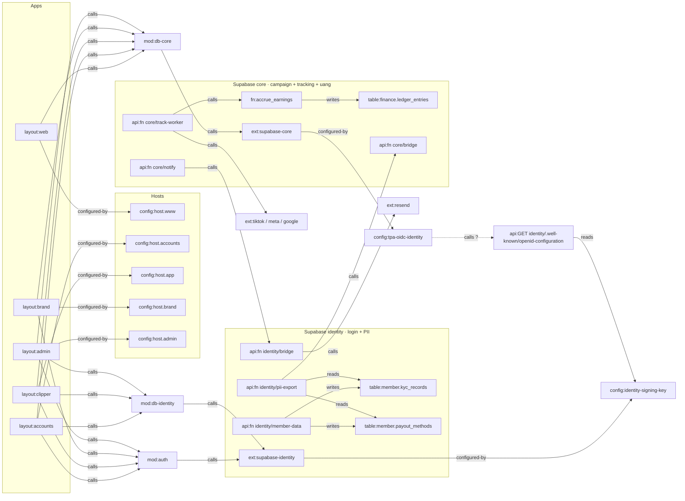

## Struktur domain, URL & folder

Sumber: `spec/structure.yaml` (PRD §15.2–15.3, Lampiran B). Kolom database per tabel: Lampiran A (dari katalog DB uji).

| Host | App | DNS | Fungsi | Indeks |
|---|---|---|---|---|
| {domain} | web | A @ → IP dari kartu domain project Vercel web (umumnya 76.76.21.21; project baru bisa dapat IP anycast lain) | Landing, legal, campaign publik, laporan read-only, link referral (?ref=) | diindeks (sitemap.xml, robots.txt) |
| www.{domain} | web | CNAME www → target CNAME unik project web (dari Vercel) | Redirect 308 ke {domain} (domain kanonik) | tidak (redirect) |
| accounts.{domain} | accounts | CNAME accounts → target CNAME unik project accounts | Login, onboarding, hub akun, KYC, rekening, MFA, privasi, terima undangan; menulis cookie SSO .{domain} | noindex (header X-Robots-Tag) |
| app.{domain} | clipper | CNAME app → target CNAME unik project clipper | App clipper (PWA), redirect URI OAuth sosmed | noindex |
| brand.{domain} | brand | CNAME brand → target CNAME unik project brand | App brand & agency per org | noindex |
| admin.{domain} | admin | CNAME admin → target CNAME unik project admin | Back-office; cookie host-only; halaman di balik IP allowlist/zero-trust | noindex |
| auth.{domain} | Supabase identity | CNAME auth → <ref-identity>.supabase.co; TXT _acme-challenge.auth (nilai dari Supabase) | Custom domain Auth identity: consent screen Google, issuer JWT; callback Google https://auth.{domain}/auth/v1/callback | tidak (API) |
| notif.{domain} | Resend (email) | MX send.notif → feedback-smtp.<region>.amazonses.com (prio 10); TXT send.notif v=spf1 include:amazonses.com ~all; TXT resend._domainkey.notif (DKIM dari Resend) | Subdomain pengirim: OTP login (SMTP Auth identity) + notifikasi; From no-reply@notif.{domain} | tidak (email) |
| _dmarc.{domain} | DNS | TXT v=DMARC1; p=none; rua=mailto:dmarc@{domain} → naik ke quarantine setelah laporan bersih | Kebijakan DMARC domain utama (berlaku juga untuk subdomain pengirim) | tidak |

| Fitur | Folder | Halaman | Tabel | Fungsi |
|---|---|---|---|---|
| F-C01 Auth & onboarding | accounts/auth, accounts/onboarding, clipper/auth, packages/auth | `page:accounts/login`, `page:accounts/onboarding`, `page:app/login` | market.profiles, member.consents, member.legal_versions, bucket.avatars | api.ensure_profile, api.record_consent, member.custom_access_token_hook |
| F-C02 Connect akun sosmed | clipper/social | `page:app/social` | tracking.social_accounts, vault.social-tokens | core/social, api.store_social_token |
| F-C03 Campaign list | clipper/campaigns | `page:app/campaigns` | market.campaigns, finance.reward_pools, market.categories | api.list_campaigns |
| F-C04 Detail & instruksi | clipper/campaigns | `page:app/campaigns/[id]` | market.campaigns, market.rate_rules, market.campaign_assets, bucket.campaign-assets | — |
| F-C05 Claim | clipper/claim | `page:app/campaigns/[id]` | market.claims | api.claim_campaign |
| F-C06 Submit link | clipper/submit | `page:app/campaigns/[id]` | tracking.submissions, market.campaigns | core/social, api.missing_brief_tags |
| F-C07 Tugas Saya | clipper/tasks | `page:app/tasks` | market.claims, tracking.submissions, tracking.view_snapshots, trust.review_decisions | api.appeal_submission |
| F-C08 Wallet | clipper/wallet | `page:app/wallet` | finance.ledger_accounts, finance.ledger_entries, finance.reward_codes | — |
| F-C09 Withdraw & klaim reward | clipper/withdraw, accounts/payout-methods | `page:app/wallet/withdraw`, `page:accounts/payout-methods` | finance.payouts, finance.fulfillments, member.payout_methods, member.recipient_details | api.request_payout, api.request_fulfillment, api.my_payout_methods, identity/member-data |
| F-C10 KYC | accounts/kyc | `page:accounts/kyc` | member.kyc_records, bucket.kyc-docs, member.consents | identity/member-data, api.store_kyc |
| F-C11 Notifikasi | clipper/notifications | `page:app/notifications`, `page:app/settings` | ops.notifications, ops.notification_prefs | ops.enqueue_notification, core/notify, identity/bridge |
| F-C12 Profil & Trust Score | clipper/profile | `page:app/profile` | market.profiles, trust.score_events | trust.recalc_scores |
| F-C13 Leaderboard | clipper/leaderboard | `page:app/leaderboard` | market.leaderboard_weekly, market.leaderboard_campaign | market.refresh_leaderboard |
| F-C14 PWA + web push | clipper/pwa, apps/clipper/src/app/manifest.ts, apps/clipper/public/sw.js | `page:app/settings` | member.push_subscriptions | api.save_push_subscription, identity/bridge |
| F-C15 Instant withdraw (dependency: Penyedia disbursement otomatis (API transfer + callback); D-02 dibuka ulang) | clipper/withdraw | `page:app/wallet/withdraw` | finance.payouts, finance.fee_rules | api.request_payout, identity/disburse |
| F-C16 Referral | clipper/referral, web/landing | `page:app/referral`, `page:www/` | market.referrals, market.profiles | api.my_referral_code, api.ensure_profile, finance.accrue_referral_bonus |
| F-C17 AI Clip (dependency: Produk terpisah (GPU, transkripsi): link keluar dari menu app ke tool AI Clip; tidak ada data di DB platform ini) | — | — | — | — |
| F-C18 i18n & tema | packages/i18n, clipper/settings | `page:app/settings` | — | — |
| F-C19 Komunitas | clipper/community | `page:app/campaigns` | ops.settings | — |
| F-B01 Org & tim | brand/org, accounts/invite | `page:brand/new`, `page:brand/[org]/team`, `page:brand/[org]/settings`, `page:accounts/invite/[token]` | market.organizations, market.org_members, market.org_invites | api.create_org, api.update_org, api.create_org_invite, api.accept_org_invite, api.manage_team, api.manage_org |
| F-B02 Campaign builder | packages/campaign-builder, brand/campaigns | `page:brand/[org]/campaigns/new`, `page:admin/campaigns/new` | market.campaigns, market.rate_rules, finance.reward_pools, market.campaign_assets, finance.invoices, bucket.campaign-covers, bucket.campaign-assets | api.save_campaign |
| F-B03 Reward type custom | brand/reward-types | `page:brand/[org]/reward-types` | market.reward_types, finance.reward_codes | api.save_reward_type, api.upload_reward_codes, core/fulfill |
| F-B04 Billing | brand/billing | `page:brand/[org]/billing` | finance.invoices, finance.org_refunds, finance.ledger_accounts | api.request_refund, api.confirm_invoice_payment |
| F-B05 Dashboard campaign | brand/dashboard | `page:brand/[org]/campaigns/[id]`, `page:brand/[org]/campaigns` | tracking.submissions, tracking.view_snapshots, finance.reward_pools | — |
| F-B06 Kontrol campaign | brand/controls | `page:brand/[org]/campaigns/[id]` | market.campaigns, market.rate_rules, finance.invoices | api.control_campaign |
| F-B07 Review queue brand | brand/review | `page:brand/[org]/review` | tracking.submissions, trust.review_decisions | api.record_review |
| F-B08 Budget utilization | brand/dashboard | `page:brand/[org]/campaigns/[id]` | finance.reward_pools, tracking.view_snapshots | market.run_budget_alerts |
| F-B09 Laporan | brand/reports, web/report | `page:brand/[org]/campaigns/[id]`, `page:www/r/[token]` | market.report_links | api.create_report_link, api.revoke_report_link, api.report_by_token |
| F-B10 Template & duplikat | brand/campaigns | `page:brand/[org]/campaigns`, `page:brand/[org]/campaigns/new` | market.campaigns | api.duplicate_campaign |
| F-B11 Campaign privat | brand/invites | `page:brand/[org]/campaigns/[id]` | market.campaign_invites, market.campaigns | api.invite_to_campaign |
| F-B12 Akun agency | brand/org | `page:brand/`, `page:brand/[org]/settings` | market.org_links | api.link_agency |
| F-A01 Overview | admin/overview | `page:admin/` | finance.ledger_entries, finance.payouts, trust.fraud_flags | — |
| F-A02 Review campaign | admin/campaign-review | `page:admin/campaigns` | market.campaigns, trust.review_decisions | api.record_review |
| F-A03 Builder admin & paket managed | admin/builder | `page:admin/campaigns`, `page:admin/campaigns/new` | market.campaigns, market.campaign_assets, bucket.campaign-assets, finance.fee_rules, finance.invoices | api.save_campaign |
| F-A04 Pinned & kategori | admin/pinned | `page:admin/pinned` | market.campaigns, market.categories, ops.settings, finance.invoices | api.update_config, api.buy_pin |
| F-A05 Moderasi submisi | admin/moderation | `page:admin/review` | tracking.submissions, trust.review_decisions | api.record_review |
| F-A06 Fraud queue | admin/fraud | `page:admin/fraud` | trust.fraud_flags, market.profiles, trust.score_events | api.resolve_fraud_flag, identity/admin-auth |
| F-A07 Manajemen user & org | admin/users | `page:admin/users` | market.profiles, market.organizations, member.kyc_records, member.platform_roles | api.admin_read, api.admin_kyc_decision, api.admin_set_role, api.manage_org, identity/admin-auth |
| F-A08 Finance | admin/finance | `page:admin/finance` | finance.invoices, finance.payouts, finance.payout_batches, finance.org_refunds, finance.ledger_entries | api.confirm_invoice_payment, api.create_payout_batch, api.approve_payout_batch, api.mark_batch_paid, identity/pii-export |
| F-A09 Config | admin/config | `page:admin/config` | ops.settings, finance.fee_rules | api.update_config |
| F-A10 Fulfillment non-tunai | admin/fulfillment | `page:admin/fulfillment` | finance.fulfillments, finance.reward_codes, member.recipient_details | identity/pii-export, core/fulfill |
| F-A11 Audit log | admin/audit | `page:admin/audit` | ops.audit_logs, member.audit_logs | — |
| F-A12 Broadcast | admin/broadcast | `page:admin/broadcast` | ops.broadcasts | api.send_broadcast, ops.dispatch_broadcasts |
| F-X01 Event notifikasi | clipper/notifications, brand/notifications, admin/overview | `page:app/notifications` | ops.notifications, ops.notification_prefs, member.push_subscriptions | ops.enqueue_notification, core/notify, identity/bridge |
| F-X02 Halaman campaign publik | web/campaign-public | `page:www/c/[slug]` | market.campaigns, bucket.campaign-covers | — |
| §4/§15.6 Akun & MFA (lintas fitur) | accounts/hub, accounts/security, admin/auth, packages/auth | `page:accounts/`, `page:accounts/security`, `page:admin/login` | member.kyc_records, member.payout_methods, member.platform_roles | api.my_payout_methods, member.custom_access_token_hook, identity/admin-auth |
| §16 Legal & hak data pribadi (lintas fitur) | web/legal, accounts/privacy | `page:www/legal/[doc]`, `page:accounts/privacy` | member.legal_versions, member.consents | api.record_consent, identity/member-data, identity/delete-account |

## Journey end-to-end

Sumber: `spec/journeys.yaml`, sama dengan PRD §6. Tiap langkah = satu layar; `next` jadi edge `routes-to` dengan bukti `§6 <langkah>`. Dicek otomatis: semua node di journey ada di tabel Nodes, semua page bisa dicapai dari entry point, tidak ada edge navigasi bertanda `?`.

### Aturan pindah host

- Login clipper dari browser: accounts.{domain}/login. Kalau sesi habis saat di app (atau dari PWA terinstal): app.{domain}/login. Brand: accounts.{domain}/login?next=https://brand.{domain}/… . Admin: hanya admin.{domain}/login, akun terpisah.
- Parameter next hanya diterima kalau URL https ke {domain}, app.{domain}, brand.{domain}, atau accounts.{domain}. Selain itu (termasuk admin.{domain} dan domain luar) diganti default app.{domain}/campaigns, supaya halaman login tidak bisa dipakai untuk open redirect.
- Belum login: app → app.{domain}/login?next=<path>; brand → accounts.{domain}/login?next=<URL brand>; accounts → /login?next=<path>; admin → admin.{domain}/login.
- Sesudah login, guard tiap app membaca claim consent_ok di JWT (diisi hook identity): app.{domain} butuh consent_ok.clipper (ToS clipper + privasi versi terbaru + pernyataan umur 18+), brand.{domain} butuh consent_ok.brand (ToS brand + privasi). Belum → accounts.{domain}/onboarding?role=clipper|brand&next=…. Versi ToS baru terbit → claim jadi false paling lama 10 menit kemudian → user diminta setuju ulang.
- Keluar: accounts, app, dan brand memanggil signOut lalu ke {domain}/; cookie .{domain} hilang untuk ketiganya sekaligus. Admin keluar ke admin.{domain}/login.
- Link di email notifikasi langsung ke halaman tujuan (mis. app.{domain}/wallet). Kalau sesi habis, guard membawa ke login lalu kembali ke halaman itu.
- Redirect URL yang didaftarkan di Auth identity: accounts.{domain}/auth/callback, accounts.{domain}/auth/confirm, app.{domain}/auth/callback, plus versi domain staging.
- Aksi yang menggerakkan uang brand (refund, rollover) dan semua halaman admin butuh aal2. Brand yang belum punya TOTP dibawa ke accounts.{domain}/security?next=<halaman>; admin mendaftarkan TOTP di admin.{domain}/login.
- Link referral {domain}/?ref=<kode> menyimpan kode di cookie .{domain} selama 30 hari; onboarding clipper mengirimnya ke ensure_profile (hanya untuk profil baru).

### Menu per app

| Layout | Menu → tujuan |
|---|---|
| `layout:web` | Masuk / Mulai jadi clipper (next=app) → `page:accounts/login`; Untuk brand: Daftar sebagai brand (next=brand/new) → `page:accounts/login`; Buka app (kalau cookie sesi ada) → `page:app/campaigns`; Footer: ToS clipper, ToS brand, privasi → `page:www/legal/[doc]` |
| `layout:accounts` | Ringkasan akun → `page:accounts/`; KYC → `page:accounts/kyc`; Rekening & penerima → `page:accounts/payout-methods`; Keamanan (MFA) → `page:accounts/security`; Privasi & data → `page:accounts/privacy`; Kembali ke app (atau ke next) → `page:app/campaigns`; Ke brand (kalau anggota org) → `page:brand/` |
| `layout:clipper` | Nav bawah: Campaign → `page:app/campaigns`; Nav bawah: Tugas → `page:app/tasks`; Nav bawah: Wallet → `page:app/wallet`; Nav bawah: Sosmed → `page:app/social`; Header: lonceng notifikasi → `page:app/notifications`; Menu avatar: Profil & Trust Score → `page:app/profile`; Menu avatar: Leaderboard → `page:app/leaderboard`; Menu avatar: Ajak teman → `page:app/referral`; Menu avatar: Pengaturan (bahasa, tema, notifikasi) → `page:app/settings`; Menu: Komunitas (Discord/WhatsApp, F-C19) → `ext:community`; Menu: AI Clip (produk terpisah, tab baru, F-C17) → `ext:ai-clip`; Menu avatar: Akun & KYC (next=halaman ini) → `page:accounts/`; Guard: belum login → `page:app/login`; Menu avatar: Keluar → `page:www/` |
| `layout:brand` | Pemilih org (org sendiri + klien agency) → `page:brand/`; Pemilih org: Buat organisasi → `page:brand/new`; Sidebar: Campaign & template → `page:brand/[org]/campaigns`; Sidebar: Review → `page:brand/[org]/review`; Sidebar: Billing → `page:brand/[org]/billing`; Sidebar: Reward type → `page:brand/[org]/reward-types`; Sidebar: Tim → `page:brand/[org]/team`; Sidebar: Pengaturan org & agency → `page:brand/[org]/settings`; Menu avatar: Akun (MFA, privasi) → `page:accounts/`; Guard: belum login (next=brand) → `page:accounts/login`; Menu avatar: Keluar → `page:www/` |
| `layout:admin` | Sidebar: Overview → `page:admin/`; Sidebar: Campaign → `page:admin/campaigns`; Sidebar: Builder → `page:admin/campaigns/new`; Sidebar: Pinned & kategori → `page:admin/pinned`; Sidebar: Moderasi → `page:admin/review`; Sidebar: Fraud → `page:admin/fraud`; Sidebar: User & KYC → `page:admin/users`; Sidebar: Finance → `page:admin/finance`; Sidebar: Fulfillment → `page:admin/fulfillment`; Sidebar: Config → `page:admin/config`; Sidebar: Audit → `page:admin/audit`; Sidebar: Broadcast → `page:admin/broadcast`; Guard & Keluar → `page:admin/login` |

### J-C1 — Clipper baru: landing → daftar → campaign pertama → dibayar (browser HP)

| Langkah | Layar | URL | User lihat → lakukan | Sistem | Lanjut ke · cabang |
|---|---|---|---|---|---|
| C1.1 Landing | `page:www/` | {domain}/ | Lihat: Hero (ambil campaign, posting di akun sendiri, dibayar per views), contoh cuan 10.000 views = Rp20.000, campaign live terbaru (cover, rate per platform, sisa budget dalam views), cara bayar, FAQ, tombol Mulai jadi clipper dan Untuk brand. Link dari teman berbentuk {domain}/?ref=<kode>. Lakukan: Tap Mulai jadi clipper, atau tap card campaign. | Card dibaca dari view publik schema api core (anon). Tidak ada script pihak ketiga selain analytics. Kode ?ref disimpan di cookie .{domain} 30 hari. `table:market.campaigns`, `policy:core.public-read` | accounts.{domain}/login?next=https://app.{domain}/campaigns (dari card: next=…/campaigns/[id]). Cabang: Untuk brand → J-B1. Cookie sesi sudah ada → tombol jadi Buka app → app.{domain}/campaigns. |
| C1.2 Login (OTP / Google) | `page:accounts/login` | accounts.{domain}/login?next=… | Lihat: Kolom email, tombol Lanjut dengan Google, CAPTCHA Turnstile (biasanya tidak terlihat), link ToS dan privasi. Lakukan: Isi email → Kirim kode → ketik 6 digit kode dari email. Atau tap Google → pilih akun. | Auth identity: signInWithOtp + token CAPTCHA; user baru dibuat otomatis; kode dikirim lewat SMTP Resend (template {{ .Token }}). verifyOtp → cookie sesi .{domain} diset dari server. Google: PKCE → layar izin Google (domain auth.{domain}) → accounts.{domain}/auth/callback menukar code jadi sesi. next dicek ke allowlist host. `mod:auth`, `ext:supabase-identity`, `ext:turnstile`, `ext:resend`, `ext:google`, `api:GET accounts/auth/callback` | Belum onboarding → accounts.{domain}/onboarding?next=…; sudah → next. Cabang: Kode salah/kedaluwarsa → kirim ulang (jeda sesuai rate limit Auth). Email tidak masuk → cek spam atau pakai Google. Akun ber-role admin → ditolak, diarahkan ke admin.{domain}. |
| C1.3 Onboarding | `page:accounts/onboarding` | accounts.{domain}/onboarding?role=clipper&next=… | Lihat: Username (dicek unik saat diketik), nama tampilan, foto (opsional, bucket avatars), centang Saya berusia 18 tahun atau lebih, ToS clipper + kebijakan privasi (termasuk data diproses di Singapura). Lakukan: Isi, centang, tap Simpan & mulai. | Urutan: core api.ensure_profile(username, nama, kode referral dari cookie) → E-01 (+ E-39 kalau kodenya sah) → identity api.record_consent untuk tos_clipper, privacy (hanya versi terbaru di E-31) dan age_18_plus → E-28 → refreshSession supaya claim consent_ok.clipper = true. Consent ditulis paling akhir: gagal di tengah jalan = kembali ke onboarding, tidak pernah masuk app tanpa profil. `api:rpc creator.ensure_profile`, `table:market.profiles`, `table:market.referrals`, `table:bucket.avatars`, `api:rpc identity.record_consent`, `table:member.consents`, `table:member.legal_versions`, `fn:custom_access_token_hook` | next (default app.{domain}/campaigns). Target F-C01: landing sampai sini ≤ 2 menit. Cabang: Username dipakai → pesan inline + saran. Belum 18 tahun → tidak bisa lanjut (data anak wajib persetujuan orang tua, UU PDP Pasal 25); umur dicek lagi dari NIK saat KYC. Tutup di tengah jalan → login berikutnya kembali ke onboarding. |
| C1.4 Daftar campaign | `page:app/campaigns` | app.{domain}/campaigns | Lihat: Banner Hubungkan akun sosmed dulu supaya bisa ambil campaign (selama belum ada akun). List: search, filter platform/status/kategori, sort, card dengan CTA 6 state (F-C03). Nav bawah: Campaign, Tugas, Wallet, Sosmed. Lakukan: Tap banner (ke Sosmed) atau buka card. | proxy.ts membaca cookie SSO dan menyegarkan sesi; client core memakai access token identity (Custom OIDC). Campaign + eligibility per user dari view schema api core (RLS). `mod:auth`, `mod:db-core`, `table:market.campaigns`, `table:tracking.social_accounts` | app.{domain}/social atau app.{domain}/campaigns/[id]. Cabang: Tidak ada sesi / sesi dicabut → app.{domain}/login?next=/campaigns (J-C2). |
| C1.5 Hubungkan sosmed | `page:app/social` | app.{domain}/social | Lihat: Kartu TikTok, Instagram, Threads, YouTube: Belum terhubung / Terverifikasi / Token kedaluwarsa / Dicabut, tombol Hubungkan atau Reconnect, maks 3 akun per platform. Lakukan: Tap Hubungkan TikTok → login & setujui izin di halaman resmi TikTok. | App membuat state anti-CSRF → halaman izin platform (TikTok Login Kit / Instagram Login / Threads / Google OAuth) → platform redirect ke app.{domain}/api/oauth/[platform]/callback → Edge Function core social menukar code, token ke Vault core, akun ke E-04 (handle, follower, Terverifikasi). `ext:tiktok`, `ext:meta`, `ext:google`, `api:GET app/api/oauth/[platform]/callback`, `api:fn creator/social`, `table:vault.social-tokens`, `table:tracking.social_accounts` | Kembali ke app.{domain}/social?connected=tiktok (toast sukses), lalu ke campaign. Cabang: Instagram personal → ditolak + panduan pindah ke Creator. Batal di halaman platform → pesan batal. Akun sosmed sudah terhubung ke clipper lain → ditolak (unik platform + external_id). Akun ke-4 di satu platform → ditolak. |
| C1.6 Detail & claim | `page:app/campaigns/[id]` | app.{domain}/campaigns/[id] | Lihat: Brief, do/don't, contoh, aset (unduh), hashtag/mention wajib, label konten bersponsor, rate & cap per platform, timeline tanggal absolut, FAQ, tombol Ambil Campaign. Lakukan: Tap Ambil Campaign. | Core api.claim_campaign: cek status E-01, eligibility (akun platform terhubung, follower, umur akun, Trust Score, KYC kalau disyaratkan), slot & kuota, bukan anggota org pemilik campaign, campaign privat hanya untuk yang diundang/levelnya cukup, belum ada claim terbuka → E-11 open, kedaluwarsa 48 jam. Aset brief lewat signed URL bucket campaign-assets; berkas internal brand tidak terlihat. `api:rpc core.claim_campaign`, `table:market.claims`, `table:market.profiles`, `table:bucket.campaign-assets` | Tetap di halaman ini: tombol berubah jadi Submit video + hitung mundur 48 jam. Cabang: Tidak eligible → alasan + aksi: Hubungkan akun (→ /social?next=…) atau Lengkapi KYC (→ accounts.{domain}/kyc?next=…). Slot penuh / budget habis / deadline lewat → tombol nonaktif + alasan. Anggota org pemilik campaign → ditolak (konflik kepentingan). |
| C1.7 Posting video | `ext:tiktok` | Aplikasi TikTok / Instagram / Threads / YouTube | Lihat: Aplikasi platform milik clipper. Lakukan: Posting klip sesuai brief: hashtag/mention wajib, setelan konten bersponsor/paid promotion. | Belum ada. job:claim-expiry mengirim pengingat sebelum 48 jam habis (in-app + email). `job:claim-expiry`, `fn:enqueue_notification` | Kembali ke app.{domain}/campaigns/[id] (tab yang masih terbuka, notifikasi, atau Tugas). Cabang: Claim kedaluwarsa → slot dilepas (S-02 expired); bisa claim ulang kalau slot masih ada. |
| C1.8 Submit video | `page:app/campaigns/[id]` | app.{domain}/campaigns/[id] (sheet Submit video) | Lihat: Daftar video dari akun terhubung yang diposting setelah claim (thumbnail, caption, tanggal); video yang captionnya kurang tag wajib sudah ditandai sebelum Submit (mis. kurang #mplid); link Tempel URL sebagai cadangan. Lakukan: Pilih video → Submit. | Edge Function core social mengambil daftar video lewat API platform lalu validasi: milik akun ini, platform diizinkan, diposting setelah claim, hashtag/mention/link wajib ada (api.missing_brief_tags), durasi sesuai brief (API tanpa durasi → review manual), video belum pernah disubmit di campaign ini → E-12 validating → in_review (review manual) atau tracking (auto); E-11 submitted. `api:fn creator/social`, `api:rpc core.missing_brief_tags`, `table:tracking.submissions`, `table:market.claims` | app.{domain}/tasks + toast Submisi masuk. Cabang: Tiap gagal punya pesan sendiri: bukan video milikmu, hashtag/mention/link kurang (disebut satu per satu, mis. #mplid), durasi di luar brief, sudah pernah disubmit, diposting sebelum claim, platform tidak diizinkan. |
| C1.9 Tugas Saya | `page:app/tasks` | app.{domain}/tasks | Lihat: Claim & submisi per status (Validasi, Review, Tracking, Ditolak, Banding, Terkunci), views terakhir + jam update, earning pending per submisi, alasan reject, tombol Banding (1×). Lakukan: Pantau; tap Banding kalau ditolak. | job:track-due (pg_cron 15 menit) → queue → track-worker ambil metrik (jadwal 4/24/72 jam) → E-13 snapshot → accrue_earnings → jurnal E-15 Pending. Review admin (F-A05) atau brand (F-B07, auto-approve 72 jam). Banding → api.appeal_submission (1× per submisi, unique index). Notifikasi in-app E-23 + email/push lewat identity (alur 4). `job:track-due`, `api:fn creator/track-worker`, `table:tracking.view_snapshots`, `fn:accrue_earnings`, `table:finance.ledger_entries`, `api:rpc core.record_review`, `table:ops.notifications`, `api:fn core/notify`, `api:fn identity/bridge`, `api:rpc core.appeal_submission` | app.{domain}/wallet. Cabang: Ditolak → Banding → antre moderasi (J-A4). Fraud flag → earning ditahan. Post dihapus/diprivate → earning hangus + notifikasi. Token dicabut → tracking pause + tombol Reconnect → /social. |
| C1.10 Wallet | `page:app/wallet` | app.{domain}/wallet | Lihat: Saldo per unit (Rp, Diamonds, dll): Pending / Tersedia / Ditarik + riwayat transaksi. Tab Reward: kode voucher yang sudah dikirim. Lakukan: Tap Tarik saat Tersedia ≥ minimum (Rp100.000, config). | job:lifecycle mengunci submisi di akhir view window; job:earning-release memindah Pending → Tersedia setelah lock + hold 7 hari tanpa fraud flag → notifikasi earning tersedia. `job:lifecycle`, `job:earning-release`, `table:finance.ledger_entries`, `table:finance.reward_codes` | app.{domain}/wallet/withdraw. Cabang: Masih Pending → tampil tanggal perkiraan Tersedia. |
| C1.11 Withdraw | `page:app/wallet/withdraw` | app.{domain}/wallet/withdraw | Lihat: Checklist: KYC (dari claim kyc), rekening (tersamar ****1234 dari identity), jumlah, pilihan Batch mingguan (gratis) atau Instant (biaya flat, Trust Score ≥ ambang config); tab reward non-tunai. Lakukan: Lengkapi KYC atau rekening kalau belum; pilih rekening + jumlah → Ajukan. | Identity api.my_payout_methods (alur 8: last4 + nama bank saja). Core api.request_payout(method_id, jumlah): cek status E-01, saldo, minimum → E-17 requested + jurnal. Non-tunai: api.request_fulfillment → E-18. Instant → bridge identity disburse ke penyedia disbursement (alur 11), tanpa menunggu batch. `fn:custom_access_token_hook`, `api:rpc identity.my_payout_methods`, `api:rpc core.request_payout`, `table:finance.payouts`, `api:rpc core.request_fulfillment`, `api:fn identity/disburse` | Sukses → app.{domain}/wallet dengan status Menunggu batch (tanggal). Cabang: KYC belum → accounts.{domain}/kyc?next=https://app.{domain}/wallet/withdraw. Rekening belum → accounts.{domain}/payout-methods?next=…. Saldo < minimum → tombol nonaktif + kekurangannya. Akun disuspend → ditolak + kontak bantuan. Instant gagal di penyedia → saldo kembali, bisa pilih batch. |
| C1.12 KYC (sekali) | `page:accounts/kyc` | accounts.{domain}/kyc?next=… | Lihat: Status (Belum / Menunggu verifikasi / Disetujui / Ditolak + alasan), form nama sesuai KTP, NIK, foto KTP, persetujuan KYC. Lakukan: Isi, unggah foto, Kirim. | Foto ke bucket kyc-docs (folder milik user). Edge Function member-data: cek umur dari NIK (digit 7–12 = tanggal lahir, perempuan +40; < 18 tahun ditolak), HMAC NIK (UNIQUE) + enkripsi → E-05 menunggu; consent kyc (E-28). Admin memutus di J-A2 → notifikasi KYC disetujui/ditolak (in-app + email); claim kyc berubah saat JWT di-refresh (≤ 10 menit). `table:bucket.kyc-docs`, `api:fn identity/member-data`, `table:member.kyc_records`, `table:member.consents` | Tombol Kembali ke app → next (withdraw); bisa langsung lanjut ke rekening. Cabang: NIK sudah dipakai akun lain → ditolak (FR-04) + kontak bantuan. Ditolak admin (foto buram, nama beda) → perbaiki & kirim ulang. Umur dari NIK < 18 tahun → ditolak. |
| C1.13 Rekening (sekali) | `page:accounts/payout-methods` | accounts.{domain}/payout-methods?next=… | Lihat: Daftar rekening tersamar; form bank + nomor rekening + nama pemilik; data penerima reward fisik (alamat/HP) bila perlu. Lakukan: Simpan. | member-data: nama pemilik wajib sama dengan nama KYC; HMAC nomor (UNIQUE bank + nomor, FR-04) + enkripsi → E-16 (last4 untuk tampilan). `api:fn identity/member-data`, `table:member.payout_methods`, `table:member.recipient_details` | next → kembali ke app.{domain}/wallet/withdraw dengan rekening terpilih. Cabang: Nama beda dari KYC → ditolak dengan pesan. Rekening sudah dipakai akun lain → ditolak (FR-04). |
| C1.14 Batch & transfer | `page:admin/finance` | admin.{domain}/finance (tim finance, J-A3) | Lihat: Clipper tidak melihat apa-apa di langkah ini. Lakukan: Finance memproses batch mingguan. | create_payout_batch → approve orang kedua → pii-export CSV → transfer massal di internet banking → bukti diunggah → mark_batch_paid → notifikasi Payout sukses/gagal (jurnal Ditarik sudah ditulis saat request_payout; gagal → dibalik ke Tersedia) (in-app + email). `api:rpc core.create_payout_batch`, `api:fn identity/pii-export`, `ext:bank`, `api:rpc core.mark_batch_paid`, `fn:enqueue_notification` | Clipper: notifikasi → app.{domain}/wallet (Ditarik sudah bertambah sejak pengajuan). Cabang: Gagal (rekening tutup / nama beda) → payout failed → saldo kembali; user memperbaiki rekening lalu ajukan ulang (S-05). |

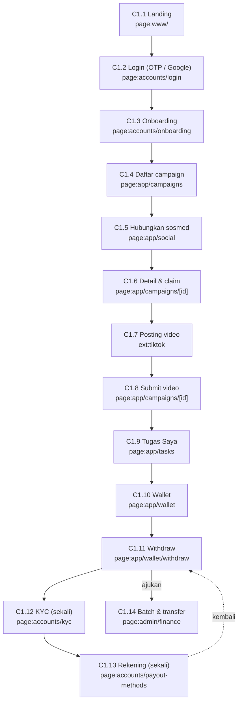

### J-C2 — Clipper kembali lagi & kelola akun

| Langkah | Layar | URL | User lihat → lakukan | Sistem | Lanjut ke · cabang |
|---|---|---|---|---|---|
| C2.1 Buka lagi | `page:app/campaigns` | app.{domain}/… (bookmark, link email, atau PWA) | Lihat: Langsung halaman yang dituju kalau sesi masih ada. Lakukan: Buka link. | proxy.ts menyegarkan sesi di server (cookie diset lewat header). JWT 10 menit; refresh token jalan diam-diam. `mod:auth` | Halaman tujuan. Cabang: Refresh gagal (logout di perangkat lain, akun di-ban, sesi dicabut) → app.{domain}/login?next=<path>. |
| C2.2 Login di app | `page:app/login` | app.{domain}/login?next=… | Lihat: Form yang sama dengan accounts (komponen packages/auth): email → kode OTP, atau Google. Lakukan: Ketik kode (atau Google). | Sama dengan C1.2 tapi di origin app; Google kembali ke app.{domain}/auth/callback. Ini juga jalur login PWA terinstal di iOS, karena cookie PWA terpisah dari Safari. `mod:auth`, `api:GET app/auth/callback`, `ext:supabase-identity` | Kembali ke next. Cabang: Akun baru dari sini (jarang) → accounts.{domain}/onboarding?next=…. |
| C2.3 Hub akun | `page:accounts/` | accounts.{domain}/?next=… | Lihat: Ringkasan: status KYC, jumlah rekening, MFA, consent; menu KYC, Rekening & penerima, Keamanan, Privasi & data; tombol Kembali ke app (dan Ke brand kalau anggota org). Lakukan: Pilih menu atau kembali. | Data sendiri dari schema api identity (RLS data sendiri). `table:member.kyc_records`, `api:rpc identity.my_payout_methods` | Halaman yang dipilih; Kembali → next atau app.{domain}/campaigns. |
| C2.4 Privasi & data | `page:accounts/privacy` | accounts.{domain}/privacy | Lihat: Consent aktif (ToS, privasi, KYC, share_with_brand) + tombol cabut; Unduh data saya; Hapus akun. Lakukan: Cabut consent, unduh data, atau hapus akun (ketik username untuk konfirmasi). | Consent → api.record_consent (E-28). Unduh data → browser mengumpulkan data sendiri dari api identity + api core (RLS) + member-data (NIK & rekening milik sendiri didekripsi) jadi satu file JSON; tidak ada alur lintas DB baru. Hapus akun → delete-account (alur 7): tolak kalau saldo/payout masih berjalan, cabut semua sesi, hapus PII. `api:rpc identity.record_consent`, `api:fn identity/member-data`, `api:fn identity/delete-account`, `api:fn core/bridge` | Setelah hapus akun → {domain}/ dengan pesan Akun dihapus. Cabang: Masih ada saldo/payout berjalan → ditolak + instruksi tarik/tunggu dulu. Cabut share_with_brand → reward fisik yang butuh data penerima tidak bisa diklaim. |
| C2.5 Pengaturan | `page:app/settings` | app.{domain}/settings | Lihat: Bahasa ID/EN, tema terang/gelap, email promosi (campaign baru, broadcast) on/off, notifikasi push on/off per perangkat. Lakukan: Ubah pengaturan. | Preferensi email → api.notification_prefs (E-34, RLS milik sendiri). Push → identity api.save_push_subscription (E-36). Email transaksional (OTP, KYC, payout) tidak bisa dimatikan. `table:ops.notification_prefs`, `api:rpc identity.save_push_subscription`, `table:member.push_subscriptions` | Kembali ke halaman sebelumnya. |

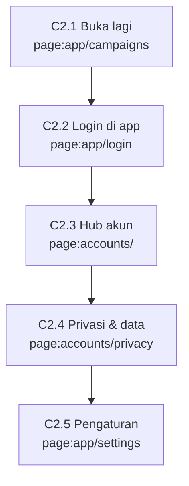

### J-C3 — PWA terpasang & notifikasi push

| Langkah | Layar | URL | User lihat → lakukan | Sistem | Lanjut ke · cabang |
|---|---|---|---|---|---|
| C3.1 Pasang app | `page:app/campaigns` | app.{domain}/campaigns (banner Pasang di layar utama) | Lihat: Android: tombol Pasang (prompt browser). iPhone: panduan Share → Add to Home Screen. Lakukan: Pasang ke layar utama. | manifest.ts + service worker (sw.js) di apps/clipper. iOS 17.2+ menyalin cookie Safari saat dipasang, jadi user yang sudah login langsung masuk. `layout:clipper` | PWA terbuka di app.{domain}/campaigns. Cabang: Cookie tidak ikut (iOS lama) → app.{domain}/login di dalam PWA (J-C2 C2.2). |
| C3.2 Izinkan notifikasi | `page:app/settings` | app.{domain}/settings | Lihat: Kartu Notifikasi push: Aktifkan. Lakukan: Tap Aktifkan → izinkan di dialog browser. | Service worker membuat langganan push (VAPID publik) → identity api.save_push_subscription → E-36 (endpoint = pengenal perangkat, jadi di identity). `api:rpc identity.save_push_subscription`, `table:member.push_subscriptions` | Status Aktif di perangkat ini. Cabang: Izin ditolak → tetap in-app + email. iPhone: push hanya untuk PWA yang sudah dipasang. |
| C3.3 Terima push | `ext:web-push` | Notifikasi sistem HP | Lihat: Mis. Payout sukses Rp150.000, Claim tinggal 6 jam. Lakukan: Tap notifikasi. | Worker notify → bridge identity send_push (kunci VAPID privat = secret Edge Function identity) bersama email (alur 4). `api:fn core/notify`, `api:fn identity/bridge` | Membuka halaman tujuan di PWA (mis. app.{domain}/wallet). Cabang: Endpoint kedaluwarsa (410) → langganan dihapus otomatis. |

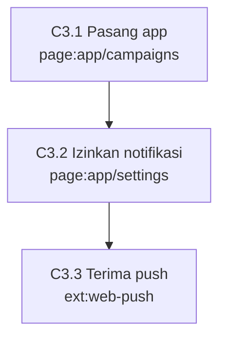

### J-C4 — Profil, Trust Score & leaderboard

| Langkah | Layar | URL | User lihat → lakukan | Sistem | Lanjut ke · cabang |
|---|---|---|---|---|---|
| C4.1 Profil & Trust Score | `page:app/profile` | app.{domain}/profile | Lihat: Total views, earning, approval rate, Trust Score 0–100 + efeknya (campaign premium, cap lebih tinggi, hold lebih pendek, instant withdraw), riwayat perubahan skor. Lakukan: Lihat kenapa skor naik/turun. | api.my_profile + api.score_events (E-40, append-only) + api.submissions + api.wallet_balances. Skor dihitung ulang job trust-score tiap malam. `table:market.profiles`, `table:trust.score_events`, `job:trust-score` | Leaderboard. Cabang: Skor diturunkan karena fraud → bisa banding 1× lewat bantuan. |
| C4.2 Leaderboard | `page:app/leaderboard` | app.{domain}/leaderboard | Lihat: Tab Minggu ini (global) dan Per campaign; posisi sendiri disorot. Lakukan: Pindah tab, buka campaign. | Materialized view leaderboard_weekly & leaderboard_campaign, di-refresh tiap jam (job leaderboard-refresh); baris campaign privat disaring RLS campaigns. `table:market.leaderboard_weekly`, `table:market.leaderboard_campaign`, `job:leaderboard-refresh` | Detail campaign. |

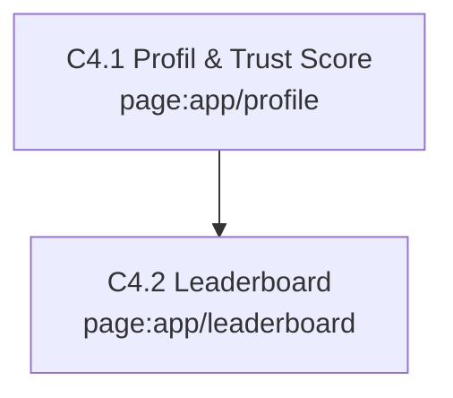

### J-C5 — Ajak teman (referral)

| Langkah | Layar | URL | User lihat → lakukan | Sistem | Lanjut ke · cabang |
|---|---|---|---|---|---|
| C5.1 Ambil link | `page:app/referral` | app.{domain}/referral | Lihat: Kode 8 karakter, tombol Bagikan link {domain}/?ref=<kode>, daftar teman (daftar, KYC, bonus aktif sampai), total bonus. Lakukan: Bagikan link. | api.my_referral_code (dibuat saat pertama diminta) + api.referrals (E-39, hanya milik pengundang). `api:rpc core.my_referral_code`, `table:market.referrals` | Teman membuka {domain}/?ref=<kode>. |
| C5.2 Teman daftar | `page:accounts/onboarding` | accounts.{domain}/onboarding?role=clipper | Lihat: Onboarding biasa (J-C1 C1.3). Lakukan: Teman menyelesaikan onboarding. | ensure_profile mencatat E-39 untuk profil baru; kode tidak dikenal atau milik sendiri diabaikan. `api:rpc creator.ensure_profile`, `table:market.referrals` | Teman masuk app. Cabang: Teman sudah punya akun → referral tidak dicatat. |
| C5.3 Bonus | `page:app/referral` | app.{domain}/referral | Lihat: Status teman berubah Bonus aktif; bonus masuk wallet sebagai Pending → Tersedia. Lakukan: — | KYC teman disetujui → qualified_at. job:referral-bonus tiap malam: bonus = persentase config dari earning teman yang Tersedia hari itu, sampai bonus_until; jurnal referral_bonus dari akun platform (bukan potong earning teman). `job:referral-bonus`, `table:finance.ledger_entries` | Wallet. Cabang: Teman satu NIK/rekening/perangkat dengan pengundang → fraud flag, bonus batal (FR-04, FR-05). |

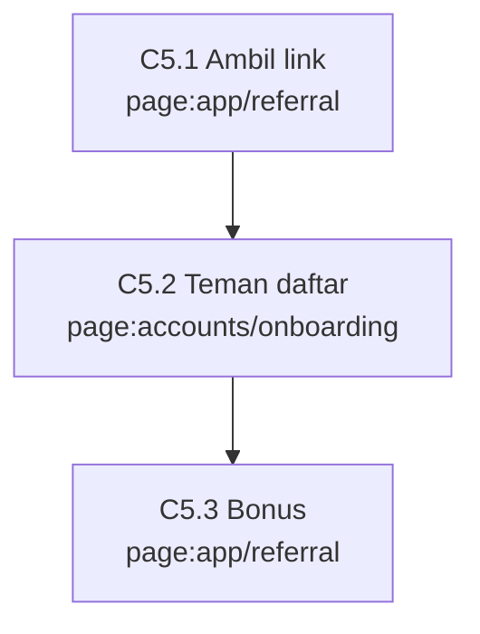

### J-C6 — Reward non-tunai & instant withdraw

| Langkah | Layar | URL | User lihat → lakukan | Sistem | Lanjut ke · cabang |
|---|---|---|---|---|---|
| C6.1 Klaim reward | `page:app/wallet/withdraw` | app.{domain}/wallet/withdraw (tab Reward) | Lihat: Saldo per reward type, field penerima (mis. User ID + Zone ID); alamat/HP diambil dari data penerima di accounts. Lakukan: Isi field, Klaim. | api.request_fulfillment → E-18. Field non-PII di core; alamat/HP di identity (E-29) lewat accounts.{domain}/payout-methods dan hanya dibagikan ke brand dengan consent share_with_brand. `api:rpc core.request_fulfillment`, `table:finance.fulfillments`, `table:member.recipient_details` | Wallet: status Diproses. Cabang: Reward fisik tanpa data penerima → accounts.{domain}/payout-methods?next=…. |
| C6.2 Reward terkirim | `page:app/wallet` | app.{domain}/wallet (tab Reward) | Lihat: Pool kode: kode voucher muncul. Webhook: Terkirim otomatis. Ekspor manual: menunggu tim (J-A5). Lakukan: Salin kode / cek akun game. | Worker core/fulfill: pool kode → pasang satu kode E-41 ke fulfillment; webhook → POST ke URL brand dengan tanda tangan (secret di Vault), gagal → retry tiap 5 menit (attempts, next_retry_at) → delivered → notifikasi. `api:fn core/fulfill`, `table:finance.reward_codes`, `job:fulfillment-retry` | — Cabang: Kode habis / webhook gagal terus → antre admin fulfillment (J-A5). |
| C6.3 Instant withdraw | `page:app/wallet/withdraw` | app.{domain}/wallet/withdraw (Instant) | Lihat: Biaya flat (E-21 instant_withdraw_fee), estimasi masuk menit itu juga. Lakukan: Pilih Instant → Ajukan. | api.request_payout(channel instant) → E-17 + jurnal → bridge identity disburse: dekripsi rekening, kirim ke penyedia disbursement, callback → mark paid lewat bridge core (alur 11) → notifikasi. `api:rpc core.request_payout`, `api:fn identity/disburse`, `ext:disbursement`, `table:finance.payouts` | Wallet: Ditarik. Cabang: Trust Score di bawah ambang → opsi Instant nonaktif + alasannya. Penyedia gagal → payout failed, saldo kembali. |

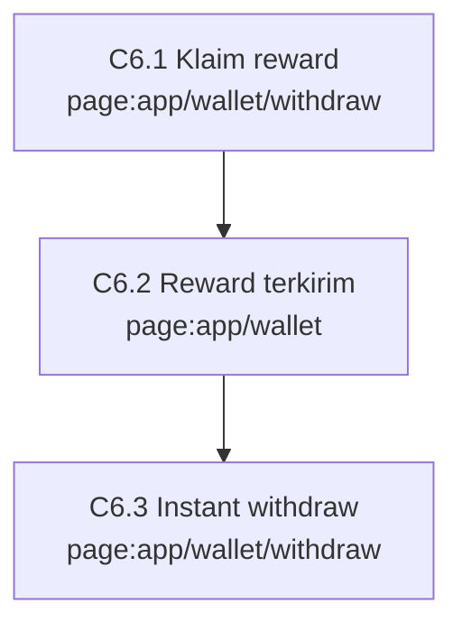

### J-B1 — Brand baru self-serve: daftar → organisasi → campaign tayang

| Langkah | Layar | URL | User lihat → lakukan | Sistem | Lanjut ke · cabang |
|---|---|---|---|---|---|
| B1.1 Untuk brand | `page:www/` | {domain}/#brand | Lihat: Cara kerja untuk brand, fee 15% + 5% di atas budget creator, contoh laporan, tombol Daftar sebagai brand dan Pakai paket managed. Lakukan: Tap Daftar sebagai brand. | Tidak ada.  | accounts.{domain}/login?next=https://brand.{domain}/new. Cabang: Pakai paket managed → login & buat org seperti biasa, lalu di builder pilih Dibantu tim: isi brief mentah + unggah berkas brief (audience internal, folder internal/, tidak terlihat clipper) → draft service_mode managed antre di builder admin (J-A7); tim melengkapi, brand menyetujui di B1.7 lalu membayar (invoice managed_service). |
| B1.2 Login | `page:accounts/login` | accounts.{domain}/login?next=… | Lihat: Sama dengan login clipper: email kantor → kode OTP, atau Google. Lakukan: Masuk. | Auth identity (C1.2). Akun yang sudah ada (mis. juga clipper) dipakai ulang. `mod:auth`, `ext:supabase-identity` | accounts.{domain}/onboarding?role=brand&next=… |
| B1.3 Onboarding brand | `page:accounts/onboarding` | accounts.{domain}/onboarding?role=brand&next=… | Lihat: Nama tampilan, username (diisi otomatis, bisa diubah), centang ToS brand + kebijakan privasi. Lakukan: Simpan. | ensure_profile → record_consent(tos_brand, privacy) → refreshSession → consent_ok.brand = true. `api:rpc creator.ensure_profile`, `api:rpc identity.record_consent`, `fn:custom_access_token_hook` | brand.{domain}/new. Cabang: Diundang ke org (J-B2) → langsung ke org itu, tanpa buat organisasi. |
| B1.4 Buat organisasi | `page:brand/new` | brand.{domain}/new | Lihat: Nama brand, jenis (badan usaha / perorangan), centang agency; badan usaha: nama legal, NPWP 15/16 digit, alamat. Lakukan: Buat organisasi. | api.create_org → E-02 status pending_verification + E-03 brand_owner. Perorangan: NPWP = NIK dan alamat pribadi tidak disimpan di core (constraint organizations_perorangan_no_pii); datanya dari KYC pemilik. `api:rpc brand.create_org`, `table:market.organizations`, `table:market.org_members` | brand.{domain}/[org]/campaigns dengan banner Menunggu verifikasi. Cabang: Perorangan → accounts.{domain}/kyc?next=https://brand.{domain}/[org]/campaigns (wajib sebelum invoice berfaktur). |
| B1.5 Verifikasi org | `page:admin/users` | admin.{domain}/users (tab Org brand, J-A2) | Lihat: Brand melihat banner Menunggu verifikasi; boleh menyusun draft. Lakukan: Tim memeriksa NPWP (badan) atau KYC pemilik (perorangan). | api.manage_org verify → verified (verified_by, verified_at) → notifikasi org.verified; ditolak → alasan + perbaiki. `api:rpc core.manage_org`, `fn:enqueue_notification` | Banner hilang; tombol Ajukan aktif. Cabang: Ditolak → brand_owner memperbaiki data di brand.{domain}/[org]/settings (Ubah data → api.update_org); banner berganti Perbaikan terkirim, admin melihat Diubah brand. Org verified mengubah nama legal/NPWP/alamat → kembali Menunggu verifikasi (campaign baru tidak bisa diajukan; yang berjalan tetap). `api:rpc brand.update_org` |
| B1.6 Susun campaign | `page:brand/[org]/campaigns/new` | brand.{domain}/[org]/campaigns/new | Lihat: Builder 7 langkah (F-B02), bisa mulai dari template atau duplikat; simpan draft kapan saja. Langkah 2 Brief: teks brief, do/don't, contoh konten (link), hashtag/mention/link wajib, durasi min–maks, label konten bersponsor, FAQ, aset (file/link); tombol Dibantu tim. Lakukan: Isi langkah 1–7. | save_campaign (draft) → E-06 dengan kolom brief terstruktur, rate rule E-08, pool E-09, aset E-10 ke bucket campaign-covers / campaign-assets (berkas brief mentah di folder internal/: hanya anggota org + admin). `comp:CampaignBuilder`, `api:rpc core.save_campaign`, `table:market.campaigns`, `table:market.campaign_assets`, `table:bucket.campaign-assets` | Langkah terakhir: ringkasan biaya. Cabang: Dibantu tim → service_mode managed, draft antre di J-A7; brand tetap bisa mengisi sendiri kapan saja. |
| B1.7 Ringkasan & ajukan | `page:brand/[org]/campaigns/new` | brand.{domain}/[org]/campaigns/new (ringkasan) | Lihat: Budget creator + management fee 15% + admin fee 5% + pajak = total; jadwal; mode review. Lakukan: Ajukan. | save_campaign (submit): org harus verified → campaign in_review + invoice E-22 (kind campaign) → notifikasi Invoice terbit. Review isi oleh admin jalan paralel dengan pembayaran. Sejak diajukan brief terkunci (trigger campaigns_brief_frozen); yang masih bisa ditambah hanya FAQ. `api:rpc core.save_campaign`, `table:finance.invoices`, `fn:enqueue_notification` | brand.{domain}/[org]/billing. Cabang: Org belum verified → tombol Ajukan nonaktif + alasan. |
| B1.8 Bayar invoice | `page:brand/[org]/billing` | brand.{domain}/[org]/billing | Lihat: Invoice: rincian, QRIS (≤ Rp10 juta) atau rekening transfer + nomor referensi wajib; status Belum dibayar; unduh faktur setelah lunas. Lakukan: Bayar dari m-banking. | Finance mencocokkan mutasi (J-A3) → confirm_invoice_payment → jurnal bank → pool → notifikasi Pembayaran diterima. `table:finance.invoices`, `ext:bank`, `api:rpc core.confirm_invoice_payment` | Invoice Lunas. Cabang: Nominal tidak cocok → finance menghubungi brand. Nomor referensi sama → ditolak sistem. |
| B1.9 Review & tayang | `page:admin/campaigns` | admin.{domain}/campaigns (F-A02) | Lihat: Brand menerima notifikasi Campaign disetujui, lalu Campaign tayang. Lakukan: Admin cek hak aset, brief aman, dana masuk → approve. | record_review: approve hanya kalau invoice lunas → scheduled → job lifecycle membuat live pada start_at → notifikasi brand + clipper eligible (campaign.new). `api:rpc core.record_review`, `job:lifecycle`, `fn:enqueue_notification` | Brand → brand.{domain}/[org]/campaigns/[id] (J-B3). Cabang: Ditolak → alasan ke brand, campaign kembali draft untuk diperbaiki. |

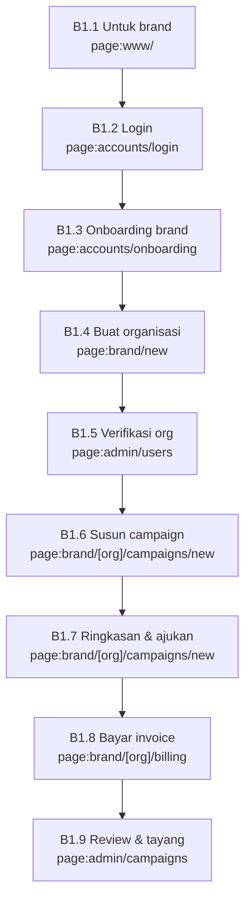

### J-B2 — Tim brand & agency

| Langkah | Layar | URL | User lihat → lakukan | Sistem | Lanjut ke · cabang |
|---|---|---|---|---|---|
| B2.1 Buat link undangan | `page:brand/[org]/team` | brand.{domain}/[org]/team | Lihat: Daftar anggota + role; tombol Buat link undangan (pilih role). Lakukan: Buat link, bagikan sendiri lewat WhatsApp/email. | create_org_invite → E-30 (token_hash, kedaluwarsa). Tanpa email dari sistem. `api:rpc brand.create_org_invite`, `table:brand/market.org_invites` | Penerima membuka accounts.{domain}/invite/[token]. Cabang: Hanya brand_owner yang bisa membuat undangan. Owner mengubah role / mengeluarkan anggota / mencabut link belum dipakai (api.manage_team); owner terakhir tidak bisa turun/keluar. `api:rpc brand.manage_team` |
| B2.2 Terima undangan | `page:accounts/invite/[token]` | accounts.{domain}/invite/[token] | Lihat: Nama org + role yang ditawarkan; kalau belum login, login dulu. Lakukan: Tap Terima. | accept_org_invite: profil E-01 dibuat dulu kalau belum ada, lalu E-03 (alur 5). `api:rpc brand.accept_org_invite`, `table:market.org_members` | brand.{domain}/. Cabang: Token kedaluwarsa atau sudah dipakai → minta link baru. |
| B2.3 Tautkan agency | `page:brand/[org]/settings` | brand.{domain}/[org]/settings (Agency) | Lihat: Agency: kirim permintaan ke org klien. Klien (brand_owner): daftar permintaan + Setujui/Cabut. Lakukan: Setujui tautan. | api.link_agency → E-38 disetujui brand_owner klien; anggota agency memegang role yang sama di org klien (ops.org_role); dicabut = revoked_at. `api:rpc brand.link_agency`, `table:market.org_links` | Org klien muncul di pemilih org agency. Cabang: Dicabut → akses agency ke org klien hilang seketika (RLS). |

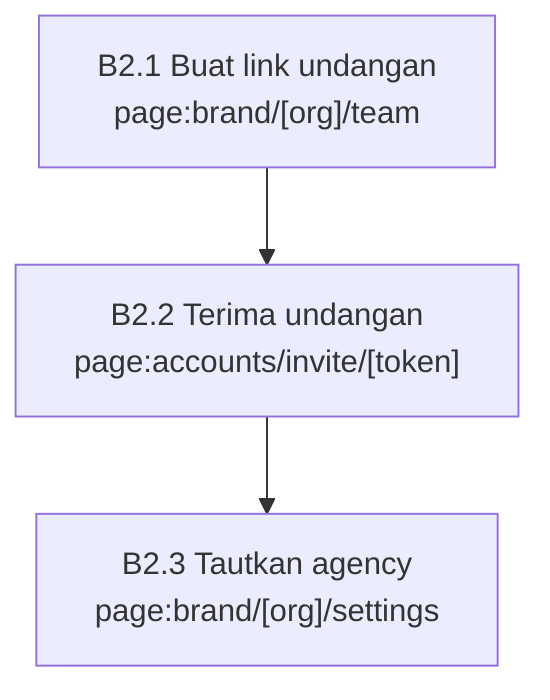

### J-B3 — Brand mengelola campaign berjalan sampai selesai

| Langkah | Layar | URL | User lihat → lakukan | Sistem | Lanjut ke · cabang |
|---|---|---|---|---|---|
| B3.1 Dashboard | `page:brand/[org]/campaigns/[id]` | brand.{domain}/[org]/campaigns/[id] | Lihat: Views valid, spend, sisa per pool, eCPM, jumlah klip & clipper, split platform, kurva harian, top klip, proyeksi budget habis vs deadline. Lakukan: Pantau. | Baca core lewat schema api (RLS anggota org); proyeksi dari snapshot & pool. `table:tracking.submissions`, `table:tracking.view_snapshots`, `table:finance.reward_pools` | Review, kontrol, laporan. Cabang: Proyeksi < 50% → saran: naikkan rate, perpanjang, undang clipper, pin. |
| B3.2 Review klip | `page:brand/[org]/review` | brand.{domain}/[org]/review | Lihat: Antrean klip campaign mode review brand, embed, alasan standar. Lakukan: Approve/reject massal. | record_review oleh brand_owner/brand_manager; tidak direview 72 jam → auto-approve (job lifecycle). `api:rpc core.record_review`, `job:lifecycle` | Clipper dikabari. |
| B3.3 Kontrol campaign | `page:brand/[org]/campaigns/[id]` | brand.{domain}/[org]/campaigns/[id] (Kontrol) | Lihat: Pause/resume, perpanjang deadline, naikkan rate, top-up budget, akhiri lebih awal. Lakukan: Pilih aksi. | api.control_campaign: naikkan rate = rule lama ditutup (effective_to) + rule baru berlaku untuk views sesudahnya; top-up = invoice kind topup → bayar → pool bertambah; transisi status mengikuti S-01. `api:rpc core.control_campaign`, `table:market.rate_rules`, `table:finance.invoices` | Top-up → billing. Cabang: Transisi tidak sah (mis. settled → live) → ditolak trigger state machine. |
| B3.4 Undang clipper | `page:brand/[org]/campaigns/[id]` | brand.{domain}/[org]/campaigns/[id] (Undangan) | Lihat: Campaign privat: cari username, daftar undangan. Lakukan: Undang. | api.invite_to_campaign → E-37 → notifikasi campaign.invited; campaign tampil hanya untuk yang diundang (RLS). `api:rpc brand.invite_to_campaign`, `table:market.campaign_invites` | — Cabang: Visibilitas level → otomatis terbuka untuk Trust Score ≥ ambang. |
| B3.5 Pin campaign | `page:brand/[org]/campaigns/[id]` | brand.{domain}/[org]/campaigns/[id] (Pin) | Lihat: Pilih durasi pin, harga per minggu (REV-4). Lakukan: Pin. | api.buy_pin → invoice kind pinned (pin_until) → lunas → pinned_until diset → tampil di atas list clipper. `api:rpc core.buy_pin`, `table:finance.invoices` | Billing. |
| B3.6 Laporan | `page:brand/[org]/campaigns/[id]` | brand.{domain}/[org]/campaigns/[id] (Laporan) | Lihat: Unduh CSV; Buat link read-only (berlaku 90 hari) + Cabut. Lakukan: Buat link, kirim ke atasan. | api.create_report_link → token sekali tampil, yang disimpan sha256-nya (E-33); atasan membuka {domain}/r/[token] tanpa login; PDF = cetak halaman itu. `api:rpc core.create_report_link`, `table:market.report_links`, `page:www/r/[token]` | {domain}/r/[token]. Cabang: Link dicabut/kedaluwarsa → halaman Link tidak berlaku. |
| B3.7 Selesai & sisa budget | `page:brand/[org]/billing` | brand.{domain}/[org]/billing (Sisa budget) | Lihat: Notifikasi Campaign selesai & laporan siap; sisa budget creator; pilih Rollover (kredit org tanpa fee baru) atau Refund (dikurangi biaya transfer). Lakukan: Pilih, konfirmasi dengan TOTP. | Butuh aal2. api.request_refund: rollover = jurnal ke akun org_credit; refund = E-35 requested → admin_finance lain approve & transfer (J-A3). `api:rpc core.request_refund`, `table:finance.org_refunds`, `page:accounts/security` | Status refund di billing. Cabang: Belum punya TOTP → accounts.{domain}/security?next=… lalu kembali. |
| B3.8 Template & duplikat | `page:brand/[org]/campaigns` | brand.{domain}/[org]/campaigns (Template) | Lihat: Simpan sebagai template, Duplikat campaign lama. Lakukan: Pilih template → buka builder terisi. | api.duplicate_campaign → campaign baru draft (template tetap draft, constraint campaigns_template_stays_draft). `api:rpc brand.duplicate_campaign`, `table:market.campaigns` | Builder. |

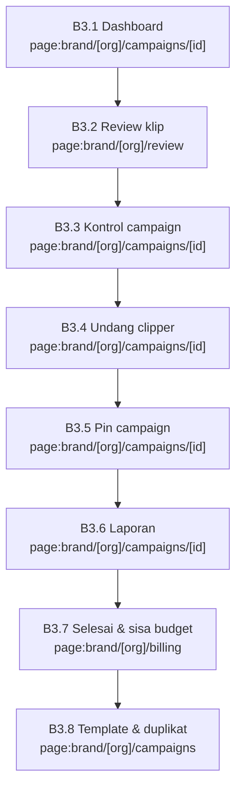

### J-A1 — Tim internal: masuk admin

| Langkah | Layar | URL | User lihat → lakukan | Sistem | Lanjut ke · cabang |
|---|---|---|---|---|---|
| A1.1 Login admin | `page:admin/login` | admin.{domain}/login | Lihat: Email → kode OTP → kode TOTP dari aplikasi authenticator. Lakukan: Login; login pertama mendaftarkan TOTP. | Akun admin terpisah dari akun clipper/brand; aal2 wajib; cookie host-only bernama lain. MFA admin didaftarkan di sini, bukan di accounts.{domain} (accounts menolak sesi admin). `mod:auth`, `ext:supabase-identity` | admin.{domain}/ (overview). Cabang: Akun non-admin → ditolak. TOTP salah → ulangi; terkunci → admin_super mereset. |
| A1.2 Overview | `page:admin/` | admin.{domain}/ | Lihat: GMV, revenue, campaign aktif, payout pending, ukuran fraud queue, kesehatan job tracking; sidebar ke semua menu. Lakukan: Pilih antrean kerja. | Baca core lewat fungsi admin (aal2). `table:finance.ledger_entries`, `table:finance.payouts`, `table:trust.fraud_flags` | Menu sesuai role (admin_ops, admin_moderator, admin_finance, admin_support). |

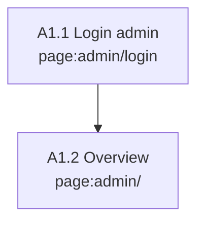

### J-A2 — Verifikasi KYC & org brand

| Langkah | Layar | URL | User lihat → lakukan | Sistem | Lanjut ke · cabang |
|---|---|---|---|---|---|
| A2.1 Periksa KYC | `page:admin/users` | admin.{domain}/users | Lihat: Antrean KYC menunggu; detail: nama KTP, NIK tersamar, foto KTP (signed URL berumur pendek). Lakukan: Bandingkan foto dengan data → Setujui atau Tolak + alasan. | Identity admin_read (akses tercatat E-24) → admin_kyc_decision (E-05). Core record_review mencatat keputusan (tanpa PII) dan mengirim notifikasi KYC disetujui/ditolak (in-app + email, alur 4). `api:rpc identity.admin_read`, `api:rpc identity.admin_kyc_decision`, `api:rpc core.record_review`, `fn:enqueue_notification` | User melihat status baru di accounts.{domain}/kyc; claim kyc ikut saat JWT di-refresh. Cabang: NIK atau rekening ganda (FR-04) → tolak + tandai fraud. |
| A2.2 Verifikasi org | `page:admin/users` | admin.{domain}/users (tab Org brand) | Lihat: Org pending_verification: badan → nama legal, NPWP, alamat; perorangan → status KYC pemilik. Lakukan: Setujui atau tolak + alasan. | api.manage_org verify → verified/suspended + record_review target org → notifikasi org.verified / org.rejected. `api:rpc core.manage_org`, `api:rpc core.record_review`, `table:market.organizations` | Brand bisa mengajukan campaign. Cabang: NPWP tidak valid → tolak; brand memperbaiki di pengaturan org (api.update_org) → baris Diubah brand di detail org menandai perlu review ulang. |

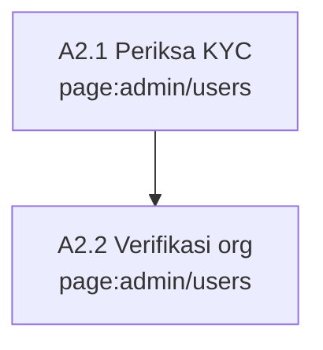

### J-A3 — Uang masuk & payout mingguan

| Langkah | Layar | URL | User lihat → lakukan | Sistem | Lanjut ke · cabang |
|---|---|---|---|---|---|
| A3.1 Konfirmasi bayar brand | `page:admin/finance` | admin.{domain}/finance (tab Pembayaran masuk) | Lihat: Invoice belum lunas + form nominal, waktu, nomor referensi. Lakukan: Cocokkan dengan mutasi rekening di internet banking → Konfirmasi. | confirm_invoice_payment → jurnal bank_clearing → campaign_pool; nomor referensi sama ditolak; notifikasi Pembayaran diterima ke brand. `api:rpc core.confirm_invoice_payment`, `ext:bank`, `table:finance.invoices` | Campaign siap direview (J-B1 B1.7). Cabang: Nominal kurang → tahan, hubungi brand. |
| A3.2 Buat & approve batch | `page:admin/finance` | admin.{domain}/finance (tab Payout) | Lihat: Payout requested sampai cut-off, top earner, flag fraud. Lakukan: admin_finance A membuat batch dan menahan yang mencurigakan; admin_finance B approve. | create_payout_batch → E-26; approve ditolak kalau approved_by = created_by; aal2. `api:rpc core.create_payout_batch`, `table:finance.payout_batches` | Tombol Export CSV aktif. Cabang: Pembuat batch tidak bisa menyetujui batchnya sendiri: selalu dua orang (§4, §15.5 alur 3). |
| A3.3 Export CSV | `page:admin/finance` | admin.{domain}/finance → Export CSV | Lihat: Link unduh CSV (berlaku 15 menit) + daftar payout yang ditahan beserta alasannya. Lakukan: Unduh CSV. | pii-export (identity) → bridge core get_batch → cek pemilik rekening = pemilik payout dan nama = nama KYC → CSV di bucket pii-exports → attach_export menahan yang tidak lolos; akses tercatat. `api:fn identity/pii-export`, `api:fn core/bridge`, `table:bucket.pii-exports` | Internet banking bisnis (luar sistem). Cabang: Rekening diganti user saat batch berjalan → payout itu ditahan (R-15). |
| A3.4 Transfer & tandai paid | `page:admin/finance` | admin.{domain}/finance → Tandai paid | Lihat: Form unggah bukti transfer per batch. Lakukan: Upload CSV di internet banking, tunggu hasil, unggah bukti, Tandai paid. | pii-export menyimpan bukti di payout-proofs + attach_proof; mark_batch_paid hanya untuk payout di CSV → jurnal Ditarik → notifikasi Payout sukses/gagal ke clipper. `ext:bank`, `table:bucket.payout-proofs`, `api:rpc core.mark_batch_paid`, `fn:enqueue_notification` | Rekap PPh 21 dari pii-export; rekonsiliasi harian berjalan otomatis. Cabang: Sebagian gagal di bank → tandai failed → saldo kembali ke clipper (S-05). |
| A3.5 Rekonsiliasi harian | `page:admin/` | admin.{domain}/ (alert) | Lihat: Alert kalau ada selisih ledger vs mutasi atau ID lintas DB yatim. Lakukan: Tindak lanjuti alert. | job:reconcile-daily: ledger vs mutasi; ID yatim dicek lewat bridge identity check_ids (alur 10). `job:reconcile-daily`, `api:fn identity/bridge` | — Cabang: Selisih ≠ 0 → alert admin (F-X01). |
| A3.6 Refund brand | `page:admin/finance` | admin.{domain}/finance (tab Refund) | Lihat: Refund requested: org, campaign, jumlah, biaya transfer. Lakukan: admin_finance lain approve → transfer → unggah bukti → Tandai paid. | E-35: approved_by ≠ requested_by (constraint); bukti di bucket payout-proofs (identity); jurnal refund. `table:finance.org_refunds`, `api:fn identity/pii-export` | Brand menerima notifikasi refund. |
| A3.7 Instant gagal | `page:admin/finance` | admin.{domain}/finance (tab Instant) | Lihat: Instant payout processing/failed + respons penyedia. Lakukan: Tindak lanjuti yang menggantung. | Callback penyedia → identity disburse → bridge core mark paid/failed (alur 11); failed → saldo kembali (S-05). `api:fn identity/disburse`, `table:finance.payouts` | — |

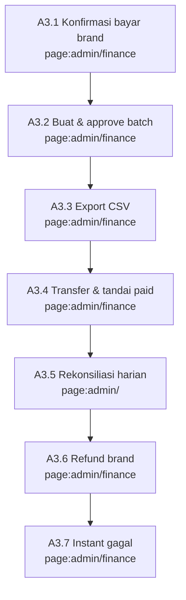

### J-A4 — Moderasi, banding & fraud

| Langkah | Layar | URL | User lihat → lakukan | Sistem | Lanjut ke · cabang |
|---|---|---|---|---|---|
| A4.1 Moderasi submisi | `page:admin/review` | admin.{domain}/review | Lihat: Antrean berfilter, preview embed, histori banding. Lakukan: Approve/reject massal dengan alasan standar; putus banding. | record_review → S-03 + notifikasi submisi approved/rejected. `api:rpc core.record_review`, `table:tracking.submissions` | Clipper melihat hasil di app.{domain}/tasks. |
| A4.2 Fraud queue | `page:admin/fraud` | admin.{domain}/fraud | Lihat: Sinyal FR-xx per submisi/akun dengan skor. Lakukan: Tahan, reverse earning, suspend, atau ban. | resolve_fraud_flag → reverse_earning / status E-01 (suspend 30 hari atau banned) + riwayat Trust Score E-40. Ban juga memanggil identity admin-auth: ban_duration → refresh token ditolak; access token yang sudah terbit tetap sah ≤ 10 menit, jadi fungsi claim/withdraw di core menolak lewat status E-01. `api:rpc core.resolve_fraud_flag`, `fn:reverse_earning`, `table:market.profiles`, `api:fn identity/admin-auth`, `table:trust.score_events` | Clipper menerima notifikasi; ban = cabut semua sesi (J-C2 C2.1). |

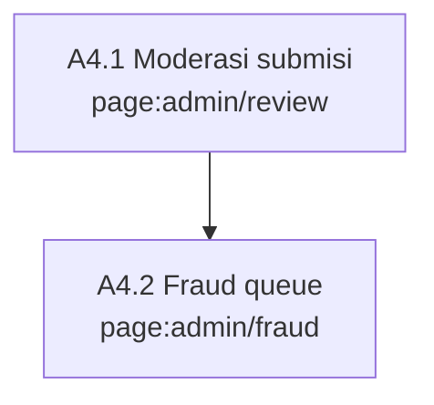

### J-A5 — Fulfillment reward non-tunai

| Langkah | Layar | URL | User lihat → lakukan | Sistem | Lanjut ke · cabang |
|---|---|---|---|---|---|
| A5.1 Kirim reward | `page:admin/fulfillment` | admin.{domain}/fulfillment | Lihat: Antrean klaim per reward type. Lakukan: Export data penerima, kirim ke brand atau isi kode, Tandai terkirim. | pii-export membuat CSV penerima hanya untuk user dengan consent share_with_brand (E-28); status E-18 delivered → notifikasi Reward terkirim. `api:fn identity/pii-export`, `table:finance.fulfillments`, `fn:enqueue_notification` | Clipper melihat status di app.{domain}/wallet. Cabang: Tanpa consent share_with_brand → tidak ikut export, user diminta memberi consent. |

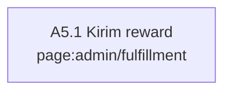

### J-A6 — Broadcast, pinned & config

| Langkah | Layar | URL | User lihat → lakukan | Sistem | Lanjut ke · cabang |
|---|---|---|---|---|---|
| A6.1 Broadcast | `page:admin/broadcast` | admin.{domain}/broadcast | Lihat: Judul, isi, segmen (platform, Trust Score, KYC, aktif N hari), kanal (in-app, email, push), jadwal. Lakukan: Jadwalkan. | api.send_broadcast → E-42 → job broadcast-dispatch → enqueue_notification per penerima (email promosi ikut preferensi E-34). `api:rpc core.send_broadcast`, `table:ops.broadcasts`, `job:broadcast-dispatch` | Jumlah penerima tercatat. |
| A6.2 Pinned & kategori | `page:admin/pinned` | admin.{domain}/pinned | Lihat: Urutan pinned (termasuk pin berbayar), kategori, banner beranda. Lakukan: Atur. | api.update_config → E-06 pinned_rank/pinned_until, E-32 kategori, banner di E-25 public.home.banners; tercatat di audit log. `api:rpc core.update_config`, `table:market.categories`, `table:ops.settings` | — |
| A6.3 Config | `page:admin/config` | admin.{domain}/config | Lihat: Fee rule, hold, minimum withdraw, ambang instant, interval polling, aturan claim, persen bonus referral, feature flag per platform. Lakukan: Ubah (admin_super). | api.update_config → E-25 / E-21; audit log sebelum/sesudah. `api:rpc core.update_config`, `table:ops.settings`, `table:finance.fee_rules` | — |

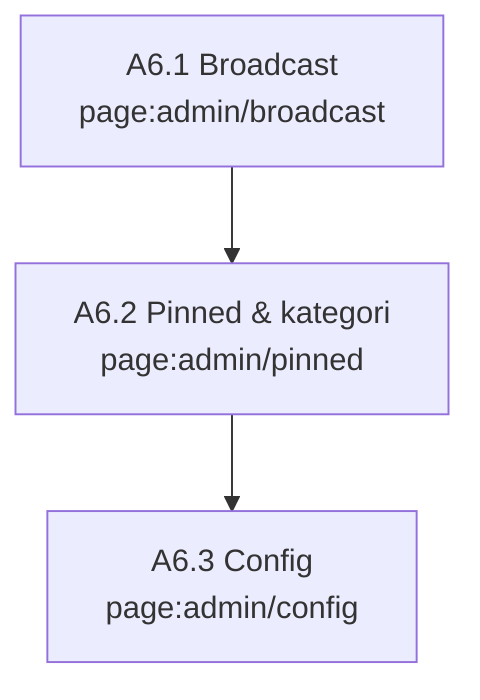

### J-A7 — Paket managed — brief brand jadi campaign

| Langkah | Layar | URL | User lihat → lakukan | Sistem | Lanjut ke · cabang |
|---|---|---|---|---|---|
| A7.1 Antrean paket managed | `page:admin/campaigns` | admin.{domain}/campaigns (tab Paket managed) | Lihat: Draft service_mode managed, terlama di atas — org, PIC, brief mentah, berkas internal (signed URL), tanggal minta. Lakukan: Ambil → buka di builder admin. | api.campaigns (service_mode managed, status draft; index campaigns_managed_queue_idx) + api.campaign_assets audience internal; admin_ops aal2. `table:market.campaigns`, `table:market.campaign_assets`, `table:bucket.campaign-assets` | admin.{domain}/campaigns/new?campaign=[id]. Cabang: Brief mentah kurang jelas → hubungi PIC brand; draft tetap di antrean. |
| A7.2 Susun di builder admin | `page:admin/campaigns/new` | admin.{domain}/campaigns/new?campaign=[id] | Lihat: Builder yang sama dengan brand (packages/campaign-builder) + override fee; brief mentah & berkas internal di panel samping. Lakukan: Lengkapi 7 langkah (brief terstruktur, rate, budget, eligibility, jadwal) → Kirim ke brand. | save_campaign (admin_ops, aal2) mengisi kolom brief terstruktur E-06, rate E-08, pool E-09; invoice managed_service E-22; notifikasi ke brand bahwa draft siap disetujui. `comp:CampaignBuilder`, `api:rpc core.save_campaign`, `table:finance.invoices`, `fn:enqueue_notification` | Brand menyetujui ringkasan dan membayar di brand.{domain}/[org]/campaigns/new (J-B1 B1.7–B1.8). Cabang: Brand minta revisi → draft tetap draft, brief masih bisa diubah. |

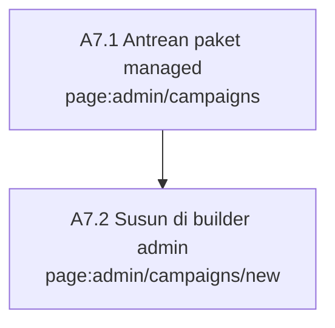

## Temuan

Masalah sistem yang ditemukan saat menyusun PRD v0.2 dan saat dicek ulang (v0.2.1–v0.3.1).

| Tanggal | Node | Temuan | Status |
|---|---|---|---|
| 2026-10-15 | `table:finance.reward_pools` | `allocated` = sumber kebenaran kedua selain saldo akun campaign_pool di ledger (E-14) | diperbaiki di PRD: allocated = cache, hanya ditulis accrue_earnings dalam transaksi yang sama |
| 2026-10-15 | `table:market.profiles` | E-01 lama mencampur identitas (kyc_status), otorisasi (roles), dan marketplace (trust_score) | diperbaiki: dipecah ke E-01 core, E-27 identity, claim kyc |
| 2026-10-15 | `table:member.kyc_records` | Hanya simpan nik_hash, padahal bukti potong PPh 21 butuh NIK asli | diperbaiki: tambah nik_enc |
| 2026-10-15 | `table:finance.payouts` | proof_url & file_url batch berisi nomor rekening (PII) di DB core | diperbaiki: proof_ref/file_ref ke bucket identity |
| 2026-10-15 | `table:member.payout_methods` | E-16 lama tidak punya id padahal dirujuk E-17.method_id | diperbaiki: tambah id + account_no_hash |
| 2026-10-15 | `table:brand/market.org_invites` | F-B01 "undang member" tanpa entitas undangan | diperbaiki: E-30 tanpa email |
| 2026-10-15 | `page:www/` | Menu nav & CTA lintas host belum didesain (edge routes-to bertanda ?) | diperbaiki v0.2.3: journey per layar + menu (§6), 0 edge navigasi bertanda ? |
| 2026-10-15 | `page:accounts/kyc` | Journey: KYC dikirim tanpa kabar keputusan (F-X01 tidak punya event KYC) | diperbaiki v0.2.3: record_review mencatat keputusan KYC + notifikasi KYC disetujui/ditolak |
| 2026-10-15 | `page:brand/[org]/billing` | Journey: brand tidak dikabari invoice terbit (F-X01) | diperbaiki v0.2.3: event Invoice terbit |
| 2026-10-15 | `table:tracking.social_accounts` | Journey: satu akun sosmed bisa terhubung ke dua akun clipper (E-04 tanpa unique) | diperbaiki v0.2.3: unique platform + external_id |
| 2026-10-15 | `page:accounts/login` | Journey: parameter next tanpa allowlist (open redirect); dari KYC/rekening tidak ada jalan kembali ke withdraw | diperbaiki v0.2.3: allowlist host + next di semua link lintas host |
| 2026-10-15 | `page:accounts/security` | Journey: MFA admin ditaruh di accounts.{domain} padahal accounts menolak sesi admin | diperbaiki v0.2.3: TOTP admin didaftarkan di admin.{domain}/login |
| 2026-10-15 | `page:accounts/privacy` | Journey: hak akses data (UU PDP) tanpa alur | diperbaiki v0.2.3: Unduh data saya dari kedua DB, tanpa alur lintas DB baru |
| 2026-10-15 | `api:GET accounts/auth/confirm` | Journey: undangan email brand (MVP) tanpa route penerima | diperbaiki v0.2.3: /auth/confirm (token_hash) |
| 2026-10-15 | `page:app/login` | R-17 ditulis seolah MVP, padahal PWA = V1 (F-C14) | diperbaiki v0.2.3: R-17 berlaku mulai V1 |
| 2026-10-15 | `config:tpa-oidc-identity` | v0.2: core percaya JWT identity lewat private key identity yang di-import ke core sebagai standby. Pola ini tidak didokumentasikan untuk dua project (tabel status key di docs ambigu soal standby) dan membuat core memegang private key identity | diperbaiki v0.2.1: Third-Party Auth → Custom OIDC; v0.2.2: discovery & iss terbukti dari kode Supabase Auth, sisa uji kombinasi di spike R-14 (open) |
| 2026-10-15 | `config:supabase.identity` | v0.2.1: login email OTP (F-C01) tanpa SMTP custom; SMTP bawaan cuma 2 email/jam dan hanya ke anggota tim | diperbaiki v0.2.2: SMTP Resend, rate limit dinaikkan, template {{ .Token }}, DMARC |
| 2026-10-15 | `mod:auth` | v0.2.1: tanpa CAPTCHA, bot bisa menguras kuota email OTP | diperbaiki v0.2.2: Turnstile di Auth identity |
| 2026-10-15 | `policy:core.admin-aal2` | v0.2.1: role/kyc dari claim JWT bisa basi sampai 1 jam; token tetap sah setelah ban/hapus akun | diperbaiki v0.2.2: JWT 10 menit, cabut sesi saat ban/hapus, fungsi uang & claim cek status E-01 |
| 2026-10-15 | `api:fn creator/track-worker` | v0.2.1: aturan semua Edge Function verifikasi JWT identity salah untuk worker pg_cron; Queue lewat supabase-js butuh pgmq_public diekspos | diperbaiki v0.2.2: secret key di header apikey + koneksi Postgres langsung |
| 2026-10-15 | `policy:core.api-only` | v0.2.1: Postgres memberi EXECUTE fungsi baru ke PUBLIC; Data API default mengekspos public | diperbaiki v0.2.2: cabut EXECUTE default, ekspos hanya api, advisors di CI |
| 2026-10-15 | `config:host.app` | v0.2.1: Vercel default region iad1 (AS) dan Hobby dilarang komersial, tidak disebut | diperbaiki v0.2.2: Pro + sin1 |
| 2026-10-15 | `page:app/login` | v0.2.1: PWA iOS punya cookie terpisah dari Safari, padahal login hanya di accounts.{domain} (di luar scope PWA) | diperbaiki v0.2.2: /login di app.{domain}; uji Fase 0 R-17 open |
| 2026-10-15 | `ext:supabase-core` | v0.2.1: biaya tanpa PITR (wajib di §16, butuh compute Small) dan tanpa Third-Party MAU | diperbaiki v0.2.2: ±US$255/bulan + US$0,0065 per user di atas 100.000 |
| 2026-10-15 | `ext:supabase-identity` | v0.2.1: region, transfer data ke luar negeri (UU PDP Pasal 56), dan pendaftaran PSE tidak disebut | diperbaiki v0.2.2: Singapura + DPA, consent sebagai cadangan; PSE lewat OSS sebelum launch |
| 2026-10-15 | `ext:supabase-core` | Caption gambar arsitektur v0.1 menyebut Xendit padahal D-02 tanpa payment gateway | diperbaiki: gambar & caption baru |
| 2026-10-15 | `api:fn identity/pii-export` | Review: export tidak menulis balik ke core; payout yang gagal cek bisa ikut ditandai paid | diperbaiki: approve 2 orang dulu, attach_export + hold (alur 3) |
| 2026-10-15 | `table:finance.payouts` | Review: method_id dari browser tidak dicek pemiliknya | diperbaiki: pii-export cek pemilik rekening = pemilik payout |
| 2026-10-15 | `config:host.app` | Review: staging stg-*.{domain} ikut menerima cookie SSO produksi | diperbaiki: staging di domain terdaftar lain + project sendiri |
| 2026-10-15 | `config:identity-signing-key` | Review: core ikut memegang private key ES256 | diperbaiki v0.2.1: core tidak memegang key apa pun |
| 2026-10-15 | `env:PII_ENC_KEY` | v0.2: kunci PII disebut di Vault identity (satu DB dengan ciphertext) sekaligus dipegang Edge Function — tidak konsisten, dan akses SQL saja cukup untuk membuka PII | diperbaiki v0.2.1: kunci = secret Edge Function; tulis lewat member-data; SQL simpan khusus service role supaya hash dari fungsi tidak bisa dipalsukan browser |
| 2026-10-15 | `config:supabase.core` | v0.2: bullet schema_paths + "grant tidak ditangkap diff" salah untuk pg-delta (default supabase init baru): schema_paths diabaikan, grant diperlakukan sebagai bagian schema oleh diff | diperbaiki v0.2.1 (§15.3) |
| 2026-10-15 | `policy:core.admin-aal2` | v0.2: IP allowlist admin via header x-forwarded-for di fungsi belum terbukti bisa dipercaya | dicoret v0.2.1; IP/zero-trust hanya di depan halaman admin |
| 2026-10-15 | `policy:core.iss-identity` | Review: view default & fungsi definer melewati RLS | diperbaiki: view security_invoker, fungsi definer cek iss/role/aal |
| 2026-10-15 | `table:finance.reward_pools` | Review: reversal tidak mengembalikan allocated | diperbaiki: fn:reverse_earning |
| 2026-10-15 | `table:tracking.submissions` | kg.yaml unique [url] vs §11 "kecuali campaign mengizinkan" (warisan v0.1) | diperbaiki v0.3: kunci video = platform + post_id per campaign (UNIQUE); lintas campaign hanya kalau allow_video_reuse |
| 2026-10-16 | `policy:core.api-only` | ALTER DEFAULT PRIVILEGES per schema tidak bisa mencabut EXECUTE fungsi dari PUBLIC (hak global); dibuktikan di Postgres 16: per-schema → anon tetap bisa EXECUTE | diperbaiki v0.3: dicabut global FOR ROLE postgres + revoke per fungsi; tes: anon hanya bisa EXECUTE report_by_token |
| 2026-10-16 | `config:supabase.core` | pg-delta harus dinyalakan [experimental.pgdelta]; engine migra membuang security_invoker dari view → semua view api melewati RLS | diperbaiki v0.3: config.toml kedua project enabled = true + tes pgTAP semua view api security_invoker |
| 2026-10-16 | `policy:core.rls-org` | Helper policy security invoker butuh USAGE schema internal → permission denied untuk authenticated (tes core_access) | diperbaiki v0.3: semua helper policy security definer + search_path kosong |
| 2026-10-16 | `table:market.campaign_invites` | Policy campaign privat lewat subquery ke campaign_invites → rekursi tak hingga (policy invites membaca campaigns) | diperbaiki v0.3: market.is_invited() security definer |
| 2026-10-16 | `table:market.campaigns` | Policy publik dengan subquery ke tabel yang tidak boleh dibaca anon → error hak akses walau kondisinya tidak terpakai | diperbaiki v0.3: policy anon dan authenticated dipisah |
| 2026-10-16 | `finance.fee_rules` | Policy fee_rules dengan subquery ke organizations/campaigns + FK sebaliknya = siklus urutan file (pg-delta mengurutkan per file) | diperbaiki v0.3: finance.fee_rule_visible() plpgsql |
| 2026-10-16 | `api:rpc identity.my_payout_methods` | Fungsi security invoker membaca member.* → butuh USAGE schema member untuk authenticated | diperbaiki v0.3: security definer + filter auth.uid() eksplisit |
| 2026-10-16 | `page:accounts/onboarding` | Onboarding: consent ditulis sebelum profil; gagal di tengah = user lolos gate tanpa profil core | diperbaiki v0.3: ensure_profile dulu, consent terakhir, gate = claim consent_ok |
| 2026-10-16 | `page:accounts/onboarding` | Tidak ada batas umur, padahal data anak wajib persetujuan orang tua (UU PDP Pasal 25; anak = < 18 tahun, UU 23/2002) | diperbaiki v0.3: pernyataan 18+ (consent age_18_plus) + cek umur dari NIK di member-data; batas 21 (KUHPerdata 330) → konsultan |
| 2026-10-16 | `table:market.profiles` | Username tanpa UNIQUE; foto profil tanpa bucket | diperbaiki v0.3: UNIQUE username (huruf kecil) + bucket avatars |
| 2026-10-16 | `api:fn identity/admin-auth` | admin_invite_user ditulis sebagai RPC SQL, padahal invite & ban butuh Auth Admin API + secret key; tidak ada admin sign-out per user | diperbaiki v0.3: Edge Function admin-auth (invite, ban_duration, reset MFA); ban juga lewat status E-01 |
| 2026-10-16 | `table:member.kyc_records` | Hapus akun cascade menghapus hash NIK, padahal akun ter-ban harus tidak bisa daftar ulang dan NIK wajib disimpan untuk PPh 21 | diperbaiki v0.3: tombstone (user_id NULL, blocked / retain_until) dicek constraint; hapus user tanpa keputusan retensi ditolak |
| 2026-10-16 | `page:brand/[org]/billing` | brand_owner bisa billing tanpa MFA, padahal brand_finance wajib MFA | diperbaiki v0.3: aksi uang brand butuh aal2 siapa pun role-nya |
| 2026-10-16 | `page:www/r/[token]` | F-B09 link laporan read-only tanpa URL & tabel | diperbaiki v0.3: {domain}/r/[token] + E-33 (sha256 token) + report_by_token |
| 2026-10-16 | `page:brand/new` | Journey brand hanya MVP managed; self-serve (F-B01/F-B02) tanpa layar | diperbaiki v0.3: J-B1 self-serve 9 langkah + J-B3 kelola campaign; paket managed jadi cabang |
| 2026-10-16 | `job:earning-release` | Job pg_cron memanggil 6 fungsi kontrak yang belum ditulis (release_earnings, run_lifecycle, run_budget_alerts, accrue_referral_bonus, recalc_scores, dispatch_broadcasts) → job gagal tiap jalan | ditandai v0.3: TODO pgTAP di core_access (lulus sendiri begitu fungsinya ada); PRD Lampiran A.4 |
| 2026-10-16 | `api:fn identity/admin-auth` | PRD §15.6 menulis ban & hapus akun "mencabut semua sesi", padahal Auth Admin tidak punya sign-out per user id dan access token tetap diterima Data API sampai exp | diperbaiki v0.3: ban_duration (refresh ditolak) + status E-01 dicek fungsi core; token lama hidup ≤ 10 menit |
| 2026-10-16 | `api:fn identity/disburse` | PRD §15 menulis uang tidak lewat API dan Edge Functions tidak memindahkan uang, padahal instant withdraw (F-C15) membayar lewat API disbursement | diperbaiki v0.3: §15 + alur 11; disburse satu-satunya Edge Function yang memindahkan uang |
| 2026-10-16 | `config:supabase.core` | PRD §15.3 menyebut pg-delta bawaan supabase init; docs: opt-in lewat [experimental.pgdelta]. Docs juga: objek di schema platform (auth, storage) tidak dilacak | diperbaiki v0.3 §15.3; open: cek di Fase 0 apakah policy storage.objects ikut migration, kalau tidak → migration manual |
| 2026-10-16 | `api:rpc core.request_refund` | Draf PRD v0.3 mewajibkan aal2 untuk top-up & beli pinned, sedangkan journey (aturan pindah host) dan contracts.yaml hanya untuk aksi yang menggerakkan uang brand | diperbaiki v0.3 (saat menulis notes developer): aal2 = request_refund (refund & rollover) + semua admin; top-up & pinned cuma menerbitkan invoice |
| 2026-10-19 | `table:market.campaigns` | Brief cuma satu kolom teks bebas: hashtag/mention/link wajib, durasi, do/don't, contoh, FAQ tidak punya tempat → core/social tidak bisa cek caption otomatis | diperbaiki v0.3.1: kolom brief terstruktur + constraint format + api.missing_brief_tags (sheet Submit, core/social, track-worker) |
| 2026-10-19 | `table:market.campaigns` | Brief bisa diubah setelah campaign diajukan/live → clipper yang sudah posting dinilai dengan aturan baru | diperbaiki v0.3.1: trigger campaigns_brief_frozen; sejak in_review yang boleh diubah hanya FAQ |
| 2026-10-19 | `page:admin/campaigns/new` | Paket managed: brief mentah & berkas brand tidak punya tempat (tim "menghubungi" di luar sistem) | diperbaiki v0.3.1: builder Dibantu tim → service_mode managed + berkas audience internal (folder internal/, tidak terlihat clipper) → antrean J-A7 |
| 2026-10-19 | `fn:org_role` | Join agency di ops.org_role tidak memeriksa link approved/revoked → anggota agency yang link-nya dicabut tetap dapat role di org klien | diperbaiki: syarat approved_at not null & revoked_at null (db/core/supabase/schemas/ops/_auth.sql) |
| 2026-10-19 | `spec/kg.yaml` S-01, S-05 | Transisi hilang: in_review → cancelled, paused → tracking/exhausted, payout paid → failed (bank memantulkan transfer) | diperbaiki di kg.yaml + state_triggers.sql dibangkitkan ulang |
| 2026-10-19 | `api:rpc core.*` (parameter enum) | RPC dengan parameter bertipe enum schema internal lolos pgTAP (literal) tapi 42501 lewat PostgREST (role API tanpa USAGE schema itu) | diperbaiki: parameter text + cast di dalam fungsi definer; tes struktural mencegah regresi |
| 2026-10-19 | `table:finance.ledger_entries` | Constraint trigger saldo seimbang (deferred) jalan saat COMMIT sebagai authenticated → semua RPC yang menulis ledger gagal 42501 lewat Data API; pgTAP menyembunyikannya karena rollback | diperbaiki: finance.check_txn_balanced security definer + tes `set constraints all immediate` |
| 2026-10-19 | `api:fn identity/pii-export` | Action audit `pii.export_pph21` melanggar CHECK member.audit_logs (tanpa angka) → ekspor PPh 21 selalu 500; unit test lolos karena rpc dimock | diperbaiki: `pii.export_tax` + tes yang memindai semua literal action terhadap regex CHECK |
| 2026-10-19 | `table:finance.ledger_accounts` (org_credit) | Rollover sisa budget masuk org_credit tapi tidak ada jalan memakainya ("kredit dipakai campaign berikutnya" tidak terimplementasi) | diperbaiki: api.pay_invoice_with_credit + api.org_credit (saldo, tersedia, riwayat, sisa per campaign dari ledger) |
| 2026-10-19 | `api:rpc core.list_campaigns` | Kartu & detail campaign tidak bisa menampilkan nama brand: organizations hanya terbaca anggota | diperbaiki: brand_name/brand_verified (list_campaigns) dan brand (campaign_detail); filter slug untuk {domain}/c/[slug] |
| 2026-10-19 | `api:fn identity/notify` (template) | Payload SQL ≠ asumsi template email: campaign.new kirim platforms[], earning.available amounts[], claim.expiring tanpa judul | diperbaiki di template + payload claim.expiring; tes regresi memakai bentuk payload SQL asli |
| 2026-10-19 | `mod:db-identity` | identityApi hanya cast tipe → client sesi memakai schema public → PGRST106 bila pemanggil lupa .schema('api') | diperbaiki: identityApi memilih schema api |
| 2026-10-19 | `table:ops.settings` | hold_days, biaya transfer refund, auto-approve review brand bukan public.* → app menebak default | diperbaiki: pindah ke public.* + data migration |
| 2026-10-19 | `page:admin/*` | Back-office tanpa antrean KYC, daftar admin, audit identity, override Trust Score/suspend, tandai fulfillment manual terkirim, upload kode oleh admin (semua di F-A07/F-A10/F-A11) | diperbaiki: admin_kyc_queue, admin_list_roles, api.audit_logs (identity); manage_user, mark_fulfillment_delivered, upload_reward_codes admin_ops, admin_profiles (core) |
| 2026-10-19 | `table:trust.review_decisions` | "Alasan standar" (F-A05, F-B07) tidak didefinisikan; brand & admin punya daftar sendiri yang beda kode | diperbaiki: REJECT_REASONS + common.rejectReasons di @clipper/i18n dipakai brand, admin, clipper |
| 2026-10-19 | `page:accounts/onboarding`, `page:accounts/invite/[token]` | ensure_profile tanpa avatar & pesan error teks bebas; halaman undangan tidak bisa menampilkan org/role | diperbaiki: p_avatar_path + kode mesin; api.invite_preview (token = kapabilitas) |
| 2026-10-19 | `page:www/` | Kalkulator biaya landing memakai 15% + 5% hardcode → basi kalau fee global diubah admin | diperbaiki: rule fee global terbaca anon (policy core.public-read), default PRD hanya cadangan |
| 2026-10-19 | `test:rls.access-matrix` | Tes di stack lokal ikut menghitung data uji manual (profil, antrean pgmq, objek storage) | diperbaiki: tiap tes mengosongkan semua tabel domain + antrean + objek bucket dulu (di-rollback) |
| 2026-10-19 | `scripts/dev-stack.sh` | Clone baru gagal start (kunci signing dev gitignored), link unduh PII menunjuk http://kong:8000, CSP memblokir gambar storage http lokal, /icon.svg ter-redirect ke login | diperbaiki: kunci ES256 dibuat otomatis, PUBLIC_SUPABASE_URL, img-src origin Supabase, matcher proxy |
| 2026-10-19 | `table:member.legal_versions` | URL dokumen wajib https (CHECK) → link ToS/privasi di onboarding lokal (http) rusak | diperbaiki: onboarding menautkan {domain}/legal/<doc> seperti login (versi tetap dari E-31); CHECK https dipertahankan |
| 2026-10-19 | `api:rpc core.confirm_invoice_payment`, `api:rpc core.create_payout_batch`, `api:rpc core.mark_batch_paid` | F-A11 "semua aksi admin/finance tercatat" belum terpenuhi: ketiga fungsi tidak menulis `ops.audit_logs` (record_review, update_config, manage_org, manage_user, resolve_fraud_flag, cancel_payout, cancel_fulfillment menulis) | diperbaiki: audit di semua mutasi admin/finance (confirm_invoice_payment, create/approve/mark_batch_paid, approve_refund, resolve_alert, save_campaign/save_reward_type/upload_reward_codes jalur admin) + tes struktural: fungsi api ber-has_admin yang menulis data wajib menulis ops.audit_logs |
| 2026-10-19 | `job:reconcile-daily` | Komentar finance/cron.sql menyebut ledger dibandingkan dengan mutasi bank, padahal reconcile_ids hanya mencocokkan ID profil/rekening/penerima dengan identity (api.bridge_collect_ids) | diperbaiki: finance.reconcile_ledger (cache pool, saldo negatif, invoice lunas tanpa jurnal & sebaliknya → alert reconcile.ledger) dijalankan job yang sama sebelum reconcile_ids; komentar disesuaikan |
| 2026-10-19 | `KNOWLEDGE_GRAPH.md` (check_graph.py) | Regex bukti `file:line` tidak menerima tanda kurung, jadi baris kode di route group `(account)`, `(auth)`, `(console)` tidak bisa dicek otomatis; edge page accounts/admin memakai `kode baris N` | open |
| 2026-10-19 | `table:finance.payouts` | Alasan payout gagal tidak disimpan; bank_ref/provider_ref tidak terbaca admin → payout instant macet tidak bisa ditelusuri | diperbaiki: payouts.last_error (disburse + reason di mark_batch_paid), api.payouts membawa bank_ref/provider_ref/last_error |
| 2026-10-19 | `api:fn identity/pii-export` | CSV batch hanya bisa diunduh sekali (get_batch menolak batch exported) | diperbaiki: batch exported → link baru untuk berkas yang sama tanpa dekripsi ulang, tercatat audit |
| 2026-10-19 | `page:www/r/[token]` | Link laporan tidak valid mengembalikan HTTP 200 (loading.tsx memaksa streaming) | diperbaiki: tanpa loading.tsx → notFound() = 404 |
| 2026-10-19 | `scripts/dev-stack.sh` | Setelah Docker/mesin restart hanya container db yang hidup; `supabase start` menganggap stack jalan, Edge Function mati | diperbaiki: cek edge runtime, stop/start ulang bila mati |
| 2026-10-19 | `api:rpc core.cancel_payout` | Review Claudex R1: payout requested di batch yang sudah approved bisa dibatalkan → dana kembali ke Tersedia sekaligus ikut CSV transfer | diperbaiki: batch_locked (batch ≠ draft, FOR SHARE serial dengan approve) |
| 2026-10-19 | `fn:accrue_earnings` | Review Claudex R1: koreksi turun final gagal bila views turun di bawah awal rule yang lebih baru (views_to < views_from) | diperbaiki: finance.correct_down menjepit views_to ke [views_from, p_views] |
| 2026-10-19 | `mod:auth` | Review Claudex R1–R2: safeNext bisa dibypass karakter kontrol/backslash lalu normalisasi dot-segment menghasilkan `//evil` (open redirect) | diperbaiki: normalisasi WHATWG URL terhadap origin dummy, tolak hasil yang beda origin atau diawali `//`; tes di apps/accounts/src/lib/lib.test.ts |
| 2026-10-19 | `table:finance.fulfillments` | Review Claudex R2–R4: klaim webhook bisa dibatalkan (refund) saat/ sesudah kiriman yang hasilnya tidak pasti (timeout, 5xx, worker mati) → reward terkirim + saldo kembali | diperbaiki: lease 5 menit (leased_until), delivery_uncertain (gagal non-4xx atau lease kedaluwarsa diambil ulang), cancel_fulfillment menolak saat lease hidup (delivery_in_flight) dan butuh konfirmasi tidak terkirim (delivery_unconfirmed); dialog admin punya centang konfirmasi |
| 2026-10-19 | `api:fn identity/pii-export` | Review Claudex R3–R4: isi CSV batch/penerima bisa beda dengan DB saat serah-terima (tahan, batal), export paralel menimpa berkas yang sudah diterima, respons hilang + retry bridge membuat serah-terima reward manual gagal lalu berkasnya dihapus | diperbaiki: core menerima daftar id persis di CSV (export_stale bila beda), nama berkas unik per percobaan, re-sign memakai file_ref batch, serah-terima reward idempoten untuk berkas yang sama, berkas dihapus hanya bila core menolak (4xx) |
| 2026-10-19 | `api:rpc core.resolve_fraud_flag` | Review Claudex R4: hold flag payout pada instant requested (sedang dikirim ke penyedia) membuka cancel + refund saat transfer berjalan. Belum terjangkau (belum ada sumber flag bertarget payout) | diperbaiki: hold hanya menahan payout batch |
| 2026-10-19 | `fn:accrue_earnings` | Review Claudex R5: raise_rate flat_per_post membuat rule baru → once_paid per rule_id kosong → post yang sudah dibayar dibayar lagi penuh | diperbaiki: flat dianggap sudah dibayar bila versi rule mana pun (pool, kind, platform sama) sudah once_paid |
| 2026-10-19 | `page:admin/fulfillment` | Review Claudex R5: CSV penerima yang sudah diserahkan tidak bisa diunduh ulang (link 15 menit kedaluwarsa / respons hilang) → klaim processing tanpa daftar penerima | diperbaiki: api.fulfillment_exports + aksi pii-export recipients_resign (prefix reward type, tanpa dekripsi ulang, tercatat audit) + tombol Unduh ulang |
| 2026-10-19 | `fn:accrue_earnings` | Review Claudex R6: perbaikan R5 menganggap flat lain di pool+platform yang sama (bukan revisi) sudah dibayar → bayaran yang dijanjikan hilang | diperbaiki: market.rate_rules.lineage_id diisi raise_rate (rule pertama yang digantikan); flat dicek per lineage |
| 2026-10-19 | `api:rpc core.save_campaign` | Review Claudex R6: invoice lunas saat in_review lalu campaign ditolak → brand bisa mengganti pool (total IDR sama) → saldo ledger pool lama yatim, pool baru kosong | diperbaiki: setelah lunas, set pool (id, reward type, total) wajib sama (pools_locked_after_payment); max_per_clip tetap boleh |
| 2026-10-19 | `api:fn identity/pii-export` | Review Claudex R6: recipients_resign bisa melepas CSV yang tidak pernah diterima core; replay serah-terima ditolak bila klaim sudah delivered | diperbaiki: re-sign wajib bridge fulfillment_export_accepted; replay mengenali berkas dari export_ref apa pun statusnya |
| 2026-10-19 | `api:rpc core.control_campaign` | Review Claudex R7: raise_rate tiered_cpm hanya membandingkan rate & from → tier terakhir terbuka bisa diberi plafon `to` → views di atasnya tidak dibayar di campaign live | diperbaiki: batas `to` tiap tier wajib sama |
| 2026-10-19 | `fn:accrue_earnings` | Review Claudex R7: migrasi lineage_id tidak mengisi revisi raise_rate yang sudah ada → flat dibayar ulang di DB yang sudah berjalan | diperbaiki: migrasi backfill_rate_rule_lineage menyambung rule yang mulai tepat saat versi sebelumnya ditutup (pool/kind/platform sama); rule independen tidak tersambung (diuji di transaksi rollback) |
| 2026-10-19 | `api:rpc core.control_campaign` | Review Claudex R8: batas tier berupa string non-angka ("1e4") lolos market.check_rule_params (jnum = null) tapi dibaca finance.rule_amount sebagai plafon | diperbaiki: `to` selain angka/null ditolak |
| 2026-10-19 | `fn:accrue_earnings` | Review Claudex R8: backfill lineage melewati versi yang sudah ber-lineage_id (raise pasca-R6 di atas rantai pra-R6) → root beda → flat dibayar ulang | diperbaiki: backfill menelusuri seluruh rantai dari rule pertama dan menyeragamkan semua versi; R9: sebagai migrasi baru (backfill_rate_rule_lineage_full_chain), migrasi R7 dikembalikan ke isi asli supaya DB yang sudah menjalankannya ikut terperbaiki |
| 2026-10-19 | `table:market.referrals` | Review Claudex R8: referral baru berlaku saat withdraw pertama (core baru melihat claim kyc di request_payout) → earning teman antara KYC disetujui dan withdraw pertama tidak dihitung | diperbaiki: record_review('kyc','approve') di core mengisi qualified_at/bonus_until; request_payout tetap cadangan |
| 2026-10-19 | `table:finance.fee_rules` | Review Claudex R10: clipper_fee_pct bisa diatur admin (config global, override org/campaign) tapi tidak pernah dipotong → setting diam-diam tidak berlaku. PRD: potongan earning clipper ada di config (default 0%) untuk dinyalakan kelak | diperbaiki: finance.release_earnings memotong fee rule efektif campaign saat Rupiah Tertunda → Tersedia, ke platform_revenue (ref fee); non-tunai tidak dipotong. api.campaign_detail membawa clipper_fee_pct; detail campaign di app clipper menampilkan potongan bila > 0 |
| 2026-10-19 | `api:fn core/fulfill` | Review Claudex R11: klaim voucher on_hold karena pool kode kosong tidak pernah lanjut setelah kode diunggah ulang (worker hanya ambil requested, assign_code menolak on_hold) → saldo sudah terpotong, voucher tak terkirim | diperbaiki: worker_fulfillments_due ikut mengambil on_hold code_pool_empty bila ada kode bebas atau kodenya sudah terpasang (R12: worker mati sebelum hasil tercatat); worker_assign_code menerimanya (S-06 on_hold → processing → delivered) |
| 2026-10-19 | `api:rpc core.buy_pin` | Review Claudex R13: pin_until dikunci saat invoice terbit → bayar telat = hari pin berkurang (lewat 7 hari = tidak dapat pin) | diperbaiki: invoices.pin_days; settle_invoice menerapkan pin sejak lunas (atau sejak pin berjalan habis), campaign dikunci, pin_until invoice diganti periode sebenarnya |
| 2026-10-19 | `api:rpc core.record_review` | Review Claudex R13: campaign managed bisa di-approve & tayang walau invoice managed_service belum lunas; halaman review admin hanya menampilkan invoice budget | diperbaiki: approve butuh managed_service lunas (invoice_unpaid); review-detail admin menampilkan invoice paket managed |
| 2026-10-19 | `api:rpc core.buy_pin` | Review Claudex R14: invoice pin yang terbit sebelum pin_days ada tetap memakai pin_until absolut → dibayar telat = tanpa pin | diperbaiki: settle_invoice memakai pin_days, atau periode perkiraan invoice (pin_until − issued_at) dibatasi minggu yang dibayar (R15: periode itu memuat sisa pin berjalan), maks 90 hari; selalu sejak lunas |
| 2026-10-19 | `page:admin/users` | Review Claudex R14: Cabut ban hanya membuka ban login identity; profil core yang di-ban fraud queue tetap banned → user tidak bisa claim/submit/withdraw | diperbaiki: api.manage_user aksi unban (wajib alasan, audit; profil closed ditolak); server action unbanUser memanggil identity lalu core, aman diulang |
| 2026-10-20 | `api:fn creator/social` | Audit PRD (Codex G-17/G-3): submisi review auto langsung tracking tanpa keputusan → tanpa notifikasi submission.approved & tanpa kenaikan Trust Score; clean_tenure tidak pernah diberikan | diperbaiki: worker_create_submission melewati trust.apply_submission_decision('auto_approve'); job trust-score memberi clean_tenure tiap 30 hari bersih |
| 2026-10-20 | `api:fn creator/track-worker` | Audit PRD (G-6, G-16): FR-03 hanya untuk akun baru (cabang follower sangat sedikit hilang); error API/rate limit diulang tiap 5 menit tetap tanpa backoff | diperbaiki: FR-03 juga follower < trust.fraud.low_followers (100); backoff 5 mnt × 2^(n−1) maks 6 jam lewat api.worker_retry_later (pgmq set_vt), Retry-After penyedia didahulukan |
| 2026-10-20 | `job:referral-bonus` | Audit PRD (G-7, C5.3): teman satu NIK/rekening/perangkat dengan pengundang tetap dibayar bonus | diperbaiki: bonus dilewati selama ada flag FR-04/FR-05 (belum dismissed) yang menghubungkan keduanya |
| 2026-10-20 | `fn:enqueue_notification` | Audit PRD (G-13, A6.1/C2.5): kanal broadcast diabaikan (selalu email + push + in-app); mematikan email promosi ikut mematikan push | diperbaiki: payload.channels menentukan in_app/email/push (kolom ops.notifications.in_app, view menyaring); preferensi email promosi hanya untuk email; worker notify menghormati flag pesan |
| 2026-10-20 | `page:admin/users` | Audit PRD (G-14, F-A07): ban dari manajemen user hanya ban login → JWT yang masih berlaku tetap bisa claim/submit, status core salah | diperbaiki: banUser juga manage_user core (≤ 365 hari = suspend durasi sama, lebih = ban); unban mencabut ban & suspend; dialog ban wajib alasan |
| 2026-10-20 | `api:fn creator/track-worker` | Review Claudex R16: backoff tertunda tapi penjadwal (lease next_poll_at 1 jam) membuat pesan baru yang memanggil API lebih awal; follower null (YouTube hidden / Threads) dianggap "sedikit" → FR-03 palsu menahan earning | diperbaiki: retry juga worker_defer next_poll_at (penundaan + 1 jam); FR-03 cabang follower hanya bila follower diketahui |
| 2026-10-20 | `page:admin/users` | Review Claudex R16: ban login berdurasi dibulatkan ke hari & > 365 hari jadi ban core permanen | diperbaiki: suspend core sampai banned_until identity persis (manage_user suspend {until}); permanen → ban |
| 2026-10-20 | `page:brand/[org]/campaigns/[id]` | Audit PRD (G-8, §3): eCPM = spend kreator saja (dashboard) / pool Rupiah saja (laporan), bukan total bayar brand | diperbaiki: market.campaign_report menghitung ecpm_idr = (nilai Rp semua pool terpakai × (1 + fee manajemen + admin)) ÷ views valid × 1.000 — satu sumber untuk dashboard & link laporan |
| 2026-10-20 | `page:brand/[org]/campaigns/[id]` | Audit PRD (G-9, F-B08): tidak ada intervensi "notif ke clipper eligible" untuk campaign yang underspend | diperbaiki: control_campaign notify_eligible + tombol & saran di dashboard; announce_campaign sekali per clipper per campaign |
| 2026-10-20 | `page:admin/finance` | Audit PRD (G-10, F-A08): ledger tidak bisa diperiksa dari back-office | diperbaiki: api.admin_ledger (admin_finance) + tab Ledger dengan pencarian transaksi/referensi/pemilik |
| 2026-10-20 | `api:fn creator/track-worker` | Review Claudex R17: di ujung view window worker_defer mentok batas window → penjadwal tetap membuat pesan baru, backoff terpotong | diperbaiki: tracking.submissions.retry_after diisi worker_retry_later; enqueue_due_submissions menunggu retry_after |
| 2026-10-20 | `page:www/` | Audit PRD (G-15, A6.2): banner beranda disimpan admin (public.home.banners) tapi tidak pernah dirender | diperbaiki: HomeBanners + parser aman di @clipper/ui (subpath ./banners tanpa JSX) — landing web & daftar campaign clipper; path tanpa "/" dinormalkan supaya sama dengan validasi admin |
| 2026-10-20 | `api:fn identity/bridge` | Audit PRD (G-12, F-X01 admin): alert operasional (tracking gagal, lonjakan fraud, payout gagal, selisih rekonsiliasi) hanya tercatat di dashboard, tanpa email ke admin | diperbaiki: ops.raise_alert → bridge core notify_admins → identity: email ke admin ber-role terkait + admin_super (svc_admin_ids), maks 1 per jenis per jam, idempoten per alert & admin; ADMIN_URL opsional supaya email lain tidak ikut gagal |
| 2026-10-20 | `fn:accrue_earnings` | Audit PRD (G-2/G-4, §12 & C4.1): Trust Score tidak memengaruhi cap/hold; TikTok tidak punya cap lebih rendah & hold lebih panjang (satu max_per_clip & satu hold global) | diperbaiki: finance.clip_terms(trust, platform) dari public.finance.trust_tiers & public.finance.platform_rules → cap = max_per_clip × cap_pct tier × cap_pct platform (accrue), hold = hold tier minimal hold platform (release); default kode netral, nilai awal di seed; profil clipper menampilkan tier yang berlaku |
| 2026-10-20 | `page:admin/finance` | Review interim (subagent, kuota Codex habis) C18: pencarian ledger dengan UUID submisi/refund tidak menemukan ref "<id>:…"; query OR lintas join tanpa indeks (scan penuh); dedupe announce tanpa indeks; eCPM memakai fee rule hari ini, bukan fee yang ditagih; margin retry_after 5 menit < lease penjadwal | diperbaiki: pencarian dipecah per kolom terindeks + awalan ref untuk UUID, indeks ledger_entries(ref_id text_pattern_ops), indeks parsial notifications campaign.new, eCPM = spend + fee invoice lunas diprorata ke spend, retry_after + 1 jam |
| 2026-10-20 | `api:fn creator/social` | Audit PRD (G-5, F-A06/FR-07): sinyal konten duplikat lintas akun (hash cover) tidak ada | diperbaiki: submit menghitung dHash 64-bit cover (thumbnail JPEG platform, jpeg-js; cover polos/format lain → null) → tracking.submissions.cover_hash; worker_create_submission mem-flag FR-07 bila cover berjarak Hamming ≤ trust.fraud.cover_distance (6) dengan submisi akun sosmed lain ≤ 90 hari |
| 2026-10-20 | `api:rpc core.pay_invoice_with_credit` | Audit PRD ulang (brand AB-2, §5.3 D-09): kredit rollover dipakai membayar invoice campaign berikutnya tetap dikenai fee mgmt/admin + pajak penuh, padahal dijanjikan "tanpa fee baru" | diperbaiki: finance.rollover_available (jurnal rollover − invoices.fee_exempt non-void, dibatasi kredit tersedia); pay_invoice_with_credit menghitung ulang fee & pajak invoice campaign/top-up tanpa porsi rollover, tercatat di fee_exempt dan tampil di invoice brand |
| 2026-10-20 | `page:admin/finance` | Review Claudex R21: sanksi di antara get_batch dan attach_export → CSV basi berisi clipper yang di-ban tetap diterima | diperbaiki: bridge_attach_export mengunci profil di CSV (FOR SHARE) dan menolak export_stale bila finance.payout_block berlaku |
| 2026-10-20 | `page:brand/[org]/campaigns/new` | Audit PRD ulang (brand AB-3): ringkasan biaya builder menjumlahkan nilai pool non-tunai ke Total dibayar (contoh MPL Rp39,7 jt vs invoice Rp27,2 jt) | diperbaiki: costSummary meniru issue_invoice — budgetIdr = pool Rupiah ditagih, nonCashIdr dasar fee saja, creatorValueIdr untuk total budget creator |
| 2026-10-20 | `page:admin/finance` | Audit PRD ulang (admin AA-1/AA-3/AA-7): payout requested milik clipper yang lalu di-ban/suspend/ber-flag tetap masuk batch & CSV; finance tak bisa menahan tanpa refund atau melepas tahan; ban dari manajemen user tidak menghanguskan pending/menghentikan tracking/mengabari | diperbaiki: finance.payout_block satu sumber alasan (create_payout_batch menahan, bridge_get_batch → identity holdReason profile_blocked, sanksi & raise_flag menahan langsung); api.hold_payout / api.release_payout + kartu "Perlu dicek sebelum batch"; trust.apply_ban dipakai fraud queue & manage_user |
| 2026-10-20 | `page:app/wallet/withdraw` | Audit PRD ulang per langkah journey (Codex, clipper AC-1…6): klaim reward ber-PII tetap jalan setelah share_with_brand dicabut (saldo terpotong, tertahan di export); rekening baru dari accounts tidak terpilih (method_id vs method); Tugas Saya menampilkan counted_views (0 sebelum min_views / beku saat flagged) sebagai views terakhir; "Hubungi bantuan" tanpa kontak; leaderboard "Minggu ini" menampilkan minggu terakhir yang ada datanya & per campaign hanya dari submisi sendiri | diperbaiki: claim consent_ok.share_with_brand (hook identity) + request_fulfillment menolak consent_required, form reward menonaktifkan & mengarahkan ke izin, refresh sesi setelah izin; initialMethod membaca method_id; tracking.submissions.last_views dari worker_record_snapshot; public.community.links.support → menu Bantuan + link di profil, withdraw, KYC, keamanan; minggu berjalan (weekStartUtc) + campaign mana pun yang terlihat + link dari detail campaign |
| 2026-10-20 | `job:reconcile-daily` | Review Claudex R19: unggah bukti refund gagal lalu diulang dengan referensi lain → invalid:note tanpa jalan keluar di UI; dua transaksi paralel sama-sama mengirim email alert sejenis; retur bank (payout paid → failed) tidak membuka baris mutasi sampai rekonsiliasi harian | diperbaiki: refund approved boleh ganti referensi tanpa catatan + dialog terisi referensi tersimpan (api.org_refunds.bank_ref); pg_try_advisory_xact_lock per jenis alert (uji 2 sesi: 2 → 1 email); mark_batch_paid, pay_refund, confirm_invoice_payment menjalankan finance.reconcile_bank |
| 2026-10-20 | `job:reconcile-daily` | Review interim C20: refund dibayar tak pernah punya bank_ref & payout boleh tanpa referensi → selamanya "tanpa mutasi" tanpa jalan koreksi; tab Mutasi bank membaca payload alert basi dan dedupe 20 jam menyembunyikan selisih baru; throttle email alert dari notified_at (asinkron) → N alert sejenis dalam satu transaksi = N email per admin (regresi C19) | diperbaiki: referensi wajib (mark_batch_paid; pay_refund setelah api.set_bank_ref yang diisi dialog bukti refund), api.set_bank_ref untuk koreksi (catatan + audit); api.bank_issues dibaca langsung; alert baru hanya untuk selisih yang belum termuat alert terbuka; ops.alerts.notify_requested_at menahan alert beruntun ≤ 15 menit (terlihat di transaksi yang sama) |
| 2026-10-20 | `api:fn creator/social` | Review interim C20-5: thumbnail Shorts YouTube (320×180, pillarbox hitam) hanya menyisakan ±16 bit dHash informatif → Shorts berbeda berjarak 0–4 bit → FR-07 palsu menahan earning | diperbaiki: bingkai polos di tepi dibuang sebelum dHash (Shorts berbeda kini 29–38 bit, re-encode ≤ 2); tes pillarbox membuktikan kode lama memberi jarak 4/4/0 |
| 2026-10-20 | `table:finance.bank_lines` | Review Claudex R18: baris mutasi identik dari dua potongan file (tanggal sama) mendapat nomor urut sama → yang kedua dibuang diam-diam (debit ganda asli bisa tersembunyi); tab Mutasi bank memotong 200 baris terbaru sebelum mengurutkan → baris selisih lama tidak terjangkau | diperbaiki: unggahan wajib sehari penuh — file yang tidak memuat semua baris tersimpan untuk tanggalnya ditolak bank_partial_day, jumlah baris yang sudah ada dilaporkan; baris selisih diambil query sendiri (terlama dulu, 500 + jumlah total) |
| 2026-10-20 | `job:reconcile-daily` | Audit PRD (G-11, F-A08/A3.5/§16): rekonsiliasi harian hanya invarian ledger & ID lintas DB; mutasi rekening bank tidak pernah masuk sistem, jadi "selisih ledger vs mutasi ≠ 0 = alert" tidak bisa terjadi | diperbaiki: finance.bank_lines + api.import_bank_lines (CSV internet banking, idempoten per hash baris) + finance.reconcile_bank (total per referensi bank = kas sistem: invoice +paid_amount, payout batch & refund −nett) di job reconcile-daily dan tiap unggahan → alert reconcile.bank (email admin_finance); tab Mutasi bank di admin finance + tutup manual dengan catatan |
| 2026-10-20 | `api:fn identity/bridge` | Review interim C19-2: email alert admin berhenti di admin pertama yang gagal (tanpa try/catch, tanpa retry); batas 1/jam dihitung dari alert yang dibuat, jadi email gagal membungkam alert sejenis sejam | diperbaiki: identity mengirim ke semua admin lalu 503 bila ada yang gagal; core bridge mengisi ops.alerts.notified_at hanya saat sukses; batas 1/jam dari notified_at; job alert-notify (15 menit) mengulang alert ≤ 1 hari yang belum terkirim |
| 2026-10-20 | `fn:accrue_earnings` | Review interim C19-3/5/6/4: nilai bukan angka di trust_tiers/platform_rules (editor JSON admin) membuat cast ::int gagal → semua accrual & release berhenti; detail campaign menampilkan max_per_clip mentah; tanggal Tersedia memakai hold global; profil menulis "dikalikan 0%" tanpa tier | diperbaiki: finance.jnum mengabaikan nilai bukan angka (desimal dibulatkan, hold ≤ 365); api.my_clip_terms (satu sumber dengan accrual/release) dipakai detail campaign (cap per platform), wallet & tugas (hold per platform); efek cap/hold disembunyikan tanpa tier |
| 2026-10-20 | `page:www/` | Review interim C19-1: banner beranda memakai path relatif di dua host (landing & app) → /campaigns 404 di landing, /c/… 404 di app | diperbaiki: path internal banner = halaman app clipper; landing memakai host app (parseHomeBanners appBase), link https luar ditandai external; petunjuk admin disesuaikan |
| 2026-10-20 | `page:brand/[org]/settings` | Audit PRD ulang (brand AB-1/AB-12, B1.5 & F-B01): org ditolak tidak bisa diperbaiki sendiri ("hubungi tim Clipper"), tidak ada jalur ubah data + verifikasi ulang; badan usaha boleh tanpa alamat padahal alamat dipakai di faktur | diperbaiki: api.update_org (brand_owner langsung; data legal berubah pada org verified → pending_verification, audit org.update, updated_at), dialog Ubah data + banner Perbaikan terkirim di brand, baris Diubah brand di detail org admin; create_org & form wajib alamat badan |
| 2026-10-20 | `page:brand/[org]/team` | Audit PRD ulang (brand AB-5, E-03 "owner kelola member"): owner tidak bisa mengubah role, mengeluarkan anggota (mis. karyawan keluar tetap pegang akses billing), atau mencabut link undangan — halaman menyuruh lewat tim Clipper | diperbaiki: api.manage_team (set_role/remove/revoke_invite, brand_owner langsung, org dikunci, last_owner) + kontrol per baris di halaman Tim; tercatat org.team.* di audit |
| 2026-10-20 | `api:rpc core.pay_invoice_with_credit` | Review Claudex R22: (1) melepas kredit setelah fee rollover dibebaskan membiarkan fee tetap terhapus (invoice bisa dilunasi transfer dengan diskon tanpa rollover); (2) jumlah default UI = total sebelum bebas fee → insufficient_credit, bayar penuh pakai kredit selalu gagal | diperbaiki: fee_gross menyimpan fee awal, bebas fee dihitung ulang tiap cadangan berubah (lepas → fee penuh kembali, rollover milik invoice itu tetap tersedia untuknya); permintaan ≥ total dengan kredit cukup = bayar penuh |
| 2026-10-20 | `page:brand/[org]/billing` | Audit PRD ulang (brand AB-4, B1.8 "unduh faktur setelah lunas"): faktur_no tidak pernah diisi siapa pun, tombol Unduh faktur selalu nonaktif | diperbaiki: bucket invoice-docs + api.attach_faktur (admin_finance, invoice lunas, nomor unik, berkas wajib ada); tab Pembayaran masuk admin menampilkan invoice ber-PPN yang menunggu faktur + unggah; brand billing mengunduh lewat signed URL |
| 2026-10-20 | `api:rpc brand.manage_team` | Review Claudex R23: owner B yang sedang dikeluarkan owner A lolos cek owner sebelum hapus A commit lalu mempromosikan anggota lain jadi owner (dibuktikan 2 sesi psql: kode lama C=brand_owner); link undangan yang dibuat owner lama tetap bisa dipakai kembali | diperbaiki di akar: market.is_direct_member membaca baris anggota FOR SHARE (menunggu hapus/ubah role yang belum commit lalu ditolak), manage_team & update_org mengunci org sebelum cek (tanpa deadlock), undangan pending milik owner yang dikeluarkan/diturunkan ikut dicabut |
| 2026-10-20 | `page:admin/finance` | Audit PRD ulang (brand AB-6, B3.7/A3.6): refund brand tidak punya rekening tujuan sama sekali (email bilang "ke rekening organisasi", finance tidak tahu harus transfer ke mana), termasuk refund otomatis saat campaign dibatalkan | diperbaiki: api.set_refund_dest (status requested, aal2; badan = rekening a.n. nama legal org, perorangan = rekening bank pribadi pemilik di identity tanpa menyalin PII ke core/brand — invarian 1), approve_refund menolak refund_dest_missing, bridge_get_refund + identity svc_user_payout_methods + pii-export refund_destination (dicek seperti payout: KYC & nama, diaudit); UI brand (form refund + Isi rekening) dan admin (rekening badan / Lihat rekening perorangan) |
| 2026-10-20 | `api:rpc brand.manage_team` | Review Claudex R24: (1) org dikunci FOR UPDATE bentrok dengan KEY SHARE cek FK insert undangan → deadlock, penghapusan owner jadi korban (dibuktikan 2 sesi psql); (2) owner yang diturunkan admin lewat manage_org add_member tetap bisa kembali lewat link undangannya; (3) PDF faktur yang ditolak/diganti tertinggal tanpa jalan hapus | diperbaiki: kunci org FOR NO KEY UPDATE (manage_team, update_org; terbukti tanpa deadlock), pencabutan undangan pindah ke trigger org_members_revoke_owner_invites (semua jalur demosi/hapus), policy invoice_docs_delete (admin_finance) + attachFaktur memvalidasi nomor dulu dan menghapus berkas yang ditolak/diganti |
| 2026-10-20 | `page:admin/finance` | Audit PRD ulang (AB-7/AA-14, §5.4 "reward non-tunai tetap punya nilai Rupiah, tetap tercatat untuk pajak"): rekap PPh 21 hanya menjumlah payout tunai; reward non-tunai terkirim tidak tercatat | diperbaiki: bridge_pph21 = payout tunai dibayar + fulfillment delivered × idr_value_per_unit per orang (kolom cash/noncash/gross), CSV pii-export ikut; tarif tetap dihitung tim pajak (keputusan sebelumnya) |
| 2026-10-20 | `api:fn identity/member-data` | Audit PRD ulang (AA-2, FR-04 "Blok withdraw + review", A2.1 "NIK atau rekening ganda → tolak + tandai fraud"): NIK/rekening yang sudah dipakai akun lain hanya ditolak, tanpa sinyal fraud untuk direview | diperbaiki: member-data mengangkat fraud flag FR-04 pada profil pencoba lewat bridge raise_fraud_flag (pemegang dari identity svc_hash_holder di payload tanpa PII; NIK akun ter-ban = skor 100; duplikat milik sendiri bukan sinyal; gagal tidak mengubah respons) → payout_block fraud_flag + bonus referral batal |
| 2026-10-20 | `api:rpc core.set_refund_dest` | Review Claudex R25: (1) rekening pribadi refund org perorangan tetap milik owner yang sudah dikeluarkan/diturunkan → dana org ke orang luar; (2) owner badan mengubah nama legal (belum diverifikasi) jadi nama pribadinya lalu mengisi rekening pribadi | diperbaiki: trigger org_members_owner_lost (pengganti revoke_owner_invites) juga mengosongkan rekening pribadi refund belum dibayar milik owner itu + membatalkan persetujuan (audit refund.dest_reset); rekening perusahaan hanya diterima saat org terverifikasi (org_unverified) |
| 2026-10-20 | `page:admin/fulfillment` | Audit PRD ulang (AA-4, C6.2 "webhook gagal terus → antre admin fulfillment", F-A10 tandai terkirim): webhook yang berhenti setelah 12× gagal hanya bisa dibatalkan; tidak ada kirim ulang atau tandai terkirim | diperbaiki: api.retry_fulfillment + worker mengambil webhook on_hold ber-next_retry_at (berhenti lagi setelah 12×), mark_fulfillment_delivered menerima webhook on_hold (bukan pool kode); tombol Kirim ulang/Tandai terkirim di admin. Bug NULL di NOT IN tertangkap tes sebelum commit |
| 2026-10-20 | `api:fn identity/pii-export` | Review Claudex R26: (1) reset tujuan refund saat owner berubah juga mengenai refund yang transfernya sudah/sedang jalan → bisa disetujui & dibayar ulang; (2) set_refund_dest mengunci refund lalu anggota, kebalikan hapus owner → deadlock (dibuktikan 2 sesi psql) | diperbaiki: checkpoint transfer_started_at dicatat bridge_refund_revealed (identity memanggilnya sebelum menampilkan rekening; dicek ulang disetujui & owner sekarang, bridge_get_refund.dest_owner_current) dan trigger on_owner_lost tidak menyentuh refund yang transfernya sudah dimulai; set_refund_dest & bridge_refund_revealed mengunci anggota dulu baru refund (terbukti tanpa deadlock) |
| 2026-10-20 | `api:fn identity/disburse` | Audit PRD ulang (AA-5, A3.7 "tindak lanjuti yang menggantung", R-18): instant processing yang sudah punya provider_ref tapi callback-nya hilang menggantung selamanya tanpa alert (retry hanya untuk yang tanpa provider_ref) | diperbaiki: retry_instant_payouts juga mengirim processing ber-ref > 1 jam ke disburse + alert payout.instant_stuck; disburse membaca status di penyedia (provider.status, GET /v2/payouts/{id}) untuk payout ber-ref — tidak pernah mengirim ulang (cegah transfer ganda); bridge_get_payout membawa provider_ref |
| 2026-10-20 | `api:rpc core.mark_fulfillment_delivered` | Review Claudex R27: webhook macet yang sedang dikirim ulang worker (lease aktif / retry terjadwal) tetap bisa ditandai terkirim manual → reward bisa sampai dua kali | diperbaiki: tandai terkirim ditolak selama lease aktif (delivery_in_flight) atau kirim ulang terjadwal (invalid_state:retrying); api.fulfillments membawa next_retry_at, admin hanya menampilkan Kirim ulang/Tandai terkirim untuk webhook yang benar-benar berhenti |
| 2026-10-20 | `job:track-due` | Audit PRD ulang (AA-6, F-A01/F-X01 kesehatan tracking): saat track-worker mati, enqueue_due_submissions terus menggeser next_poll_at (+1 jam lease) sehingga alert tracking.lag & kartu overview "Tracking terlambat" tetap 0 — pesan cuma menumpuk di antrean | diperbaiki: tracking.lagging_count = submisi jatuh tempo > 2 jam ATAU pesan antrean tracking > 1 jam belum diproses; dipakai alert lifecycle dan api.admin_overview |
| 2026-10-20 | `api:fn core/bridge` | Audit PRD ulang (AA-16, alur 7 hapus akun UU PDP): close_account hanya mengosongkan avatar_path; file foto profil di bucket publik avatars/{user_id}/ tetap bisa diakses lewat URL publik | diperbaiki: setelah close_account ok (baru/sudah tertutup), bridge menghapus semua objek avatars/{user_id}/ lewat Storage API (gagal → error, identity mengulang; close_account idempoten); diverifikasi ke storage lokal: URL publik tidak melayani file lagi |
| 2026-10-20 | `table:trust.sanctions` | Audit PRD ulang (AA-8, §12 "sanksi bertingkat: peringatan → tahan → suspend 30 hari → ban; semua sanksi bisa dibanding sekali"): tidak ada sanksi peringatan dan sanksi akun tidak bisa dibanding (hanya submisi ditolak) | diperbaiki: trust.sanctions dicatat resolve_fraud_flag (aksi baru warn, −5) & manage_user; api.appeal_sanction (sekali) + api.decide_sanction_appeal (dikabulkan → suspend/ban dicabut + unban identity, hold di-dismiss, penalti skor kembali; earning hangus tidak dijurnal ulang); notifikasi account.warned & sanction.appeal_decided; Profil clipper (Sanksi akun + Banding) dan antrean banding di Fraud admin |
| 2026-10-20 | `job:track-due` | Review Claudex R29: lagging_count menghitung pesan antrean milik submisi yang sudah berhenti dilacak (akun dihapus) — juga pesan yang sengaja ditunda retry_later — sebagai macet | diperbaiki: cabang antrean hanya pesan yang sudah bisa diambil (vt ≤ now) > 1 jam dan submisinya masih tracking/flagged |
| 2026-10-20 | `page:admin/broadcast` | Audit PRD ulang (AA-15, §16 UU PDP "notifikasi kebocoran ke subjek data maks 3 × 24 jam"): satu-satunya jalur massal = broadcast promo — hanya ke profil aktif dan emailnya dilewati bagi yang mematikan email promosi, jadi subjek data yang disuspend/diban/unsubscribe tidak dikabari | diperbaiki: ops.broadcasts.kind security (send_broadcast p_kind, admin_super, tanpa segmen, selalu in-app + email) → dispatch ke semua profil kecuali closed dengan event transaksional security.notice (template identity, clipper & brand); pilihan di form broadcast admin |
| 2026-10-20 | `api:fn creator/social` | Audit PRD (G-1, F-C02/D-11): YouTube hanya bisa dihubungkan lewat OAuth Google; fallback kode di deskripsi channel tidak ada (YOUTUBE_API_KEY tak dipakai) | diperbaiki: aksi youtube_code / youtube_verify (kode CLIP-… per user+channel harus ada di deskripsi) → akun terverifikasi dengan token mode api_key; adapter memakai ?key= (tanpa Analytics, tanpa refresh); dialog di halaman Akun sosmed |
| 2026-10-20 | `api:rpc core.decide_sanction_appeal` | Review Claudex R30: (1) clipper ban/suspend-login tidak bisa membanding (login diblokir); (2) bridge identity menolak unban dari core; (3) banding dikabulkan tidak menyamakan ban login identity; (4) satu sanksi dibatalkan langsung membuat akun active walau sanksi lain masih berlaku; (5) warn atas flag submisi yang ditahan membiarkan submisi flagged | diperbaiki: api.record_sanction_appeal (admin_support, Catat banding di detail user); identity bridge ban_user unban:true → unbanUser; sanksi menyimpan until/login_blocked/lifted_at, overturn menghitung ulang status (ban lain / suspend terjauh) dan login identity (sisa durasi atau dibuka); warn melanjutkan tracking bila tak ada flag lain |
| 2026-10-20 | `page:accounts/kyc` | Verifikasi final `pnpm build`: app accounts gagal build — supportUrl (coreServer, next/headers) ditaruh di lib/url.ts yang juga diimpor komponen client account-nav | diperbaiki: supportUrl dipindah ke lib/support.ts (server-only); kyc & security mengimpor dari sana |
| 2026-10-20 | `api:rpc core.send_broadcast` | Review Claudex R31-2: lonceng brand hanya menampilkan judul pemberitahuan keamanan, isi (langkah yang harus dilakukan) hilang. R31-1 (backfill sanksi pra-R30) ditolak: tabel trust.sanctions baru ada di branch ini, origin/main = initial commit dan ci.yml tanpa db push, jadi tidak ada lingkungan berisi baris lama | diperbaiki: brand notif security.notice = "{title}: {body}" + notificationValues.body |
| 2026-10-20 | `api:fn identity/bridge` | Review Claudex R32-1: perbaikan R30-2 memakai kontrak yang salah — core bridge meneruskan unban sebagai duration "none" (handler.ts ban_user), identity mengecek unban:true sehingga jatuh ke banUser dan ditolak 400; login tetap terblokir walau banding dikabulkan | diperbaiki: identity bridge ban_user duration "none" → unbanUser; tes identity memakai payload yang sama dengan yang diasersikan tes core bridge |
| 2026-10-20 | `api:rpc core.reset_social_account` | Audit PRD ulang AA-10 (§4 "admin_support … reset koneksi akun"): admin_support hanya bisa membaca akun sosmed | diperbaiki: api.reset_social_account (token Vault dihapus, status revoked, tracking di-pause, notifikasi social.token_expired, audit) + tombol Reset koneksi di detail user admin; pemilik menyambung ulang akun yang sama |
| 2026-10-20 | `api:fn creator/track-worker` | Audit PRD ulang AA-9/AA-11/AA-12 (§12 Trust Score "turun dari … fraud flag"; §11 "Campaign musik/sound: … verifikasi manual"; FR-11 "Sumber traffic … tidak wajar"): FR-06 otomatis tanpa penalti skor, campaign musik TikTok langsung tracking, FR-11 hanya memeriksa negara | diperbaiki: worker_post_gone menulis score_events fraud_flag (trust.score_deltas.post_gone, default −10); campaign musik di TikTok → in_review; FR-11 juga dari porsi views sumber trust.fraud.offsite_traffic_sources > trust.fraud.max_offsite_traffic_share (tahan earning) |
| 2026-10-20 | `api:fn identity/bridge` | Audit PRD ulang AA-13 (§12 "Semua ambang di bawah ada di config"): ambang FR-05 (jendela, minimum akun) hard-code di identity dan trust.fraud.cover_distance (FR-07) tidak di-seed sehingga tidak bisa diubah admin | diperbaiki: identity membaca ambang lewat core bridge fraud_device_params (trust.fraud.shared_device_window_hours / _min_accounts); seed cover_distance & kunci FR-11 baru |
| 2026-10-20 | `api:rpc identity.admin_set_role` | Audit PRD ulang AA-20 (§4 "Akun admin dibuat terpisah dari akun clipper/brand"): set role by user ID bisa menjadikan akun clipper/brand admin | diperbaiki: grant role admin ditolak (admin_account_must_be_separate) untuk akun yang punya consent tos_clipper/tos_brand dan belum admin |
| 2026-10-20 | `api:rpc core.resolve_fraud_flag` | Audit PRD ulang AA-22 (A4.2 "Tahan, reverse earning, suspend, atau ban → Clipper menerima notifikasi"): tahan tidak mengabari; reverse atas submisi locked diam; salinan submission.forfeited selalu menyebut video tidak bisa diakses walau penyebabnya fraud | diperbaiki: event earning.held (template identity + render clipper + i18n); reverse mengabari submisi locked yang earning-nya belum rilis; copy forfeited dibedakan reason fraud:* |
| 2026-10-20 | `api:rpc core.reset_social_account` | Review Claudex R34: (1) refresh token yang sedang jalan saat admin mereset menulis token baru (store_social_token) lalu worker_account_status('verified') menghidupkan akun revoked; (2) campaign musik review brand yang tidak direview 72 jam di-auto-approve tanpa verifikasi sound | diperbaiki: store_social_token menolak akun selain verified/token_expired, worker_account_status tidak memverifikasi ulang akun revoked (hanya sambung ulang pemilik); trust.auto_approve_overdue melewati submisi musik TikTok |
| 2026-10-20 | `api:fn creator/track-worker` | Review Claudex R35: hasil polling lama (401 → worker_account_status('expired')) mengubah akun revoked menjadi token_expired sehingga refresh yang sedang jalan bisa menulis token lagi dan menghidupkan akun yang direset | diperbaiki: worker_account_status tidak mengubah akun revoked/disconnected sama sekali; hanya sambung ulang pemilik yang memulihkan |
| 2026-10-20 | `table:tracking.social_accounts` | Review Claudex R36: trigger batas akun per platform ikut memeriksa setiap perubahan status, jadi setelah admin menurunkan public.market.max_accounts_per_platform semua polling 401, refresh, reset admin, dan sambung ulang akun lama gagal 23514 | diperbaiki: tracking.check_account_limit hanya membatasi insert, disconnected → aktif, dan pindah user/platform |
| 2026-10-20 | `doc:deploy/deploy.sh` | Deploy self-hosted (permintaan user: server sendiri): compose resmi Supabase mengisi SUPABASE_SECRET_KEYS={"default":""} → firstKey core mengembalikan "" (?? tidak jatuh ke service_role) sehingga semua Edge Function core gagal misconfigured; migration init `CREATE EXTENSION "pg_net"` tanpa IF NOT EXISTS gagal di image yang sudah memasang pg_net (self-hosted webhooks.sql, juga project hosted yang mengaktifkan pg_net) | diperbaiki: firstKey core mengabaikan key kosong (+ tes); CREATE EXTENSION IF NOT EXISTS di kedua init migration. Deploy diuji di sandbox: 18 container sehat, pgTAP core 972 + identity 119 di DB self-hosted, e2e lintas host 9/9 lewat Caddy, bridge identity↔core, service key core ditolak identity (401) |
| 2026-10-20 | `doc:deploy/deploy.sh` | Review Claudex R38 + cek sendiri: (1) .dockerignore hanya mengecualikan .env di root → apps/*/.env.local ikut ke image; (2) setenv membuat file .env sementara 0644 → secret stack terbaca user lain selama deploy, config.env tidak dibatasi; (3) login Google identity tidak dikonfigurasi di GoTrue self-hosted; (4) .env stack disalin sekali → variabel baru compose resmi hilang saat SUPABASE_REF dinaikkan; (5) migration baru dijalankan tanpa backup | diperbaiki: **/.env*; umask 077 di setenv + chmod 600 config.env; GOTRUE_EXTERNAL_GOOGLE_* dari GOOGLE_LOGIN_CLIENT_ID/SECRET; kunci baru .env.example ditambahkan tiap deploy; pg_dump -Fc ke deploy/stack/<p>/backups sebelum migration pertama yang tertunda (diuji: backup 84 tabel, hanya stack yang punya migration baru) |
| 2026-10-20 | `doc:deploy/deploy.sh` | Koreksi user: deploy sebelumnya menaruh identity & core (dua Postgres terpisah) di satu mesin → host yang kebobol membuka data PII dan data bisnis sekaligus | diubah: deploy per peran (identity / core / apps di server terpisah), secret dipecah per peran, Caddy & extra_hosts per server (PEER_HOSTS opsional untuk jaringan privat), APP_IMAGE dari CI (ditarik bila belum ada, tidak dibangun ulang — bug yang ditemukan simulasi). Diuji: simulasi 3 server (IP berbeda, salinan repo & secret terpisah) e2e 9/9, pgTAP identity 119 + core 972, bridge A→B, server core tidak memegang kunci identity; mode satu server e2e 9/9 |
| 2026-10-20 | `doc:deploy/deploy.sh` | Review Claudex R40: PEER_HOSTS yang memetakan sebagian host (mis. server app hanya auth.) membuat peer_ip mengembalikan status 1 → set -e menghentikan deploy sebelum app & Caddy jalan | diperbaiki: peer_ip return 0 bila tidak ada pemetaan (host jatuh ke DNS publik); direproduksi dengan fungsi asli (rc 1 → 0) |
| 2026-10-20 | `doc:deploy/deploy.sh` | Cek pertanyaan user ("database & endpoint sudah?"): DB baru tidak punya admin_super → admin.{domain} tidak bisa dimasuki siapa pun (api.admin_set_role butuh admin_super); callback Xendit memakai token acak deploy padahal Xendit menandatangani dengan Callback Verification Token miliknya → semua callback payout ditolak | ditambah: `deploy.sh admin <email>` (Admin API GoTrue di container auth, role admin_super + audit sekali, akun ber-ToS clipper/brand ditolak; diuji: token login ES256 berisi app_roles admin_super, ulang idempoten, clipper ditolak); XENDIT_CALLBACK_TOKEN menimpa DISBURSE_CALLBACK_TOKEN |
| 2026-10-21 | `doc:deploy/deploy.sh` | Review Claudex R42: (1) `deploy.sh admin` menaruh service key identity di argumen docker exec/wget (terbaca user lain lewat daftar proses); CLI `gotrue admin createuser` juga ditolak karena wajib password di argumen; (2) Turnstile hanya widget — Auth identity tidak memverifikasi token sehingga /auth/v1/otp bisa dipanggil langsung | diperbaiki: akun admin dibuat lewat pg_net dari Postgres dengan service key di Vault (diuji: kunci tidak muncul di ps, email terkonfirmasi, ulang idempoten); TURNSTILE_SECRET_KEY → GOTRUE_SECURITY_CAPTCHA_* (diuji: OTP tanpa token ditolak captcha_failed, dengan token GoTrue memanggil siteverify Cloudflare) |
| 2026-10-21 | `page:accounts/login` | Review Claudex R43: dengan Turnstile aktif, tombol Kirim ulang (dan kirim ulang setelah gagal) memakai token CAPTCHA yang sudah dihabiskan Auth identity (token sekali pakai) → semua kirim ulang gagal; widget juga hilang di langkah kode | diperbaiki: LoginForm (packages/auth) membuang token & memasang ulang widget setelah tiap kirim, widget tampil di langkah kode, Kirim ulang menunggu token baru. Diuji di browser (Turnstile palsu): token kirim pertama ≠ kirim ulang; versi lama mengirim token yang sama dua kali |
| 2026-10-21 | `doc:deploy/deploy.sh` | Lanjutan produksi (cek sendiri): (1) tidak ada backup terjadwal — dump hanya sebelum migration, file Storage (KTP, bukti payout, aset campaign) tidak di-backup sama sekali; (2) tidak ada pra-cek — DNS belum mengarah membuat sertifikat Let's Encrypt gagal saat up; (3) SMTP_PORT kosong ditulis `SMTP_PORT=` ke .env stack → GoTrue crash loop (`converting '' to type int`), deploy baru gagal setelah ~4 menit; (4) healthcheck Studio resmi 3×5 dtk tanpa start_period → saat CPU sibuk Studio "unhealthy", api-gw (depends_on) batal start; (5) header menulis compose ≥ 2.24 padahal `!override` butuh 2.24.4 (docs Docker); (6) `deploy.sh` tanpa argumen gagal mencetak bantuan (`sed "$0"` setelah cd) | ditambah `deploy.sh backup [peran]` (pg_dump -Fc + tar Storage lewat container, 0600, tmp→mv, BACKUP_KEEP_DAYS, stack tidak jalan dilewati di `all`) dan `deploy.sh check [peran]` (compose ≥ 2.24.4, secret, DNS host server ini, JWKS GoTrue server lain lewat jalur PEER_HOSTS yang sama dengan container — cek TCP/HTTP biasa terbukti tertipu proxy); SMTP_PORT wajib angka di load_config; studio start_period 120s. Diuji di sandbox: upload objek → backup → tgz berisi byte identik, dump 45 tabel data termasuk storage.objects, file basi 20 hari terhapus (pre-* tetap), peran core/apps & KEEP non-angka ditolak; check positif (identity menjawab via PEER_HOSTS) & negatif; versi 2.24.3/2.9.0 ditolak; cold start identity di bawah beban CPU sehat |
| 2026-10-21 | `doc:deploy/deploy.sh` | Review Claudex R45: (1) `backup` (cron, mode all) berhenti total bila satu container DB ada tapi mati — docker inspect lolos, docker exec gagal, set -e → stack lain tidak di-backup (direproduksi: identity-db stop → core tanpa backup); (2) `check` meloloskan DNS yang mengarah ke server lama (hanya mengecek record ada) → sertifikat Let's Encrypt gagal saat up | diperbaiki: backup memeriksa .State.Running — container tidak ada dilewati di all, container mati = GAGAL + stack lain tetap di-backup + exit 1 (diuji 5 kasus); check mencocokkan IP DNS dengan IP interface server atau PUBLIC_IP (config.env, untuk NAT), https → gagal bila tidak cocok (diuji: server lama gagal, PUBLIC_IP cocok lolos, IP lokal lolos) |
| 2026-10-21 | `doc:deploy/deploy.sh` | Review Claudex R46: check DNS meloloskan record campuran (server ini + sisa server lama) karena cukup satu IP cocok — ACME/pengunjung bisa memilih record lama (direproduksi: HEAD rc 0) | diperbaiki: semua A record harus IP interface/PUBLIC_IP server ini, IP asing disebut di pesan (diuji: campuran gagal, hanya lama gagal, hanya lokal lolos) |
| 2026-10-21 | `doc:deploy/deploy.sh` | Review Claudex R47: PUBLIC_IP menggantikan (bukan menambah) IP interface → server NAT dengan split DNS ke IP privatnya gagal palsu (direproduksi: HEAD rc 1) | diperbaiki: himpunan IP server = PUBLIC_IP + hostname -I (diuji: split DNS lolos, record server lama tetap gagal, record publik = PUBLIC_IP lolos) |
| 2026-10-21 | `page:www/` | Keluhan user ("websitenya gajelas", "apps mobile kan ada di desainnya"), dicek ke DS: (1) hero landing hanya teks + kartu biru, tanpa visual — Clipper Hero DS 16–18 meminta split/layered hero dengan media, kartu kaca melayang, mockup HP; (2) DS Android/iOS v2 hanya halaman 01 Brand Overview berisi momen native (share sheet kirim clip, notif approve dengan tombol, widget saldo, Live Activity) sedangkan PRD §3 menulis native app = non-goal (cukup PWA, F-C14); PWA belum punya share target, tombol aksi notifikasi, maupun badge; tidak ada jalur Play Store | hero: mockup HP berisi CampaignCard asli (campaign live teratas, stream di Suspense supaya LCP tetap teks), kartu kaca contoh cuan + rate tertinggi dari data live (tanpa angka sosial palsu seperti "25K+ kreator"), blob token, HP: kartu jadi grid di bawah mockup; PWA: share_target → /share → detail ?submit=1&url (sheet Submit terisi), push submission.approved membawa aksi Lihat saldo / Kirim clip lagi, sw.js aksi + setAppBadge; Android: assetlinks.json dari env + Bubblewrap (project TWA ter-generate: SEND intent, autoVerify, asset_statements). Diuji: e2e 10/10 (langkah share baru), tes sw.js di vm gagal di versi lama, templates_test, light/dark 390/1440 tanpa overflow. Tidak dibuat: widget home screen, Live Activity, Dynamic Island, Share Extension iOS (butuh app native Kotlin/SwiftUI; iOS butuh Mac + Xcode) |
| 2026-10-21 | `layout:mobile` | User minta app mobile native ("lanjutlah bikin") walau PRD §3 menulis native app = non-goal; DS Android/iOS v2 hanya punya halaman 01 (momen native: share sheet, notif dengan tombol, widget saldo, Live Activity). Saat membangun ketemu: (1) modul murni app clipper diimport app lain → melanggar check-arch "app tidak boleh import app lain"; (2) bridge send_push hanya web push; (3) `@clipper/i18n` index memakai dynamic import yang tidak didukung Metro; (4) lockfile memuat apps/mobile sedangkan image app tidak | app Expo satu kode Android/iOS di atas RPC/view/Edge Function yang sama; modul murni dipindah ke `packages/clipper-lib` (git mv, tes ikut); push native = `member.push_subscriptions` kind expo (CHECK bentuk) + `api.save_expo_push_token` + bridge kirim lewat Expo Push API (DeviceNotRegistered → token dihapus); `i18n/core`, `ui/format`, `ui/platform-paths`, `ui/campaign-labels`, `auth/otp` dipisah supaya bisa dipakai RN; token DS dibangkitkan dari styles.css (drift dicek `pnpm lint`); widget saldo Android; share sheet Android SEND + iOS Share Extension (expo prebuild terverifikasi); `apps/mobile` di .dockerignore + install frozen tanpa mobile disimulasikan. Diuji: e2e:mobile 9/9, pgTAP identity 128, deno push 6 (3 baru gagal di kode lama), vitest. Tidak dibuat: Live Activity/Dynamic Island & widget iOS (butuh target Swift/WidgetKit), build APK/IPA (butuh akun EAS, Android SDK/Xcode di luar sandbox) |
| 2026-10-21 | `api:fn identity/bridge` | Review Codex R50 atas app native: (1) logout tidak melepas langganan push perangkat (native **dan** PWA web — bug lama web) → HP/browser bersama tetap menerima notifikasi akun sebelumnya; (2) Tugas native menjumlah earning lintas pool (Rp + poin jadi "Rp10.050"); (3) label views Tugas tanpa angka; (4) notifikasi ber-href relatif (/profile) gagal dibuka; (5) receipt Expo tidak pernah dicek, padahal DeviceNotRegistered umumnya datang di receipt | (1) logout native `disablePush` lalu signOut; web account-menu `deletePush` + `unsubscribe` lalu signOut; (2) `earningsBySubmission` di `packages/clipper-lib` (dipakai web tasks + native, per unit); (3) label + angka, plus "Dihitung untuk earning" seperti web; (4) `webHref` → app.{domain}; (5) kolom `push_subscriptions.expo_ticket`, `svc_touch_push(endpoint, ticket)`, bridge cek getReceipts ticket sebelumnya sebelum kirim (tanpa cron; jeda bersih = satu notifikasi, receipt Expo ±24 jam). Diuji: deno identity 97 (2 tes receipt gagal di kode lama), pgTAP identity 129, vitest clipper-lib 28 + mobile 3, e2e 10/10 + e2e:mobile 10/10 (langkah keluar baru). Tidak dibuat: alih token otomatis saat akun lain login tanpa logout (butuh fungsi definer pelepas token milik akun lain; kasusnya sesi mati tanpa logout) |
| 2026-10-21 | `layout:mobile` | Review Codex R51: (1) logout native lanjut walau DELETE langganan gagal (offline) → kredensial hilang, baris push akun lama tertinggal; (2) kiriman berikutnya menimpa ticket Expo yang receipt-nya belum siap | (1) `releasePush`: DELETE (error tidak lagi diabaikan, toggle akun menampilkan status jujur) lalu `unregisterForNotificationsAsync` — padanan `unsubscribe` web: token lama ditolak FCM/APNs → bridge menghapus barisnya; (2) tidak dibangun: DeviceNotRegistered adalah status perangkat, receipt ticket berikutnya membawa error yang sama, jadi ticket yang tertimpa hanya menunda pembersihan satu kiriman; sisa celah = user yang jarang dapat notifikasi (>±24 jam, receipt kedaluwarsa) tetap dikirimi token mati — tanpa dampak ke user, tidak sepadan dengan tabel ticket + cron |
| 2026-10-21 | `mod:live-activity` | Bundle iOS tidak memuat Live Activity sama sekali: Metro mencoba ekstensi di luar varian platform (`x.ios.ts` → `x.native.ts` → `x.ts` → `x.ios.tsx`), jadi stub `live-activity.ts` menang atas `live-activity.ios.tsx`. Ketahuan dari bundle `expo export --platform ios --no-bytecode`, bukan dari tsc | diperbaiki: stub jadi `.tsx` (pasangan platform wajib ekstensi sama); bundle memuat layout + save_activity_token |
| 2026-10-21 | `mod:live-activity` | Plugin babel `'widget'` menjadikan fungsi template literal tanpa meng-escape backslash → regex `\B(?=(\d{3})+…)` di layout Payout jadi `/B(?=(d{3})+…)/` (nominal tanpa titik ribuan di Lock Screen) | diperbaiki: pemformat ribuan tanpa regex; `apps/mobile/src/widget-fns.test.ts` menjalankan string fungsi dari babel-preset-expo di context terpisah (terbukti gagal dengan regex lama) |
| 2026-10-21 | `page:mobile/withdraw` | e2e native mengira tombol Tarik saldo selalu aktif; ternyata native & web sama-sama menonaktifkan di bawah minimum dan menampilkan checklist KYC/rekening sebelum form | tes diperbaiki (saldo lewat finance.post + assert checklist), kode tidak diubah |
| 2026-10-21 | `layout:mobile` | Judul layar Dompet masih "Wallet" (copy web) padahal tab & DS mobile memakai "Dompet" | diperbaiki: judul layar akar tab = label tab |
| 2026-10-21 | `api:fn identity/bridge` | payout.processing mengirim push Expo biasa **dan** Live Activity → iPhone dengan Live Activity bisa dapat dua tanda untuk satu transfer | terbuka: keputusan produk (redam push biasa bila token apns_start ada) |
| 2026-10-21 | `fn:notify_payout_processing` | Instant yang langsung requested → paid/failed dari callback penyedia tidak pernah lewat processing → tidak ada "lagi ditransfer" / Live Activity, hanya notifikasi akhir | terbuka (perilaku penyedia) |
| 2026-10-21 | `mod:apns` | APNs belum pernah diuji ke server Apple (tanpa .p8 di sandbox); HTTP/2 dari Edge runtime & token provider per isolate (risiko TooManyProviderTokenUpdates) belum terverifikasi; push-to-start butuh iOS 17.2+ | belum terverifikasi |
| 2026-10-21 | `mod:live-activity` | DS iOS: Live Activity "cuma buat pencairan dan submission yang lagi direview" — yang review belum dibuat (butuh push end dari bridge untuk submission.approved/rejected + token per submisi) | terbuka |
| 2026-10-21 | `doc:scripts/dev-stack.sh` | `supabase db reset` menghapus secret Vault (core_url dkk.) → pgTAP core finance gagal (`url` null di net.http_request_queue) sampai dev-stack.sh dijalankan lagi | catatan lingkungan: setelah reset jalankan `scripts/dev-stack.sh` |
| 2026-10-21 | `mod:live-activity` | Review Codex R53: (1) keluar mengabaikan DELETE token APNs yang gagal (offline) — token push-to-start tak bisa dicabut dari app, jadi pencairan akun lama tetap bisa mulai Live Activity (nominal + 4 digit rekening) di HP bersama; listener token bisa mendaftarkan ulang di tengah keluar; (2) activity yang dimulai push setelah sinkronisasi tak pernah dapat token update → server tak bisa mengakhirinya, layar kunci terus "Lagi ditransfer"; (3) muatan widget yang sedang jalan saat keluar menulis & merender saldo akun lama, cadangan offline tak dibatasi per user | diperbaiki: (1) token APNs dilepas lebih dulu, gagal = keluar dibatalkan + toast (`signOut` → false), listener/poll dihentikan dan simpan yang sedang jalan ditunggu sebelum DELETE; (2) poll 30 detik selama app aktif menautkan activity baru, stale-date server = eta + 15 menit dan layout menampilkan "Cek status di Clipper" saat basi; (3) generasi muatan + cek ulang sesi sebelum simpan/render, cadangan `{uid, snap}`; tes `apps/mobile/src/device-release.test.ts` + kasus basi di widget-fns.test.ts (5 asersi gagal di c5bf6de) |
| 2026-10-21 | `page:accounts/handoff` | Kelas risiko login-CSRF magic link: siapa pun yang punya kode handoff akunnya sendiri bisa membuat korban masuk ke akun penyerang (lalu tanpa sadar mengisi KYC/rekening di sana). Sama dengan magic link / OTP email; dibatasi TTL 60 detik, sekali pakai, admin ditolak | terbuka: pertimbangkan halaman konfirmasi "Masuk sebagai @username?" bila browser sudah punya sesi lain |
| 2026-10-21 | `mod:live-activity` | Review Codex R54: (1) activity ditandai tertaut sebelum token tersimpan → simpan gagal (offline) tak pernah dicoba lagi, server tak bisa mengakhirinya; ditemukan juga: query payout gagal dianggap "tak ada payout" → activity diakhiri; (2) sync yang selesai setelah app ke latar menyimpan penghenti global lalu mematikan listener/poll sync baru saat app aktif lagi | diperbaiki: tertaut hanya setelah save_activity_token sukses (gagal → poll berikutnya), error query = lewati; penghenti terikat run (generasi) dan DeviceSync membuang hasil sync usang; 3 tes baru di device-release.test.ts (gagal di afda301) |
| 2026-10-21 | `mod:live-activity` | Review sendiri (Codex R55 terkena batas pemakaian): `remember()` baca-ubah-tulis daftar token APNs tanpa serialisasi → simpan token push-to-start dan token activity bersamaan saling menimpa, satu token hilang dari daftar dan tidak dihapus saat keluar (celah R53-1 terbuka lagi); exception query payout membuat activity tertaut selamanya | diperbaiki: rantai serial untuk daftar token, exception query = lepas tautan; tes "simpan bersamaan" di device-release.test.ts (gagal di 8976788) |
| 2026-10-21 | `mod:live-activity` | Review Codex R55: satu kegagalan AsyncStorage membuat rantai serial daftar token tertolak selamanya → token yang didaftarkan sesudahnya tidak tercatat dan tidak dihapus saat keluar | diperbaiki: antrean pulih sebelum tiap operasi, token terdaftar juga dicatat di memori dan keluar menghapus gabungan memori + storage; tes "storage gagal sekali" (gagal di b71067f) |
| 2026-10-21 | `mod:live-activity` | Review Codex R56: daftar token tersimpan yang gagal dibaca saat keluar dianggap kosong → setelah restart (memori kosong) keluar sukses tanpa DELETE, token push-to-start akun lama tetap di server | diperbaiki: gagal baca = batal keluar, daftar tidak dihapus; tes R56 di device-release.test.ts (gagal di 3160369) |
| 2026-10-21 | `mod:live-activity` | Review Codex R57: pendaftaran token push-to-start yang gagal (offline) tak pernah dicoba lagi selama app aktif — dan lebih luas: native mengirim token itu sekali per proses app, jadi akun yang login setelah akun lain keluar tak pernah mendaftarkannya (asumsi R53 "login berikutnya memindah kepemilikan token" keliru) | diperbaiki: token perangkat disimpan di memori, didaftarkan tiap sync & poll 30 detik sampai sukses, tetap dipegang setelah keluar untuk akun berikutnya; tes R57 (gagal di 8afdfdb) |
| 2026-10-21 | `mod:live-activity` | Review Codex R58: app aktif lagi di tengah keluar → DeviceSync memanggil sync yang membuka lagi pendaftaran, token akun lama didaftarkan ulang setelah DELETE | diperbaiki: palang keluar tak dibuka sync; dibuka hanya oleh keluar gagal atau login baru (`reopenLiveActivities` di SIGNED_IN, diabaikan selama keluar); tes R58 (gagal di 812d571) |
| 2026-10-21 | `test:e2e.mobile` | Uji ulang sebagai pengguna (screenshot ditinjau): langkah "tab Clip menampilkan claim" bisa lulus dari judul campaign di tab Campaign yang sedang memudar (tab Clip masih "Memuat…"); tombol "Buka wallet" di tab bernama Dompet; 503 list_videos (TikTok tanpa internet) tidak tersaring | diperbaiki: asersi pakai teks khas tab Clip + filter visible + tunggu fade sebelum screenshot; label `clipper.mobile.openWallet` "Buka Dompet"; filter galat lingkungan 500/503 khusus /submit |
| 2026-10-21 | `doc:scripts/dev-stack.sh` | URL Supabase app native ditulis 127.0.0.1 → dari emulator / HP itu alamat perangkatnya sendiri, app tak bisa login ke stack laptop | diperbaiki: `MOBILE_HOST=<ip laptop> scripts/dev-stack.sh` (emulator Android 10.0.2.2); dicek identity & core menjawab lewat IP non-loopback. Halaman web (accounts.clipper.localhost) tetap tak terjangkau dari HP |
| 2026-10-21 | `api:rpc core.appeal_submission` | Review Codex R60 (alur bisnis penuh): submisi ditolak tidak menahan settle → campaign settled, brand menarik sisa dana (refund/rollover), lalu clipper masih bisa banding tanpa batas; admin membalik → accrual memakai total − allocated (masih menghitung dana yang sudah ditarik) → earning tanpa dana, saldo ledger pool negatif | diperbaiki: banding ditolak `appeal_closed` bila campaign settling/settled/cancelled (banding berjalan tetap menahan settle); accrual & pembayaran settlement dibatasi saldo ledger pool nyata; pgTAP 3 asersi baru (core 1000) |
| 2026-10-21 | `api:rpc core.worker_create_submission` | Review Codex R61: dua submit bersamaan untuk video yang sama ke dua campaign (allow_video_reuse = false) sama-sama lolos cek pakai-ulang (unique index hanya per campaign) → satu video dibayar dua pool | diperbaiki: pg_advisory_xact_lock per (platform, post_id) sebelum cek & insert; dibuktikan dua sesi psql (sesi kedua menunggu) + pgTAP core 1000 |
| 2026-10-21 | `api:rpc core.appeal_submission` | Review Codex R62: (1) tagihan top-up/pin masih bisa dibayar setelah campaign tracking/settled → dana masuk pool yang sudah tertutup; (2) banding clip lama setelah clip pengganti terkirim melewati max_clips_per_clipper → dua clip berbayar | diperbaiki: settle_invoice menolak `invoice_campaign_closed` untuk add-on pada campaign selesai + `void_stale_addons` dipanggil lifecycle saat masuk tracking; banding ditolak `appeal_replaced` bila clip aktif lain sudah memenuhi batas; pgTAP core 1003 |
| 2026-10-21 | `api:rpc core.worker_create_submission` | Review Codex R63: claim_check cukup satu akun lolos min_followers/min_account_age, lalu submit boleh memakai akun lain yang tidak lolos → clip dari akun di bawah syarat brand masuk tracking dan dibayar | diperbaiki: submit menolak `not_eligible:min_followers` / `not_eligible:min_account_age` per akun yang dipakai (pesan i18n sudah ada); pgTAP core 1005 (2 asersi gagal di kode lama) |
| 2026-10-21 | `api:rpc core.worker_create_submission` | Review Codex R64: (1) claim pengganti dibuka sebelum banding clip lama → banding lolos (belum ada submisi), lalu submit claim itu tanpa cek ulang kuota → 2 clip berbayar di atas max_clips_per_clipper; (2) fungsi social memetakan `not_eligible:*` (R63) ke 500 internal → UI pesan generik (klaim gua di R63 bahwa pesan sudah sampai ke UI salah, tidak dicek sampai edge function) | diperbaiki: submit cek ulang kuota → `not_eligible:max_clips`, advisory lock `clip_quota:(campaign,user)` dipakai appeal_submission + submit; SUBMIT_ERRORS + `not_eligible` dikirim dengan kode utuh (422) → kunci i18n bertingkat; pgTAP core 1006, deno core 81 |
| 2026-10-21 | `api:rpc core.record_review` | Review Codex R65: otorisasi review brand membaca status submisi tanpa kunci → admin menolak + clipper banding bersamaan, review brand lolos cek `in_review` lalu apply_submission_decision melihat `appealed` → brand memutus banding yang khusus admin_moderator | diperbaiki: baris submisi dikunci `for update of sb` sebelum cek status/otorisasi; dibuktikan dua sesi psql (kode lama: `auth:forbidden` langsung tanpa menunggu kunci; kode baru: menunggu kunci → lock timeout) + pgTAP core 1006 |
| 2026-10-21 | `table:tracking.submissions` | Review Codex R66: submit tanpa durasi (API Instagram tidak memberi) di campaign berbatas durasi masuk in_review, tapi alasannya tidak disimpan → auto_approve_overdue (72 jam review brand) meloloskan clip 5 detik ke tracking | diperbaiki: kolom `duration_sec` (null = tidak diketahui) diisi worker_create_submission; auto-approve mengecualikan durasi tak diketahui pada campaign berbatas durasi (submisi lama sebelum migrasi = null → ikut menunggu review manusia di campaign berbatas durasi); pgTAP core 1007 (asersi gagal dengan fungsi lama) |
| 2026-10-21 | `api:rpc core.worker_create_submission` | Review Codex R67: own_org hanya dicek saat claim → clipper menerima undangan brand_manager org pemilik setelah claim, submit lolos, lalu (review brand) mereview clip sendiri | diperbaiki: submit cek ulang keanggotaan langsung + lewat agency → `not_eligible:own_org`; record_review jalur brand menolak submisi milik peninjau sendiri; pgTAP core 1009 (kedua asersi gagal di kode lama) |
| 2026-10-21 | `api:rpc core.manage_user` | Review Codex R68: ban hanya menghanguskan submisi tracking/flagged/locked → submisi in_review lolos auto-approve 72 jam (atau banding dibalik admin) lalu tracking dan accrual dana campaign ke user banned | diperbaiki: apply_ban menutup in_review/validating → rejected dan appealed → rejected_final; apply_submission_decision menolak ke tracking bila profil banned/closed (FOR SHARE profil, serial dengan ban); auto_approve_overdue melewati profil banned/closed; pgTAP core 1011 (2 asersi gagal di kode lama) |
| 2026-10-21 | `job:lifecycle` | Review Codex R69: submisi di-approve/banding dibalik setelah akhir window + grace → lifecycle langsung mengunci tanpa snapshot (track-due 15 menit belum sempat jalan) → clip ter-approve tidak pernah dapat earning; next_poll_at null juga tidak pernah diantrekan ulang | diperbaiki: grace snapshot final dihitung dari max(akhir window, keputusan approve/auto_approve/overturn terakhir); next_poll_at null ikut diantrekan; pgTAP core 1012 (asersi gagal di kode lama) |
| 2026-10-21 | `page:brand/[org]/campaigns/[id]` | Review Codex R70: naikkan rate menutup rule lama + membuat rule baru (ID baru); panel kontrol tetap memegang ID lama → input hilang, kenaikan kedua gagal sampai reload | diperbaiki: api.rate_rules mengekspos lineage_id, pilihan panel disimpan per lineage (lineage_id ?? id), daftar rule diurutkan effective_from; dibuktikan Playwright di brand dev (kode lama: input hilang setelah naik pertama; kode baru: dua kenaikan beruntun, rantai rate di DB 20488 → 30488) |
| 2026-10-21 | `api:rpc core.request_fulfillment` | Review Codex R71: flag fraud profil (FR-04/FR-05 open/held) hanya memblok payout tunai → saldo voucher/kode tetap bisa diklaim, dikirim worker, dan diekspor ke brand selama penarikan ditahan | diperbaiki: helper finance.withdraw_blocked dipakai request_payout, request_fulfillment (payout_blocked), worker_fulfillments_due, bridge_fulfillment_export (klaim yang sudah antre tertahan sampai flag direview); pgTAP core 1014 (asersi gagal di kode lama) |
| 2026-10-21 | `api:rpc core.worker_fulfillments_due` | Review Codex R72: flag diputus ban (actioned) → withdraw_blocked (R71) kembali false → reward non-tunai yang antre dikirim/diekspor ke user banned; suspend berjalan juga lolos | diperbaiki: withdraw_blocked juga memblok profil tidak aktif (banned/closed/suspend berjalan, syarat sama dengan require_active_clipper); pgTAP core 1015 (asersi gagal di kode lama) |
| 2026-10-21 | `table:market.reward_types` | Review Codex R73: (1) export reward manual menerima penerima yang diban/disuspend di antara baca dan attach; (2) stok reward type ("Stok" di form brand) tidak membatasi apa pun → pool lintas campaign bisa didanai melebihi stok; ditemukan saat menelusuri: sisa pool non-tunai campaign settled tidak pernah kembali ke brand | diperbaiki: bridge_attach_fulfillment_export mengunci profil (FOR SHARE) + `export_stale` bila withdraw_blocked (ulang berkas yang sudah diterima tetap no-op); stock = sisa yang belum dipakai: dicek saat issue_invoice dan dipotong atomik saat settle_invoice (`reward_stock_insufficient`), kembali lewat refund_cancelled_campaign dan finance.return_noncash_leftover saat campaign settled; teks bantuan Stok diperjelas; pgTAP core 1021 (semua asersi R73 gagal di kode lama) |
| 2026-10-21 | `api:rpc core.save_reward_type` | Review Codex R74 (efek semantik stok R73): form edit reward type selalu mengirim stok yang dilihat saat dibuka → invoice lunas memotong stok lalu brand ganti nama → stok kembali ke angka lama, komitmen ganda | diperbaiki: form hanya mengirim stock bila diubah + stock_expected; save_reward_type (baris dikunci FOR UPDATE) menolak `stock_stale` bila stok sudah berubah; dibuktikan pgTAP core 1025 dan Playwright di brand dev (ganti nama: stok 4 tetap; form basi 99: stok 57 tetap + pesan stock_stale; buka ulang: stok berubah) |
| 2026-10-21 | `job:lifecycle` | Review Codex R75: suspend berdurasi yang lewat masa tetap berstatus suspended (tidak ada job yang mengaktifkan); claim_check menerima, tapi submit & hubungkan sosmed mensyaratkan status 'active' → clip tidak bisa dikirim sampai admin unsuspend manual (±10 entry point lain juga literal 'active') | diperbaiki: run_lifecycle (tiap 5 menit) mengaktifkan profil yang suspended_until sudah lewat (sanksi tetap tercatat dengan until); submit & sosmed memakai predikat aktif-efektif yang sama dengan claim_check supaya tanpa jeda; pgTAP core 1027 (2 asersi gagal di kode lama) |
| 2026-10-22 | `fn:accrue_earnings` | Review Codex R76: selama settlement mode tiap poll menambah demand (upsert akumulatif) padahal kontrak settle_pool = snapshot pertama setelah cut-off → bagian pro-rata bergantung frekuensi polling (A dua kali poll dapat 2/3, B 1/3) | diperbaiki: di cabang settlement, submisi yang sudah punya snapshot sejak cut-off tidak menambah demand (termasuk snapshot pertama yang demand-nya nol); pertumbuhan sesudahnya tidak masuk jatah settlement itu; pgTAP core 1028 (asersi baru + 'jatah sama untuk Δ sama' gagal di kode lama) |
| 2026-10-22 | `fn:accrue_earnings` | Review Codex R77 (efek fix R76 gua): cutoff settlement = now() (awal transaksi) sedangkan snapshot pakai clock_timestamp() → snapshot pemicu settlement terhitung "setelah cut-off", poll berikutnya submisi itu dilewati → clipper lain dengan Δ sama mengambil seluruh sisa | diperbaiki: start_settlement mencatat cutoff_at = clock_timestamp(); pemicu ikut dapat jatah dari poll berikutnya (finalisasi tetap menunggunya); simulasi K4 memakai clock_timestamp seperti worker; pgTAP core 1029 (asersi gagal di kode lama: demand pemicu 0) |
| 2026-10-22 | `fn:accrue_earnings` | Review Codex R78 (efek fix R76 gua): poll yang dilewati selama settlement tetap memajukan counted_views → bila settlement kurang peminat (sisa > demand), pertumbuhan & milestone pada poll itu hilang permanen | diperbaiki: selama settlement berjalan, snapshot non-final berikutnya dari submisi yang sudah tercatat ditunda utuh (return sebelum loop: tanpa accrual, counted_views tidak maju) → dihitung sesudah settlement; tidak ada hitung ganda di pool lain; snapshot final tetap dihitung; pgTAP core 1031 (2 asersi gagal di kode lama: 1000 vs 2000) |
| 2026-10-22 | `fn:accrue_earnings` | Review Codex R79 (efek fix R78 gua): penundaan se-campaign membuat submisi yang sudah ikut settlement pool Rupiah terlewat dari settlement pool Diamonds (cut-off berbeda) → jatahnya hilang. Akar R76/R78/R79: satu kursor counted_views dipakai semua pool | diperbaiki: kursor per rule — rule berbasis views menghitung dari views_to rule itu (lalu lineage raise_rate, lalu counted_views); settlement dilewati per pool, bukan se-campaign; rule yang dilewati tanpa kursor dipaku di nilai sekarang; milestone & flat sekali per lineage (milestone tidak hilang bila poll yang melewatinya ditunda). Perubahan perilaku: views selama pool habis dibayar bila pool di-top-up (dulu hangus). pgTAP core 1033 (asersi R79 gagal di kode lama) + e2e:roles 20/20 |
| 2026-10-22 | `fn:accrue_earnings` | Review Codex R80 (sisa R79): snapshot final dengan views < counted_views menjalankan correct_down lalu return → rule yang kursornya tertunda settlement (di bawah views final) tidak dibayar sampai final, hilang saat lock | diperbaiki: setelah correct_down, accrual lanjut lewat loop per rule (kursor rule terkoreksi = v sehingga Δ 0; rule tertunda dibayar sampai v); pgTAP core 1034 (asersi gagal di kode lama: 1.000 vs 1.500) |
| 2026-10-22 | `fn:accrue_earnings` | Review Codex R81 (konsistensi perilaku R79): submisi tanpa kursor di pool kosong/cap penuh dilewati tanpa kursor, counted_views maju karena pool lain → setelah top-up views awalnya hilang, beda dengan submisi yang sudah punya kursor | diperbaiki: rule berbasis views yang dilewati karena pool habis / cap per klip dipaku kursornya (seperti cabang settlement); pgTAP core 1035 (asersi gagal di kode lama: 1.000 vs 2.000), invarian ledger tetap bersih |
| 2026-10-21 | `page:admin/login` | QA lintas peran (e2e/roles.cjs, 20/20 langkah): pendaftaran TOTP admin pertama kadang menolak kode benar — halaman login dirender ulang server setelah OTP sehingga dua MfaPanel enroll memanggil mfaEnroll, yang menghapus faktor belum terverifikasi milik panel lain (GoTrue: POST/DELETE/POST /factors) | diperbaiki: satu promise enroll per jenis sesi di packages/auth components (gagal → dibuang supaya bisa diulang); GoTrue log tinggal satu POST /factors |
| 2026-10-21 | `page:app/wallet/withdraw` | QA lintas peran: setelah KYC disetujui, withdraw masih "Menunggu verifikasi" sampai token sesi diperbarui (klaim kyc dari JWT, umur 600 dtk) tanpa petunjuk; API mengembalikan 500 (bukan 404) untuk submisi/claim yang tidak ada; nama aset tampil dengan prefix UUID storage | terbuka (UX/kosmetik, tidak memengaruhi uang atau akses) |
| 2026-10-21 | `page:app/campaigns/[id]` | QA lintas peran: ukuran aset < 1 MB tampil "0 MB" di detail campaign web dan native (formatCompact(bytes / 1e6)) | diperbaiki: formatBytes dipindah dari campaign-builder ke @clipper/ui/format (B/KB/MB/GB) dan dipakai builder, detail web, detail native; e2e:roles mengecek ukuran aset |
| 2026-10-23 | `page:www/` | Simulasi VPS 4DB-4: cover campaign di landing 400 — host brand-api.{domain} di container app dipetakan deploy.sh ke Caddy lokal (IP privat), Next 16 menolak upstream IP privat; di dev lolos karena dangerouslyAllowLocalIP hanya untuk 127.0.0.1 | diperbaiki: dangerouslyAllowLocalIP selalu true (remotePatterns tetap mengunci host + path storage cover); e2e roles kini gagal bila ada resource gagal dimuat / error JS |
| 2026-10-23 | `table:tracking.view_snapshots` | Simulasi upgrade VPS: admin berisi snapshot lama (id 1..N) → snapshot creator ber-id sama bentrok trigger append-only → bus creator→admin macet; migration 4DB-4 tidak memindahkan data lama | diperbaiki: migration profiles_to_creator & tracking_to_creator menolak (RAISE) bila admin masih berisi profil / data tracking; deploy pertama dari nol diuji ulang (roles 21/21, bus 6/6, nol macet) |
| 2026-10-23 | `api:fn creator/social` | View api.settings creator tidak ikut migration → flag platform tak terbaca → submit UI "Layanan sedang sibuk" | diperbaiki: migration tracking_settings_view; e2e roles memeriksa pesan submit bukan settings_unavailable |
| 2026-10-23 | `job:lifecycle` | Review Codex R83-1: submisi diterima creator sesaat sebelum deadline tapi replikanya belum tiba → lifecycle admin langsung settle campaign (sisa dana bisa di-refund) lalu submisi masuk tracking tanpa hak bayar | diperbaiki: campaign tracking baru settle setelah ping creator yang dikirim > 1 menit sesudah deadline tiba (FIFO bus); submisi yang tetap tiba untuk campaign selesai/batal → rejected tanpa penalti Trust Score + notifikasi final (banding ditutup appeal_closed); template submission.rejected final tidak menawarkan banding |
| 2026-10-23 | `table:bus.outbox` | Review Codex R83-2: bus.resync membaca snapshot lama tanpa kunci → tulisan baru yang commit di tengah resync bisa tersalip event resync lama di penerima | diperbaiki: resync mengunci tabel sumber (share mode) sampai commit. R83-3 (alarm untuk peer yang belum pernah ping) tidak berlaku: seed.sql mengisi baris creator/brand tiap deploy sehingga ping pertama yang tak datang terdeteksi telat |
| 2026-10-23 | `table:bus.outbox` | Review Codex R84-1: bus.resync tabel append-only (view_snapshots) ke admin → apply_row meng-UPDATE baris yang sama → trigger append-only raise → antrean creator→admin macet selamanya; hook snapshot juga akan jalan dua kali | diperbaiki: apply_row hanya meng-UPDATE kolom yang berbeda dan tidak menjalankan hook bila baris sudah ada dengan nilai sama (tes terbukti merah di kode lama) |
| 2026-10-23 | `api:fn identity/delete-account` | Review Codex R84-2: hapus akun saat replika profil creator belum tiba di admin → bridge_close_account no_profile tanpa event → profil, avatar & token sosmed di creator tertinggal; replika telat membuat profil aktif di admin | diperbaiki: no_profile tetap mengirim profile.anonymize ke creator dan menulis nisan profil closed di admin (replika telat hanya mengisi kolom isi, status tetap closed) |
| 2026-10-23 | `api:fn creator/bridge` | Review Codex R85-1: policy avatars hanya mengunci folder pertama = uid → user bisa unggah avatars/<uid>/x/y.webp; saat hapus akun list() mengembalikan entri folder (id null) dan remove(folder) no-op → loop tak berujung, batch admin→creator tidak pernah 200 → bus macet | diperbaiki: bridge/avatars.ts mengosongkan subfolder rekursif dan berhenti bila tidak ada kemajuan; terbukti di Storage lokal (entri folder id null, remove folder no-op) dan tes baru hang di kode lama |
| 2026-10-23 | `api:rpc core.bus_receive` | Simulasi VPS dari nol: Caddy restart di akhir deploy memutus request relay yang transaksinya masih jalan di DB penerima; retry relay bersamaan → bus_receive kedua gagal duplicate key inbox → 500 → backoff 80/160 dtk, bus tertahan ~3 menit, attempts ≥ 5 (bus.stuck) dan e2e roles gagal | diperbaiki: bus_receive mengklaim inbox (on conflict do nothing) sebelum handler, kiriman kembar menunggu lalu dilewati; deploy.sh up menolkan attempts saat kick outbox. Bukti: e2e/bus.sh kiriman kembar merah di kode lama; sim ulang dari nol → outbox kosong attempts 0, roles 21/21, bus 7/7, 0 alert |
| 2026-10-24 | `fn:bus_in.market_campaigns_applied` | Review Claude independen C1 (lolos 5 putaran Codex): brand menyetel is_template tepat setelah campaign diajukan (replika status di brand masih draft) → hook admin in_review → rejected → trigger template_stays_draft raise → batch brand→admin macet selamanya; varian scheduled → live membatalkan seluruh run_lifecycle | diperbaiki: penjaga template hanya di titik pengajuan (→ in_review); hook dibungkus exception + alert campaign.apply_failed. Tes merah di kode lama (invalid:template) |
| 2026-10-24 | `fn:tracking.decide_new_submission` | Review Claude independen C2: profil di-ban/ditutup selagi submisi review auto di jalan → apply_submission_decision raise not_eligible:profile_inactive, hook menelan error → submisi tertahan validating selamanya → campaign tidak pernah settle; juga notifikasi ke anggota brand yang profilnya belum tiba di admin (FK) | diperbaiki: profil banned/closed → rejected tanpa penalti; notifikasi review brand tidak fatal (alert tracking.notify_failed); hook gagal → submisi jatuh ke in_review (antre moderator). Tes merah di kode lama (not_eligible:profile_inactive). notify.user dari brand yang kena FK tidak diubah: batch di-retry sampai profil tiba (benar) |
| 2026-10-24 | `fn:bus.accepts` | Review Claude independen C3: rep.row menerima tabel & kolom apa pun dari peer mana pun → secret bus satu peer yang bocor = tulis uang/sanksi di penerima (terbukti: kode lama creator bisa mem-ban user di admin), bertentangan dengan "kolom milik penerima tidak tersentuh" | diperbaiki: apply_row(p, source) menolak (42501 bus_not_allowed) tabel/kolom di luar bus.accepts; allowlist dibangkitkan dari trigger bus.replicate pengirim (scripts/gen-bus-accept.mjs), `pnpm lint` gagal bila basi. Bukti trafik sah tidak tertolak: e2e roles 21/21, journey 10/10, mobile 13/13, bus 7/7, outbox kosong |
| 2026-10-24 | `fn:bus.accepts` | Cek silang ronde 2 — Codex R88-1 = Claude C5 (ditemukan independen keduanya): topik selain rep.row tidak dibatasi pengirim → secret brand yang bocor bisa memanggil post_gone (forfeit earning + penalti), profile.anonymize, referral.record; bus.ping memakai payload.source → brand memalsukan ping creator dan membuka gerbang settle R83-1 (terbukti di kode lama) | diperbaiki: bus.accepts_topic dari bus.emit literal pengirim, bus_receive menolak 42501; sumber bus.ping = pengirim terautentikasi; uji.ping (handler e2e/bus.sh) dikecualikan |
| 2026-10-24 | `fn:bus_in.creator` | Cek silang ronde 2 — Codex R88-2 = Claude C4: username deleted_<md5[:12]> bisa didaftarkan orang → profile.anonymize kena unik → antrean admin→creator macet; nisan admin bentrok juga | diperbaiki: prefix deleted_ direservasi (api.ensure_profile → username_taken, profile.ensure → m_<hex>, regex onboarding), nama anonim 22 hex. Tes merah di kode lama |
| 2026-10-24 | `table:ops.notifications` | Cek silang ronde 2 — Claude C6 (mengoreksi argumen Claude utama bahwa notify.user brand pulih lewat retry): FK user_id → profiles lintas sumber; anggota brand yang profilnya belum tiba dari creator membuat notify.user brand menolak batch dan notify_org di run_lifecycle (campaign.live/settled) membatalkan seluruh job lifecycle | diperbaiki: FK dilepas (sama dengan org_members), notifikasi tetap terbaca lewat user_id. Terbukti di kode lama (notifications_user_id_fkey) |
| 2026-10-24 | `fn:bus_in.admin` | Cek silang ronde 3 — Claude C7: topik yang diizinkan masih memercayai isi payload: brand bisa menulis keputusan banding submisi (jatah banding clipper hangus, tenggang lock diperpanjang) dan notifikasi event apa pun (mis. payout.paid) ke user mana pun | diperbaiki: bus_receive menyisipkan _source (pengirim terautentikasi) ke payload; review.decision hanya target org, notify.user brand = org.*/agency.*/campaign.invited, creator = social.*; selain itu dilewati + alert bus.rejected_payload (tidak menahan antrean). audit.log tidak dibatasi (risiko diterima): brand yang dibobol sudah bisa menulis audit brand sendiri, salinan admin hanya cermin |
| 2026-10-24 | `fn:tracking.decide_new_submission` | Cek silang ronde 3 — Codex R89-1: review_route dihitung creator dari replika isi campaign yang bisa tertinggal (review_mode baru belum tiba) → admin auto-approve submisi campaign yang sudah review manual, accrual jalan tanpa review | diperbaiki: admin menghitung ulang syarat review manual dari campaign miliknya (review_mode manual/brand, durasi tak diketahui, musik TikTok) dan selalu menang. Tes merah di kode lama |
| 2026-10-24 | `fn:bus_in.creator` | Cek silang ronde 3 — Codex R89-2: hapus akun sebelum profil creator ada → anonymize 0 baris → JWT yang belum kedaluwarsa membuat profil aktif lagi untuk akun terhapus | diperbaiki: profile.anonymize meng-upsert nisan closed (ensure_profile hanya memperbarui profil active). Tes merah di kode lama |
| 2026-10-24 | `fn:tracking.decide_new_submission` | Cek silang ronde 4 — Claude C8: admin tidak mengecek ulang dua syarat yang dicek creator dari replika: claim masih terbuka (end_early melepas claim; update claim → submitted diam-diam 0 baris) dan R67 own-org (bergabung ke org pemilik tepat setelah claim) | diperbaiki: claim released → ditolak (expired tetap diterima bila submisi tercatat sebelum kedaluwarsa); own-org (anggota langsung / lewat agency) → ditolak; keduanya tanpa penalti + notifikasi final. Tes merah di kode lama |
| 2026-10-24 | `fn:tracking.decide_new_submission` | Cek silang ronde 4 — Codex R90-1: kuota max_clips_per_clipper dicek di creator dan appeal_submission di admin dengan advisory lock bernama sama di dua DB fisik → submit pengganti + banding clip lama bersamaan sama-sama lolos | diperbaiki: admin mengecek ulang kuota di bawah lock yang sama dengan appeal_submission; submisi yang tiba belakangan ditolak tanpa penalti. Tes merah di kode lama |
| 2026-10-24 | `fn:bus.accepts` | Cek silang ronde 5 — Codex R91-1: allowlist C3 hanya memeriksa kolom upsert; rep.row delete baris campuran lalu upsert ulang mengembalikan kolom milik penerima ke default (nisan closed → active, fee_rule_id org hilang) | diperbaiki: delete hanya untuk tabel yang seluruh kolomnya milik pengirim (kolom penerima ⊆ allowlist + PK) — dicek ke katalog: semua delete sah (campaign_assets, org_members, org_links, social_accounts) tetap lolos, tabel campuran tidak pernah dihapus pengirimnya. Tes merah di kode lama |
| 2026-10-24 | `fn:tracking.decide_new_submission` | Review Claude baru ronde 5 D1 (bug di fix C8): claim yang sudah expired di-update ke submitted — bukan transisi S-02 → raise → fallback in_review + alert, semua cek sesudahnya (own-org, kuota, profil, FR-07) terlewati | diperbaiki: claim expired dibiarkan, diterima bila expires_at > created_at submisi. Tes merah di kode lama (transisi expired → submitted) |
| 2026-10-24 | `job:lifecycle` | Review Claude baru ronde 5 D2 (bug di fix R83-1): end_early tidak memajukan submit_deadline → gerbang settle (ping creator > deadline + 1 menit) menunggu deadline asli; sisa dana & refund tertahan sampai puluhan hari | diperbaiki: end_early live/paused → submit_deadline = least(deadline, sekarang) (ikut direplika: creator menutup submit). Tes merah di kode lama |
| 2026-10-24 | `doc:deploy/deploy.sh` | Review Claude baru ronde 5 D3: `up creator` / `up brand` di server sendiri (secret difilter role_keys) mati "BRIDGE_SECRET_CORE_TO_IDENTITY: unbound variable" — simulasi sebelumnya hanya `up all` | diperbaiki: secret bridge identity ↔ admin hanya untuk stack identity/core. Bukti di simulasi VPS dengan secrets.creator.env: lama mati di baris 187, baru siap; secret bridge tidak ada di container creator. up brand melewati titik yang sama (port 80 bentrok di sim satu mesin = artefak sim) |
| 2026-10-24 | `page:app/tasks` | Review Claude baru ronde 5 D4: sesudah submit / sambung sosmed, halaman berikut membaca replika admin yang belum tiba → tombol Submit tampil lagi (submit ulang already_submitted), akun baru tampil belum tersambung | diperbaiki: submitVideo (web & mobile) menunggu keputusan admin atas replika submisi lalu mengembalikan status admin; callback OAuth menunggu akun verified di admin. Diverifikasi typecheck + lint; tidak ter-e2e (submit & OAuth butuh API platform sungguhan) |
| 2026-10-24 | `page:app/tasks` | Review Claude ronde 6 D5 (bug di fix D4): tunggu replika di callback OAuth mencari akun verified mana pun di platform itu (maybeSingle) → langsung lolos bila sudah ada akun lain, atau gagal "multiple rows" dan menahan redirect ~10 dtk bila ada ≥ 2 | diperbaiki: tunggu akun yang dikembalikan connect (account_id) berstatus verified. typecheck + lint; tidak ter-e2e (OAuth butuh platform sungguhan) |
| 2026-10-24 | `fn:bus_in.creator` | Codex R92-1: sambung OAuth (worker_upsert_social_account) memeriksa profil aktif tanpa kunci → bersamaan dengan penutupan akun, akun & token tersimpan sesudah profile.anonymize membersihkan | diperbaiki: profil dikunci FOR SHARE sebelum cek → sambung menunggu penutupan lalu ditolak profile_inactive. Dibuktikan dua sesi (lama: akun tersimpan; baru: ditolak, 0 akun); regresi di e2e/bus.sh |
| 2026-10-24 | `fn:bus.accepts` | Ditemukan saat menguji R92 (bug di fix R91-1): delete baris campuran ditolak dengan raise → satu hapus manual profil di creator memacetkan antrean creator→admin & creator→brand selamanya (terjadi di dev) | diperbaiki: delete baris campuran dilewati + alert bus.rejected_payload (tidak raise); delete palsu tetap tidak diterapkan. Bukti: hapus manual → outbox kosong + 1 alert; e2e/bus.sh membuat profil uji tanpa replika (bus.applying) |
| 2026-10-24 | `page:app/tasks` | Review Claude ronde 7 D6 (bug di fix D4): submit kini mengembalikan keputusan admin yang bisa langsung rejected, tapi toast & banner tetap "Submisi masuk … direview dulu" | diperbaiki: status rejected → toast galat "Submisi ditolak — lihat alasannya di Tugas" tanpa banner sukses (web & mobile, i18n id/en). typecheck + unit test |
| 2026-10-24 | `fn:tracking.decide_new_submission` | Codex R93-1 (kelas R89-1): durasi video dicek creator terhadap replika brief basi → video di luar batas durasi baru di-auto-approve dan dibayar | diperbaiki menyeluruh untuk kelasnya: admin mengecek ulang semua syarat isi campaign yang dicek creator — platform, min followers, umur akun, durasi, pakai ulang video — terhadap campaign miliknya; melanggar → ditolak tanpa penalti dengan alasan spesifik. Batasan: tag wajib caption tidak bisa dicek ulang (caption tiba bersama snapshot). Tes merah di kode lama |
| 2026-10-24 | `fn:tracking.decide_new_submission` | Review Claude ronde 8 D7: penolakan otomatis admin (claim dilepas, org sendiri, kuota, syarat campaign, campaign tutup) tidak menulis review_decisions → alasan tidak tampil di Tugas (bertentangan dengan toast D6) dan tombol banding tetap ada; overturn banding melewati semua cek otomatis itu | diperbaiki: tracking.reject_auto mencatat keputusan reject dengan reason_code system:<kode> + pesan; appeal_submission menolak banding atas penolakan system:* (appeal_closed); Tugas web & mobile menyembunyikan tombol banding. Tes merah di kode lama. Codex R94 = [] pada b404fd0 |
| 2026-10-24 | `fn:bus_in.market_campaigns_applied` | Codex R95-1: antrean admin → brand macet → brand masih melihat draft dan bisa mengubah isi campaign yang sudah disetujui; replika menimpa isi di admin (dulu hanya dicatat content_drift) → min_views / tag wajib berubah di tengah jalan, earning & FR-06 ikut berubah | diperbaiki: trigger market.campaign_content_frozen membekukan kolom isi milik brand (selain FAQ) setelah campaign disetujui — nilai lama dipertahankan + alert campaign.content_drift, event tidak ditolak. Claude ronde 9 = [] pada 3e9f002. Tes merah di kode lama; e2e tanpa alert palsu |
| 2026-10-24 | `fn:bus_in.market_campaigns_applied` | Review Claude ronde 10 D8 (celah di fix R95): pembekuan hanya di admin — tag wajib caption tetap dikirim brand langsung ke creator, jadi creator memvalidasi caption terhadap brief yang belum disetujui (submit gagal missing_tags / FR-06 flag palsu di admin) | diperbaiki: tag wajib (hashtag, mention, link) ke creator kini dikirim admin (isi yang disetujui, ikut tiap perubahan status) dan tidak lagi dari brand; allowlist dibangkitkan ulang. Freeze di creator sengaja tidak dipakai: bisa mengunci brief lama bila status live tiba lebih dulu dari isi yang disetujui (skenario R89). Tes merah di kode lama |
| 2026-10-24 | `fn:bus_in.market_campaigns_applied` | Codex R96-1 (celah di fix R95): slug ikut dibekukan → brand mengganti slug lalu memakai slug lama untuk campaign lain → replikanya bentrok unik di admin → antrean brand → admin macet | diperbaiki: slug tidak dibekukan; freeze hanya untuk isi dengan content_version > submitted_version (salinan telat versi yang disetujui & fixture tanpa submitted_version tidak tersentuh — e2e kini 0 alert). Tes merah di kode lama |
| 2026-10-24 | `table:market.campaign_assets` | Review Claude ronde 11 D9 (celah di fix R95): pembekuan hanya kolom baris campaigns — aset (video sumber, cover, dokumen brief) direplika terpisah, jadi saat admin → brand macet brand bisa mengganti file yang sudah direview dan clipper menerima file yang belum direview | diperbaiki: trigger market.campaign_assets_frozen melewati insert/hapus aset lewat replika untuk campaign yang sudah disetujui + alert campaign.content_drift. Codex R97 = [] pada eb66750. Tes merah di kode lama |
| 2026-10-24 | `table:market.campaign_assets` | Codex R98-1 (celah di fix D9): aset berubah lewat replika selagi in_review diterima, tapi kenaikan content_version bisa tiba di batch berikutnya sesudah admin menyetujui lalu ikut dibekukan → aset yang belum direview menempel di campaign yang disetujui | diperbaiki: perubahan aset lewat replika selagi in_review membatalkan review saat itu juga (market.require_resubmit, diekstrak dari jalur C1: kembali draft, invoice belum lunas void, brand diminta mengajukan ulang; status draft ikut direplika). Claude ronde 12 = [] pada 7ab3397. Tes merah di kode lama |
| 2026-10-24 | `table:market.campaign_assets` | Cek silang ronde 13 — Claude D10 = Codex R99-1 (ditemukan independen keduanya; celah di fix R98): BEFORE INSERT jalan sebelum ON CONFLICT, jadi putar ulang aset identik (bus.resync) membatalkan review semua campaign in_review (invoice void, brand diberi tahu) dan memicu alert content_drift palsu | diperbaiki: insert aset yang sudah ada = no-op di trigger. Tes merah di kode sebelumnya; bukti langsung: resync aset brand → admin sesudah e2e → 0 alert, outbox kosong |
| 2026-10-24 | `job:alert-notify` | Review desain antar-DB — Codex CX4 = Claude CL1 (independen): alert bus.stuck, tracking.apply_failed, campaign.apply_failed, campaign.content_drift hanya tercatat di dasbor, tidak pernah diemail (daftar kind notify_alerts & ALERT_ROLE bridge tidak memuatnya) padahal KG mengklaim email | diperbaiki: kind ditambah ke ops.notify_alerts, prefix bus/campaign → admin_ops di bridge, label email; uji deno merah di kode lama |
| 2026-10-24 | `fn:bus.reject` | Review desain — Codex CX1 = Claude CL2: payload antre sebelum allowlist berubah (mis. kolom tag caption D8) → bus_not_allowed → batch rollback & antrean pengirim macet selamanya | diperbaiki: topik/tabel/hapus di luar allowlist dilewati, kolom asing dibuang dan sisanya diterapkan, tiap penolakan jadi alert kritis (dari creator/brand lewat bus.rejected); handler yang belum ada tetap menahan antrean (penerima belum upgrade) |
| 2026-10-24 | `table:ops.bus_peers` | Review desain — Codex CX3: bus creator → admin macet melewati grace → submisi dikunci tanpa snapshot final yang sebenarnya sudah ada di creator; snapshot yang tiba belakangan diabaikan (locked) → earning kurang permanen | diperbaiki: lock fallback hanya bila ping creator sudah melewati batas grace (watermark yang sama dengan settle R83-1) |
| 2026-10-24 | `job:bus-prune` | Review desain — Claude CL4: outbox/inbox tumbuh tanpa batas dan salinan profil (username, nama) tetap di outbox terkirim sesudah hapus akun | diperbaiki: bus.prune harian (outbox terkirim 14 hari, inbox 30 hari) + profile_anonymize menghapus salinan profil di outbox terkirim |
| 2026-10-24 | `fn:bus.reject` | Cek silang D2 — Claude CL7 (celah di fix CX1): strip/skip tidak membedakan kontrak dipensiunkan vs penerima belum upgrade → kolom/topik baru yang dikirim pengirim yang upgrade duluan hilang permanen (sebelumnya antrean tertahan lalu pulih sendiri) | diperbaiki: tabel/kolom yang belum ada di penerima → raise (antrean ditahan); hanya yang ada tapi bukan milik pengirim yang dibuang |
| 2026-10-24 | `fn:bus.reject` | Cek silang D2 — Codex CX5 (celah di fix CX1): topik tak diizinkan dilewati lalu di-ack → efek sesudah batch di bridge creator (hapus folder avatar) tetap jalan untuk event mentah → secret brand bocor bisa menghapus avatar user mana pun | diperbaiki: topik di luar allowlist kembali raise (seluruh batch batal, after() tidak jalan) |
| 2026-10-24 | `fn:bus.reject` | Cek silang D2 — Claude CL8: tiap event ditolak = 1 alert + 1 event laporan di jalur creator → admin (amplifikasi oleh secret bocor, menunda ping watermark) | diperbaiki: penolakan dikumpulkan per batch (bus.report_rejects): 1 laporan per kiriman berisi jumlah + 10 contoh |
| 2026-10-24 | `job:bus-ping` | Cek silang D2 — Codex CX6: relay hanya melihat baris yang sudah commit → ping bisa menyalip snapshot yang transaksinya belum commit → watermark lock/settle lolos → earning terkunci tanpa snapshot final | diperbaiki: bus.ping menunggu semua xid < xid-nya selesai (rentang [xmin, xid ping), bukan hanya xip: xid berjalan bisa ≥ xmax snapshot); > 60 detik → ping dilewati (watermark tidak maju, ping telat → bus.stuck) |
| 2026-10-24 | `job:bus-prune` | Cek silang D2 — Codex CX7 (celah di fix CL4): inbox dipangkas 30 hari padahal retry outbox tanpa batas → batch yang ack-nya hilang + pengirim mati > 30 hari → perintah (social.reset, audit, notifikasi) diterapkan dua kali | diperbaiki: inbox tidak dipangkas (id/sumber/topik saja, tanpa PII); hanya outbox terkirim yang dipangkas |
| 2026-10-24 | `fn:bus_in.creator` | Cek silang D2 — Codex CX8 = Claude CL9: scrub hapus akun melewatkan salinan notifikasi (user_id level atas) dan snapshot (submission_id + caption) | diperbaiki: predicate mencakup payload.user_id & snapshot via submisi user; sisa yang tidak dijangkau (belum terkirim, outbox brand) hilang oleh retensi 14 hari — terdokumentasi di kode |
| 2026-10-24 | `api:fn creator/bridge` | Cek silang D3 — Codex CX9 (celah di fix CX5): id duplikat di satu batch brand (profile.ensure lalu profile.anonymize id sama) dilewati SQL sebelum cek allowlist, tapi after() bridge menerima event mentah → hapus avatar user mana pun | diperbaiki: efek avatar hanya untuk kiriman dari admin (pengirim terautentikasi); kontrak after() mendokumentasikan event mentah wajib dicek sendiri |
| 2026-10-24 | `job:bus-ping` | Cek silang D3 — Codex CX10 + Claude CL11 (celah di fix CX6): loop barrier `for x in lo..me` = integer 32-bit (rusak permanen sesudah xid 2^31); transaksi tulis > 60 detik di mana pun di cluster membuat ping dilewati diam-diam → watermark lock/settle beku, alert menunjuk antrean | diperbaiki: ping tidak menunggu dan tidak ber-loop — at = least(waktu ping, awal transaksi lain yang masih terbuka di DB ini); transaksi terbuka > 5 menit dilaporkan di stuck (alert bus.stuck menunjuk pid/umur) |
| 2026-10-24 | `job:bus-prune` | Cek silang D3 — Claude CL10 (celah di fix CL9): scrub hapus akun memindai seluruh outbox terkirim (jsonb, tanpa indeks) di dalam transaksi bus_receive → batch admin → creator timeout, antrean macet | diperbaiki: scrub pindah ke bus.scrub_closed di job bus-prune malam (akun status closed), paling lama sehari |
| 2026-10-24 | `fn:bus.reject` | Cek silang D3 — Claude CL12: kolom yang pindah pemilik sudah ada di penerima → nilai pemilik baru dibuang (bukan ditahan) bila penerima belum upgrade | keputusan: aturan deploy ditambah — pindah pemilik kolom = deploy penerima dulu, lalu bus.resync kolom itu |
| 2026-10-24 | `job:bus-ping` | Cek silang D4 — Claude CL13: watermark aman hanya bila pemilik bus.ping bisa membaca xact_start sesi role lain (pg_read_all_stats); sesi tak terbaca diam-diam diabaikan → at terlalu maju (CX6 terbuka lagi) | diperbaiki: fail-closed — ada sesi client backend yang tak terbaca → at = -infinity (watermark tidak maju) + dilaporkan; transaksi prepared ikut dihitung; pgTAP memeriksa pemilik bus.ping anggota pg_read_all_stats (jalur fail-closed butuh sesi kedua, tidak dites pgTAP) |
| 2026-10-24 | `job:bus-watch` | Cek silang D4 — Claude CL14: watermark yang ditahan transaksi panjang (pg_dump malam, job scrub) membuat pinged_at tertinggal → alert kritis 'ping telat' tiap malam + dedupe 1 jam menyembunyikan macet sungguhan | diperbaiki: tanda hidup dipisah dari watermark (bus_peers.seen_at); watermark tertahan > 1 jam = alert warning bus.watermark_held (menunjuk transaksinya), entri 'transaksi' tidak memicu bus.stuck |
| 2026-10-24 | `job:lifecycle` | Cek silang D4 — Codex CX11: hook snapshot gagal (tertangkap → alert) lalu lifecycle menemukan snapshot final → accrual + lock langsung tanpa cek fraud apply_snapshot → bisa dibayar | diperbaiki: snapshot final yang belum diproses (last_snapshot_at < taken_at) diproses ulang lewat tracking.apply_snapshot; gagal → tetap tracking + alert (dedupe 1 jam), dicoba lagi run berikutnya |
| 2026-10-24 | `table:tracking.submissions` | Cek silang D5 — Claude CL15 = Codex CX12 (ditemukan independen keduanya; celah di fix CX11): penanda 'sudah diproses' = last_snapshot_at, padahal kolom itu milik creator dan tiba sebagai replika sesudah snapshot walau hook gagal → lifecycle tetap accrual + lock tanpa cek fraud; finalize_settlements juga memakai kolom itu → demand snapshot gagal hilang dari pro-rata | diperbaiki: penanda admin sendiri applied_snapshot_id (hanya ditulis apply_snapshot) dipakai lifecycle & finalize_settlements; admin berhenti menulis last_snapshot_at/last_views (satu pemilik per kolom); tes mengirim pasangan event creator utuh lewat bus |
| 2026-10-24 | `job:bus-ping` | Cek silang D5 — Claude CL15 (catatan): waktu pg_prepared_xacts.prepared = saat PREPARE, bukan awal transaksi → bukan batas bawah created_at event | diperbaiki: transaksi prepared di DB itu = fail-closed (watermark tidak maju) |
| 2026-10-24 | `fn:tracking.apply_snapshot` | Cek silang D6 — Claude CL16 = Codex CX13 (independen; kelas yang sama dengan CL15): snapshot non-final yang hook-nya gagal tetap tersimpan → snapshot berikutnya (accrue_earnings R76) menganggapnya 'snapshot pertama setelah cut-off' yang sudah dihitung → jatah settlement clipper hilang permanen; non-final tidak pernah dicoba ulang | diperbaiki di akar: apply_snapshot memproses dulu snapshot sebelumnya yang belum diproses (id > applied_snapshot_id), berurutan; masih gagal → snapshot ini ikut gagal (alert), tidak ada yang dilompati. applied_snapshot_id jadi penanda berurutan 'semua ≤ id ini diproses' |
| 2026-10-24 | `table:tracking.submissions` | Cek silang D6 — Claude CL17: kolom applied_snapshot_id baru tanpa backfill → final lama diproses ulang → flag yang sudah diselesaikan moderator muncul lagi; settlement berjalan menunggu sia-sia | diperbaiki: migrasi D6 mengisi applied_snapshot_id = snapshot terakhir untuk baris lama (kode lama sudah memprosesnya; kegagalan dulu hanya alert) |
| 2026-10-24 | `fn:tracking.apply_snapshot` | Cek silang D7 — Claude CL18 (celah di fix CL16): early return (submisi locked/forfeited, creator masih polling karena replika tertinggal) tidak memajukan applied_snapshot_id → replay rekursif 2^k panggilan dalam satu transaksi bus → timeout, jalur creator → admin macet | diperbaiki: early return menandai snapshot diproses (worker.sql:99) → replay linear; tes 25 snapshot tertunda (kode lama: statement timeout 10 detik) |
| 2026-10-24 | `table:tracking.submissions` | Cek silang D7 — Codex CX14 (celah di fix CL17): backfill applied_snapshot_id = snapshot terakhir mencap snapshot yang hook-nya dulu gagal sebagai diproses → bypass cek fraud (CX11) & jatah settlement (CL16) terbuka lagi untuk data lama | diperbaiki: backfill hanya dari bukti — kegagalan hook selalu tercatat di ops.alerts (snapshot_id, tidak pernah dihapus); ditandai diproses hanya snapshot sebelum kegagalan pertama, sisanya diproses ulang berurutan. Migrasi D6 dikoreksi di tempat (belum pernah di-deploy); diverifikasi manual pada data sintetis (rollback), bukan tes permanen |
| 2026-10-24 | `job:lifecycle` | Cek silang D8 — Codex CX15 (celah di fix CX11): lifecycle memeriksa applied_snapshot_id = final; snapshot non-final sesudah final (creator polling ulang saat replika status tertinggal) memajukan penanda melewati final → final diproses ulang → flag yang sudah diselesaikan moderator muncul lagi, earning & settlement tertahan | diperbaiki: applied_snapshot_id ≥ final = final sudah diproses (penanda naik berurutan). Claude D8 = [] |
| 2026-10-24 | `fn:tracking.apply_snapshot` | Cek silang D9 — Claude CL20 (premis fix CX15): jalur sukses apply_snapshot menulis applied_snapshot_id = sid tanpa greatest → snapshot lama yang dipulihkan bus.resync memundurkan penanda, memproses ulang bukti fraud lama (flag yang sudah ditutup muncul lagi), dan memundurkan kesiapan settlement. Codex D9 = [] untuk d7008b2 | diperbaiki: penanda monoton (greatest) dan snapshot dengan id ≤ penanda = no-op |
| 2026-10-24 | `table:bus.outbox` | Cek silang D10 — Codex CX16 (premis fix CL20): bus.resync mengirim baris tanpa ORDER BY (urutan fisik heap) → snapshot 102 bisa tiba sebelum 101 → penanda naik ke 102 lalu 101 jadi no-op selamanya (cek fraud & accrual terlewat). Claude D10 = [] untuk 4252659 | diperbaiki: resync mengirim urut kunci primer (bus.sql:399); FIFO outbox → penerima memproses berurutan; tulisan baru menunggu resync (lock share) |

## Keputusan

Keputusan yang sudah diambil — jangan dibahas ulang tanpa alasan baru.

| Tanggal | Keputusan | Alasan | Node terdampak |
|---|---|---|---|
| 2026-10-20 | S-05 ditambah on_hold → requested (lepas tahan) | Penahanan sebelum CSV (checkpoint §12) butuh jalan kembali ke antrean batch; PRD hanya punya on_hold → processing (untuk payout di batch yang sedang diekspor) | `table:finance.payouts`, `api:rpc core.release_payout` |
| 2026-10-20 | FR-07 memakai dHash perseptual (bukan sha256 byte) dengan ambang Hamming 6 dari 64 bit | Tiap unggahan ulang di-encode ulang platform (byte beda); uji: re-encode berjarak 0–5, cover lain 28–35; hanya flag untuk review manual | `api:fn creator/social`, `table:trust.fraud_flags` |
| 2026-10-20 | Rekonsiliasi bank dicocokkan per nomor referensi (jumlah per referensi), bukan per baris; invoice QRIS tidak dicek "tanpa mutasi" | Transfer massal bisa satu referensi per batch atau per payout; jumlah per referensi juga menangkap dana masuk dua kali; acquirer QRIS menyetor gabungan sehingga barisnya ditutup manual dengan catatan | `table:finance.bank_lines`, `job:reconcile-daily` |
| 2026-10-20 | Kode verifikasi deskripsi YouTube deterministik sha256(user:channel) tanpa secret | Yang dibuktikan kendali atas deskripsi channel, bukan kerahasiaan kode; kode user lain tidak berguna tanpa akses edit channel; tanpa state/secret baru | `api:fn creator/social`, `mod:social` |
| 2026-10-20 | Nilai awal tier Trust Score: skor ≥ 80 → cap 120% & hold 3 hari, ≥ 60 → cap 100% & hold 5 hari; TikTok cap 80% & hold minimal 10 hari | PRD tidak memberi angka; nilai konservatif, bisa diubah admin (ops.settings) | `fn:accrue_earnings`, `job:earning-release`, `page:app/profile` |
| 2026-10-15 | D-12: DB dipisah jadi identity (login + PII) dan core (campaign, tracking, uang) | Permintaan owner: database member terpisah; core bocor tidak membuka PII | `ext:supabase-identity`, `ext:supabase-core`, semua `table:member.*` |
| 2026-10-22 | DIGANTI owner: core dipecah jadi 3 database fisik — creator, brand, admin (identity tetap) | Permintaan owner (data admin, creator, brand harus terpisah fisik). Syarat §10.5 #4 tetap: ledger + aturan bayar + pool + accrual di satu DB (admin); domain lain bertukar event lewat outbox (lihat Arsitektur 4 database) | semua `table:*` core, `fn:accrue_earnings`, `api:fn */bus` |
| 2026-10-22 | Campaign dibelah per kolom: isi + aset + undangan milik brand; status, jadwal (start, deadline, window), fee, pin, pool, rule, invoice milik admin. Report link & budget alert tetap admin | Jadwal ikut lifecycle (perpanjang deadline vs job tracking harus satu transaksi di admin); isi beku sejak diajukan sehingga replika satu arah cukup; report/alert dihitung dari uang & views | `table:brand/market.campaigns`, `api:rpc brand.save_campaign`, `api:rpc core.save_campaign`, `fn:bus_in.market_campaigns_applied` |
| 2026-10-22 | Org/tim/undangan/agency ditulis di DB brand; admin & creator hanya replika. Fee org tetap kolom milik admin di replika | Pemilik data = tempat ditulis; fee = aturan uang (admin). Verifikasi org oleh admin memanggil DB brand langsung (JWT admin), keputusan + notifikasi + audit dikirim ke admin sebagai event | `table:brand/market.organizations`, `api:rpc brand.manage_org`, `api:rpc core.manage_org`, `fn:bus_in.admin` |
| 2026-10-23 | Profil E-01 + bucket avatars ditulis di DB creator; admin & brand replika isi. Status, sanksi, trust score, kode referral tetap milik admin (fraud, sanksi, uang) dan direplika ke creator & brand. Referral & hapus akun lewat event; FK admin ke profil dari replika antar-sumber dihapus | Pemilik data = tempat ditulis; FK lintas sumber bisa memacetkan bus (urutan replika brand vs creator tidak dijamin). App membaca profil dari replika admin, jadi penulis menunggu replika (read-your-writes) |
| 2026-10-23 | DIAMANDEMEN (bantah rencana awal "claim → creator"): claim tetap milik admin; pipeline tracking (akun sosmed + token, isi submisi, snapshot, antrean poll, Edge Function sosmed) milik creator; status submisi, counted_views, lock, jadwal poll (next_poll_at), fraud, accrual milik admin | Fakta kode: claim_check & claim_campaign memeriksa kuota clipper + sisa pool (uang) dalam satu transaksi — di DB lain butuh reservasi terdistribusi; token harus dipegang pihak yang memanggil API platform (social submit & track-worker), jadi token + worker + snapshot harus satu DB; admin tetap satu-satunya penulis uang. Jadwal poll milik admin (10 penulis next_poll_at di admin tetap), lease/backoff antrean milik creator |
| 2026-10-23 | Inbox notifikasi clipper (ops.notifications, notification_prefs, antrean email) tetap di admin, tidak pindah ke creator seperti rencana awal | Notifikasi lahir dari kejadian admin (uang, review, fraud, payout) dan dikirim lewat bridge identity (email/push); creator/brand mengirim event notify.user. Memindahkannya = satu lompatan bus lagi untuk tiap notifikasi uang tanpa memisahkan data rahasia apa pun |
| 2026-10-23 | Folder `db/core`, env `NEXT_PUBLIC_CORE_*`, package `db-core`, peran deploy `core` TIDAK di-rename ke admin; nama tampilan & dokumen memakai "admin" | Rename menyentuh ratusan rujukan (KG, spec, deploy, env app, nama container, secret) tanpa mengubah perilaku apa pun; risiko salah ganti di jalur deploy lebih besar dari manfaat kosmetik. Pemetaan tetap: admin = db/core |
| 2026-10-23 | Endpoint health tiap DB = RPC api.health (anon) + GET /auth/v1/health bawaan GoTrue untuk identity; alarm bus = ping 5 menit creator/brand → admin + job bus-watch | Antrean bus FIFO: event macet menahan ping, jadi ping telat = macet tanpa admin perlu akses ke DB lain; alert lewat ops.alerts yang sudah dikirim email oleh alert-notify |
| 2026-10-15 | (diganti 2026-10-22) Core tidak dipecah per fitur; pemisahan di core per schema | accrue_earnings wajib satu transaksi (§10.5 #4) | `fn:accrue_earnings`, `table:finance.*` |
| 2026-10-15 | D-13: subdomain per kelompok user (5 app), bukan per fitur | 45 fitur di satu trust level; scope PWA satu origin; redirect URI TikTok maks 10 | `config:host.*`, `layout:*` |
| 2026-10-15 | Satu monorepo, folder per fitur, 1 project Vercel per app | Kode bersama tanpa disalin; deploy & env terpisah | `mod:*`, `comp:CampaignBuilder` |
| 2026-10-15 | Panggilan lintas project hanya lewat bridge HMAC; tidak ada project yang pegang secret key project lain | Least privilege di batas PII | `api:fn core/bridge`, `api:fn identity/bridge`, `policy:bridge-hmac` |
| 2026-10-15 | Admin: cookie host-only + akun terpisah | XSS di subdomain lain tidak bisa mencuri sesi admin (R-16) | `layout:admin`, `mod:auth` |
| 2026-10-15 | Core percaya JWT identity lewat Third-Party Auth → Custom OIDC (bagian dari D-12; menggantikan key bersama v0.2) | Fitur resmi Supabase untuk issuer OIDC luar; core tidak memegang private key; rotasi key identity terbaca lewat JWKS | `config:tpa-oidc-identity`, `config:identity-signing-key`, `policy:core.iss-identity` |
| 2026-10-15 | Kunci enkripsi & HMAC PII = secret Edge Function identity, bukan Vault | Kunci tidak di database yang sama dengan ciphertext; akses SQL saja tidak cukup membuka NIK/rekening | `api:fn identity/member-data`, `api:fn identity/pii-export`, `env:PII_ENC_KEY`, `env:PII_HMAC_KEY` |
| 2026-10-15 | Staging di domain terdaftar terpisah + sepasang project Supabase sendiri | Cookie SSO produksi berlaku di semua *.{domain} | `config:host.*` |
| 2026-10-15 | JWT expiry identity 10 menit | Claim role/kyc dan pencabutan sesi berlaku paling lama 10 menit; core tidak bisa cek auth.sessions identity | `config:supabase.identity`, `policy:core.admin-aal2` |
| 2026-10-15 | Login PWA di app.{domain}/login; accounts.{domain} tetap pusat data akun | iOS: cookie PWA terpisah dari Safari, link di luar scope dibuka Safari View Controller | `page:app/login`, `mod:auth` |
| 2026-10-15 | Vercel Pro region sin1; Supabase ap-southeast-1 | Hobby dilarang komersial; satu region untuk latensi; Supabase tidak punya region Indonesia | `config:host.*`, `ext:supabase-core`, `ext:supabase-identity` |
| 2026-10-15 | PITR di kedua project (compute Small) | §16 mewajibkan PITR; identity menyimpan consent & rekening, core menyimpan ledger | `config:supabase.identity`, `config:supabase.core` |
| 2026-10-15 | Journey ditulis sekali di spec/journeys.yaml; PRD §6, graph, dan gambar journey dibangkitkan dari situ | Alur user dan navigasi tidak bisa beda antara PRD dan graph | `page:*`, `layout:*` |
| 2026-10-15 | Brand MVP masuk lewat tombol Hubungi tim (tanpa form) — DIGANTI 2026-10-16: brand self-serve penuh, paket managed jadi opsi | MVP managed (§6); form lead tidak ada di daftar fitur | `page:www/` |
| 2026-10-16 | Produk penuh, bukan MVP: 45 fitur didesain sampai layar, URL, folder, tabel, dan tes | Permintaan owner 2026-10-16: siap dipakai, fitur lengkap; yang tertunda hanya dependency luar (disbursement, app review, API X, AI Clip) | `page:*`, `table:*`, `spec/structure.yaml` |
| 2026-10-16 | Kolom & constraint bersumber dari SQL (db/); kg.yaml = registri entitas + state machine, fields dibangkitkan dari katalog | Satu sumber; constraint ditegakkan database dan dites pgTAP | `table:*`, `spec/kg.yaml` |
| 2026-10-16 | Baca tabel finance lewat RLS (data sendiri/org/admin finance); tulis tetap hanya fungsi security definer | Wallet, invoice, payout cukup dibaca lewat view api; mutasi uang tetap satu jalan | `table:finance.*` |
| 2026-10-16 | {domain} kanonik; www.{domain} redirect 308 ke {domain} | Link, allowlist next, dan cookie memakai {domain}; Vercel mendukung dua arah (menyarankan apex → www) | `config:host.www` |
| 2026-10-16 | Email dikirim dari subdomain notif.{domain} (Resend) | Reputasi pengirim terpisah dari domain utama (saran Resend); DMARC di domain utama | `ext:resend` |
| 2026-10-16 | Umur minimum clipper 18 tahun (pernyataan + cek NIK); batas 21 tahun KUHPerdata Pasal 330 untuk kontrak divalidasi konsultan | UU PDP Pasal 25: data anak wajib persetujuan orang tua; anak = < 18 tahun (UU 23/2002) | `page:accounts/onboarding`, `api:fn identity/member-data` |
| 2026-10-19 | Brief dikunci sejak campaign diajukan; yang boleh diubah hanya FAQ | Clipper dinilai dengan aturan yang mereka lihat saat claim; ganti aturan = duplikat campaign | `table:market.campaigns`, `api:rpc core.save_campaign` |
| 2026-10-19 | Berkas brief mentah brand disimpan di bucket campaign-assets folder internal/ (audience internal): hanya anggota org + admin | Satu bucket + satu tabel aset; pemisahan ditegakkan constraint path ↔ audience, RLS tabel, dan policy storage | `table:market.campaign_assets`, `table:bucket.campaign-assets` |
| 2026-10-19 | Cek caption mengembalikan daftar tag wajib yang hilang (hashtag/mention tanpa beda huruf besar, link tanpa https/www) | Pesan gagal menyebut tag satu per satu; satu fungsi untuk sheet Submit, core/social, dan track-worker | `api:rpc core.missing_brief_tags` |
| 2026-10-19 | Sesi Supabase di cookie httpOnly; browser tidak punya client Supabase — baca di RSC, mutasi lewat Server Action, unggah lewat signed upload URL | Token tidak terbaca XSS (lebih ketat dari R-16/PRD yang memakai client browser) | `mod:auth`, semua `page:*` |
| 2026-10-19 | Ikon = SVG inline yang dibangkitkan dari Material Symbols (bukan font ikon); UI ditulis tangan di atas Radix (bukan generator shadcn) | Tanpa FOUT/request font ikon; token desain DS dipakai langsung | `packages/ui` |
| 2026-10-19 | Kredit org bisa dipakai sebagian (diubah atas permintaan owner): dicadangkan di invoice (credit_applied), dijurnal saat lunas; sisa tagihan (amount_due) dibayar transfer/QRIS | Cadangan tanpa jurnal lepas sendiri bila invoice void; jurnal pelunasan tetap satu (kas + org_credit = total, finance.settle_invoice) | `api:rpc core.pay_invoice_with_credit`, `api:rpc core.confirm_invoice_payment` |
| 2026-10-19 | Estimasi sisa views = pool yang paling lama habis per platform | Konsisten dengan finance.check_exhausted: campaign tutup saat SEMUA pool habis | `api:rpc core.list_campaigns` |
| 2026-10-19 | Kunci config yang dibaca app wajib public.*; selain itu hanya fungsi definer | Satu aturan RLS (settings_public_read); app tidak menebak default | `table:ops.settings` |
| 2026-10-19 | Biaya paket managed ikut dikembalikan bila campaign dibatalkan sebelum live (keputusan owner) | Refund batal satu E-35 untuk semua yang sudah dibayar (budget, fee, jasa, pajak) | `api:rpc core.control_campaign` |
| 2026-10-19 | Lokal: dua stack Supabase di network Docker terpisah, lintas stack lewat host.docker.internal; email lewat Mailpit; typecheck = next typegen + tsc (next-env.d.ts & AGENTS.md tidak di-commit) | Alias kong/db bentrok di satu network; file hasil generate berubah tiap build | `scripts/dev-stack.sh`, `.github/workflows/ci.yml` |
| 2026-10-21 | App native = Expo (React Native) satu kode Android & iOS; KYC, rekening, hubungkan sosmed, tarik saldo & onboarding tetap di web (browser sistem) | Satu bahasa (TypeScript) dengan 5 app dan logika bersama (`packages/clipper-lib`); Google/Meta menolak OAuth di WebView; NIK & rekening tetap hanya diproses accounts.{domain} + identity; app native tanpa secret (invarian 4). PRD §3 (native = non-goal) dilangkahi atas permintaan user | `layout:mobile`, `mod:clipper-lib`, `api:rpc identity.save_expo_push_token` |
| 2026-10-21 | Live Activity payout hanya dimulai server (APNs push-to-start di payout.processing), app tidak start lokal; app hanya mendaftarkan token & menautkan activity ke payout yang diproses | Start lokal + push-to-start = activity ganda; props activity tak terbaca dari JS | `mod:live-activity`, `mod:apns` |
| 2026-10-21 | Widget Android & iOS memakai satu snapshot teks (`mod:widget-snapshot`); Android tetap react-native-android-widget (headless 30 menit), iOS expo-widgets diperbarui saat app aktif | Fungsi widget iOS jalan tanpa kode app (formatter tak tersedia); Android expo-widgets masih opt-in `enableAndroid` dan tanpa refresh headless | `mod:mobile-widget`, `mod:mobile-widget-ios` |
| 2026-10-21 | Tarik saldo & hubungkan sosmed jadi layar native (melanjutkan keputusan app native sebelumnya); KYC, rekening, PII penerima reward & onboarding tetap di accounts.{domain} lewat browser in-app dengan sesi (session-handoff, kode sekali pakai 60 detik) | DS mobile: alur uang & sosmed di app; NIK/rekening tetap hanya di identity; OAuth Google/Meta tetap di browser resmi, kembali via app-return | `page:mobile/withdraw`, `page:mobile/social`, `api:fn identity/session-handoff` |
| 2026-10-21 | Kirim clip & filter = `presentation: 'modal'` (sheet kartu iOS, layar penuh Android), bukan formSheet ber-detent | Footer CTA absolut terpotong di detent < 1; formSheet Android tanpa header native | `layout:mobile` |
| 2026-10-21 | Daftar path universal link / App Link = satu JSON (`packages/clipper-lib/src/native-paths.json`) untuk AASA, intent filter Android, dan dipetakan nativeRoute | Satu sumber: path yang dibuka app = path yang punya layar native | `page:app/.well-known/apple-app-site-association`, `config:expo-app`, `mod:native-intent` |
| 2026-10-21 | Teks Live Activity berbahasa Indonesia saja | Payload APNs tidak membawa locale; sama dengan push/email server (templates.ts) | `mod:live-activity` |
| 2026-10-24 | Urutan deploy kontrak bus: penambahan (topik, tabel, kolom baru) → urutan bebas: pengirim yang upgrade duluan membuat antrean tertahan (raise) sampai penerima upgrade, lalu pulih sendiri. Penghapusan → kosongkan antrean pengirim dulu (kolom pensiun yang masih antre dibuang + alert; topik pensiun menahan antrean). Pindah pemilik kolom yang sudah ada (pola D8) → deploy penerima dulu, lalu bus.resync kolom itu (CL12) | Kontrak tanpa versi: penerima hanya bisa membedakan 'belum ada di sini' (tahan) vs 'ada tapi bukan milik pengirim' (buang + alert) | `fn:bus.reject`, `fn:bus.accepts`, `doc:deploy/deploy.sh` |
| 2026-10-24 | TERBUKA (butuh keputusan owner): restore satu DB (Codex CX2 = Claude CL3), jalur bus interaktif vs massal (CL5), klasifikasi retry 4xx / rotasi secret ganda / alat `deploy.sh bus` (CL6) | Desain/ops berskala M–L, bukan bug lokal; rekomendasi di laporan review desain | `api:rpc core.bus_receive`, `table:bus.outbox`, `doc:deploy/deploy.sh` |
| 2026-10-24 | TERBUKA (butuh keputusan owner): snapshot yang gagal permanen menahan submisi itu & settlement campaign-nya (Claude CL19) — belum ada RPC admin untuk lewati/ulang snapshot | Rekomendasi: RPC admin_ops ber-audit 'lewati snapshot' (tandai diproses + flag review manual), disebut di email alert tracking.apply_failed; digabung dengan alat ops CL6 | `fn:tracking.apply_snapshot`, `job:lifecycle` |
